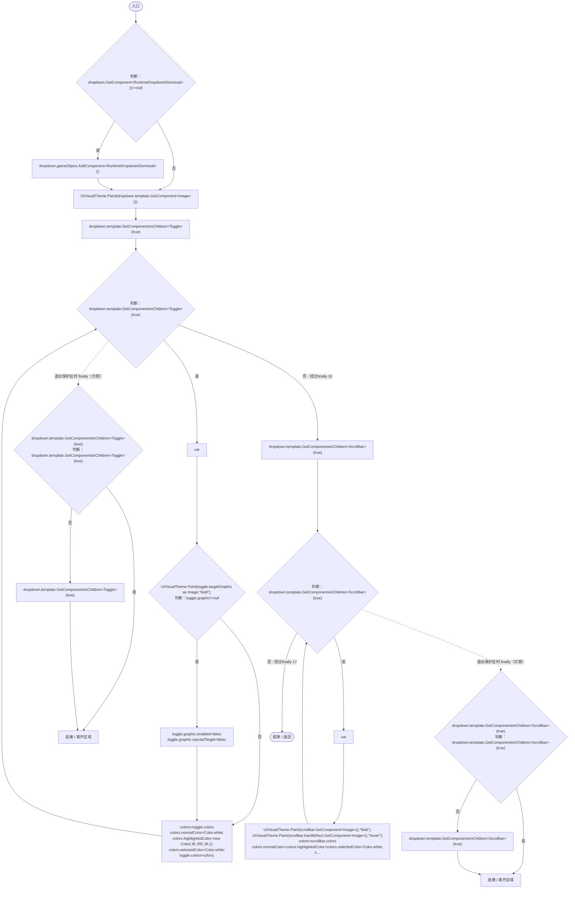

# RuntimeDropdownSkin.cs

[返回总索引](../README.md) · `Runtime` · `Assets/DarwinPark/UI/RuntimeDropdownSkin.cs`

[源文件](../../../Assets/DarwinPark/UI/RuntimeDropdownSkin.cs) · 源码校验：`b9b0d8a92630f951041ed52a137a763df5178bac7f83fe185fd6a40fffe6d00b`

方法按源文件位置排列。事件/回调引用不表示立即执行；分支与异常说明见总索引。完整源码与可点击关系图请打开离线手册。

## Apply · L10

`public static void Apply(Dropdown dropdown)`

### Editor / Player · Roslyn编译器控制流

项目内调用/回调引用：

- [UIVisualTheme.Paint · L58](ca525a798a08f966.md#m2d61a6b26ab24980)（方法）
