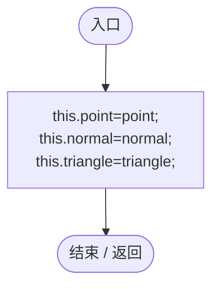
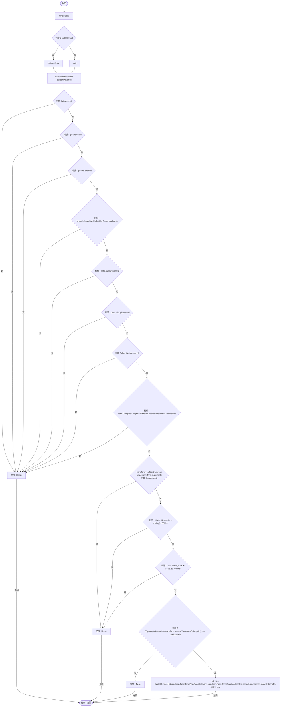
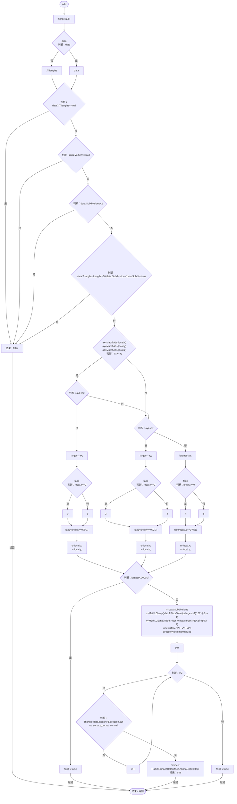
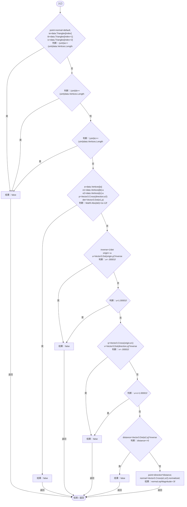

# RadialTerrainSurface.cs

[返回总索引](../README.md) · `Runtime` · `Assets/DarwinPark/Planet/Terrain/RadialTerrainSurface.cs`

[源文件](../../../Assets/DarwinPark/Planet/Terrain/RadialTerrainSurface.cs) · 源码校验：`ef1de1bad43bc1ac2826bd9e1e07bc55d493b742fcc628110589e59848b93e52`

方法按源文件位置排列。事件/回调引用不表示立即执行；分支与异常说明见总索引。完整源码与可点击关系图请打开离线手册。

## RadialSurfaceHit.ctor · L7

`public RadialSurfaceHit(Vector3 point,Vector3 normal,int triangle)`

### Editor / Player · Roslyn编译器控制流

## TrySample · L12

`public static bool TrySample(PlanetTerrainMeshBuilder builder,MeshCollider ground,Vector3 point,out RadialSurfaceHit hit)`

### Editor / Player · Roslyn编译器控制流

项目内调用/回调引用：

- [PlanetTerrainMeshBuilder.Data.get · L81](415285cf043354a9.md#m1a65abfe0f34c5d8)（访问器）
- [RadialTerrainSurface.TrySampleLocal · L23](4eb5c0c8143bed20.md#m40e797fdadbf4b35)（方法）
- [RadialSurfaceHit.RadialSurfaceHit.ctor · L7](4eb5c0c8143bed20.md#m734a493927f55e4f)（构造函数）

## TrySampleLocal · L23

`public static bool TrySampleLocal(PlanetTerrainData data,Vector3 local,out RadialSurfaceHit hit)`

★ 新增：后台建导航图也查询最终三角形，与实际接地共用几何；双线性高度在陡岸可能把水下判为陆地。

### Editor / Player · Roslyn编译器控制流

项目内调用/回调引用：

- [RadialTerrainSurface.Triangle · L37](4eb5c0c8143bed20.md#mf2672373c7ee16f5)（方法）
- [RadialSurfaceHit.RadialSurfaceHit.ctor · L7](4eb5c0c8143bed20.md#m734a493927f55e4f)（构造函数）

## Triangle · L37

`private static bool Triangle(PlanetTerrainData data,int index,Vector3 direction,out Vector3 point,out Vector3 normal)`

### Editor / Player · Roslyn编译器控制流

