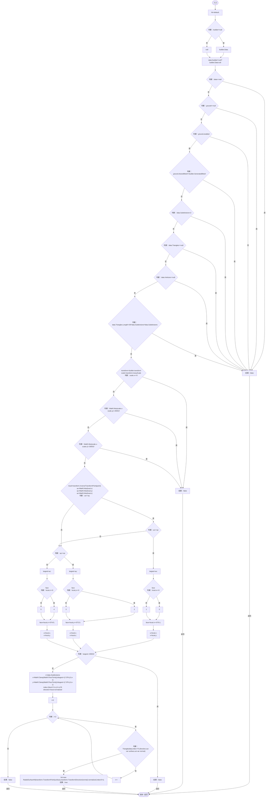

# RadialTerrainSurface.cs

[返回总索引](../README.md) · `Runtime` · `Assets/DarwinPark/Planet/Terrain/RadialTerrainSurface.cs`

[源文件](../../../Assets/DarwinPark/Planet/Terrain/RadialTerrainSurface.cs) · 源码校验：`ac6c188f9590574e343297cd5addfeb4b95fede505433cbe838f2a8fa855501a`

方法按源文件位置排列。事件/回调引用不表示立即执行；分支与异常说明见总索引。完整源码与可点击关系图请打开离线手册。

## RadialSurfaceHit.ctor · L7

`public RadialSurfaceHit(Vector3 point,Vector3 normal,int triangle)`

### Editor / Player · Roslyn编译器控制流

## TrySample · L12

`public static bool TrySample(PlanetTerrainMeshBuilder builder,MeshCollider ground,Vector3 point,out RadialSurfaceHit hit)`

### Editor / Player · Roslyn编译器控制流

项目内调用/回调引用：

- [PlanetTerrainMeshBuilder.Data.get · L78](415285cf043354a9.md#m8382f579717fbc6d)（访问器）
- [RadialTerrainSurface.Triangle · L31](4eb5c0c8143bed20.md#mc9c935940faf698b)（方法）
- [RadialSurfaceHit.RadialSurfaceHit.ctor · L7](4eb5c0c8143bed20.md#m734a493927f55e4f)（构造函数）

## Triangle · L31

`private static bool Triangle(PlanetTerrainData data,int index,Vector3 direction,out Vector3 point,out Vector3 normal)`

### Editor / Player · Roslyn编译器控制流

