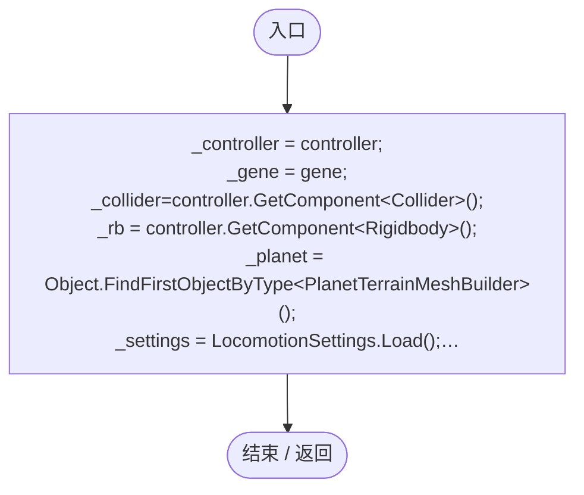
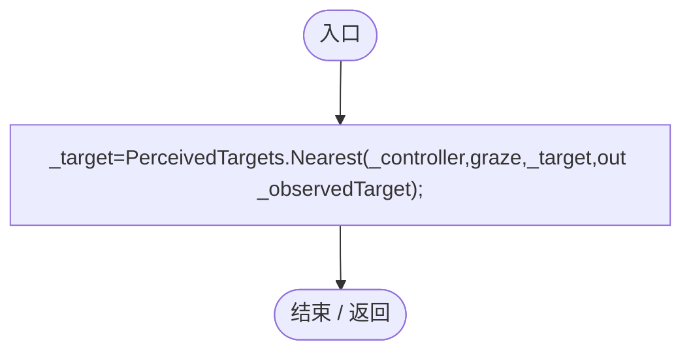
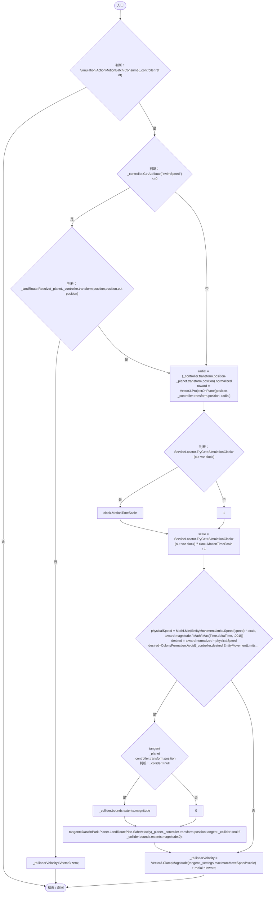

```mermaid
flowchart TD
  b0(["入口"])
  b1["performance=PerformanceTimings.Measure(PerformanceTimings.Area.Locomotion)"]
  b2{"判断：GeneBehaviorAuthority.IsPrimary&lt;LocomotionGeneLogic&gt;(_controller,_gene)"}
  b3{"判断：EcologyMotion.Immobilized(_controller)"}
  b4{"判断：_rb == null"}
  b5["_rb = ActiveSimulationBatch.Read&lt;Rigidbody&gt;(_controller);"]
  b6{"判断：_planet == null"}
  b7["_planet = Object.FindFirstObjectByType&lt;PlanetTerrainMeshBuilder&gt;();"]
  b8{"判断：_rb == null"}
  b9{"判断：_planet == null"}
  b10{"判断：dt &lt;= 0"}
  b11{"_actionCooldown -= dt;<br/>speed = _controller.GetAttribute(&quot;moveSpeed&quot;)<br/>stats = ActiveSimulationBatch.Read&lt;EntityStats&gt;(_controller)<br/>判断：speed &lt;= 0"}
  b12{"判断：stats == null"}
  b13{"判断：stats.TryGet(&quot;health&quot;, out float hp)"}
  b14{"判断：hp &lt;= 0"}
  b15{"ActiveSimulationBatch.Read&lt;DarwinPark.Entities.Vitals.EntityEnvironmentHazard&gt;(_controller)<br/>判断：ActiveSimulationBatch.Read&lt;DarwinPark.Entities.Vitals.EntityEnvironmentHazard&gt;(_controller)"}
  b16[".IsSubmerged"]
  b17["ActiveSimulationBatch.Read&lt;DarwinPark.Entities.Vitals.EntityEnvironmentHazard&gt;(_controller)"]
  b18{"判断：ActiveSimulationBatch.Read&lt;DarwinPark.Entities.Vitals.EntityEnvironmentHazard&gt;(_controller)?.IsSubmerged == true"}
  b19["_target=null;"]
  b20["evaluated = _controller.GetEvaluation(_gene)"]
  b21{"evaluated<br/>判断：evaluated"}
  b22[".State"]
  b23["evaluated"]
  b24["state = evaluated?.State"]
  b25{"manual = ActiveSimulationBatch.Read&lt;EntityManualControl&gt;(_controller)<br/>判断：manual != null"}
  b26{"判断：manual.IsControlled"}
  b27{"_decision.Reset();<br/>判断：_actionCooldown &gt; 0"}
  b28{"判断：manual.ConsumeAttack()"}
  b29["manual.AttackHeld"]
  b30["manual.ConsumeAttack()"]
  b31["requested=manual.ConsumeAttack() &#124;&#124; manual.AttackHeld"]
  b32{"判断：manual.CanMove"}
  b33{"判断：requested"}
  b34{"判断：state != null"}
  b35{"graze=state.StateId==&quot;herbivore&quot;<br/>_target=manual.GetAttackTarget();<br/>判断：_target!=null"}
  b36["TryBite(stats,graze);"]
  b37{"decide=_decision.Due(_controller,dt)<br/>判断：decide"}
  b38["_decision.directive=EcologyMotion.Directive(_controller,out _decision.point,out _decision.target,out _decision.multiplier);"]
  b39{"判断：_decision.directive"}
  b40{"_target=_decision.target;<br/>判断：_target!=null"}
  b41["explicitOrder=ActiveSimulationBatch.Read&lt;RtsOrderController&gt;(_controller)<br/>pop=ActiveSimulationBatch.Read&lt;PopulationBehavior&gt;(_controller)"]
  b42{"explicitOrder<br/>判断：explicitOrder"}
  b43[".State.active"]
  b44["explicitOrder"]
  b45{"判断：explicitOrder?.State.active==true"}
  b46{"判断：explicitOrder.State.kind==RtsOrderKind.Attack"}
  b47{"pop<br/>判断：pop"}
  b48[".ManualRemaining"]
  b49["pop"]
  b50{"判断：pop?.ManualRemaining&gt;0"}
  b51["EntityNeighborhood.TryPosition(_target,out _decision.point);"]
  b52{"判断：EntityPerceptionHub.TryLocate(_controller,_target,out _decision.point)"}
  b53["_decision.Reset();<br/>_target=null;"]
  b54{"Chase(_decision.point,speed*_decision.multiplier,dt);<br/>判断：_target!=null"}
  b55["TryBite(stats,false);"]
  b56{"判断：NutritionTransfer.CanHuntForFood(_controller)"}
  b57{"判断：EcologyEnergyBudget.WantsFood(_controller,stats,_settings.hungerThreshold)"}
  b58{"判断：state != null"}
  b59{"graze = state.StateId == &quot;herbivore&quot;<br/>判断：state.StateId == &quot;hunt&quot;"}
  b60{"判断：graze"}
  b61{"判断：decide"}
  b62["FindTarget(graze);"]
  b63{"判断：_target!=null"}
  b64{"判断：PerceivedTargets.Valid(_controller,_target,graze,out _observedTarget)"}
  b65["_target=null;"]
  b66{"判断：_target != null"}
  b67["Chase(_observedTarget, speed, dt);<br/>TryBite(stats, graze);"]
  b68{"_target = null;<br/>_wanderTimer -= dt;<br/>判断：_wanderTimer &lt;= 0"}
  b69["_wanderTimer = _settings.wanderInterval;<br/>_wanderDir = Random.onUnitSphere;"]
  b70["Chase(_controller.transform.position + _wanderDir * _settings.wanderDistance, speed * _settings.wanderSpeedRatio, dt);"]
  b71["performance=PerformanceTimings.Measure(PerformanceTimings.Area.Locomotion)"]
  b72(["结束 / 返回"])
  b0 --> b1
  b1 --> b2
  b2 -->|"是"| b3
  b2 -->|"否 · 经过finally 71"| b72
  b3 -->|"是 · 经过finally 71"| b72
  b3 -->|"否"| b4
  b4 -->|"是"| b5
  b4 -->|"否"| b6
  b5 --> b6
  b6 -->|"是"| b7
  b6 -->|"否"| b8
  b7 --> b8
  b8 -->|"否"| b9
  b8 -->|"是 · 经过finally 71"| b72
  b9 -->|"否"| b10
  b9 -->|"是 · 经过finally 71"| b72
  b10 -->|"是 · 经过finally 71"| b72
  b10 -->|"否"| b11
  b11 -->|"否"| b12
  b11 -->|"是 · 经过finally 71"| b72
  b12 -->|"否"| b13
  b12 -->|"是 · 经过finally 71"| b72
  b13 -->|"是"| b14
  b13 -->|"否 · 经过finally 71"| b72
  b14 -->|"是 · 经过finally 71"| b72
  b14 -->|"否"| b15
  b15 -->|"否"| b16
  b15 -->|"是"| b17
  b16 --> b18
  b17 --> b18
  b18 -->|"是"| b19
  b18 -->|"否"| b20
  b19 -->|"经过finally 71"| b72
  b20 --> b21
  b21 -->|"否"| b22
  b21 -->|"是"| b23
  b22 --> b24
  b23 --> b24
  b24 --> b25
  b25 -->|"是"| b26
  b25 -->|"否"| b37
  b26 -->|"是"| b27
  b26 -->|"否"| b37
  b27 -->|"是 · 经过finally 71"| b72
  b27 -->|"否"| b28
  b28 -->|"否"| b29
  b28 -->|"是"| b30
  b29 --> b31
  b30 --> b31
  b31 --> b32
  b32 -->|"是"| b33
  b32 -->|"否 · 经过finally 71"| b72
  b33 -->|"是"| b34
  b33 -->|"否 · 经过finally 71"| b72
  b34 -->|"是"| b35
  b34 -->|"否 · 经过finally 71"| b72
  b35 -->|"是"| b36
  b35 -->|"否 · 经过finally 71"| b72
  b36 -->|"经过finally 71"| b72
  b37 -->|"是"| b38
  b37 -->|"否"| b39
  b38 --> b39
  b39 -->|"是"| b40
  b39 -->|"否"| b56
  b40 -->|"是"| b41
  b40 -->|"否"| b54
  b41 --> b42
  b42 -->|"否"| b43
  b42 -->|"是"| b44
  b43 --> b45
  b44 --> b45
  b45 -->|"是"| b46
  b45 -->|"否"| b47
  b46 -->|"否"| b47
  b46 -->|"是"| b51
  b47 -->|"否"| b48
  b47 -->|"是"| b49
  b48 --> b50
  b49 --> b50
  b50 -->|"是"| b51
  b50 -->|"否"| b52
  b51 --> b54
  b52 -->|"否"| b53
  b52 -->|"是"| b54
  b53 -->|"经过finally 71"| b72
  b54 -->|"是"| b55
  b54 -->|"否 · 经过finally 71"| b72
  b55 -->|"经过finally 71"| b72
  b56 -->|"是"| b57
  b56 -->|"否"| b68
  b57 -->|"是"| b58
  b57 -->|"否"| b68
  b58 -->|"是"| b59
  b58 -->|"否"| b68
  b59 -->|"否"| b60
  b59 -->|"是"| b61
  b60 -->|"是"| b61
  b60 -->|"否"| b68
  b61 -->|"是"| b62
  b61 -->|"否"| b63
  b62 --> b66
  b63 -->|"是"| b64
  b63 -->|"否"| b66
  b64 -->|"否"| b65
  b64 -->|"是"| b66
  b65 --> b66
  b66 -->|"是"| b67
  b66 -->|"否"| b68
  b67 -->|"经过finally 71"| b72
  b68 -->|"是"| b69
  b68 -->|"否"| b70
  b69 --> b70
  b70 -->|"经过finally 71"| b72
  b2 -. "退出保护区时 finally（示意）" .-> b71

```

```mermaid
flowchart TD
  b0(["入口"])
  b1{"判断：_target == null"}
  b2{"判断：_actionCooldown &gt; 0"}
  b3{"判断：PredationSizePolicy.Allows(_controller,_target)"}
  b4["_target=null;"]
  b5["otherStats = _target.GetComponent&lt;EntityStats&gt;()<br/>a = ActiveSimulationBatch.Read&lt;Collider&gt;(_controller)<br/>b = _target.GetComponent&lt;Collider&gt;()"]
  b6{"判断：a != null"}
  b7{"判断：b != null"}
  b8["Vector3.Distance(a.ClosestPoint(b.bounds.center),b.ClosestPoint(a.bounds.center))"]
  b9["Vector3.Distance(_controller.transform.position,_target.transform.position)"]
  b10["gap = a != null &amp;&amp; b != null ? Vector3.Distance(a.ClosestPoint(b.bounds.center),b.ClosestPoint(a.bounds.center)) : Vector3.Distance(_controller.transform.position,_target.transform.position)"]
  b11["_settings.attackReach"]
  b12{"ActiveSimulationBatch.Read&lt;EntityManualControl&gt;(_controller)<br/>判断：ActiveSimulationBatch.Read&lt;EntityManualControl&gt;(_controller)"}
  b13[".IsControlled"]
  b14["ActiveSimulationBatch.Read&lt;EntityManualControl&gt;(_controller)"]
  b15{"判断：ActiveSimulationBatch.Read&lt;EntityManualControl&gt;(_controller)?.IsControlled==true"}
  b16["GameplayTuning.Current.manualAttackReachBonus"]
  b17["0"]
  b18["reach=_settings.attackReach+(ActiveSimulationBatch.Read&lt;EntityManualControl&gt;(_controller)?.IsControlled==true?GameplayTuning.Current.manualAttackReachBonus:0)"]
  b19{"判断：gap &gt; reach"}
  b20{"判断：otherStats == null"}
  b21{"判断：otherStats.TryGet(&quot;health&quot;,out float health)"}
  b22{"判断：health &lt;= 0"}
  b23{"判断：graze"}
  b24["_settings.grazeDamage"]
  b25["_controller.GetAttribute(&quot;attack&quot;)"]
  b26["damage = graze ? _settings.grazeDamage : _controller.GetAttribute(&quot;attack&quot;)"]
  b27{"判断：damage &lt;= 0"}
  b28{"_actionCooldown = _settings.attackInterval;<br/>EntityCombat.Ensure(_target.gameObject).Receive(ActiveSimulationBatch.Read&lt;DarwinEntity&gt;(_controller),damage);<br/>otherStats.TryGet(&quot;health&quot;,out float remainingHealth);<br/>判断：Ecology.AntColonyCombat.…"}
  b29{"判断：remainingHealth&lt;=0"}
  b30["_target.gameObject.SetActive(false);<br/>Object.Destroy(_target.gameObject);<br/>_target=null;"]
  b31{"判断：remainingHealth&lt;=0"}
  b32["_target=null;"]
  b33(["结束 / 返回"])
  b0 --> b1
  b1 -->|"否"| b2
  b1 -->|"是"| b33
  b2 -->|"是"| b33
  b2 -->|"否"| b3
  b3 -->|"否"| b4
  b3 -->|"是"| b5
  b4 --> b33
  b5 --> b6
  b6 -->|"是"| b7
  b6 -->|"否"| b9
  b7 -->|"是"| b8
  b7 -->|"否"| b9
  b8 --> b10
  b9 --> b10
  b10 --> b11
  b11 --> b12
  b12 -->|"否"| b13
  b12 -->|"是"| b14
  b13 --> b15
  b14 --> b15
  b15 -->|"是"| b16
  b15 -->|"否"| b17
  b16 --> b18
  b17 --> b18
  b18 --> b19
  b19 -->|"否"| b20
  b19 -->|"是"| b33
  b20 -->|"否"| b21
  b20 -->|"是"| b33
  b21 -->|"是"| b22
  b21 -->|"否"| b33
  b22 -->|"是"| b33
  b22 -->|"否"| b23
  b23 -->|"是"| b24
  b23 -->|"否"| b25
  b24 --> b26
  b25 --> b26
  b26 --> b27
  b27 -->|"是"| b33
  b27 -->|"否"| b28
  b28 -->|"是"| b29
  b28 -->|"否"| b31
  b29 -->|"是"| b30
  b29 -->|"否"| b33
  b30 --> b33
  b31 -->|"是"| b32
  b31 -->|"否"| b33
  b32 --> b33

```

# LocomotionGeneLogic.cs

[返回总索引](../README.md) · `Runtime` · `Assets/DarwinPark/Entities/Logic/LocomotionGeneLogic.cs`

[源文件](../../../Assets/DarwinPark/Entities/Logic/LocomotionGeneLogic.cs) · 源码校验：`df8608737164c5e04a55a758284556f96d6ae298d72f2fd8f37b726ee3be6e45`

方法按源文件位置排列。事件/回调引用不表示立即执行；分支与异常说明见总索引。完整源码与可点击关系图请打开离线手册。

## Initialize · L26

`public virtual void Initialize(EntityGeneController controller, GeneInstance gene)`

### Editor / Player · Roslyn编译器控制流

项目内调用/回调引用：

- [LocomotionSettings.Load · L17](8cce83c7d4563cf0.md#m06b74c04dd63fb4a)（方法）

## OnUpdate · L32

`public void OnUpdate(float dt)`

### Editor / Player · Roslyn编译器控制流

项目内调用/回调引用：

- [PerformanceTimings.Measure · L25](a8403a4c7503726d.md#m36fde3c234084192)（方法）
- [GeneBehaviorAuthority.IsPrimary · L10](be83fa896bbe02ae.md#me2fc1f2e16fcd073)（方法）
- [EcologyMotion.Immobilized · L11](6ed9d0eedb456d32.md#m5ee13c6cd31e5243)（方法）
- [ActiveSimulationBatch.Read · L57](ac63422a085684a6.md#mc77e063d3598b3fd)（方法）
- [EntityGeneController.GetAttribute · L288](7494d53178552f0e.md#m45127bcdd833aaf5)（方法）
- [EntityStats.TryGet · L93](75aa86a368efdf24.md#m03cef847022eee28)（方法）
- [EntityEnvironmentHazard.IsSubmerged.get · L31](5c434d0ba85333b1.md#mab7b6057b8137739)（访问器）
- [EntityGeneController.GetEvaluation · L236](7494d53178552f0e.md#ma04ba3204e97eec3)（方法）
- [EntityManualControl.IsControlled.get · L12](a6969896da35e1f0.md#m125d8f7da7ab33bf)（访问器）
- [ActionDecisionCadence.Reset · L28](9f8bb5c506593a21.md#m5cd6ccb9a9090fee)（方法）
- [EntityManualControl.ConsumeAttack · L25](a6969896da35e1f0.md#m3427183a9d7fd9f6)（方法）
- [EntityManualControl.AttackHeld.get · L13](a6969896da35e1f0.md#m39dd2982bac56366)（访问器）
- [EntityManualControl.GetAttackTarget · L28](a6969896da35e1f0.md#mb046508bf5d61cb1)（方法）
- [LocomotionGeneLogic.TryBite · L104](50c563bf540685c7.md#me85a5743954fc9a1)（方法）
- [ActionDecisionCadence.Due · L15](9f8bb5c506593a21.md#mebbf1b6d04267fca)（方法）
- [EcologyMotion.Directive · L12](6ed9d0eedb456d32.md#m9d6872b8c4a43080)（方法）
- [RtsOrderController.State.get · L16](cac3b6501f41ca35.md#me514e46eb890238d)（访问器）
- [EntityNeighborhood.TryPosition · L98](e5e24c4aff0395b1.md#m79085083ee9c5000)（方法）
- [EntityPerceptionHub.TryLocate · L57](aeecc36cb2c3cc24.md#m2cd96337ffd40bb4)（方法）
- [LocomotionGeneLogic.Chase · L133](50c563bf540685c7.md#mb27832835cb87568)（方法）
- [NutritionTransfer.CanHuntForFood · L28](081d3b8ff683e442.md#m2cbdf5db3ea5d5c3)（方法）
- [EcologyEnergyBudget.WantsFood · L16](06a91c8201f26593.md#m735b7aa45241348f)（方法）
- [LocomotionGeneLogic.FindTarget · L128](50c563bf540685c7.md#m9346c0b10ad64aae)（方法）
- [PerceivedTargets.Valid · L7](b78759d0d0a172e4.md#m1aa909943d40ed9f)（方法）

## TryBite · L104

`private void TryBite(EntityStats stats, bool graze)`

### Editor / Player · Roslyn编译器控制流

项目内调用/回调引用：

- [PredationSizePolicy.Allows · L9](80ea865fb0f12053.md#m70764380d885d2d4)（方法）
- [ActiveSimulationBatch.Read · L57](ac63422a085684a6.md#mc77e063d3598b3fd)（方法）
- [EntityManualControl.IsControlled.get · L12](a6969896da35e1f0.md#m125d8f7da7ab33bf)（访问器）
- [GameplayTuning.Current.get · L46](db546e5713b32d53.md#m4fa691bd8a3b9618)（访问器）
- [EntityStats.TryGet · L93](75aa86a368efdf24.md#m03cef847022eee28)（方法）
- [EntityGeneController.GetAttribute · L288](7494d53178552f0e.md#m45127bcdd833aaf5)（方法）
- [EntityCombat.Receive · L13](a5b5b46ac6c197ae.md#ma763706a48b8843a)（方法）
- [EntityCombat.Ensure · L12](a5b5b46ac6c197ae.md#me21fe8f31497e62f)（方法）
- [AntColonyCombat.SettleSoldierAttack · L16](aa858de55ec8e51a.md#mcb554a0399af6a1c)（方法）

## FindTarget · L128

`private void FindTarget(bool graze)`

### Editor / Player · Roslyn编译器控制流

项目内调用/回调引用：

- [PerceivedTargets.Nearest · L11](b78759d0d0a172e4.md#m0b32361294d1f689)（方法）

## Chase · L133

`private void Chase(Vector3 position, float speed, float dt)`

### Editor / Player · Roslyn编译器控制流

项目内调用/回调引用：

- [ActionMotionBatch.Consume · L11](e54155ca229c2706.md#m184f7ab096673914)（方法）
- [EntityGeneController.GetAttribute · L288](7494d53178552f0e.md#m45127bcdd833aaf5)（方法）
- [LandRoutePlan.Resolve · L42](d357e13967229560.md#md0b0a64ddf86d978)（方法）
- [ServiceLocator.TryGet · L26](f2fdbe9f9ccd93cb.md#m143b24e6d58471b0)（方法）
- [EntityMovementLimits.Speed · L9](bf2a44fffc5f10d6.md#mbe765ae4c73829b7)（方法）
- [ColonyFormation.Avoid · L43](c65dce2d54e43480.md#me7d09f85ef3637a0)（方法）
- [LandRoutePlan.SafeVelocity · L54](d357e13967229560.md#mdb046d6a448848cc)（方法）

## GetTooltipInfo · L154

`public virtual string GetTooltipInfo()`

### Editor / Player · Roslyn编译器控制流

