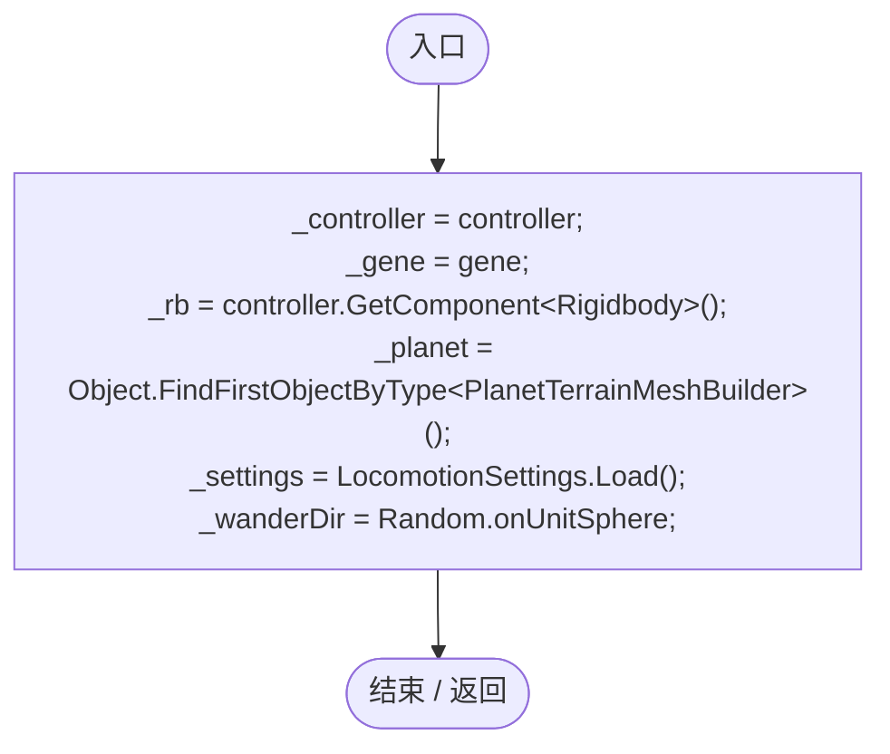
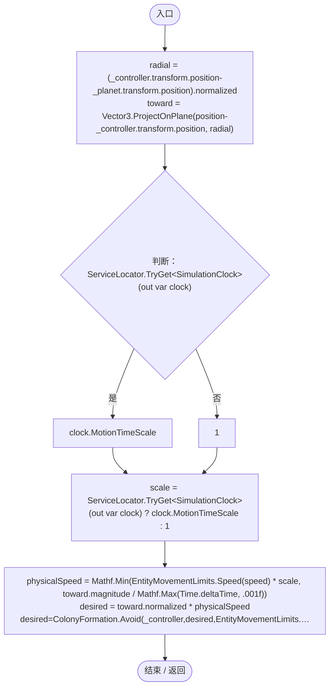
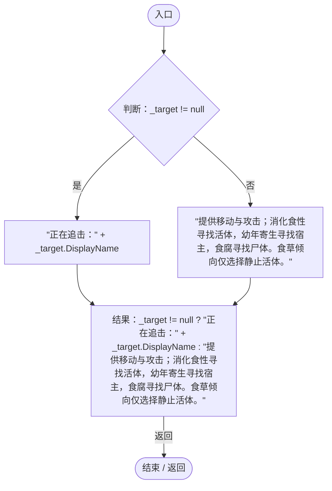

```mermaid
flowchart TD
  b0(["入口"])
  b1["performance=PerformanceTimings.Measure(PerformanceTimings.Area.Locomotion)"]
  b2{"判断：GeneBehaviorAuthority.IsPrimary&lt;LocomotionGeneLogic&gt;(_controller,_gene)"}
  b3{"判断：EcologyMotion.Immobilized(_controller)"}
  b4{"判断：_rb == null"}
  b5["_rb = _controller.GetComponent&lt;Rigidbody&gt;();"]
  b6{"判断：_planet == null"}
  b7["_planet = Object.FindFirstObjectByType&lt;PlanetTerrainMeshBuilder&gt;();"]
  b8{"判断：_rb == null"}
  b9{"判断：_planet == null"}
  b10{"判断：dt &lt;= 0"}
  b11{"_actionCooldown -= dt;<br/>speed = _controller.GetAttribute(&quot;moveSpeed&quot;)<br/>stats = _controller.GetComponent&lt;EntityStats&gt;()<br/>判断：speed &lt;= 0"}
  b12{"判断：stats == null"}
  b13{"判断：stats.TryGet(&quot;health&quot;, out float hp)"}
  b14{"判断：hp &lt;= 0"}
  b15{"_controller.GetComponent&lt;DarwinPark.Entities.Vitals.EntityEnvironmentHazard&gt;()<br/>判断：_controller.GetComponent&lt;DarwinPark.Entities.Vitals.EntityEnvironmentHazard&gt;()"}
  b16[".IsSubmerged"]
  b17["_controller.GetComponent&lt;DarwinPark.Entities.Vitals.EntityEnvironmentHazard&gt;()"]
  b18{"判断：_controller.GetComponent&lt;DarwinPark.Entities.Vitals.EntityEnvironmentHazard&gt;()?.IsSubmerged == true"}
  b19["_target=null;"]
  b20["evaluated = _controller.GetEvaluation(_gene)"]
  b21{"evaluated<br/>判断：evaluated"}
  b22[".State"]
  b23["evaluated"]
  b24["state = evaluated?.State"]
  b25{"manual = _controller.GetComponent&lt;EntityManualControl&gt;()<br/>判断：manual != null"}
  b26{"判断：manual.IsControlled"}
  b27{"判断：_actionCooldown &gt; 0"}
  b28{"判断：manual.ConsumeAttack()"}
  b29["manual.AttackHeld"]
  b30["manual.ConsumeAttack()"]
  b31["requested=manual.ConsumeAttack() &#124;&#124; manual.AttackHeld"]
  b32{"判断：manual.CanMove"}
  b33{"判断：requested"}
  b34{"判断：state != null"}
  b35{"graze=state.StateId==&quot;herbivore&quot;<br/>_target=manual.GetAttackTarget();<br/>判断：_target!=null"}
  b36["TryBite(stats,graze);"]
  b37{"判断：EcologyMotion.Directive(_controller,out var destination,out var commandTarget,out float multiplier)"}
  b38{"_target=commandTarget;<br/>Chase(destination,speed*multiplier,dt);<br/>判断：_target!=null"}
  b39["TryBite(stats,false);"]
  b40{"判断：NutritionTransfer.CanHuntForFood(_controller)"}
  b41{"判断：EcologyEnergyBudget.WantsFood(_controller,stats,_settings.hungerThreshold)"}
  b42{"判断：state != null"}
  b43{"graze = state.StateId == &quot;herbivore&quot;<br/>判断：state.StateId == &quot;hunt&quot;"}
  b44{"判断：graze"}
  b45{"FindTarget(graze);<br/>判断：_target != null"}
  b46["Chase(_observedTarget, speed, dt);<br/>TryBite(stats, graze);"]
  b47{"_target = null;<br/>_wanderTimer -= dt;<br/>判断：_wanderTimer &lt;= 0"}
  b48["_wanderTimer = _settings.wanderInterval;<br/>_wanderDir = Random.onUnitSphere;"]
  b49["Chase(_controller.transform.position + _wanderDir * _settings.wanderDistance, speed * _settings.wanderSpeedRatio, dt);"]
  b50["performance=PerformanceTimings.Measure(PerformanceTimings.Area.Locomotion)"]
  b51(["结束 / 返回"])
  b0 --> b1
  b1 --> b2
  b2 -->|"是"| b3
  b2 -->|"否 · 经过finally 50"| b51
  b3 -->|"是 · 经过finally 50"| b51
  b3 -->|"否"| b4
  b4 -->|"是"| b5
  b4 -->|"否"| b6
  b5 --> b6
  b6 -->|"是"| b7
  b6 -->|"否"| b8
  b7 --> b8
  b8 -->|"否"| b9
  b8 -->|"是 · 经过finally 50"| b51
  b9 -->|"否"| b10
  b9 -->|"是 · 经过finally 50"| b51
  b10 -->|"是 · 经过finally 50"| b51
  b10 -->|"否"| b11
  b11 -->|"否"| b12
  b11 -->|"是 · 经过finally 50"| b51
  b12 -->|"否"| b13
  b12 -->|"是 · 经过finally 50"| b51
  b13 -->|"是"| b14
  b13 -->|"否 · 经过finally 50"| b51
  b14 -->|"是 · 经过finally 50"| b51
  b14 -->|"否"| b15
  b15 -->|"否"| b16
  b15 -->|"是"| b17
  b16 --> b18
  b17 --> b18
  b18 -->|"是"| b19
  b18 -->|"否"| b20
  b19 -->|"经过finally 50"| b51
  b20 --> b21
  b21 -->|"否"| b22
  b21 -->|"是"| b23
  b22 --> b24
  b23 --> b24
  b24 --> b25
  b25 -->|"是"| b26
  b25 -->|"否"| b37
  b26 -->|"是"| b27
  b26 -->|"否"| b37
  b27 -->|"是 · 经过finally 50"| b51
  b27 -->|"否"| b28
  b28 -->|"否"| b29
  b28 -->|"是"| b30
  b29 --> b31
  b30 --> b31
  b31 --> b32
  b32 -->|"是"| b33
  b32 -->|"否 · 经过finally 50"| b51
  b33 -->|"是"| b34
  b33 -->|"否 · 经过finally 50"| b51
  b34 -->|"是"| b35
  b34 -->|"否 · 经过finally 50"| b51
  b35 -->|"是"| b36
  b35 -->|"否 · 经过finally 50"| b51
  b36 -->|"经过finally 50"| b51
  b37 -->|"是"| b38
  b37 -->|"否"| b40
  b38 -->|"是"| b39
  b38 -->|"否 · 经过finally 50"| b51
  b39 -->|"经过finally 50"| b51
  b40 -->|"是"| b41
  b40 -->|"否"| b47
  b41 -->|"是"| b42
  b41 -->|"否"| b47
  b42 -->|"是"| b43
  b42 -->|"否"| b47
  b43 -->|"否"| b44
  b43 -->|"是"| b45
  b44 -->|"是"| b45
  b44 -->|"否"| b47
  b45 -->|"是"| b46
  b45 -->|"否"| b47
  b46 -->|"经过finally 50"| b51
  b47 -->|"是"| b48
  b47 -->|"否"| b49
  b48 --> b49
  b49 -->|"经过finally 50"| b51
  b2 -. "退出保护区时 finally（示意）" .-> b50

```

```mermaid
flowchart TD
  b0(["入口"])
  b1{"判断：_target == null"}
  b2{"判断：_actionCooldown &gt; 0"}
  b3{"判断：PredationSizePolicy.Allows(_controller,_target)"}
  b4["_target=null;"]
  b5["otherStats = _target.GetComponent&lt;EntityStats&gt;()<br/>a = _controller.GetComponent&lt;Collider&gt;()<br/>b = _target.GetComponent&lt;Collider&gt;()"]
  b6{"判断：a != null"}
  b7{"判断：b != null"}
  b8["Vector3.Distance(a.ClosestPoint(b.bounds.center),b.ClosestPoint(a.bounds.center))"]
  b9["Vector3.Distance(_controller.transform.position,_target.transform.position)"]
  b10["gap = a != null &amp;&amp; b != null ? Vector3.Distance(a.ClosestPoint(b.bounds.center),b.ClosestPoint(a.bounds.center)) : Vector3.Distance(_controller.transform.position,_target.transform.position)"]
  b11["_settings.attackReach"]
  b12{"_controller.GetComponent&lt;EntityManualControl&gt;()<br/>判断：_controller.GetComponent&lt;EntityManualControl&gt;()"}
  b13[".IsControlled"]
  b14["_controller.GetComponent&lt;EntityManualControl&gt;()"]
  b15{"判断：_controller.GetComponent&lt;EntityManualControl&gt;()?.IsControlled==true"}
  b16["GameplayTuning.Current.manualAttackReachBonus"]
  b17["0"]
  b18["reach=_settings.attackReach+(_controller.GetComponent&lt;EntityManualControl&gt;()?.IsControlled==true?GameplayTuning.Current.manualAttackReachBonus:0)"]
  b19{"判断：gap &gt; reach"}
  b20{"判断：otherStats == null"}
  b21{"判断：otherStats.TryGet(&quot;health&quot;,out float health)"}
  b22{"判断：health &lt;= 0"}
  b23{"判断：graze"}
  b24["_settings.grazeDamage"]
  b25["_controller.GetAttribute(&quot;attack&quot;)"]
  b26["damage = graze ? _settings.grazeDamage : _controller.GetAttribute(&quot;attack&quot;)"]
  b27{"判断：damage &lt;= 0"}
  b28{"_actionCooldown = _settings.attackInterval;<br/>EntityCombat.Ensure(_target.gameObject).Receive(_controller.GetComponent&lt;DarwinEntity&gt;(),damage);<br/>otherStats.TryGet(&quot;health&quot;,out float remainingHealth);<br/>判断：Ecology.AntColonyCombat.SettleSoldier…"}
  b29{"判断：remainingHealth&lt;=0"}
  b30["_target.gameObject.SetActive(false);<br/>Object.Destroy(_target.gameObject);<br/>_target=null;"]
  b31{"判断：remainingHealth&lt;=0"}
  b32["_target=null;"]
  b33(["结束 / 返回"])
  b0 --> b1
  b1 -->|"否"| b2
  b1 -->|"是"| b33
  b2 -->|"是"| b33
  b2 -->|"否"| b3
  b3 -->|"否"| b4
  b3 -->|"是"| b5
  b4 --> b33
  b5 --> b6
  b6 -->|"是"| b7
  b6 -->|"否"| b9
  b7 -->|"是"| b8
  b7 -->|"否"| b9
  b8 --> b10
  b9 --> b10
  b10 --> b11
  b11 --> b12
  b12 -->|"否"| b13
  b12 -->|"是"| b14
  b13 --> b15
  b14 --> b15
  b15 -->|"是"| b16
  b15 -->|"否"| b17
  b16 --> b18
  b17 --> b18
  b18 --> b19
  b19 -->|"否"| b20
  b19 -->|"是"| b33
  b20 -->|"否"| b21
  b20 -->|"是"| b33
  b21 -->|"是"| b22
  b21 -->|"否"| b33
  b22 -->|"是"| b33
  b22 -->|"否"| b23
  b23 -->|"是"| b24
  b23 -->|"否"| b25
  b24 --> b26
  b25 --> b26
  b26 --> b27
  b27 -->|"是"| b33
  b27 -->|"否"| b28
  b28 -->|"是"| b29
  b28 -->|"否"| b31
  b29 -->|"是"| b30
  b29 -->|"否"| b33
  b30 --> b33
  b31 -->|"是"| b32
  b31 -->|"否"| b33
  b32 --> b33

```

# LocomotionGeneLogic.cs

[返回总索引](../README.md) · `Runtime` · `Assets/DarwinPark/Entities/Logic/LocomotionGeneLogic.cs`

[源文件](../../../Assets/DarwinPark/Entities/Logic/LocomotionGeneLogic.cs) · 源码校验：`0a5a5dcc1675d1ad2eeb8822c167279db3c0fb7e97a3ce18f28cc17b6784682d`

方法按源文件位置排列。事件/回调引用不表示立即执行；分支与异常说明见总索引。完整源码与可点击关系图请打开离线手册。

## Initialize · L22

`public virtual void Initialize(EntityGeneController controller, GeneInstance gene)`

### Editor / Player · Roslyn编译器控制流

项目内调用/回调引用：

- [LocomotionSettings.Load · L17](8cce83c7d4563cf0.md#m06b74c04dd63fb4a)（方法）

## OnUpdate · L28

`public void OnUpdate(float dt)`

### Editor / Player · Roslyn编译器控制流

项目内调用/回调引用：

- [PerformanceTimings.Measure · L24](a8403a4c7503726d.md#m8b21456474d7b973)（方法）
- [GeneBehaviorAuthority.IsPrimary · L10](be83fa896bbe02ae.md#me2fc1f2e16fcd073)（方法）
- [EcologyMotion.Immobilized · L9](6ed9d0eedb456d32.md#mff3eeb8fb207a31e)（方法）
- [EntityGeneController.GetAttribute · L267](7494d53178552f0e.md#mfd8d6d35f485440c)（方法）
- [EntityStats.TryGet · L90](75aa86a368efdf24.md#m24ee1433e4a70d94)（方法）
- [EntityEnvironmentHazard.IsSubmerged.get · L31](5c434d0ba85333b1.md#mab7b6057b8137739)（访问器）
- [EntityGeneController.GetEvaluation · L218](7494d53178552f0e.md#ma55c8398ef64561d)（方法）
- [EntityManualControl.IsControlled.get · L12](a6969896da35e1f0.md#m125d8f7da7ab33bf)（访问器）
- [EntityManualControl.ConsumeAttack · L25](a6969896da35e1f0.md#m3427183a9d7fd9f6)（方法）
- [EntityManualControl.AttackHeld.get · L13](a6969896da35e1f0.md#m39dd2982bac56366)（访问器）
- [EntityManualControl.GetAttackTarget · L28](a6969896da35e1f0.md#mb046508bf5d61cb1)（方法）
- [LocomotionGeneLogic.TryBite · L93](50c563bf540685c7.md#m414c48f85676e77e)（方法）
- [EcologyMotion.Directive · L10](6ed9d0eedb456d32.md#m1305a80f2f4f99b2)（方法）
- [LocomotionGeneLogic.Chase · L122](50c563bf540685c7.md#m90b1439bafccc4e9)（方法）
- [NutritionTransfer.CanHuntForFood · L27](081d3b8ff683e442.md#m6302d01073c28891)（方法）
- [EcologyEnergyBudget.WantsFood · L15](06a91c8201f26593.md#m699844ada2b20a0b)（方法）
- [LocomotionGeneLogic.FindTarget · L117](50c563bf540685c7.md#mbccd662f0a620b0a)（方法）

## TryBite · L93

`private void TryBite(EntityStats stats, bool graze)`

### Editor / Player · Roslyn编译器控制流

项目内调用/回调引用：

- [PredationSizePolicy.Allows · L9](80ea865fb0f12053.md#m70764380d885d2d4)（方法）
- [EntityManualControl.IsControlled.get · L12](a6969896da35e1f0.md#m125d8f7da7ab33bf)（访问器）
- [GameplayTuning.Current.get · L40](db546e5713b32d53.md#m1bbf27bd17853fc4)（访问器）
- [EntityStats.TryGet · L90](75aa86a368efdf24.md#m24ee1433e4a70d94)（方法）
- [EntityGeneController.GetAttribute · L267](7494d53178552f0e.md#mfd8d6d35f485440c)（方法）
- [EntityCombat.Receive · L12](a5b5b46ac6c197ae.md#mcdb8fa72b26b29f2)（方法）
- [EntityCombat.Ensure · L11](a5b5b46ac6c197ae.md#m1b9e5f59cedd143e)（方法）
- [AntColonyCombat.SettleSoldierAttack · L15](aa858de55ec8e51a.md#mfe92ac116eaa4c33)（方法）

## FindTarget · L117

`private void FindTarget(bool graze)`

### Editor / Player · Roslyn编译器控制流

项目内调用/回调引用：

- [PerceivedTargets.Nearest · L11](b78759d0d0a172e4.md#mb5f59684e2d33e59)（方法）

## Chase · L122

`private void Chase(Vector3 position, float speed, float dt)`

### Editor / Player · Roslyn编译器控制流

项目内调用/回调引用：

- [ServiceLocator.TryGet · L26](f2fdbe9f9ccd93cb.md#m143b24e6d58471b0)（方法）
- [EntityMovementLimits.Speed · L9](bf2a44fffc5f10d6.md#mbe765ae4c73829b7)（方法）
- [ColonyFormation.Avoid · L43](c65dce2d54e43480.md#me7d09f85ef3637a0)（方法）

## GetTooltipInfo · L138

`public virtual string GetTooltipInfo()`

### Editor / Player · Roslyn编译器控制流

