# ColonyWorldState.cs

[返回总索引](../README.md) · `Runtime` · `Assets/DarwinPark/Entities/Ecology/ColonyWorldState.cs`

[源文件](../../../Assets/DarwinPark/Entities/Ecology/ColonyWorldState.cs) · 源码校验：`3ca2d879ad73ce73d815d7608161f5dc8ebc67609195765c5a6dfc1053f20725`

方法按源文件位置排列。事件/回调引用不表示立即执行；分支与异常说明见总索引。完整源码与可点击关系图请打开离线手册。

## IsEmpty.get · L14

`public bool IsEmpty`

### Editor / Player · 语法控制结构 / 声明（非CFG）

```mermaid
flowchart TD
  n2(["入口"])
  n1["version==0&amp;&amp;string.IsNullOrEmpty(settings)&amp;&amp;(resources==null&#124;&#124;resources.Count==0)&amp;&amp;population==null"]
  n0(["结束 / 返回"])
  n1 --> n0
  n2 --> n1

```

## Capture · L15

`public static ColonyWorldState Capture()`

### Editor / Player · Roslyn编译器控制流

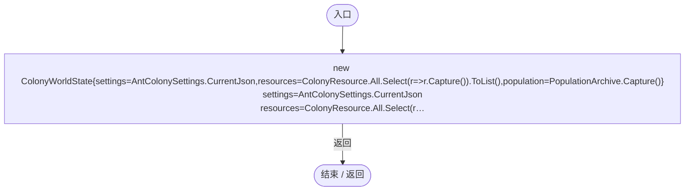

项目内调用/回调引用：

- [AntColonySettings.CurrentJson.get · L32](cb0a937e97c8fbb3.md#maa4463e90fdc2684)（访问器）
- [PopulationArchive.Capture · L110](084e119b69cdd751.md#m2b63358c5191143d)（方法）
- [ColonyWorldState.回调@15 · L15](50d866ed6b21d869.md#mcfb1de3ce616c882)（回调/委托）

## 回调@15 · L15

`r … => 回调`

### Editor / Player · Roslyn编译器控制流

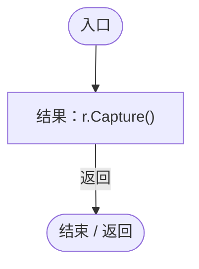

项目内调用/回调引用：

- [ColonyResource.Capture · L101](293dbaecfff4b585.md#m001b2604d9e5f3ee)（方法）

## Validate · L16

`public static void Validate(ColonyWorldState state)`

### Editor / Player · Roslyn编译器控制流

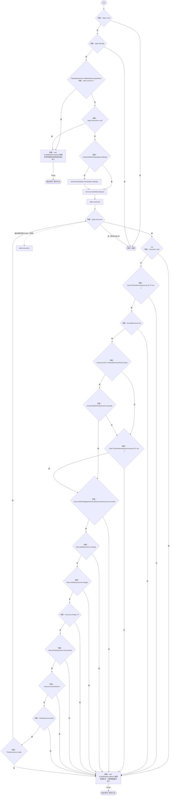

项目内调用/回调引用：

- [PopulationArchive.Validate · L111](084e119b69cdd751.md#m4399dc92547fc7e0)（方法）
- [AntColonySettings.Parse · L40](cb0a937e97c8fbb3.md#mb52d89914d989e58)（方法）
- [ColonyWorldState.Finite · L28](50d866ed6b21d869.md#mf6f5c84fe38d4a7c)（方法）

## Finite · L28

`private static bool Finite(Vector3 p)`

### Editor / Player · Roslyn编译器控制流

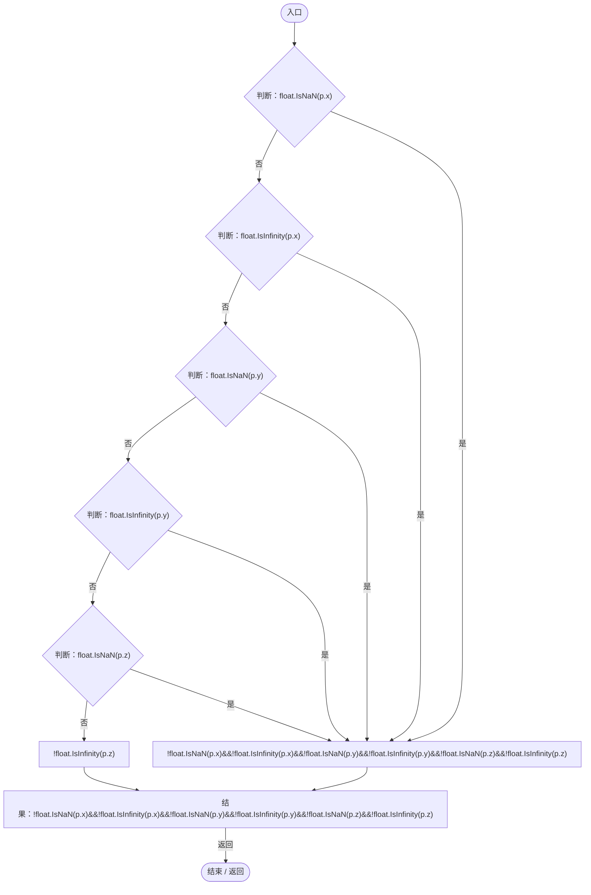

## Prepare · L29

`public static void Prepare(ColonyWorldState state)`

### Editor / Player · Roslyn编译器控制流

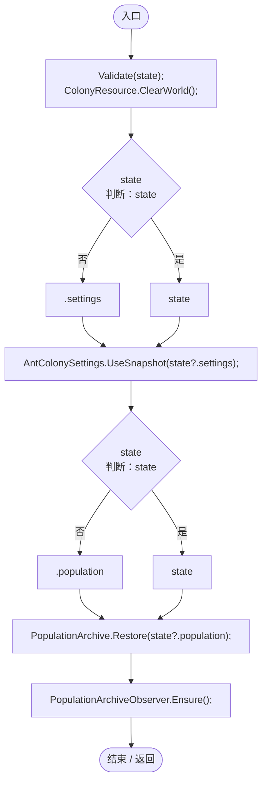

项目内调用/回调引用：

- [ColonyWorldState.Validate · L16](50d866ed6b21d869.md#m8da7d1a3858b9c67)（方法）
- [ColonyResource.ClearWorld · L100](293dbaecfff4b585.md#m634e84088b7cf78c)（方法）
- [AntColonySettings.UseSnapshot · L62](cb0a937e97c8fbb3.md#m50cd0fd034f16b81)（方法）
- [PopulationArchive.Restore · L123](084e119b69cdd751.md#ma1030dfe5b5f2565)（方法）
- [PopulationArchiveObserver.Ensure · L134](084e119b69cdd751.md#m335d06800d06e362)（方法）

## Restore · L30

`public static void Restore(ColonyWorldState state)`

### Editor / Player · Roslyn编译器控制流

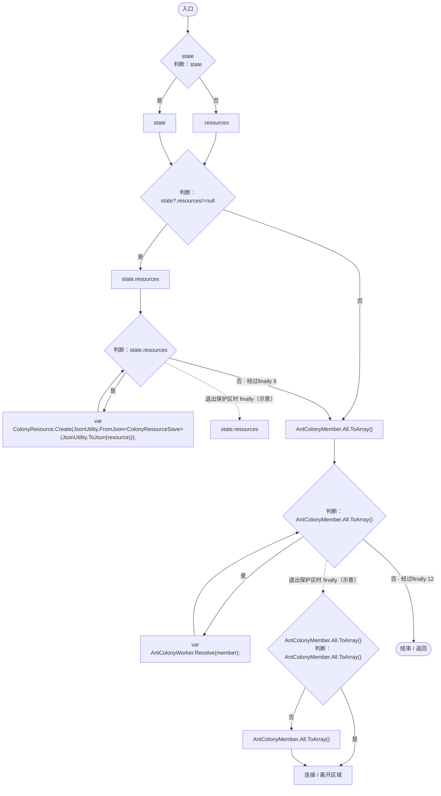

项目内调用/回调引用：

- [ColonyResource.Create · L42](293dbaecfff4b585.md#ma07be53c3e3fff10)（方法）
- [AntColonyWorker.Resolve · L135](8a0cca2020271b6f.md#m893de518d5495a3a)（方法）

## Clear · L35

`public static void Clear()`

### Editor / Player · Roslyn编译器控制流

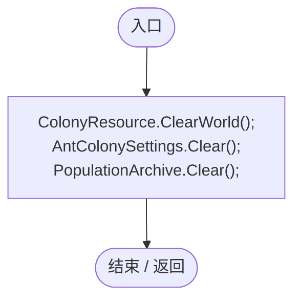

项目内调用/回调引用：

- [ColonyResource.ClearWorld · L100](293dbaecfff4b585.md#m634e84088b7cf78c)（方法）
- [AntColonySettings.Clear · L63](cb0a937e97c8fbb3.md#m3139fd188f0f2c2b)（方法）
- [PopulationArchive.Clear · L127](084e119b69cdd751.md#m75435a20db62d6a0)（方法）

## ValidateMember · L36

`public static void ValidateMember(AntColonyMemberSave state)`

### Editor / Player · Roslyn编译器控制流

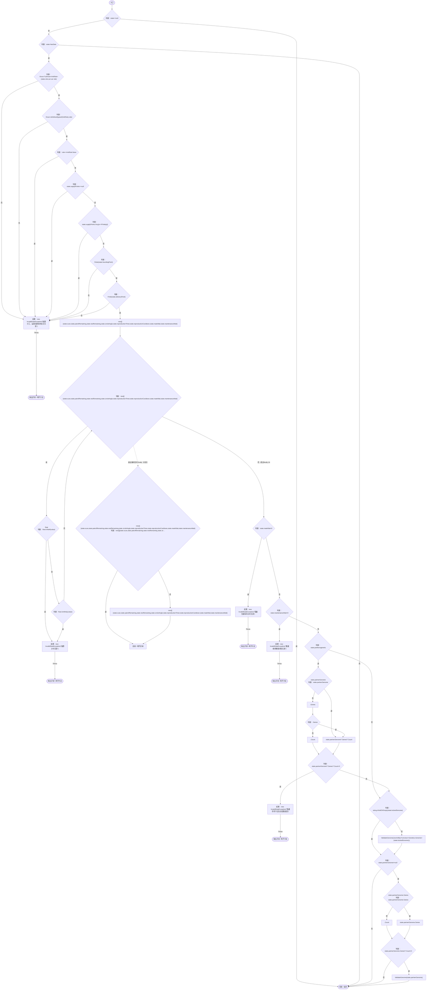

项目内调用/回调引用：

- [ColonyWorldState.Finite · L28](50d866ed6b21d869.md#mf6f5c84fe38d4a7c)（方法）
- [ColonyWorldState.ValidateGenome · L49](50d866ed6b21d869.md#m0c369605f50697fc)（方法）
- [ColonyWorldState.回调@40 · L40](50d866ed6b21d869.md#m0781cde9b1e76194)（回调/委托）

## 回调@40 · L40

`p … => 回调`

### Editor / Player · Roslyn编译器控制流

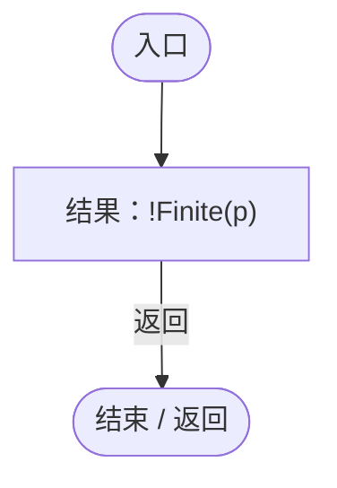

项目内调用/回调引用：

- [ColonyWorldState.Finite · L28](50d866ed6b21d869.md#mf6f5c84fe38d4a7c)（方法）

## ValidateGenome · L49

`private static void ValidateGenome(Genetics.Genome genome)`

### Editor / Player · Roslyn编译器控制流

```mermaid
flowchart TD
  b0(["入口"])
  b1{"genome<br/>判断：genome"}
  b2[".Genes"]
  b3["genome"]
  b4{"判断：genome?.Genes==null"}
  b5{"判断：genome.Genes.Count==0"}
  b6{"判断：genome.Genes.Any(g=&gt;g==null&#124;&#124;string.IsNullOrEmpty(g.DefinitionId)&#124;&#124;float.IsNaN(g.Value)&#124;&#124;float.IsInfinity(g.Value)&#124;&#124;g.MissingStateIds==null)"}
  b7["结果：new InvalidDataException(&quot;蚁群固定或配偶基因快照无效&quot;)"]
  x7(["抛出异常 / 离开方法"])
  b8(["结束 / 返回"])
  b0 --> b1
  b1 -->|"否"| b2
  b1 -->|"是"| b3
  b2 --> b4
  b3 --> b4
  b4 -->|"否"| b5
  b4 -->|"是"| b7
  b5 -->|"否"| b6
  b5 -->|"是"| b7
  b6 -->|"是"| b7
  b6 -->|"否"| b8
  b7 -->|"Throw"| x7

```

项目内调用/回调引用：

- [ColonyWorldState.回调@51 · L51](50d866ed6b21d869.md#m7b0b1675cc8ea881)（回调/委托）

## 回调@51 · L51

`g … => 回调`

### Editor / Player · Roslyn编译器控制流

```mermaid
flowchart TD
  b0(["入口"])
  b1{"判断：g==null"}
  b2{"判断：string.IsNullOrEmpty(g.DefinitionId)"}
  b3{"判断：float.IsNaN(g.Value)"}
  b4{"判断：float.IsInfinity(g.Value)"}
  b5["g.MissingStateIds==null"]
  b6["g==null&#124;&#124;string.IsNullOrEmpty(g.DefinitionId)&#124;&#124;float.IsNaN(g.Value)&#124;&#124;float.IsInfinity(g.Value)&#124;&#124;g.MissingStateIds==null"]
  b7["结果：g==null&#124;&#124;string.IsNullOrEmpty(g.DefinitionId)&#124;&#124;float.IsNaN(g.Value)&#124;&#124;float.IsInfinity(g.Value)&#124;&#124;g.MissingStateIds==null"]
  b8(["结束 / 返回"])
  b0 --> b1
  b1 -->|"否"| b2
  b1 -->|"是"| b6
  b2 -->|"否"| b3
  b2 -->|"是"| b6
  b3 -->|"否"| b4
  b3 -->|"是"| b6
  b4 -->|"否"| b5
  b4 -->|"是"| b6
  b5 --> b7
  b6 --> b7
  b7 -->|"返回"| b8

```

## ValidateMotion · L53

`public static void ValidateMotion(EcologySaveState state)`

### Editor / Player · Roslyn编译器控制流

```mermaid
flowchart TD
  b0(["入口"])
  b1{"判断：state==null"}
  b2{"判断：state.rts!=null"}
  b3{"判断：Enum.IsDefined(typeof(RtsOrderKind),state.rts.kind)"}
  b4{"判断：Finite(state.rts.point)"}
  b5["结果：new InvalidDataException(&quot;RTS命令或目标位置无效&quot;)"]
  x5(["抛出异常 / 离开方法"])
  b6["new[]{state.patrol?.rest??0,state.patrol?.active??0,state.combat?.remaining??0}"]
  b7{"state.patrol<br/>判断：state.patrol"}
  b8[".rest"]
  b9["state.patrol"]
  b10{"判断：state.patrol?.rest"}
  b11["state.patrol?.rest"]
  b12["0"]
  b13{"state.patrol<br/>判断：state.patrol"}
  b14[".active"]
  b15["state.patrol"]
  b16{"判断：state.patrol?.active"}
  b17["state.patrol?.active"]
  b18["0"]
  b19{"state.combat<br/>判断：state.combat"}
  b20[".remaining"]
  b21["state.combat"]
  b22{"判断：state.combat?.remaining"}
  b23["state.combat?.remaining"]
  b24["0"]
  b25["new[]{state.patrol?.rest??0,state.patrol?.active??0,state.combat?.remaining??0}"]
  b26{"判断：new[]{state.patrol?.rest??0,state.patrol?.active??0,state.combat?.remaining??0}"}
  b27{"float<br/>判断：float.IsNaN(value)"}
  b28{"判断：float.IsInfinity(value)"}
  b29{"判断：value&lt;0"}
  b30["结果：new InvalidDataException(&quot;巡逻或反击计时无效&quot;)"]
  x30(["抛出异常 / 离开方法"])
  b31{"new[]{state.patrol?.rest??0,state.patrol?.active??0,state.combat?.remaining??0}<br/>判断：new[]{state.patrol?.rest??0,state.patrol?.active??0,state.combat?.remaining??0}"}
  b32["new[]{state.patrol?.rest??0,state.patrol?.active??0,state.combat?.remaining??0}"]
  b33["连接 / 离开区域"]
  b34(["结束 / 返回"])
  b0 --> b1
  b1 -->|"是"| b34
  b1 -->|"否"| b2
  b2 -->|"是"| b3
  b2 -->|"否"| b6
  b3 -->|"是"| b4
  b3 -->|"否"| b5
  b4 -->|"否"| b5
  b4 -->|"是"| b6
  b5 -->|"Throw"| x5
  b6 --> b7
  b7 -->|"否"| b8
  b7 -->|"是"| b9
  b8 --> b10
  b9 --> b10
  b10 -->|"否"| b11
  b10 -->|"是"| b12
  b11 --> b13
  b12 --> b13
  b13 -->|"否"| b14
  b13 -->|"是"| b15
  b14 --> b16
  b15 --> b16
  b16 -->|"否"| b17
  b16 -->|"是"| b18
  b17 --> b19
  b18 --> b19
  b19 -->|"否"| b20
  b19 -->|"是"| b21
  b20 --> b22
  b21 --> b22
  b22 -->|"否"| b23
  b22 -->|"是"| b24
  b23 --> b25
  b24 --> b25
  b25 --> b26
  b26 -->|"是"| b27
  b26 -->|"否 · 经过finally 31"| b34
  b27 -->|"否"| b28
  b27 -->|"是"| b30
  b28 -->|"否"| b29
  b28 -->|"是"| b30
  b29 -->|"是"| b30
  b29 -->|"否"| b26
  b30 -->|"Throw"| x30
  b31 -->|"否"| b32
  b31 -->|"是"| b33
  b32 --> b33
  b26 -. "退出保护区时 finally（示意）" .-> b31

```

项目内调用/回调引用：

- [ColonyWorldState.Finite · L28](50d866ed6b21d869.md#mf6f5c84fe38d4a7c)（方法）
