# StutterRepairRegression.cs

[返回总索引](../README.md) · `Editor` · `Assets/DarwinPark/Editor/StutterRepairRegression.cs`

[源文件](../../../Assets/DarwinPark/Editor/StutterRepairRegression.cs) · 源码校验：`288bafd43d4d4edae0bf4adcc8d1cfb9e63ad63c96759ccebb8e66a7bf132d52`

方法按源文件位置排列。事件/回调引用不表示立即执行；分支与异常说明见总索引。完整源码与可点击关系图请打开离线手册。

<a id="m9b0ccef29d132374"></a>

## Folder.get · L27

`private static string Folder`


### Editor · 语法控制结构 / 声明（非CFG）

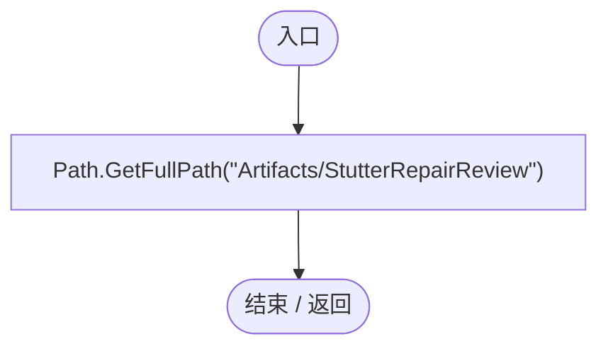

<a id="ma0d01698203cf936"></a>

## StutterRepairRegression.ctor · L28

`static StutterRepairRegression()`


### Editor · Roslyn编译器控制流

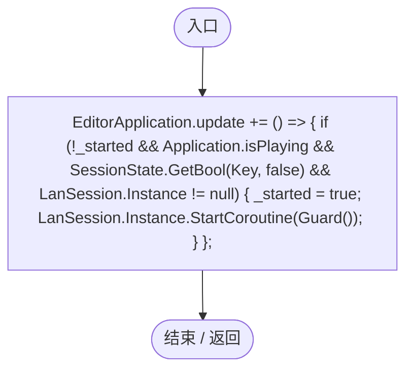

项目内调用/回调引用：

- [StutterRepairRegression.回调@29 · L29](5193d52284c85dc4.md#m7c920704798d892f)（回调/委托）

<a id="m7c920704798d892f"></a>

## 回调@29 · L29

`( … => 回调`


### Editor · Roslyn编译器控制流

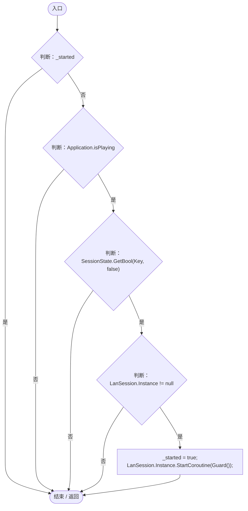

项目内调用/回调引用：

- [LanSession.Instance.get · L23](9fb633eebffe669c.md#mbf83306994878383)（访问器）
- [StutterRepairRegression.Guard · L34](5193d52284c85dc4.md#mda9ebdfecd72eafe)（方法）

<a id="m54093bf5bce4b08d"></a>

## RunBatch · L30

`public static void RunBatch()`


### Editor · Roslyn编译器控制流

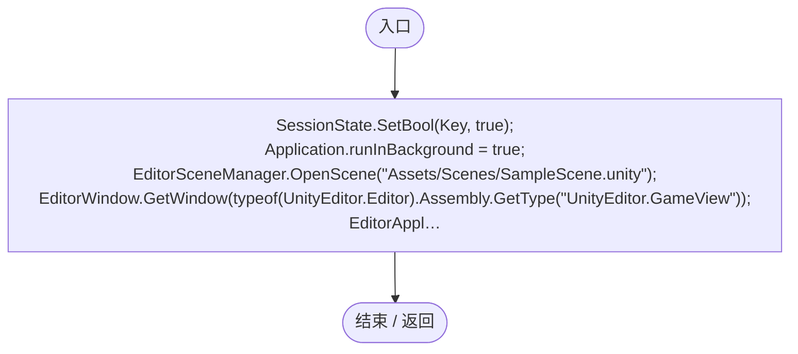

<a id="m5e40bbf0a47094cc"></a>

## Check · L32

`private static void Check(bool pass, string text)`


### Editor · Roslyn编译器控制流

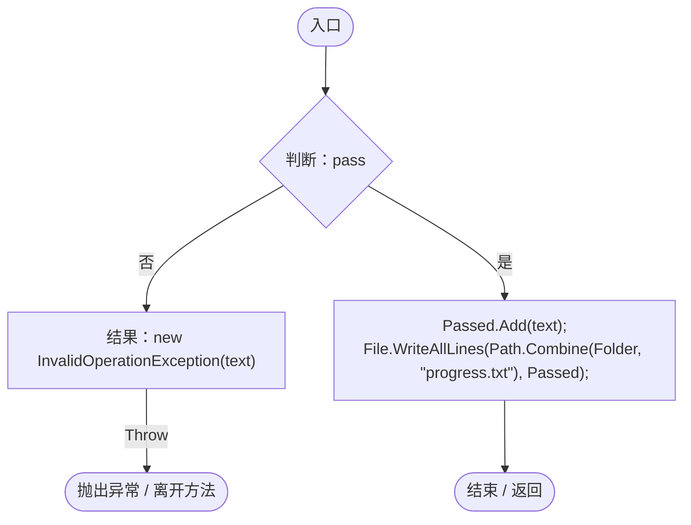

<a id="mda9ebdfecd72eafe"></a>

## Guard · L34

`private static IEnumerator Guard()`


### Editor · Roslyn编译器控制流

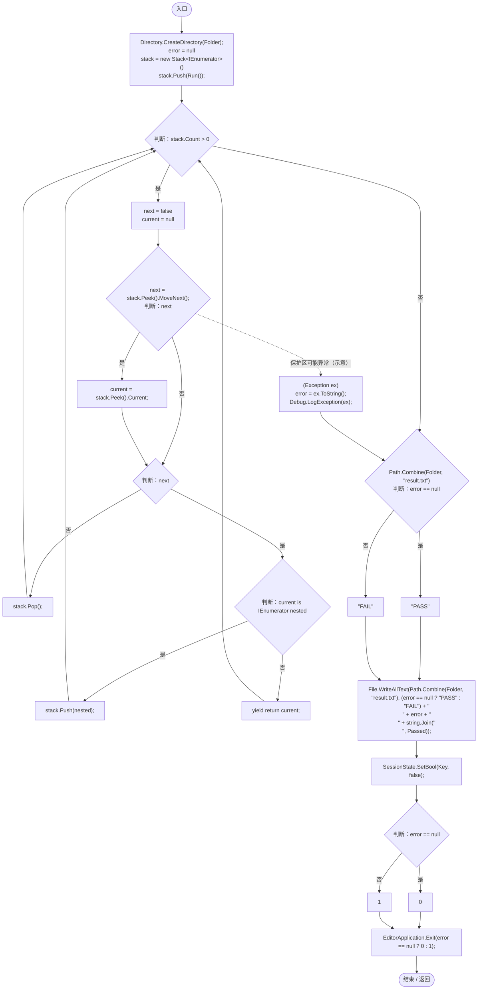

项目内调用/回调引用：

- [StutterRepairRegression.Run · L60](5193d52284c85dc4.md#mf3861354ff973072)（方法）

<a id="m4c156fbd07724c9f"></a>

## Spawn · L48

`private static DarwinEntity Spawn(string template, Vector3 position)`


### Editor · Roslyn编译器控制流

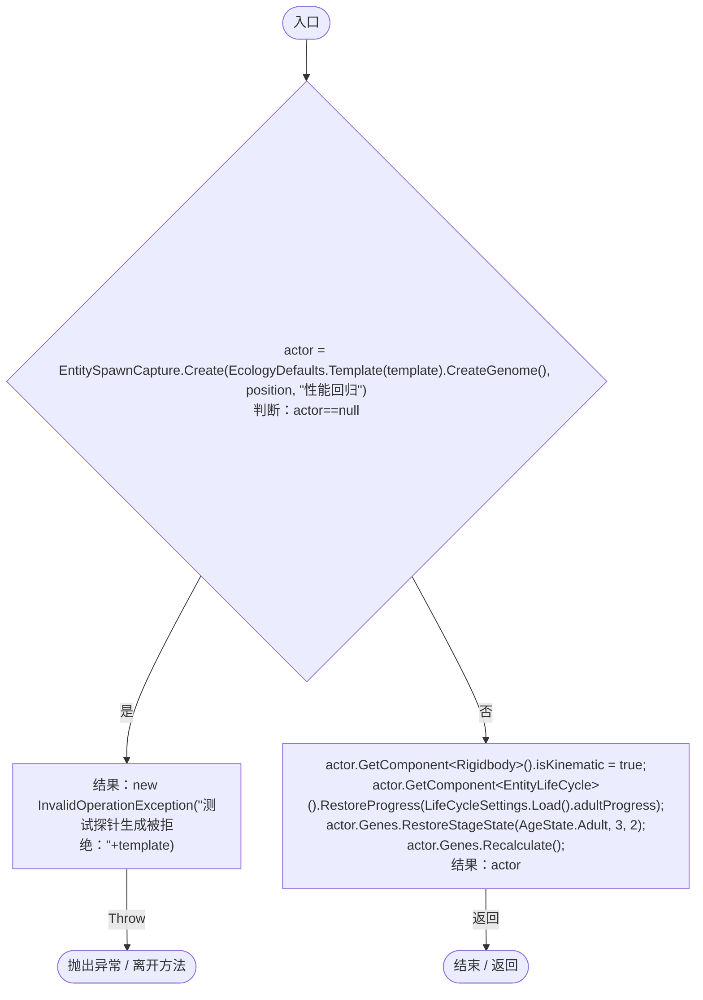

项目内调用/回调引用：

- [EntitySpawnCapture.Create · L11](5a4874756805f604.md#m2adfeb24d77063b5)（方法）
- [RandomSpawnRecipe.CreateGenome · L25](923ccc4e86c4786c.md#m2612c79fe3848e08)（方法）
- [EcologyDefaults.Template · L68](5b565b57de741d98.md#m98d16ffadd19320f)（方法）
- [EntityLifeCycle.RestoreProgress · L53](9f4138bfbae654b7.md#m9ac5190ce2d7c425)（方法）
- [LifeCycleSettings.Load · L16](ace76969fe8f61de.md#m6fe263852e5a8989)（方法）
- [EntityGeneController.RestoreStageState · L58](7494d53178552f0e.md#m89a02f44ce209b2f)（方法）
- [DarwinEntity.Genes.get · L14](70798dde169f2e8b.md#m622eb1adf401d431)（访问器）
- [EntityGeneController.Recalculate · L120](7494d53178552f0e.md#m7bf63f9a1482db3c)（方法）

<a id="me2718d18e7a06c77"></a>

## Set · L56

`private static void Set(EntityStats stats, string id, float value)`


### Editor · Roslyn编译器控制流

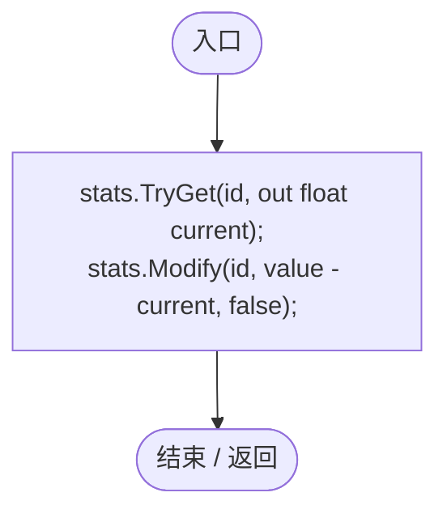

项目内调用/回调引用：

- [EntityStats.TryGet · L93](75aa86a368efdf24.md#m03cef847022eee28)（方法）
- [EntityStats.Modify · L114](75aa86a368efdf24.md#m375a3812ef990b45)（方法）

<a id="m7bf61e41460615c7"></a>

## Resource · L58

`private static ColonyResource Resource(Vector3 point, string group, ColonyResourceKind kind, float energy = 30)`


### Editor · Roslyn编译器控制流

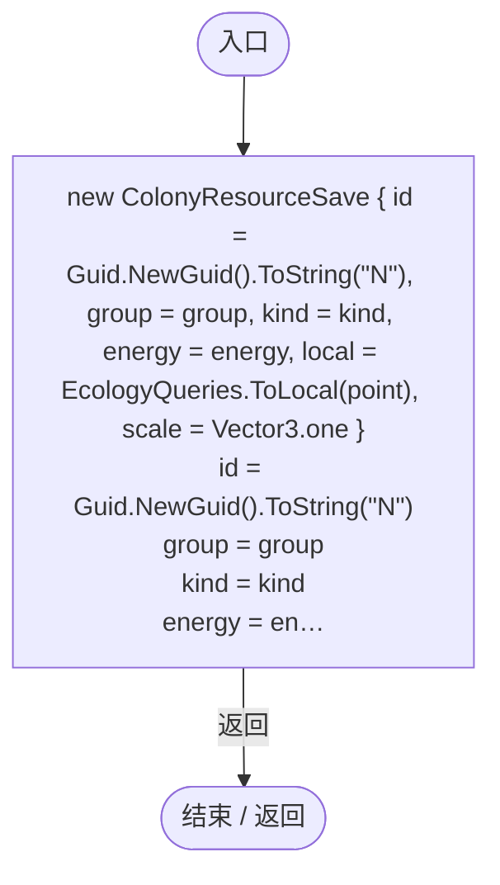

项目内调用/回调引用：

- [ColonyResource.Create · L45](293dbaecfff4b585.md#m6768b4f531fe91dd)（方法）
- [EcologyQueries.ToLocal · L40](bdf7ccc2c9c0452f.md#mfa1ace432c73012a)（方法）

<a id="mf3861354ff973072"></a>

## Run · L60

`private static IEnumerator Run()`


### Editor · Roslyn编译器控制流

```mermaid
flowchart TD
  b0(["入口"])
  b1["session = Object.FindFirstObjectByType&lt;WorldSessionManager&gt;()<br/>session.autoSaveInterval = 36000;<br/>session.Open(WorldSaveStore.Read(Path.GetFullPath(&quot;Artifacts/NearViewReview/input/world.json&quot;)));"]
  b2{"判断：session.Busy"}
  b3["yield return null;"]
  b4["clock = ServiceLocator.Get&lt;SimulationClock&gt;()<br/>clock.Pause();<br/>GameplayTuning.Current.mutationRoundsEnabled = false;"]
  b5["new WorldGameSettings{entityLimit=0}<br/>entityLimit=0<br/>EntityPopulationLimit.UseSnapshot(new WorldGameSettings{entityLimit=0});"]
  b6["planet = EcologyQueries.Planet<br/>resources = ColonyResource.All.Count()<br/>energy = ColonyResource.All.Sum(r =&gt; r.State.energy)<br/>corpses = ColonyResource.All.Count(r =&gt; r.State.kind == ColonyResourceKind.Corpse)<br/>yield return null;<br/>yield return…"]
  b7{"判断：corpses &gt; 5000"}
  b8["CorpseInstanceRenderer.RegisteredParts == corpses * 2"]
  b9["corpses &gt; 5000"]
  b10["Check(corpses &gt; 5000 &amp;&amp; CorpseInstanceRenderer.RegisteredParts == corpses * 2, &quot;完整五千以上尸体的身体/叉号均登记批次，保留原资源对象&quot;);"]
  b11{"判断：CorpseInstanceRenderer.LastInstances == corpses * 2"}
  b12["CorpseInstanceRenderer.LastBatches &gt; 0"]
  b13["CorpseInstanceRenderer.LastInstances == corpses * 2"]
  b14["Check(CorpseInstanceRenderer.LastInstances == corpses * 2 &amp;&amp; CorpseInstanceRenderer.LastBatches &gt; 0, &quot;真实帧实际提交尸体GPU实例，而非只勾选材质开关&quot;);"]
  b15["SimulationOptimization.Current.corpseBatchRendering = false;<br/>yield return null;<br/>yield return new WaitForEndOfFrame();<br/>Check(ColonyResource.All.Where(r =&gt; r.State.kind == ColonyResourceKind.Corpse).All(r =&gt; r.GetComponentsInChildren&lt;MeshR…"]
  b16{"判断：ColonyResource.All.Count() == resources"}
  b17["Math.Abs(ColonyResource.All.Sum(r =&gt; r.State.energy) - energy) &lt; .01f"]
  b18["ColonyResource.All.Count() == resources"]
  b19["Check(ColonyResource.All.Count() == resources &amp;&amp; Math.Abs(ColonyResource.All.Sum(r =&gt; r.State.energy) - energy) &lt; .01f, &quot;切换显示没有删除尸体或改变真实营养&quot;);"]
  b20["SimulationOptimization.Current.corpseBatchRendering = true;<br/>yield return null;<br/>yield return new WaitForEndOfFrame();<br/>Check(CorpseInstanceRenderer.LastInstances == corpses * 2, &quot;再次开启恢复相同数量的尸体实例&quot;);<br/>home = EntityRegistry.All.First(e =&gt; !pla…"]
  b21{"判断：EntityRegistry.All.Contains(actor)"}
  b22{"判断：actor.Genes != null"}
  b23["actor.GetComponent&lt;EntityStats&gt;() != null"]
  b24["EntityRegistry.All.Contains(actor) &amp;&amp; actor.Genes != null &amp;&amp; actor.GetComponent&lt;EntityStats&gt;() != null"]
  b25["Check(EntityRegistry.All.Contains(actor) &amp;&amp; actor.Genes != null &amp;&amp; actor.GetComponent&lt;EntityStats&gt;() != null, &quot;直接捕获返回已完成组件安装的新生实体&quot;);"]
  b26["original = DarwinEntity.Spawner<br/>captured = EntitySpawnCapture.Captured<br/>threw = false"]
  b27["DarwinEntity.Spawner = (_, _, _) =&gt; throw new InvalidOperationException(&quot;expected spawn failure&quot;);<br/>EntitySpawnCapture.Create(actor.Genes.Genome, point);"]
  b28["threw = true;"]
  b29["DarwinEntity.Spawner = original;"]
  b30["next = Spawn(&quot;producer&quot;, point + Vector3.right * 5)"]
  b31{"判断：threw"}
  b32{"判断：EntitySpawnCapture.Captured == captured + 1"}
  b33{"判断：next != actor"}
  b34["EntityRegistry.All.Count == count + 1"]
  b35["threw &amp;&amp; EntitySpawnCapture.Captured == captured + 1 &amp;&amp; next != actor &amp;&amp; EntityRegistry.All.Count == count + 1"]
  b36["Check(threw &amp;&amp; EntitySpawnCapture.Captured == captured + 1 &amp;&amp; next != actor &amp;&amp; EntityRegistry.All.Count == count + 1, &quot;生成异常解除事件订阅，下一次生成不泄漏捕获或错认旧身份&quot;);"]
  b37["yield return Ground(actor, planet);<br/>yield return Feeding(point);<br/>ResourceQueries(point);<br/>yield return CorpseDisplay(planet, point);"]
  b38(["结束 / 返回"])
  b0 --> b1
  b1 --> b2
  b2 -->|"是"| b3
  b2 -->|"否"| b4
  b3 --> b2
  b4 --> b5
  b5 --> b6
  b6 --> b7
  b7 -->|"是"| b8
  b7 -->|"否"| b9
  b8 --> b10
  b9 --> b10
  b10 --> b11
  b11 -->|"是"| b12
  b11 -->|"否"| b13
  b12 --> b14
  b13 --> b14
  b14 --> b15
  b15 --> b16
  b16 -->|"是"| b17
  b16 -->|"否"| b18
  b17 --> b19
  b18 --> b19
  b19 --> b20
  b20 --> b21
  b21 -->|"是"| b22
  b21 -->|"否"| b24
  b22 -->|"是"| b23
  b22 -->|"否"| b24
  b23 --> b25
  b24 --> b25
  b25 --> b26
  b26 --> b27
  b27 -->|"经过finally 29"| b30
  b28 -->|"经过finally 29"| b30
  b30 --> b31
  b31 -->|"是"| b32
  b31 -->|"否"| b35
  b32 -->|"是"| b33
  b32 -->|"否"| b35
  b33 -->|"是"| b34
  b33 -->|"否"| b35
  b34 --> b36
  b35 --> b36
  b36 --> b37
  b37 --> b38
  b27 -. "保护区可能异常（示意）" .-> b28
  b27 -. "退出保护区时 finally（示意）" .-> b29

```

项目内调用/回调引用：

- [WorldSessionManager.Open · L60](08741c7b7b9d9344.md#m7bd56ef45131b4e5)（方法）
- [WorldSaveStore.Read · L74](d67a35e5e3814c15.md#mde52fadbe0185af1)（方法）
- [WorldSessionManager.Busy.get · L24](08741c7b7b9d9344.md#m4483e2e4f28f7c85)（访问器）
- [ServiceLocator.Get · L33](f2fdbe9f9ccd93cb.md#m2ae625299520c56d)（方法）
- [SimulationClock.Pause · L79](a8f444aec9614b0a.md#m30929d45a885d0f1)（方法）
- [GameplayTuning.Current.get · L46](db546e5713b32d53.md#m4fa691bd8a3b9618)（访问器）
- [EntityPopulationLimit.UseSnapshot · L30](44f717c5df79d270.md#m735185cedc969868)（方法）
- [StutterRepairRegression.Check · L32](5193d52284c85dc4.md#m5e40bbf0a47094cc)（方法）
- [CorpseInstanceRenderer.LastInstances.get · L50](29964f1f6c300ac9.md#mc48fbcf8c606dd25)（访问器）
- [CorpseInstanceRenderer.LastBatches.get · L49](29964f1f6c300ac9.md#mb8773097c387985e)（访问器）
- [SimulationOptimization.Current.get · L30](11c9091e70893352.md#mcfa8eb2e650e57b1)（访问器）
- [EcologyQueries.Up · L42](bdf7ccc2c9c0452f.md#ma73e6bbbc726282f)（方法）
- [StutterRepairRegression.Spawn · L48](5193d52284c85dc4.md#m4c156fbd07724c9f)（方法）
- [DarwinEntity.Genes.get · L14](70798dde169f2e8b.md#m622eb1adf401d431)（访问器）
- [EntitySpawnCapture.Captured.get · L10](5a4874756805f604.md#m5a0171000652f2d4)（访问器）
- [EntitySpawnCapture.Create · L11](5a4874756805f604.md#m2adfeb24d77063b5)（方法）
- [StutterRepairRegression.Ground · L111](5193d52284c85dc4.md#mb1ab64e2ed1edacc)（方法）
- [StutterRepairRegression.Feeding · L136](5193d52284c85dc4.md#m6fd49af987f5418e)（方法）
- [StutterRepairRegression.ResourceQueries · L94](5193d52284c85dc4.md#mc23def0e88cd7ab1)（方法）
- [StutterRepairRegression.CorpseDisplay · L157](5193d52284c85dc4.md#m0de9be630e486279)（方法）
- [StutterRepairRegression.回调@68 · L68](5193d52284c85dc4.md#m3507f432be7b74cd)（回调/委托）
- [StutterRepairRegression.回调@69 · L69](5193d52284c85dc4.md#me35ff440d8b20cee)（回调/委托）
- [StutterRepairRegression.回调@74 · L74](5193d52284c85dc4.md#mb6d034f82e4e8138)（回调/委托）
- [StutterRepairRegression.回调@74 · L74](5193d52284c85dc4.md#m4a311a22a62be2f9)（回调/委托）
- [StutterRepairRegression.回调@75 · L75](5193d52284c85dc4.md#mecc977a1b80182df)（回调/委托）
- [StutterRepairRegression.回调@78 · L78](5193d52284c85dc4.md#m3c423c388a8a76c4)（回调/委托）
- [StutterRepairRegression.回调@83 · L83](5193d52284c85dc4.md#m125caf23a9489d17)（回调/委托）

<a id="m3507f432be7b74cd"></a>

## 回调@68 · L68

`r … => 回调`


### Editor · Roslyn编译器控制流

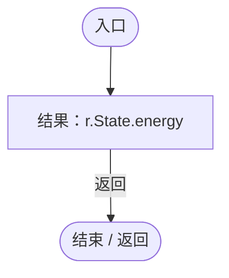

项目内调用/回调引用：

- [ColonyResource.State.get · L24](293dbaecfff4b585.md#m41824f1a0e160aa5)（访问器）

<a id="me35ff440d8b20cee"></a>

## 回调@69 · L69

`r … => 回调`


### Editor · Roslyn编译器控制流

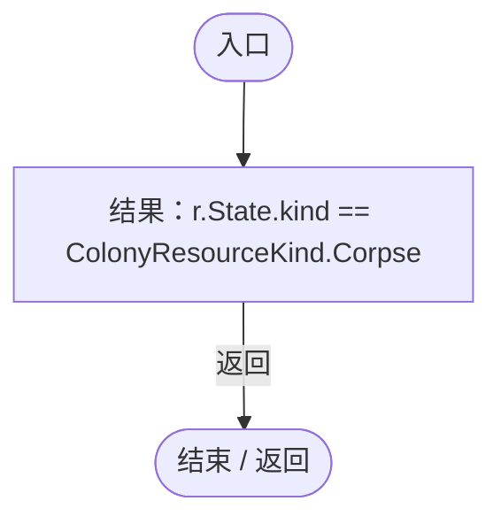

项目内调用/回调引用：

- [ColonyResource.State.get · L24](293dbaecfff4b585.md#m41824f1a0e160aa5)（访问器）

<a id="mb6d034f82e4e8138"></a>

## 回调@74 · L74

`r … => 回调`


### Editor · Roslyn编译器控制流


项目内调用/回调引用：

- [ColonyResource.State.get · L24](293dbaecfff4b585.md#m41824f1a0e160aa5)（访问器）

<a id="m4a311a22a62be2f9"></a>

## 回调@74 · L74

`r … => 回调`


### Editor · Roslyn编译器控制流

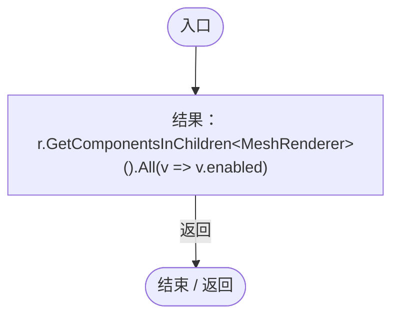

项目内调用/回调引用：

- [StutterRepairRegression.回调@74 · L74](5193d52284c85dc4.md#mfc7242e30bdd004c)（回调/委托）

<a id="mfc7242e30bdd004c"></a>

## 回调@74 · L74

`v … => 回调`


### Editor · Roslyn编译器控制流

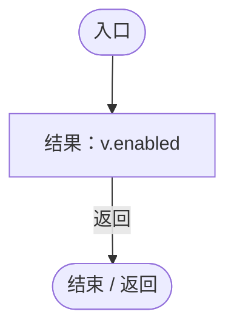

<a id="mecc977a1b80182df"></a>

## 回调@75 · L75

`r … => 回调`


### Editor · Roslyn编译器控制流


项目内调用/回调引用：

- [ColonyResource.State.get · L24](293dbaecfff4b585.md#m41824f1a0e160aa5)（访问器）

<a id="m3c423c388a8a76c4"></a>

## 回调@78 · L78

`e … => 回调`


### Editor · Roslyn编译器控制流

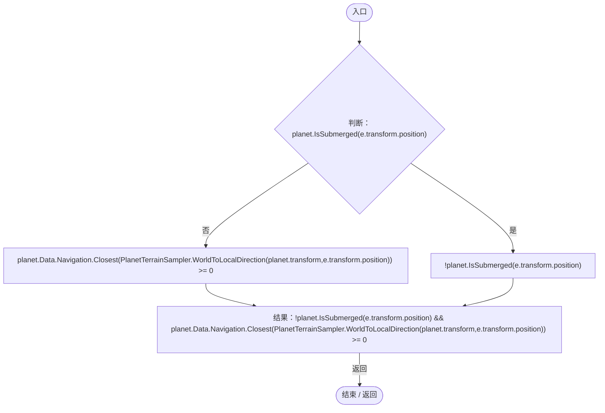

项目内调用/回调引用：

- [PlanetTerrainMeshBuilder.IsSubmerged · L107](415285cf043354a9.md#m77993fefee27a702)（方法）
- [LandNavigationGraph.Closest · L31](6f2590f045ea5d3f.md#m84242b314c22284e)（方法）
- [PlanetTerrainMeshBuilder.Data.get · L81](415285cf043354a9.md#m1a65abfe0f34c5d8)（访问器）
- [PlanetTerrainSampler.WorldToLocalDirection · L76](fd5c1d83b88a7c8b.md#m463193acae2d5044)（方法）

<a id="m125caf23a9489d17"></a>

## 回调@83 · L83

`( … => 回调`


### Editor · Roslyn编译器控制流

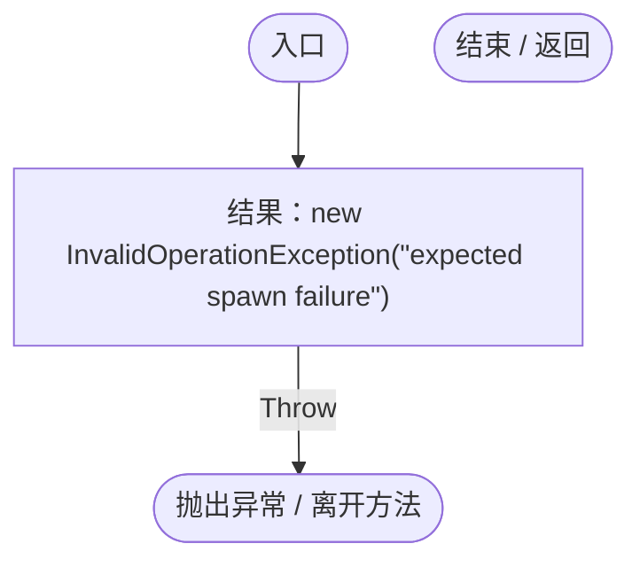

<a id="mc23def0e88cd7ab1"></a>

## ResourceQueries · L94

`private static void ResourceQueries(Vector3 point)`

★ 新增：稀疏扫描和格查询都必须与原球面距离逐对象结果一致，包含全球无穷范围与星球旋转后的重建。

### Editor · Roslyn编译器控制流

```mermaid
flowchart TD
  b0(["入口"])
  b1["found=new List&lt;ResourceCoordinate&gt;()"]
  b2["new[]{false,true}"]
  b3{"判断：new[]{false,true}"}
  b4["bool"]
  b5["new[]{false,true}"]
  b6{"判断：new[]{false,true}"}
  b7["bool"]
  b8["new[]{3f,90f,float.PositiveInfinity}"]
  b9{"判断：new[]{3f,90f,float.PositiveInfinity}"}
  b10["float"]
  b11["ResourceCoordinates.Query(point,radius,surface,corpses,found);<br/>expected=ColonyResource.All.Where(r=&gt;(r.State.kind==ColonyResourceKind.Corpse)==corpses&amp;&amp;(float.IsPositiveInfinity(radius)&#124;&#124;(surface?EcologyQueries.Distance(point,r.transform…"]
  b12{"new[]{3f,90f,float.PositiveInfinity}<br/>判断：new[]{3f,90f,float.PositiveInfinity}"}
  b13["new[]{3f,90f,float.PositiveInfinity}"]
  b14["连接 / 离开区域"]
  b15{"new[]{false,true}<br/>判断：new[]{false,true}"}
  b16["new[]{false,true}"]
  b17["连接 / 离开区域"]
  b18{"new[]{false,true}<br/>判断：new[]{false,true}"}
  b19["new[]{false,true}"]
  b20["连接 / 离开区域"]
  b21["planet=EcologyQueries.Planet<br/>rotation=planet.transform.rotation<br/>rebuilds=ResourceCoordinates.Rebuilds<br/>planet.transform.Rotate(Vector3.up,5);<br/>ResourceCoordinates.Query(point,90,true,false,found);<br/>Check(ColonyResource.All.Where(r=&gt;r.State.…"]
  b22{"判断：ResourceCoordinates.Rebuilds&gt;rebuilds"}
  b23["ColonyResource.All.Where(r=&gt;r.State.kind!=ColonyResourceKind.Corpse&amp;&amp;EcologyQueries.Distance(point,r.transform.position)&lt;=90).ToHashSet().SetEquals(found.Select(c=&gt;c.resource))"]
  b24["ResourceCoordinates.Rebuilds&gt;rebuilds"]
  b25["Check(ResourceCoordinates.Rebuilds&gt;rebuilds&amp;&amp;ColonyResource.All.Where(r=&gt;r.State.kind!=ColonyResourceKind.Corpse&amp;&amp;EcologyQueries.Distance(point,r.transform.position)&lt;=90).ToHashSet().SetEquals(found.Select(c=&gt;c.resource)),&quot;缩放确实重建资源坐标，并保持…"]
  b26["planet.transform.localScale=scale;"]
  b27(["结束 / 返回"])
  b0 --> b1
  b1 --> b2
  b2 --> b3
  b3 -->|"是"| b4
  b3 -->|"否 · 经过finally 18"| b21
  b4 --> b5
  b5 --> b6
  b6 -->|"是"| b7
  b6 -->|"否 · 经过finally 15"| b3
  b7 --> b8
  b8 --> b9
  b9 -->|"是"| b10
  b9 -->|"否 · 经过finally 12"| b6
  b10 --> b11
  b11 --> b9
  b12 -->|"否"| b13
  b12 -->|"是"| b14
  b13 --> b14
  b15 -->|"否"| b16
  b15 -->|"是"| b17
  b16 --> b17
  b18 -->|"否"| b19
  b18 -->|"是"| b20
  b19 --> b20
  b21 --> b22
  b22 -->|"是"| b23
  b22 -->|"否"| b24
  b23 --> b25
  b24 --> b25
  b25 --> b26
  b26 --> b27
  b9 -. "退出保护区时 finally（示意）" .-> b12
  b6 -. "退出保护区时 finally（示意）" .-> b15
  b3 -. "退出保护区时 finally（示意）" .-> b18

```

项目内调用/回调引用：

- [ResourceCoordinates.Query · L69](93d731ac01e3af48.md#mf169cf6ba025c1ca)（方法）
- [StutterRepairRegression.Check · L32](5193d52284c85dc4.md#m5e40bbf0a47094cc)（方法）
- [ResourceCoordinates.Rebuilds.get · L24](93d731ac01e3af48.md#m8d7daf91ba26e421)（访问器）
- [StutterRepairRegression.回调@100 · L100](5193d52284c85dc4.md#m30d4ed38cf0eb2da)（回调/委托）
- [StutterRepairRegression.回调@101 · L101](5193d52284c85dc4.md#m5b9157586416cd4d)（回调/委托）
- [StutterRepairRegression.回调@105 · L105](5193d52284c85dc4.md#m3a2c2cc5ceed4b7b)（回调/委托）
- [StutterRepairRegression.回调@105 · L105](5193d52284c85dc4.md#m201a343f7563622d)（回调/委托）
- [StutterRepairRegression.回调@109 · L109](5193d52284c85dc4.md#md3e8cdfc65b6a2c4)（回调/委托）
- [StutterRepairRegression.回调@109 · L109](5193d52284c85dc4.md#m230ea8a49779b5a3)（回调/委托）

<a id="m30d4ed38cf0eb2da"></a>

## 回调@100 · L100

`r … => 回调`


### Editor · Roslyn编译器控制流

```mermaid
flowchart TD
  b0(["入口"])
  b1{"判断：(r.State.kind==ColonyResourceKind.Corpse)==corpses"}
  b2{"判断：float.IsPositiveInfinity(radius)"}
  b3{"判断：surface"}
  b4["EcologyQueries.Distance(point,r.transform.position)&lt;=radius"]
  b5["(point-r.transform.position).sqrMagnitude&lt;=radius*radius"]
  b6["surface?EcologyQueries.Distance(point,r.transform.position)&lt;=radius:(point-r.transform.position).sqrMagnitude&lt;=radius*radius"]
  b7["float.IsPositiveInfinity(radius)"]
  b8["(r.State.kind==ColonyResourceKind.Corpse)==corpses"]
  b9["结果：(r.State.kind==ColonyResourceKind.Corpse)==corpses&amp;&amp;(float.IsPositiveInfinity(radius)&#124;&#124;(surface?EcologyQueries.Distance(point,r.transform.position)&lt;=radius:(point-r.transform.position).sqrMagnitude&lt;=radius*radius))"]
  b10(["结束 / 返回"])
  b0 --> b1
  b1 -->|"是"| b2
  b1 -->|"否"| b8
  b2 -->|"否"| b3
  b2 -->|"是"| b7
  b3 -->|"是"| b4
  b3 -->|"否"| b5
  b4 --> b6
  b5 --> b6
  b6 --> b9
  b7 --> b9
  b8 --> b9
  b9 -->|"返回"| b10

```

项目内调用/回调引用：

- [ColonyResource.State.get · L24](293dbaecfff4b585.md#m41824f1a0e160aa5)（访问器）
- [EcologyQueries.Distance · L43](bdf7ccc2c9c0452f.md#m6e395dce655ebcac)（方法）

<a id="m5b9157586416cd4d"></a>

## 回调@101 · L101

`c … => 回调`


### Editor · Roslyn编译器控制流

```mermaid
flowchart TD
  b0(["入口"])
  b1["结果：c.resource"]
  b2(["结束 / 返回"])
  b0 --> b1
  b1 -->|"返回"| b2

```

<a id="m3a2c2cc5ceed4b7b"></a>

## 回调@105 · L105

`r … => 回调`


### Editor · Roslyn编译器控制流

```mermaid
flowchart TD
  b0(["入口"])
  b1{"判断：r.State.kind!=ColonyResourceKind.Corpse"}
  b2["EcologyQueries.Distance(point,r.transform.position)&lt;=90"]
  b3["r.State.kind!=ColonyResourceKind.Corpse"]
  b4["结果：r.State.kind!=ColonyResourceKind.Corpse&amp;&amp;EcologyQueries.Distance(point,r.transform.position)&lt;=90"]
  b5(["结束 / 返回"])
  b0 --> b1
  b1 -->|"是"| b2
  b1 -->|"否"| b3
  b2 --> b4
  b3 --> b4
  b4 -->|"返回"| b5

```

项目内调用/回调引用：

- [ColonyResource.State.get · L24](293dbaecfff4b585.md#m41824f1a0e160aa5)（访问器）
- [EcologyQueries.Distance · L43](bdf7ccc2c9c0452f.md#m6e395dce655ebcac)（方法）

<a id="m201a343f7563622d"></a>

## 回调@105 · L105

`c … => 回调`


### Editor · Roslyn编译器控制流

```mermaid
flowchart TD
  b0(["入口"])
  b1["结果：c.resource"]
  b2(["结束 / 返回"])
  b0 --> b1
  b1 -->|"返回"| b2

```

<a id="md3e8cdfc65b6a2c4"></a>

## 回调@109 · L109

`r … => 回调`


### Editor · Roslyn编译器控制流

```mermaid
flowchart TD
  b0(["入口"])
  b1{"判断：r.State.kind!=ColonyResourceKind.Corpse"}
  b2["EcologyQueries.Distance(point,r.transform.position)&lt;=90"]
  b3["r.State.kind!=ColonyResourceKind.Corpse"]
  b4["结果：r.State.kind!=ColonyResourceKind.Corpse&amp;&amp;EcologyQueries.Distance(point,r.transform.position)&lt;=90"]
  b5(["结束 / 返回"])
  b0 --> b1
  b1 -->|"是"| b2
  b1 -->|"否"| b3
  b2 --> b4
  b3 --> b4
  b4 -->|"返回"| b5

```

项目内调用/回调引用：

- [ColonyResource.State.get · L24](293dbaecfff4b585.md#m41824f1a0e160aa5)（访问器）
- [EcologyQueries.Distance · L43](bdf7ccc2c9c0452f.md#m6e395dce655ebcac)（方法）

<a id="m230ea8a49779b5a3"></a>

## 回调@109 · L109

`c … => 回调`


### Editor · Roslyn编译器控制流

```mermaid
flowchart TD
  b0(["入口"])
  b1["结果：c.resource"]
  b2(["结束 / 返回"])
  b0 --> b1
  b1 -->|"返回"| b2

```

<a id="mb1ab64e2ed1edacc"></a>

## Ground · L111

`private static IEnumerator Ground(DarwinEntity actor, PlanetTerrainMeshBuilder planet)`


### Editor · Roslyn编译器控制流

```mermaid
flowchart TD
  b0(["入口"])
  b1["body = actor.GetComponent&lt;Rigidbody&gt;()<br/>probe = actor.GetComponent&lt;PlanetGravity&gt;().Grounding<br/>body.position = EcologyQueries.Surface(actor.transform.position) + EcologyQueries.Up(actor.transform.position) * 3;<br/>direct = EntityGroundProbe.D…"]
  b2{"判断：EntityGroundProbe.DirectSamples == sampled"}
  b3["EntityGroundProbe.CrossStepReused &gt; reused"]
  b4["EntityGroundProbe.DirectSamples == sampled"]
  b5["Check(EntityGroundProbe.DirectSamples == sampled &amp;&amp; EntityGroundProbe.CrossStepReused &gt; reused, &quot;跨物理步真实复用地表平面，接地降频配置生效&quot;);"]
  b6["body.position += EcologyQueries.Up(body.position) * 1;<br/>probe.Read(planet.transform);<br/>Check(EntityGroundProbe.DirectSamples == sampled + 1, &quot;超出容差的位移立即刷新接地，不冻结出生下落或传送&quot;);<br/>rotation = planet.transform.rotation<br/>sampled = EntityGroundProbe.Dire…"]
  b7["i = 0"]
  b8{"判断：i &lt; 12"}
  b9["Check(OffspringPlacement.TryGetPosition(body.position, true, out var position), &quot;真实出生落点快查成功&quot;);<br/>up = EcologyQueries.Up(position)<br/>ray = new Ray(position + up * 1000, -up)"]
  b10{"判断：collider.Raycast(ray, out var physical, 2000)"}
  b11["Vector3.Distance(position - up * LifeCycleSettings.Load().birthHeight, physical.point) &lt; .03f"]
  b12["collider.Raycast(ray, out var physical, 2000)"]
  b13["Check(collider.Raycast(ray, out var physical, 2000) &amp;&amp; Vector3.Distance(position - up * LifeCycleSettings.Load().birthHeight, physical.point) &lt; .03f, &quot;出生快查与真实PhysX表面一致&quot;);"]
  b14["i++"]
  b15["actor.Genes.Genome.Add(GeneInstance.Create(&quot;gene_locomotion&quot;, 50, 0));<br/>actor.Genes.Recalculate();<br/>speed = GroundMotionSnapshot.Speed(actor.Genes)<br/>actor.Genes.Genome.Genes.Last(g =&gt; g.DefinitionId == &quot;gene_locomotion&quot;).Enabled = false;"]
  b16{"判断：speed &gt; 0"}
  b17["GroundMotionSnapshot.Speed(actor.Genes) == 0"]
  b18["speed &gt; 0"]
  b19["Check(speed &gt; 0 &amp;&amp; GroundMotionSnapshot.Speed(actor.Genes) == 0, &quot;同帧禁用行动基因立即失效物理移动资格缓存&quot;);"]
  b20(["结束 / 返回"])
  b0 --> b1
  b1 --> b2
  b2 -->|"是"| b3
  b2 -->|"否"| b4
  b3 --> b5
  b4 --> b5
  b5 --> b6
  b6 --> b7
  b7 --> b8
  b8 -->|"是"| b9
  b8 -->|"否"| b15
  b9 --> b10
  b10 -->|"是"| b11
  b10 -->|"否"| b12
  b11 --> b13
  b12 --> b13
  b13 --> b14
  b14 --> b8
  b15 --> b16
  b16 -->|"是"| b17
  b16 -->|"否"| b18
  b17 --> b19
  b18 --> b19
  b19 --> b20

```

项目内调用/回调引用：

- [EcologyQueries.Surface · L48](bdf7ccc2c9c0452f.md#m40ee3e975d7f5137)（方法）
- [EcologyQueries.Up · L42](bdf7ccc2c9c0452f.md#ma73e6bbbc726282f)（方法）
- [EntityGroundProbe.Read · L20](6cefee808441951d.md#md243671db147a614)（方法）
- [StutterRepairRegression.Check · L32](5193d52284c85dc4.md#m5e40bbf0a47094cc)（方法）
- [OffspringPlacement.TryGetPosition · L9](eeef5e6fb7a6f46b.md#mcf47222366c0f594)（方法）
- [LifeCycleSettings.Load · L16](ace76969fe8f61de.md#m6fe263852e5a8989)（方法）
- [Genome.Add · L19](a2ef23f865bc7ee8.md#md9cfdc94b8b8d40f)（方法）
- [DarwinEntity.Genes.get · L14](70798dde169f2e8b.md#m622eb1adf401d431)（访问器）
- [GeneInstance.Create · L20](f82e1498d67f5afd.md#m72e94c278de3cf8b)（方法）
- [EntityGeneController.Recalculate · L120](7494d53178552f0e.md#m7bf63f9a1482db3c)（方法）
- [GroundMotionSnapshot.Speed · L12](24903349a79c9f98.md#m93f0898ab9866968)（方法）
- [StutterRepairRegression.回调@133 · L133](5193d52284c85dc4.md#m1f1da594c4a248d7)（回调/委托）

<a id="m1f1da594c4a248d7"></a>

## 回调@133 · L133

`g … => 回调`


### Editor · Roslyn编译器控制流

```mermaid
flowchart TD
  b0(["入口"])
  b1["结果：g.DefinitionId == &quot;gene_locomotion&quot;"]
  b2(["结束 / 返回"])
  b0 --> b1
  b1 -->|"返回"| b2

```

<a id="m6fd49af987f5418e"></a>

## Feeding · L136

`private static IEnumerator Feeding(Vector3 point)`


### Editor · Roslyn编译器控制流

```mermaid
flowchart TD
  b0(["入口"])
  b1["queen = Spawn(&quot;ant_founder&quot;, point)<br/>member = AntColonyMember.Ensure(queen.GetComponent&lt;PopulationBehavior&gt;())<br/>member.Assign(AntRole.Queen, Guid.NewGuid().ToString(&quot;N&quot;));<br/>stats = queen.GetComponent&lt;EntityStats&gt;()<br/>Set(stats, &quot;nutrient&quot;, 1)…"]
  b2["i = 0"]
  b3{"判断：i &lt; 20"}
  b4["Check(EntityTaskPlan.Feeding(member), &quot;同帧真实饥饿持续补给&quot;);<br/>i++"]
  b5["Check(ColonyFeedDecision.Computations == computed + 1, &quot;没有属性变化的多入口只计算一次补给插队&quot;);<br/>Set(stats, &quot;nutrient&quot;, 10);<br/>Set(stats, &quot;storedNutrient&quot;, 100);<br/>Check(!EntityTaskPlan.Feeding(member), &quot;同帧吃饱立即退出补给，没有沿用旧饥饿结果&quot;);<br/>Set(stats, &quot;nutrient&quot;, 1);<br/>Set(…"]
  b6{"判断：Math.Abs(before - nursery.State.energy - (after - food + afterReserve - reserve)) &lt; .001f"}
  b7["before &gt; nursery.State.energy"]
  b8["Math.Abs(before - nursery.State.energy - (after - food + afterReserve - reserve)) &lt; .001f"]
  b9["Check(Math.Abs(before - nursery.State.energy - (after - food + afterReserve - reserve)) &lt; .001f &amp;&amp; before &gt; nursery.State.energy, &quot;实际进食仍实时扣块并保持营养守恒&quot;);"]
  b10["nursery.Remove();<br/>Check(ColonyFoodSources.Nearest(member, false) != nursery, &quot;耗尽/移除即使跨帧缓存尚未到期也立即失效&quot;);<br/>GameplayTuning.Current.colonyShareBackupFood = true;<br/>yield return null;"]
  b11(["结束 / 返回"])
  b0 --> b1
  b1 --> b2
  b2 --> b3
  b3 -->|"是"| b4
  b3 -->|"否"| b5
  b4 --> b3
  b5 --> b6
  b6 -->|"是"| b7
  b6 -->|"否"| b8
  b7 --> b9
  b8 --> b9
  b9 --> b10
  b10 --> b11

```

项目内调用/回调引用：

- [StutterRepairRegression.Spawn · L48](5193d52284c85dc4.md#m4c156fbd07724c9f)（方法）
- [AntColonyMember.Ensure · L61](baebd85c05598377.md#m4e1194d3f46affcd)（方法）
- [AntColonyMember.Assign · L64](baebd85c05598377.md#m27a8ec4fadc8e70b)（方法）
- [StutterRepairRegression.Set · L56](5193d52284c85dc4.md#me2718d18e7a06c77)（方法）
- [ColonyFeedDecision.Computations.get · L18](e6b738dfaf434f21.md#mf9ebce4438daf4d9)（访问器）
- [StutterRepairRegression.Check · L32](5193d52284c85dc4.md#m5e40bbf0a47094cc)（方法）
- [EntityTaskPlan.Feeding · L20](da041665b1125ffc.md#m0546cdf948a33533)（方法）
- [StutterRepairRegression.Resource · L58](5193d52284c85dc4.md#m7bf61e41460615c7)（方法）
- [GameplayTuning.Current.get · L46](db546e5713b32d53.md#m4fa691bd8a3b9618)（访问器）
- [ColonyFoodSources.Nearest · L30](4c419a1a067d428c.md#madb4912c0220704c)（方法）
- [ColonyResource.State.get · L24](293dbaecfff4b585.md#m41824f1a0e160aa5)（访问器）
- [EntityStats.TryGet · L93](75aa86a368efdf24.md#m03cef847022eee28)（方法）
- [ColonyResource.Feed · L94](293dbaecfff4b585.md#md183207c0c9fb737)（方法）
- [ColonyResource.Remove · L108](293dbaecfff4b585.md#m42fd78441247c433)（方法）

<a id="m0de9be630e486279"></a>

## CorpseDisplay · L157

`private static IEnumerator CorpseDisplay(PlanetTerrainMeshBuilder planet, Vector3 point)`


### Editor · Roslyn编译器控制流

```mermaid
flowchart TD
  b0(["入口"])
  b1["corpse = Resource(point + Vector3.up * 10, &quot;&quot;, ColonyResourceKind.Corpse, 17)<br/>id = corpse.State.id<br/>yield return null;<br/>yield return new WaitForEndOfFrame();"]
  b2{"判断：WorldInspectablePicker.Pick(new Ray(corpse.transform.position + Vector3.up, Vector3.down), 2, out _, out var picked)"}
  b3["picked == corpse"]
  b4["WorldInspectablePicker.Pick(new Ray(corpse.transform.position + Vector3.up, Vector3.down), 2, out _, out var picked)"]
  b5["Check(WorldInspectablePicker.Pick(new Ray(corpse.transform.position + Vector3.up, Vector3.down), 2, out _, out var picked) &amp;&amp; picked == corpse, &quot;批次显示下仍能点选原尸体身份&quot;);"]
  b6["writes=CorpseInstanceRenderer.InstanceWrites<br/>corpse.CarryTo(corpse.transform.position + Vector3.right * 20);<br/>yield return null;<br/>yield return new WaitForEndOfFrame();"]
  b7{"判断：WorldInspectablePicker.Pick(new Ray(corpse.transform.position + Vector3.up, Vector3.down), 2, out _, out picked)"}
  b8{"判断：picked == corpse"}
  b9["corpse.State.energy == 17"]
  b10["WorldInspectablePicker.Pick(new Ray(corpse.transform.position + Vector3.up, Vector3.down), 2, out _, out picked) &amp;&amp; picked == corpse &amp;&amp; corpse.State.energy == 17"]
  b11["Check(WorldInspectablePicker.Pick(new Ray(corpse.transform.position + Vector3.up, Vector3.down), 2, out _, out picked) &amp;&amp; picked == corpse &amp;&amp; corpse.State.energy == 17, &quot;运输改变坐标后显示和点选同步且能量不变&quot;);"]
  b12["Check(CorpseInstanceRenderer.InstanceWrites-writes&lt;64,&quot;移动单具尸体仅更新自身及交换槽，没有整体重写数千实例&quot;);<br/>corpse.transform.localScale=Vector3.one*4;<br/>camera=Camera.main<br/>camera.GetComponent&lt;OrbitCamera&gt;().enabled=false;<br/>normal=EcologyQueries.Up(corpse.transfor…"]
  b13["mode=0"]
  b14{"判断：mode&lt;2"}
  b15["SimulationOptimization.Current.corpseBatchRendering=mode==1;<br/>yield return null;<br/>yield return new WaitForEndOfFrame();<br/>texture=ScreenCapture.CaptureScreenshotAsTexture()"]
  b16{"Folder<br/>判断：mode==0"}
  b17["&quot;corpse-individual.png&quot;"]
  b18["&quot;corpse-batched.png&quot;"]
  b19["File.WriteAllBytes(Path.Combine(Folder,mode==0?&quot;corpse-individual.png&quot;:&quot;corpse-batched.png&quot;),texture.EncodeToPNG());"]
  b20["width=texture.width/12<br/>height=texture.height/12<br/>images[mode]=texture.GetPixels(texture.width/2-width/2,texture.height/2-height/2,width,height);<br/>Object.Destroy(texture);"]
  b21["mode++"]
  b22["difference=0"]
  b23["i=0"]
  b24{"判断：i&lt;images[0].Length"}
  b25["delta=images[0][i]-images[1][i]<br/>difference+=Math.Abs(delta.r)+Math.Abs(delta.g)+Math.Abs(delta.b);"]
  b26["i++"]
  b27["difference/=Math.Max(1,images[0].Length*3);<br/>File.WriteAllText(Path.Combine(Folder,&quot;pixel-difference.txt&quot;),difference.ToString(&quot;R&quot;,System.Globalization.CultureInfo.InvariantCulture));<br/>Check(difference&lt;.03,&quot;实例身体与原显示中心像素一致，没有消失/粉色材质或串色&quot;);<br/>p…"]
  b28{"判断：CorpseInstanceRenderer.RegisteredParts == parts - 2"}
  b29["ColonyResource.Find(id) == null"]
  b30["CorpseInstanceRenderer.RegisteredParts == parts - 2"]
  b31["Check(CorpseInstanceRenderer.RegisteredParts == parts - 2 &amp;&amp; ColonyResource.Find(id) == null, &quot;移除即时注销两个实例，无幽灵尸体或可重复领取资源&quot;);"]
  b32["first=Resource(point,&quot;&quot;,ColonyResourceKind.Corpse,11)<br/>middle=Resource(point,&quot;&quot;,ColonyResourceKind.Corpse,13)<br/>last=Resource(point,&quot;&quot;,ColonyResourceKind.Corpse,19)<br/>yield return null;<br/>yield return new WaitForEndOfFrame();<br/>instances=CorpseIn…"]
  b33{"判断：CorpseInstanceRenderer.LastInstances==instances-2"}
  b34{"判断：ColonyResource.Find(removed)==null"}
  b35{"判断：first.State.energy==11"}
  b36["last.State.energy==19"]
  b37["CorpseInstanceRenderer.LastInstances==instances-2&amp;&amp;ColonyResource.Find(removed)==null&amp;&amp;first.State.energy==11&amp;&amp;last.State.energy==19"]
  b38["Check(CorpseInstanceRenderer.LastInstances==instances-2&amp;&amp;ColonyResource.Find(removed)==null&amp;&amp;first.State.energy==11&amp;&amp;last.State.energy==19,&quot;删除同格中间尸体只少两个实例，交换后的两具身份与营养保持&quot;);"]
  b39["Check(CorpseInstanceRenderer.InstanceWrites-writes&lt;=4,&quot;中间删除只更新交换槽，没有重写同格或全世界其他实例&quot;);<br/>first.Remove();<br/>last.Remove();"]
  b40(["结束 / 返回"])
  b0 --> b1
  b1 --> b2
  b2 -->|"是"| b3
  b2 -->|"否"| b4
  b3 --> b5
  b4 --> b5
  b5 --> b6
  b6 --> b7
  b7 -->|"是"| b8
  b7 -->|"否"| b10
  b8 -->|"是"| b9
  b8 -->|"否"| b10
  b9 --> b11
  b10 --> b11
  b11 --> b12
  b12 --> b13
  b13 --> b14
  b14 -->|"是"| b15
  b14 -->|"否"| b22
  b15 --> b16
  b16 -->|"是"| b17
  b16 -->|"否"| b18
  b17 --> b19
  b18 --> b19
  b19 --> b20
  b20 --> b21
  b21 --> b14
  b22 --> b23
  b23 --> b24
  b24 -->|"是"| b25
  b24 -->|"否"| b27
  b25 --> b26
  b26 --> b24
  b27 --> b28
  b28 -->|"是"| b29
  b28 -->|"否"| b30
  b29 --> b31
  b30 --> b31
  b31 --> b32
  b32 --> b33
  b33 -->|"是"| b34
  b33 -->|"否"| b37
  b34 -->|"是"| b35
  b34 -->|"否"| b37
  b35 -->|"是"| b36
  b35 -->|"否"| b37
  b36 --> b38
  b37 --> b38
  b38 --> b39
  b39 --> b40

```

项目内调用/回调引用：

- [StutterRepairRegression.Resource · L58](5193d52284c85dc4.md#m7bf61e41460615c7)（方法）
- [ColonyResource.State.get · L24](293dbaecfff4b585.md#m41824f1a0e160aa5)（访问器）
- [StutterRepairRegression.Check · L32](5193d52284c85dc4.md#m5e40bbf0a47094cc)（方法）
- [WorldInspectablePicker.Pick · L10](b30f6db5375f9436.md#m29ceec2fbb2deaa1)（方法）
- [CorpseInstanceRenderer.InstanceWrites.get · L47](29964f1f6c300ac9.md#m9330ca4e2a209288)（访问器）
- [ColonyResource.CarryTo · L85](293dbaecfff4b585.md#md7070757a728b6f5)（方法）
- [EcologyQueries.Up · L42](bdf7ccc2c9c0452f.md#ma73e6bbbc726282f)（方法）
- [SimulationOptimization.Current.get · L30](11c9091e70893352.md#mcfa8eb2e650e57b1)（访问器）
- [ColonyResource.Remove · L108](293dbaecfff4b585.md#m42fd78441247c433)（方法）
- [ColonyResource.Find · L28](293dbaecfff4b585.md#m1324285ab40ac6f4)（方法）
- [CorpseInstanceRenderer.LastInstances.get · L50](29964f1f6c300ac9.md#mc48fbcf8c606dd25)（访问器）
