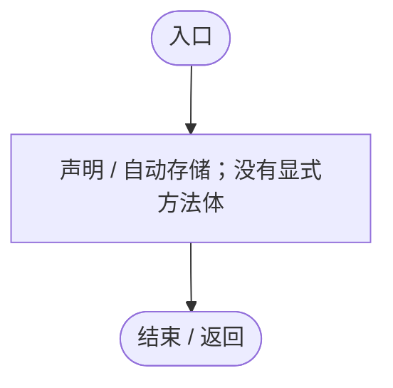
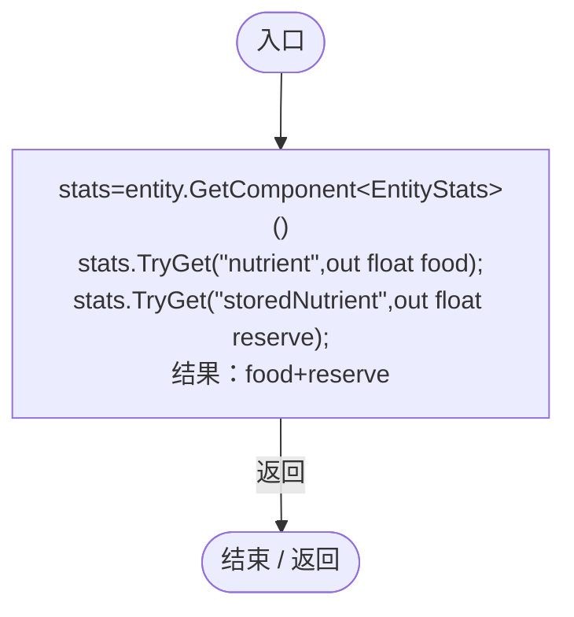
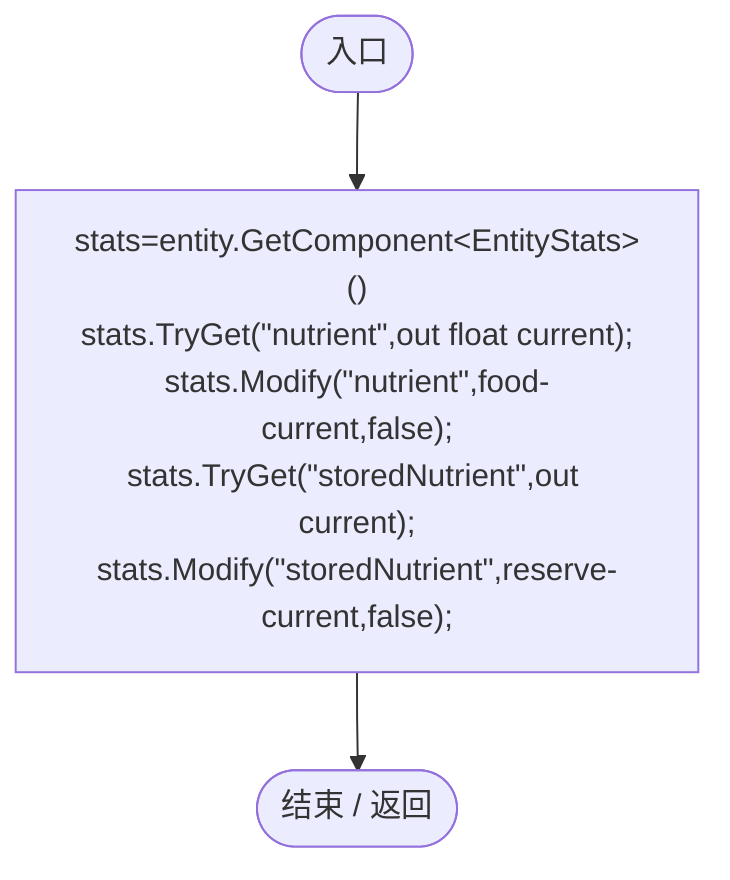
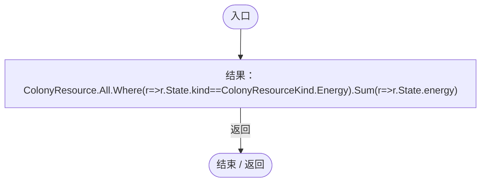
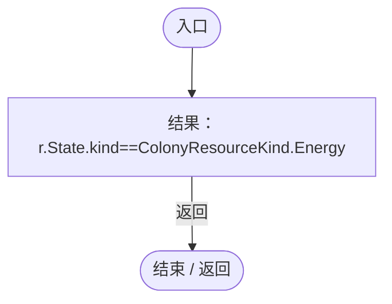
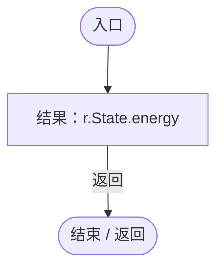
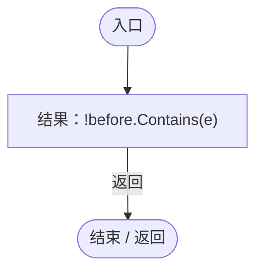
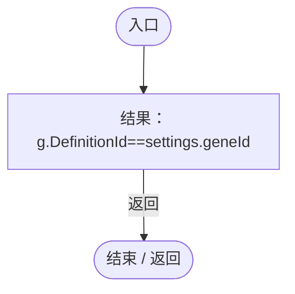
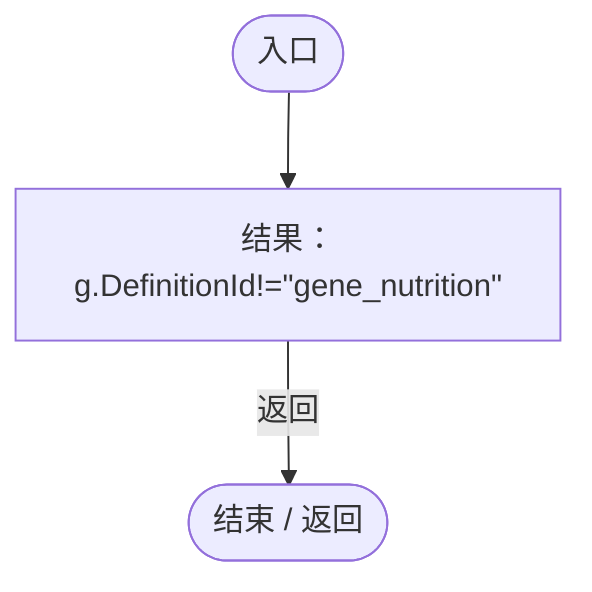

```mermaid
flowchart TD
  b0(["入口"])
  b1["view=EntityViewController.Instance<br/>input=view.GetComponent&lt;EntityPossessionInput&gt;()<br/>keys=view.GetComponent&lt;EnergyBlockInput&gt;()<br/>clock=ServiceLocator.Get&lt;SimulationClock&gt;()<br/>settings=NutrientUtilizationSettings.Current<br/>canvas=ServiceLocator…"]
  b2{"check<br/>判断：canvas.Find(&quot;EntityViewBar&quot;)==null"}
  b3["canvas.Find(&quot;BottomPanel/TabBar/AddColonyEnergy&quot;)==null"]
  b4["canvas.Find(&quot;EntityViewBar&quot;)==null"]
  b5["check(canvas.Find(&quot;EntityViewBar&quot;)==null&amp;&amp;canvas.Find(&quot;BottomPanel/TabBar/AddColonyEnergy&quot;)==null,&quot;操控提示栏和免费添加能量按钮均已移除&quot;);"]
  b6["input.SetCursorReleased(true);"]
  b7{"check<br/>判断：input.CursorReleased"}
  b8["Cursor.lockState==CursorLockMode.None"]
  b9["input.CursorReleased"]
  b10["check(input.CursorReleased&amp;&amp;Cursor.lockState==CursorLockMode.None,&quot;按住Alt释放鼠标&quot;);"]
  b11["input.SetCursorReleased(true);<br/>check(input.CursorReleased,&quot;Alt持续按住不会反复切换&quot;);<br/>input.SetCursorReleased(false);<br/>check(!input.CursorReleased,&quot;松开Alt恢复操控&quot;);<br/>clock.Play();<br/>check(!keys.HandleKey(KeyCode.E),&quot;旧E键免费补给入口已取消&quot;);<br/>check(!keys.HandleKey(K…"]
  b12{"check<br/>判断：definition!=null"}
  b13{"判断：definition.LogicScriptId==&quot;EnergyBlockGeneLogic&quot;"}
  b14["UIIconRegistry.Get(UIVisualTheme.GeneIcon(definition.Id))!=null"]
  b15["definition!=null&amp;&amp;definition.LogicScriptId==&quot;EnergyBlockGeneLogic&quot;&amp;&amp;UIIconRegistry.Get(UIVisualTheme.GeneIcon(definition.Id))!=null"]
  b16["check(definition!=null&amp;&amp;definition.LogicScriptId==&quot;EnergyBlockGeneLogic&quot;&amp;&amp;UIIconRegistry.Get(UIVisualTheme.GeneIcon(definition.Id))!=null,&quot;旧存档补齐独立营养利用基因及图标&quot;);"]
  b17{"up=EcologyQueries.Up(view.Target.transform.position)<br/>axis=Vector3.Cross(up,Vector3.forward).normalized<br/>判断：axis.sqrMagnitude&lt;.1f"}
  b18["axis=Vector3.Cross(up,Vector3.right).normalized;"]
  b19["point=EcologyQueries.Surface(view.Target.transform.position+axis*24)<br/>genome=new Genome()"]
  b20["new[]{&quot;gene_growth&quot;,&quot;gene_locomotion&quot;,settings.geneId}"]
  b21{"判断：new[]{&quot;gene_growth&quot;,&quot;gene_locomotion&quot;,settings.geneId}"}
  b22["var<br/>genome.Add(GeneInstance.Create(id,50,GeneDatabase.Get(id).Tier));"]
  b23{"new[]{&quot;gene_growth&quot;,&quot;gene_locomotion&quot;,settings.geneId}<br/>判断：new[]{&quot;gene_growth&quot;,&quot;gene_locomotion&quot;,settings.geneId}"}
  b24["new[]{&quot;gene_growth&quot;,&quot;gene_locomotion&quot;,settings.geneId}"]
  b25["连接 / 离开区域"]
  b26["before=EntityRegistry.All.ToArray()<br/>DarwinEntity.Spawner(genome,point,&quot;营养利用验证&quot;);<br/>actor=EntityRegistry.All.Single(e=&gt;!before.Contains(e))<br/>ActorId=EcologyIdentity.Of(actor);<br/>actor.Genes.mutationChance=0;<br/>actor.GetComponent&lt;EntityLifeCycle&gt;…"]
  b27{"check<br/>判断：metabolism!=null"}
  b28{"判断：metabolism.Active"}
  b29["actor.Genes.Genome.Genes.All(g=&gt;g.DefinitionId!=&quot;gene_nutrition&quot;)"]
  b30["metabolism!=null&amp;&amp;metabolism.Active&amp;&amp;actor.Genes.Genome.Genes.All(g=&gt;g.DefinitionId!=&quot;gene_nutrition&quot;)"]
  b31["check(metabolism!=null&amp;&amp;metabolism.Active&amp;&amp;actor.Genes.Genome.Genes.All(g=&gt;g.DefinitionId!=&quot;gene_nutrition&quot;),&quot;新基因可独立生效，不依赖营养生产基因或蚁群身份&quot;);"]
  b32["view.EnterView(actor);<br/>yield return null;<br/>Fill(actor,10,7);<br/>clock.Play();<br/>initial=Food(actor)<br/>energy=Energy()<br/>cost=actor.Genes.GetAttribute(settings.releaseAttribute)<br/>check(keys.HandleKey(KeyCode.Q),&quot;Q通过实际操控入口吐出能量块&quot;);<br/>stats=actor.GetComp…"]
  b33{"check<br/>判断：Mathf.Abs(Food(actor)+Energy()-initial-energy)&lt;.001f"}
  b34{"判断：Mathf.Abs(nutrient-10)&lt;.001f"}
  b35["Mathf.Abs(reserve-(7-cost))&lt;.001f"]
  b36["Mathf.Abs(Food(actor)+Energy()-initial-energy)&lt;.001f&amp;&amp;Mathf.Abs(nutrient-10)&lt;.001f&amp;&amp;Mathf.Abs(reserve-(7-cost))&lt;.001f"]
  b37["check(Mathf.Abs(Food(actor)+Energy()-initial-energy)&lt;.001f&amp;&amp;Mathf.Abs(nutrient-10)&lt;.001f&amp;&amp;Mathf.Abs(reserve-(7-cost))&lt;.001f,&quot;吐出优先扣储存营养，实体与块总能量守恒&quot;);"]
  b38["check(keys.HandleKey(KeyCode.Q),&quot;储备不足时允许补扣饱食度&quot;);<br/>stats.TryGet(&quot;storedNutrient&quot;,out reserve);"]
  b39{"check<br/>判断：reserve==0"}
  b40["Mathf.Abs(Food(actor)+Energy()-initial-energy)&lt;.001f"]
  b41["reserve==0"]
  b42["check(reserve==0&amp;&amp;Mathf.Abs(Food(actor)+Energy()-initial-energy)&lt;.001f,&quot;混合扣账不重复或凭空生成能量&quot;);"]
  b43["foodBefore=Food(actor)<br/>metabolism.Advance(.1f);<br/>check(Mathf.Abs(Food(actor)-foodBefore)&lt;.001f,&quot;吐出距离超过吸收半径，避免同帧自动吸回&quot;);<br/>gene.Enabled=false;<br/>actor.Genes.Recalculate();<br/>check(!keys.HandleKey(KeyCode.Q),&quot;禁用基因后不能吐出&quot;);<br/>gene.Enabled=true;<br/>gene.V…"]
  b44{"check<br/>判断：keys.HandleKey(KeyCode.Q)"}
  b45["Mathf.Abs(Energy()-energy)&lt;.001f"]
  b46["!keys.HandleKey(KeyCode.Q)"]
  b47["check(!keys.HandleKey(KeyCode.Q)&amp;&amp;Mathf.Abs(Energy()-energy)&lt;.001f,&quot;营养不足不生成任何块&quot;);"]
  b48["Fill(actor,10,7);<br/>clock.Pause();<br/>check(!keys.HandleKey(KeyCode.Q),&quot;暂停时Q不改变能量&quot;);<br/>clock.Play();<br/>GameInputGate.Blocked=true;<br/>check(!keys.HandleKey(KeyCode.Q),&quot;覆盖菜单屏蔽Q&quot;);<br/>GameInputGate.Blocked=false;<br/>input.SetCursorReleased(true);<br/>check(!key…"]
  b49{"判断：Food(actor)&lt;=3"}
  b50{"判断：Energy()&gt;=worldEnergy"}
  b51{"判断：actor==null"}
  b52{"判断：clock.GameTime-began&gt;25"}
  b53{"判断：EditorApplication.timeSinceStartup-start&gt;30"}
  b54["结果：new TimeoutException(&quot;普通实体没有实际移动并吸收通用能量块&quot;)"]
  x54(["抛出异常 / 离开方法"])
  b55["yield return null;"]
  b56["clock.Pause();"]
  b57{"check<br/>判断：EcologyQueries.Distance(origin,actor.transform.position)&gt;.2f"}
  b58{"判断：Food(actor)&gt;3"}
  b59["Energy()&lt;worldEnergy"]
  b60["EcologyQueries.Distance(origin,actor.transform.position)&gt;.2f&amp;&amp;Food(actor)&gt;3&amp;&amp;Energy()&lt;worldEnergy"]
  b61["check(EcologyQueries.Distance(origin,actor.transform.position)&gt;.2f&amp;&amp;Food(actor)&gt;3&amp;&amp;Energy()&lt;worldEnergy,&quot;普通实体在实际物理步中自动靠近并吸收能量块&quot;);"]
  b62["check(Mathf.Abs(Food(actor)-3+Energy()-worldEnergy)&lt;.02f,&quot;普通实体自动吸收保持能量守恒&quot;);"]
  b63{"check<br/>判断：view.EnterView(actor)"}
  b64["canvas.Find(&quot;EntityViewBar&quot;)==null"]
  b65["view.EnterView(actor)"]
  b66["check(view.EnterView(actor)&amp;&amp;canvas.Find(&quot;EntityViewBar&quot;)==null,&quot;重新进入操控仍不创建功能UI&quot;);"]
  b67["yield return null;"]
  b68(["结束 / 返回"])
  b0 --> b1
  b1 --> b2
  b2 -->|"是"| b3
  b2 -->|"否"| b4
  b3 --> b5
  b4 --> b5
  b5 --> b6
  b6 --> b7
  b7 -->|"是"| b8
  b7 -->|"否"| b9
  b8 --> b10
  b9 --> b10
  b10 --> b11
  b11 --> b12
  b12 -->|"是"| b13
  b12 -->|"否"| b15
  b13 -->|"是"| b14
  b13 -->|"否"| b15
  b14 --> b16
  b15 --> b16
  b16 --> b17
  b17 -->|"是"| b18
  b17 -->|"否"| b19
  b18 --> b19
  b19 --> b20
  b20 --> b21
  b21 -->|"是"| b22
  b21 -->|"否 · 经过finally 23"| b26
  b22 --> b21
  b23 -->|"否"| b24
  b23 -->|"是"| b25
  b24 --> b25
  b26 --> b27
  b27 -->|"是"| b28
  b27 -->|"否"| b30
  b28 -->|"是"| b29
  b28 -->|"否"| b30
  b29 --> b31
  b30 --> b31
  b31 --> b32
  b32 --> b33
  b33 -->|"是"| b34
  b33 -->|"否"| b36
  b34 -->|"是"| b35
  b34 -->|"否"| b36
  b35 --> b37
  b36 --> b37
  b37 --> b38
  b38 --> b39
  b39 -->|"是"| b40
  b39 -->|"否"| b41
  b40 --> b42
  b41 --> b42
  b42 --> b43
  b43 --> b44
  b44 -->|"否"| b45
  b44 -->|"是"| b46
  b45 --> b47
  b46 --> b47
  b47 --> b48
  b48 --> b49
  b49 -->|"否"| b50
  b49 -->|"是"| b51
  b50 -->|"是"| b51
  b50 -->|"否"| b56
  b51 -->|"否"| b52
  b51 -->|"是"| b54
  b52 -->|"否"| b53
  b52 -->|"是"| b54
  b53 -->|"是"| b54
  b53 -->|"否"| b55
  b54 -->|"Throw"| x54
  b55 --> b49
  b56 --> b57
  b57 -->|"是"| b58
  b57 -->|"否"| b60
  b58 -->|"是"| b59
  b58 -->|"否"| b60
  b59 --> b61
  b60 --> b61
  b61 --> b62
  b62 --> b63
  b63 -->|"是"| b64
  b63 -->|"否"| b65
  b64 --> b66
  b65 --> b66
  b66 --> b67
  b67 --> b68
  b21 -. "退出保护区时 finally（示意）" .-> b23

```

# NutrientUtilizationRegression.cs

[返回总索引](../README.md) · `Editor` · `Assets/DarwinPark/Editor/NutrientUtilizationRegression.cs`

[源文件](../../../Assets/DarwinPark/Editor/NutrientUtilizationRegression.cs) · 源码校验：`0db1022d303ab903d4e1239e5f280fc27932fb711dc46952076981bbb013c930`

方法按源文件位置排列。事件/回调引用不表示立即执行；分支与异常说明见总索引。完整源码与可点击关系图请打开离线手册。

## ActorId.get · L20

`get`

### Editor · 语法控制结构 / 声明（非CFG）

## ActorId.set · L20

`private set`

### Editor · 语法控制结构 / 声明（非CFG）

## Food · L21

`private static float Food(DarwinEntity entity)`

### Editor · Roslyn编译器控制流

项目内调用/回调引用：

- [EntityStats.TryGet · L90](75aa86a368efdf24.md#m24ee1433e4a70d94)（方法）

## Fill · L22

`private static void Fill(DarwinEntity entity,float food,float reserve)`

### Editor · Roslyn编译器控制流

项目内调用/回调引用：

- [EntityStats.TryGet · L90](75aa86a368efdf24.md#m24ee1433e4a70d94)（方法）
- [EntityStats.Modify · L111](75aa86a368efdf24.md#m9c837be197158240)（方法）

## Energy · L24

`private static float Energy()`

### Editor · Roslyn编译器控制流

项目内调用/回调引用：

- [NutrientUtilizationRegression.回调@24 · L24](5280b7c1dd3cc658.md#m03486d60e56d26a6)（回调/委托）
- [NutrientUtilizationRegression.回调@24 · L24](5280b7c1dd3cc658.md#mbb1d5dae9df50999)（回调/委托）

## 回调@24 · L24

`r … => 回调`

### Editor · Roslyn编译器控制流

项目内调用/回调引用：

- [ColonyResource.State.get · L22](293dbaecfff4b585.md#m341a1355f4d657bf)（访问器）

## 回调@24 · L24

`r … => 回调`

### Editor · Roslyn编译器控制流

项目内调用/回调引用：

- [ColonyResource.State.get · L22](293dbaecfff4b585.md#m341a1355f4d657bf)（访问器）

## Verify · L25

`public static IEnumerator Verify(Action<bool,string> check)`

### Editor · Roslyn编译器控制流

项目内调用/回调引用：

- [EntityViewController.Instance.get · L15](0ad0345f83229ef0.md#mb3b8144b56e80842)（访问器）
- [ServiceLocator.Get · L33](f2fdbe9f9ccd93cb.md#m2ae625299520c56d)（方法）
- [NutrientUtilizationSettings.Current.get · L17](276bc943280dcfce.md#mfa1e978a0be0644c)（访问器）
- [UIRoot.MainCanvas.get · L14](9c1421378791f0e0.md#maa2cc9baf1248477)（访问器）
- [EntityPossessionInput.SetCursorReleased · L82](4c12d3ae76941d37.md#m931bb1228af13972)（方法）
- [EntityPossessionInput.CursorReleased.get · L18](4c12d3ae76941d37.md#m4c0ff7787f8b0aa3)（访问器）
- [SimulationClock.Play · L78](a8f444aec9614b0a.md#m7aa9e64b7de60ed0)（方法）
- [EnergyBlockInput.HandleKey · L15](cbc301144604182a.md#m53f5b1a382b8417d)（方法）
- [SimulationClock.Pause · L79](a8f444aec9614b0a.md#m30929d45a885d0f1)（方法）
- [GeneDatabase.Get · L135](ec0a03483435a863.md#m8f3bbfb35f3ca397)（方法）
- [UIIconRegistry.Get · L38](5e97f4545b48cac2.md#m95da89c0db2bbab9)（方法）
- [UIVisualTheme.GeneIcon · L53](ca525a798a08f966.md#m3219debd95233e85)（方法）
- [EcologyQueries.Up · L41](bdf7ccc2c9c0452f.md#maca7070196f125fd)（方法）
- [EntityViewController.Target.get · L16](0ad0345f83229ef0.md#m87ca090092a884ab)（访问器）
- [EcologyQueries.Surface · L47](bdf7ccc2c9c0452f.md#m2f1f6873ee5fc8df)（方法）
- [Genome.Add · L19](a2ef23f865bc7ee8.md#md9cfdc94b8b8d40f)（方法）
- [GeneInstance.Create · L20](f82e1498d67f5afd.md#m72e94c278de3cf8b)（方法）
- [NutrientUtilizationRegression.ActorId.set · L20](5280b7c1dd3cc658.md#me901ac38b2879299)（访问器）
- [EcologyIdentity.Of · L21](bdf7ccc2c9c0452f.md#m1143cf9570a93b72)（方法）
- [DarwinEntity.Genes.get · L14](70798dde169f2e8b.md#m622eb1adf401d431)（访问器）
- [EntityLifeCycle.RestoreProgress · L48](9f4138bfbae654b7.md#mfc75121476d49679)（方法）
- [LifeCycleSettings.Load · L16](ace76969fe8f61de.md#mbd2925785484f343)（方法）
- [EntityGeneController.RestoreStageState · L51](7494d53178552f0e.md#m6264213de2a5ca6f)（方法）
- [EntityGeneController.Recalculate · L97](7494d53178552f0e.md#m65ea735c1e0e37a1)（方法）
- [EntityViewController.EnterView · L73](0ad0345f83229ef0.md#mbd7be6d2bbd0ec83)（方法）
- [NutrientUtilizationRegression.Fill · L22](5280b7c1dd3cc658.md#m38cc44dc1d013b8f)（方法）
- [NutrientUtilizationRegression.Food · L21](5280b7c1dd3cc658.md#m6181560c7cfbe087)（方法）
- [NutrientUtilizationRegression.Energy · L24](5280b7c1dd3cc658.md#mbc793853940e7515)（方法）
- [EntityGeneController.GetAttribute · L257](7494d53178552f0e.md#m600509f72d274f0c)（方法）
- [EntityStats.TryGet · L90](75aa86a368efdf24.md#m24ee1433e4a70d94)（方法）
- [EnergyBlockMetabolism.Advance · L34](123c1bf82bdb8ea2.md#m23d8a3e49e260c4c)（方法）
- [GameInputGate.Blocked.set · L8](52955daae7e592ab.md#m578697f6379686f4)（访问器）
- [EntityViewController.ExitView · L105](0ad0345f83229ef0.md#mca8619c7f27942c9)（方法）
- [SimulationClock.SetTimeScale · L81](a8f444aec9614b0a.md#mecaa463a0561aca3)（方法）
- [SimulationClock.GameTime.get · L23](a8f444aec9614b0a.md#m74adfa39a896652f)（访问器）
- [EcologyQueries.Distance · L42](bdf7ccc2c9c0452f.md#mba9c3e3c95d0f2dd)（方法）
- [NutrientUtilizationRegression.回调@37 · L37](5280b7c1dd3cc658.md#m05724be69db3c830)（回调/委托）
- [NutrientUtilizationRegression.回调@40 · L40](5280b7c1dd3cc658.md#m9da7e0b9d12724c0)（回调/委托）
- [NutrientUtilizationRegression.回调@41 · L41](5280b7c1dd3cc658.md#m12112eae52c2a1af)（回调/委托）

## 回调@37 · L37

`e … => 回调`

### Editor · Roslyn编译器控制流

## 回调@40 · L40

`g … => 回调`

### Editor · Roslyn编译器控制流

## 回调@41 · L41

`g … => 回调`

### Editor · Roslyn编译器控制流

