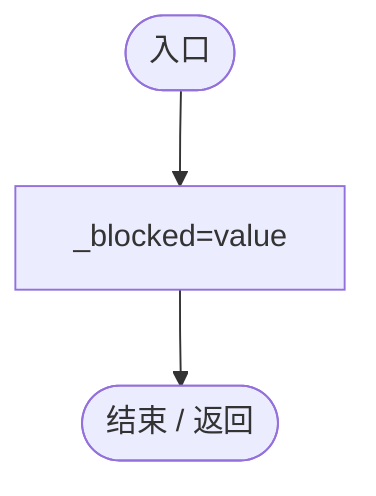
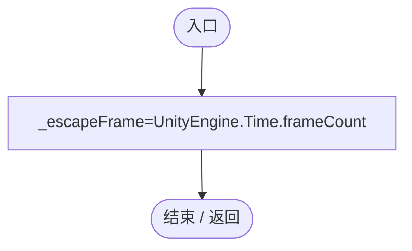
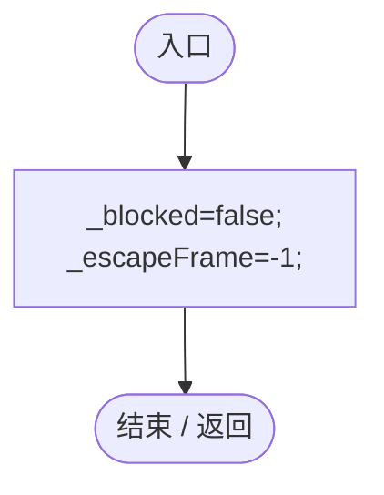

# GameInputGate.cs

[返回总索引](../README.md) · `Runtime` · `Assets/DarwinPark/Core/GameInputGate.cs`

[源文件](../../../Assets/DarwinPark/Core/GameInputGate.cs) · 源码校验：`a53778ddc995bdb3ddcd9c2e1ae69b11709616be042e07e14139a82eeed6276f`

方法按源文件位置排列。事件/回调引用不表示立即执行；分支与异常说明见总索引。完整源码与可点击关系图请打开离线手册。

## Blocked.get · L8

`get`

### Editor / Player · Roslyn编译器控制流

```mermaid
flowchart TD
  b0(["入口"])
  b1{"判断：_blocked"}
  b2["_escapeFrame==UnityEngine.Time.frameCount"]
  b3["_blocked"]
  b4["结果：_blocked &#124;&#124; _escapeFrame==UnityEngine.Time.frameCount"]
  b5(["结束 / 返回"])
  b0 --> b1
  b1 -->|"否"| b2
  b1 -->|"是"| b3
  b2 --> b4
  b3 --> b4
  b4 -->|"返回"| b5

```

## Blocked.set · L8

`set`

### Editor / Player · Roslyn编译器控制流

## ConsumeEscape · L9

`public static void ConsumeEscape()`

### Editor / Player · Roslyn编译器控制流

## Reset · L10

`[UnityEngine.RuntimeInitializeOnLoadMethod(UnityEngine.RuntimeInitializeLoadType.SubsystemRegistration)] private static void Reset()`

### Editor / Player · Roslyn编译器控制流

