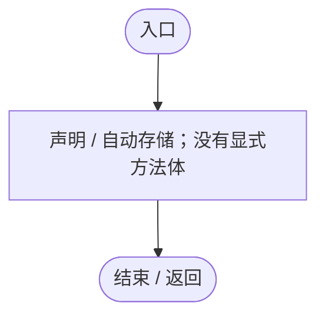
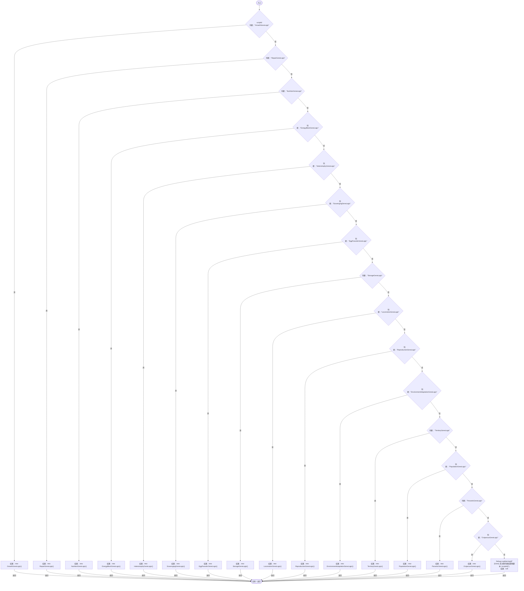

# GeneLogicRegistry.cs

[返回总索引](../README.md) · `Runtime` · `Assets/DarwinPark/Entities/Logic/GeneLogicRegistry.cs`

[源文件](../../../Assets/DarwinPark/Entities/Logic/GeneLogicRegistry.cs) · 源码校验：`e0cc1e784c9e89b43e309b958555fcb88d459161789fc3b8efc2d62573d3446a`

方法按源文件位置排列。事件/回调引用不表示立即执行；分支与异常说明见总索引。完整源码与可点击关系图请打开离线手册。

## Initialize · L8

`void Initialize(EntityGeneController controller, GeneInstance gene)`

### Editor / Player · 语法控制结构 / 声明（非CFG）

## OnUpdate · L9

`void OnUpdate(float deltaTime)`

### Editor / Player · 语法控制结构 / 声明（非CFG）

## GetTooltipInfo · L10

`string GetTooltipInfo()`

### Editor / Player · 语法控制结构 / 声明（非CFG）

## CreateLogic · L15

`public static IGeneLogic CreateLogic(string scriptId)`

### Editor / Player · Roslyn编译器控制流

