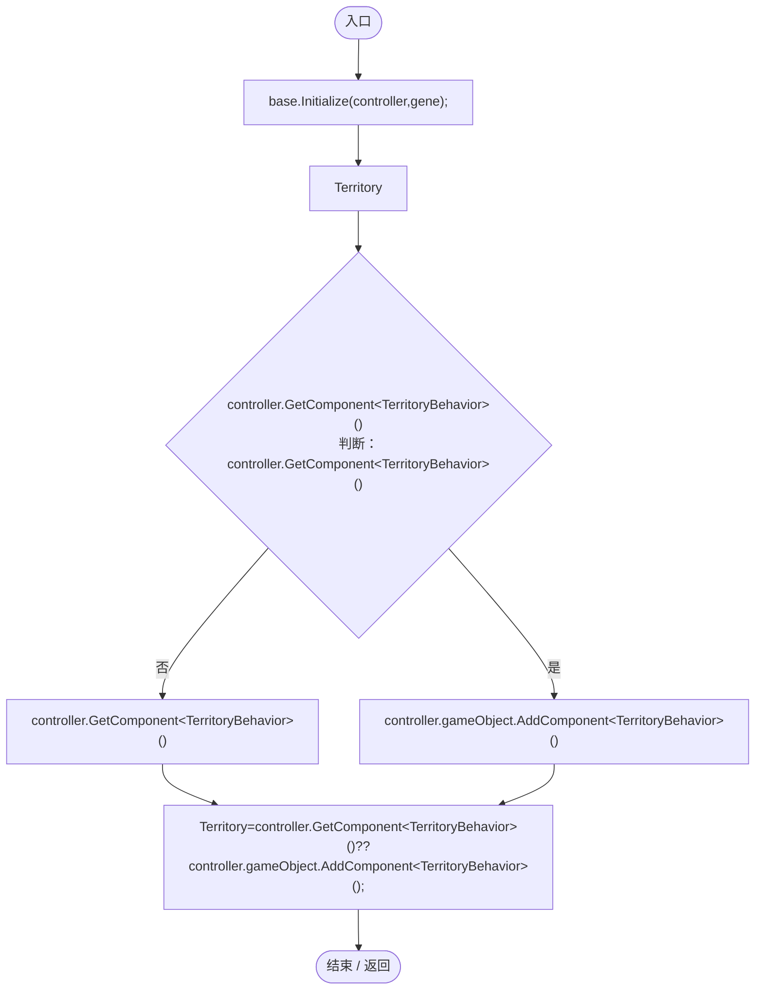
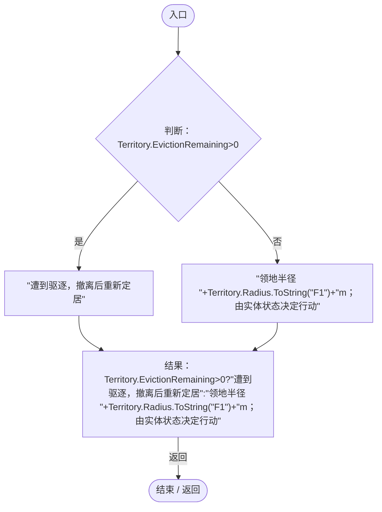

# TerritoryGeneLogic.cs

[返回总索引](../README.md) · `Runtime` · `Assets/DarwinPark/Entities/Logic/TerritoryGeneLogic.cs`

[源文件](../../../Assets/DarwinPark/Entities/Logic/TerritoryGeneLogic.cs) · 源码校验：`8c58fed42e3ff21353e8c29a1455e9d071267098ba6e80b8ade36eec778c42d8`

方法按源文件位置排列。事件/回调引用不表示立即执行；分支与异常说明见总索引。完整源码与可点击关系图请打开离线手册。

## Initialize · L9

`public override void Initialize(EntityGeneController controller,GeneInstance gene)`

### Editor / Player · Roslyn编译器控制流

项目内调用/回调引用：

- [LocomotionGeneLogic.Initialize · L21](50c563bf540685c7.md#m17501768a4397f9e)（方法）

## GetTooltipInfo · L12

`public override string GetTooltipInfo()`

★ 适配：避免提示把领地能力误写成始终巡逻，实际活动由独立实体状态决定。

### Editor / Player · Roslyn编译器控制流

项目内调用/回调引用：

- [TerritoryBehavior.EvictionRemaining.get · L11](19d504dcdc8bc624.md#m412b89a669c39b71)（访问器）
