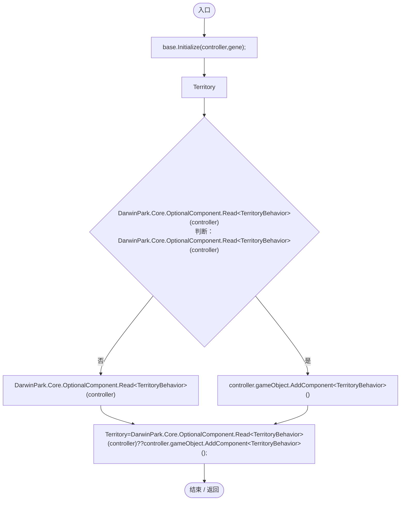
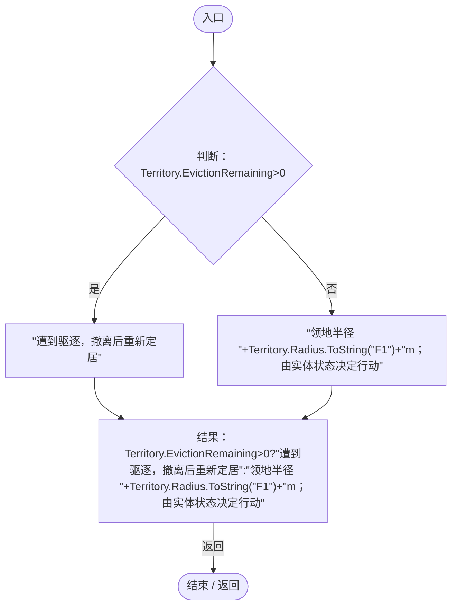

# TerritoryGeneLogic.cs

[返回总索引](../README.md) · `Runtime` · `Assets/DarwinPark/Entities/Logic/TerritoryGeneLogic.cs`

[源文件](../../../Assets/DarwinPark/Entities/Logic/TerritoryGeneLogic.cs) · 源码校验：`40db0f2e277eec4d11265718090dbd87af2c50fc643c8b367de7e846ae995636`

方法按源文件位置排列。事件/回调引用不表示立即执行；分支与异常说明见总索引。完整源码与可点击关系图请打开离线手册。

## Initialize · L10

`public override void Initialize(EntityGeneController controller,GeneInstance gene)`

### Editor / Player · Roslyn编译器控制流

项目内调用/回调引用：

- [LocomotionGeneLogic.Initialize · L26](50c563bf540685c7.md#m000716623a8bdfa1)（方法）
- [OptionalComponent.Read · L7](806c46b42ced4d36.md#m69622a4dee165c5a)（方法）

## GetTooltipInfo · L13

`public override string GetTooltipInfo()`

★ 适配：避免提示把领地能力误写成始终巡逻，实际活动由独立实体状态决定。

### Editor / Player · Roslyn编译器控制流

项目内调用/回调引用：

- [TerritoryBehavior.EvictionRemaining.get · L12](19d504dcdc8bc624.md#m737a47b8e966cdb5)（访问器）
