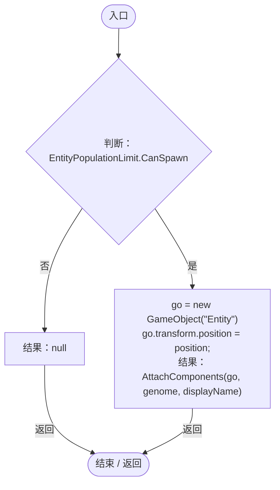
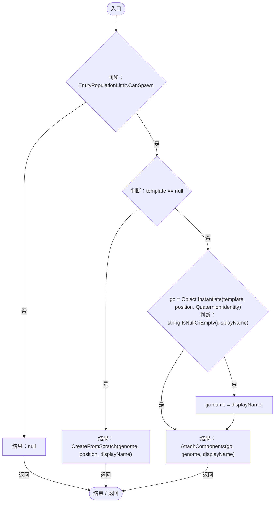

```mermaid
flowchart TD
  b0(["入口"])
  b1{"col = go.GetComponent&lt;Collider&gt;()<br/>判断：col == null"}
  b2["col = go.AddComponent&lt;SphereCollider&gt;();"]
  b3["col.isTrigger = false;"]
  b4{"go.GetComponent&lt;DarwinEntity&gt;()<br/>判断：go.GetComponent&lt;DarwinEntity&gt;()"}
  b5["go.GetComponent&lt;DarwinEntity&gt;()"]
  b6["go.AddComponent&lt;DarwinEntity&gt;()"]
  b7["entity = go.GetComponent&lt;DarwinEntity&gt;() ?? go.AddComponent&lt;DarwinEntity&gt;()"]
  b8{"genes = go.GetComponent&lt;EntityGeneController&gt;()<br/>判断：genes == null"}
  b9["genes = go.AddComponent&lt;EntityGeneController&gt;();"]
  b10{"判断：genome != null"}
  b11{"判断：genome.Genes.Count &gt; 0"}
  b12["genes.Genome = genome;"]
  b13{"判断：string.IsNullOrEmpty(displayName)"}
  b14["displayName = genes.GetRandomName();"]
  b15{"entity.DisplayName = displayName;<br/>判断：go.GetComponent&lt;EntityStats&gt;() == null"}
  b16["go.AddComponent&lt;EntityStats&gt;();"]
  b17{"判断：go.GetComponent&lt;EntityVitals&gt;() == null"}
  b18["go.AddComponent&lt;EntityVitals&gt;();"]
  b19{"判断：go.GetComponent&lt;EntityEnvironmentHazard&gt;() == null"}
  b20["go.AddComponent&lt;EntityEnvironmentHazard&gt;();"]
  b21{"判断：go.GetComponent&lt;EntityAIController&gt;() == null"}
  b22["go.AddComponent&lt;EntityAIController&gt;();"]
  b23{"rb = go.GetComponent&lt;Rigidbody&gt;()<br/>判断：rb == null"}
  b24["rb = go.AddComponent&lt;Rigidbody&gt;();"]
  b25{"rb.mass = 1f;<br/>rb.linearDamping = 0.5f;<br/>rb.angularDamping = 5f;<br/>gravity = go.GetComponent&lt;PlanetGravity&gt;()<br/>判断：gravity == null"}
  b26["gravity = go.AddComponent&lt;PlanetGravity&gt;();"]
  b27{"gravity.baseGravity = 15f;<br/>判断：go.GetComponent&lt;EntitySurfaceAnchor&gt;() == null"}
  b28["go.AddComponent&lt;EntitySurfaceAnchor&gt;();"]
  b29{"genes.Recalculate();<br/>判断：go.GetComponent&lt;EntityLifeCycle&gt;()==null"}
  b30["go.AddComponent&lt;EntityLifeCycle&gt;();"]
  b31["结果：entity"]
  b32(["结束 / 返回"])
  b0 --> b1
  b1 -->|"是"| b2
  b1 -->|"否"| b3
  b2 --> b3
  b3 --> b4
  b4 -->|"否"| b5
  b4 -->|"是"| b6
  b5 --> b7
  b6 --> b7
  b7 --> b8
  b8 -->|"是"| b9
  b8 -->|"否"| b10
  b9 --> b10
  b10 -->|"是"| b11
  b10 -->|"否"| b13
  b11 -->|"是"| b12
  b11 -->|"否"| b13
  b12 --> b13
  b13 -->|"是"| b14
  b13 -->|"否"| b15
  b14 --> b15
  b15 -->|"是"| b16
  b15 -->|"否"| b17
  b16 --> b17
  b17 -->|"是"| b18
  b17 -->|"否"| b19
  b18 --> b19
  b19 -->|"是"| b20
  b19 -->|"否"| b21
  b20 --> b21
  b21 -->|"是"| b22
  b21 -->|"否"| b23
  b22 --> b23
  b23 -->|"是"| b24
  b23 -->|"否"| b25
  b24 --> b25
  b25 -->|"是"| b26
  b25 -->|"否"| b27
  b26 --> b27
  b27 -->|"是"| b28
  b27 -->|"否"| b29
  b28 --> b29
  b29 -->|"是"| b30
  b29 -->|"否"| b31
  b30 --> b31
  b31 -->|"返回"| b32

```

# EntityFactory.cs

[返回总索引](../README.md) · `Runtime` · `Assets/DarwinPark/GameRoot/EntityFactory.cs`

[源文件](../../../Assets/DarwinPark/GameRoot/EntityFactory.cs) · 源码校验：`6625a885e114078c38a30b3b8bf4c0dce0e124a283b06f90c923942f1bfcacd2`

方法按源文件位置排列。事件/回调引用不表示立即执行；分支与异常说明见总索引。完整源码与可点击关系图请打开离线手册。

## CreateFromScratch · L13

`public static DarwinEntity CreateFromScratch(Genome genome, Vector3 position, string displayName)`

### Editor / Player · Roslyn编译器控制流

项目内调用/回调引用：

- [EntityFactory.AttachComponents · L33](54fcd89ef79d04f6.md#mb3b9a103bd797020)（方法）

## CreateFromTemplate · L22

`public static DarwinEntity CreateFromTemplate(GameObject template, Genome genome, Vector3 position, string displayName)`

### Editor / Player · Roslyn编译器控制流

项目内调用/回调引用：

- [EntityFactory.CreateFromScratch · L13](54fcd89ef79d04f6.md#m2e808e57fb3995c8)（方法）
- [EntityFactory.AttachComponents · L33](54fcd89ef79d04f6.md#mb3b9a103bd797020)（方法）

## AttachComponents · L33

`private static DarwinEntity AttachComponents(GameObject go, Genome genome, string displayName)`

### Editor / Player · Roslyn编译器控制流

项目内调用/回调引用：

- [EntityGeneController.GetRandomName · L242](7494d53178552f0e.md#meef08ed0f4b99e2d)（方法）
- [EntityGeneController.Recalculate · L97](7494d53178552f0e.md#m65ea735c1e0e37a1)（方法）
