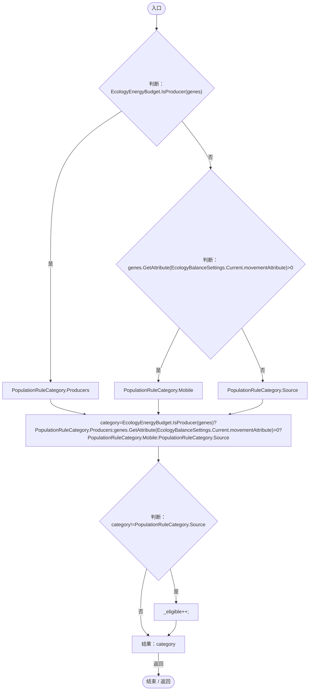
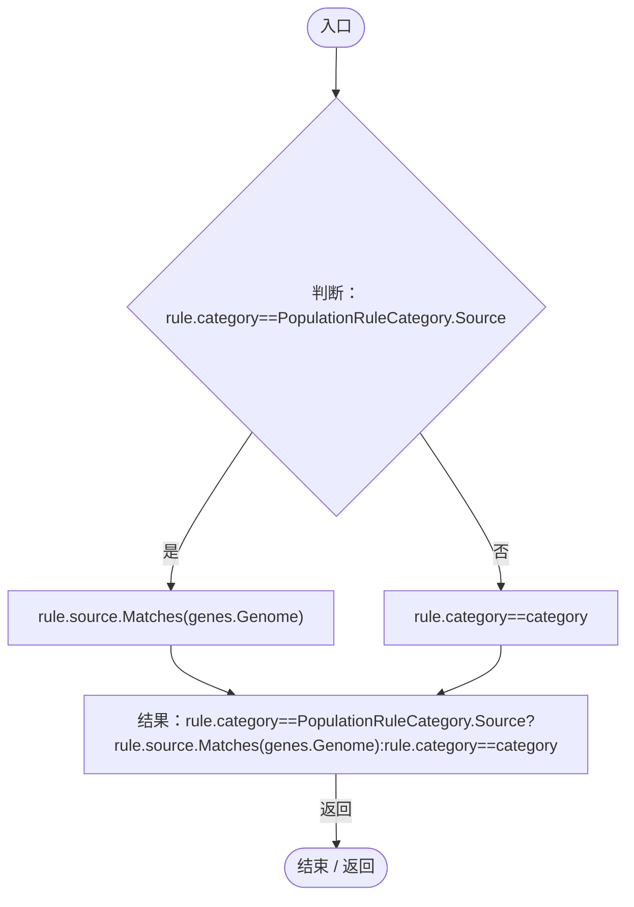
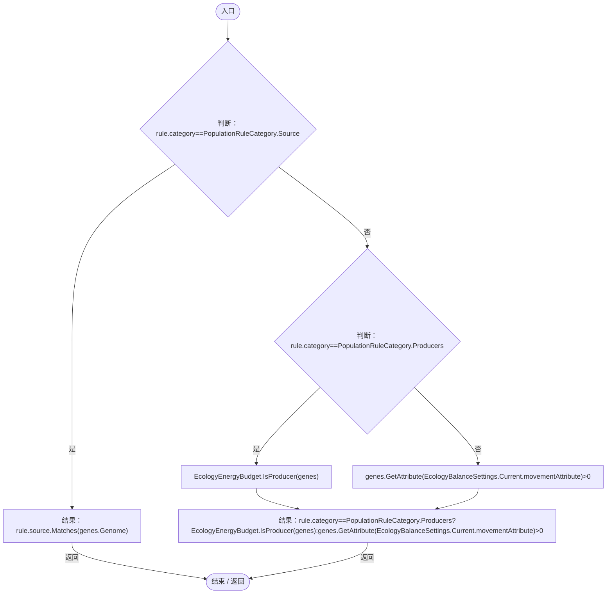
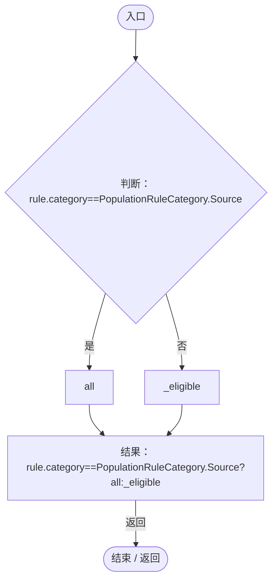
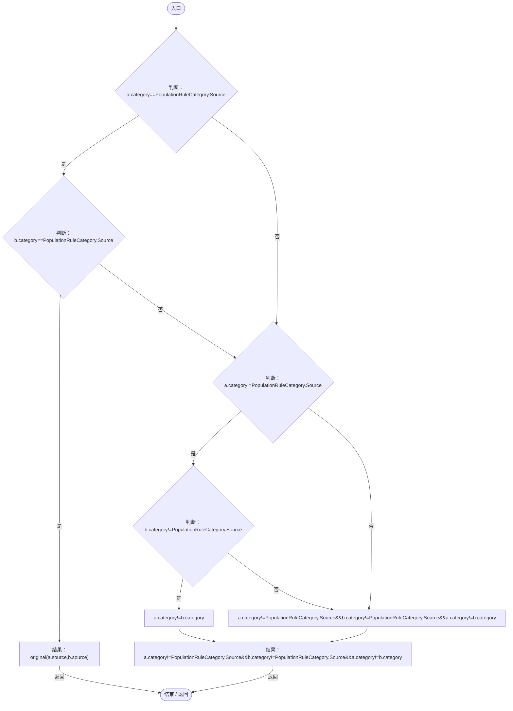
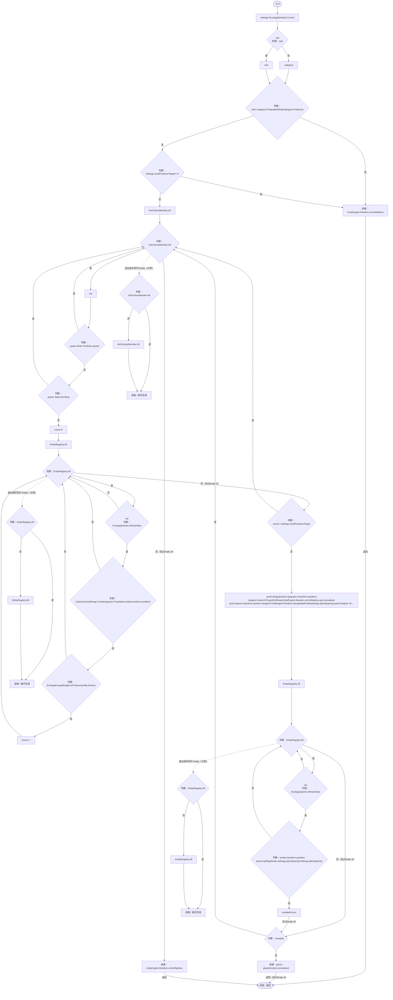

# EcologyMaintenancePolicy.cs

[返回总索引](../README.md) · `Runtime` · `Assets/DarwinPark/Entities/Ecology/EcologyMaintenancePolicy.cs`

[源文件](../../../Assets/DarwinPark/Entities/Ecology/EcologyMaintenancePolicy.cs) · 源码校验：`7fde91f77c771d237b7b3cf04a0cdbd6d3425f9d02b453c5c308cd27237b832e`

方法按源文件位置排列。事件/回调引用不表示立即执行；分支与异常说明见总索引。完整源码与可点击关系图请打开离线手册。

## ResetCounts · L12

`public static void ResetCounts()`

### Editor / Player · Roslyn编译器控制流

## Observe · L13

`public static PopulationRuleCategory Observe(EntityGeneController genes)`

### Editor / Player · Roslyn编译器控制流

项目内调用/回调引用：

- [EcologyEnergyBudget.IsProducer · L26](06a91c8201f26593.md#m4f70d9cadaa1bc5c)（方法）
- [EntityGeneController.GetAttribute · L282](7494d53178552f0e.md#mc3503e198ec80ff1)（方法）
- [EcologyBalanceSettings.Current.get · L29](5a37bc79f15f6238.md#md33d4c4b8f82540b)（访问器）

## Matches · L18

`public static bool Matches(PopulationMaintenanceRule rule,EntityGeneController genes,PopulationRuleCategory category)`

### Editor / Player · Roslyn编译器控制流

项目内调用/回调引用：

- [RandomSpawnRecipe.Matches · L34](923ccc4e86c4786c.md#mb2348b1f360c1cce)（方法）

## Matches · L20

`public static bool Matches(PopulationMaintenanceRule rule,EntityGeneController genes)`

### Editor / Player · Roslyn编译器控制流

项目内调用/回调引用：

- [RandomSpawnRecipe.Matches · L34](923ccc4e86c4786c.md#mb2348b1f360c1cce)（方法）
- [EcologyEnergyBudget.IsProducer · L26](06a91c8201f26593.md#m4f70d9cadaa1bc5c)（方法）
- [EntityGeneController.GetAttribute · L282](7494d53178552f0e.md#mc3503e198ec80ff1)（方法）
- [EcologyBalanceSettings.Current.get · L29](5a37bc79f15f6238.md#md33d4c4b8f82540b)（访问器）

## Denominator · L25

`public static int Denominator(PopulationMaintenanceRule rule,int all)`

### Editor / Player · Roslyn编译器控制流

## Disjoint · L26

`public static bool Disjoint(PopulationMaintenanceRule a,PopulationMaintenanceRule b,Func<RandomSpawnRecipe,RandomSpawnRecipe,bool> original)`

### Editor / Player · Roslyn编译器控制流

## Describe · L31

`public static string Describe(PopulationMaintenanceRule rule)`

### Editor / Player · Roslyn编译器控制流

## SpawnDirection · L33

`public static Vector3 SpawnDirection(PopulationMaintenanceRule rule,Vector3 planetCenter)`

★ 新增：默认生产者优先投放到缺少植物的定居蚁群活动区，仍由原地形射线检查陆地，不能在空中/海底硬生成。

### Editor / Player · Roslyn编译器控制流

项目内调用/回调引用：

- [EcologyDefaults.Current.get · L35](5b565b57de741d98.md#m75cb60b88e3cc1c7)（访问器）
- [AntColonyMember.Role.get · L38](baebd85c05598377.md#mab30d459d599e4df)（访问器）
- [AntColonyMember.State.get · L32](baebd85c05598377.md#m426db6a7c12dd7aa)（访问器）
- [EcologyQueries.Alive · L38](bdf7ccc2c9c0452f.md#mb2877c487f449970)（方法）
- [ColonyActivityRange.Contains · L21](e8d854132f563257.md#m535d817473d6a256)（方法）
- [AntColonyMember.Population.get · L35](baebd85c05598377.md#mbb8ec90c4baa2d1c)（访问器）
- [EcologyEnergyBudget.IsProducer · L26](06a91c8201f26593.md#m4f70d9cadaa1bc5c)（方法）
- [DarwinEntity.Genes.get · L14](70798dde169f2e8b.md#m622eb1adf401d431)（访问器）
- [EcologyQueries.Up · L41](bdf7ccc2c9c0452f.md#maca7070196f125fd)（方法）
