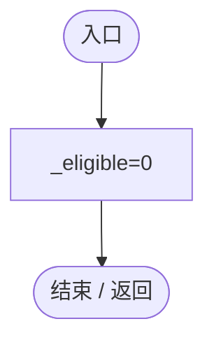
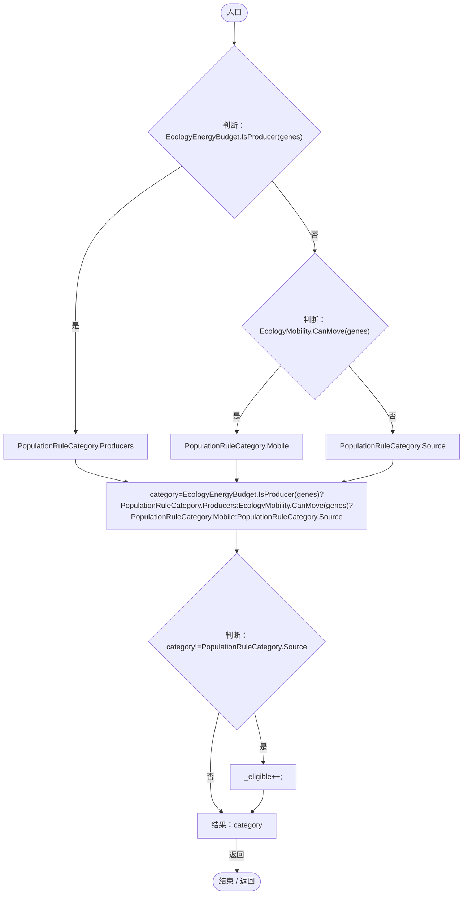
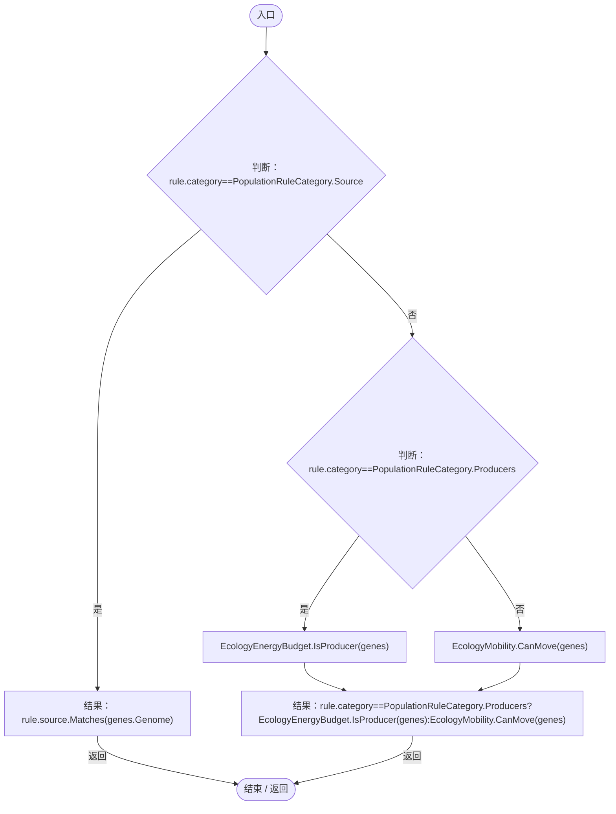
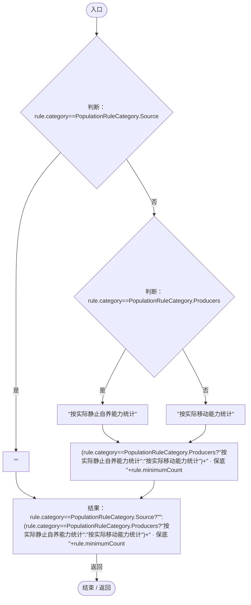
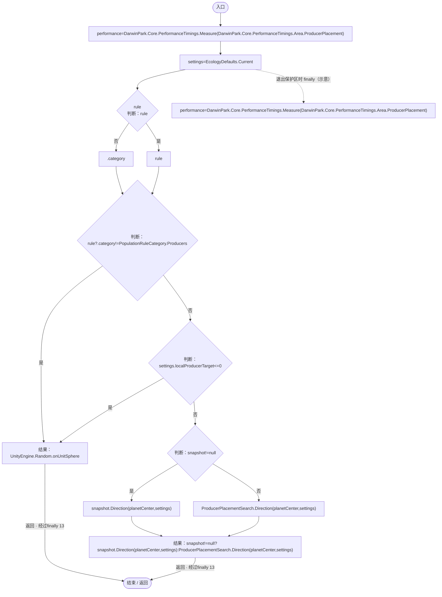

# EcologyMaintenancePolicy.cs

[返回总索引](../README.md) · `Runtime` · `Assets/DarwinPark/Entities/Ecology/EcologyMaintenancePolicy.cs`

[源文件](../../../Assets/DarwinPark/Entities/Ecology/EcologyMaintenancePolicy.cs) · 源码校验：`bcc9ffe630b48cbdf8c8b98f83d8c7663c53789a2a0296dd52c39c13982b2a63`

方法按源文件位置排列。事件/回调引用不表示立即执行；分支与异常说明见总索引。完整源码与可点击关系图请打开离线手册。

## ResetCounts · L12

`public static void ResetCounts()`

### Editor / Player · Roslyn编译器控制流

## Observe · L13

`public static PopulationRuleCategory Observe(EntityGeneController genes)`

### Editor / Player · Roslyn编译器控制流

项目内调用/回调引用：

- [EcologyEnergyBudget.IsProducer · L27](06a91c8201f26593.md#mdf11c493dfe1c754)（方法）
- [EcologyMobility.CanMove · L6](5cf9761659037d31.md#m9806988ade82d499)（方法）

## Matches · L18

`public static bool Matches(PopulationMaintenanceRule rule,EntityGeneController genes,PopulationRuleCategory category)`

### Editor / Player · Roslyn编译器控制流

项目内调用/回调引用：

- [RandomSpawnRecipe.Matches · L34](923ccc4e86c4786c.md#mb2348b1f360c1cce)（方法）

## Matches · L20

`public static bool Matches(PopulationMaintenanceRule rule,EntityGeneController genes)`

### Editor / Player · Roslyn编译器控制流

项目内调用/回调引用：

- [RandomSpawnRecipe.Matches · L34](923ccc4e86c4786c.md#mb2348b1f360c1cce)（方法）
- [EcologyEnergyBudget.IsProducer · L27](06a91c8201f26593.md#mdf11c493dfe1c754)（方法）
- [EcologyMobility.CanMove · L6](5cf9761659037d31.md#m9806988ade82d499)（方法）

## Denominator · L25

`public static int Denominator(PopulationMaintenanceRule rule,int all)`

### Editor / Player · Roslyn编译器控制流

## Disjoint · L26

`public static bool Disjoint(PopulationMaintenanceRule a,PopulationMaintenanceRule b,Func<RandomSpawnRecipe,RandomSpawnRecipe,bool> original)`

### Editor / Player · Roslyn编译器控制流

## Describe · L31

`public static string Describe(PopulationMaintenanceRule rule)`

### Editor / Player · Roslyn编译器控制流

## SpawnDirection · L33

`public static Vector3 SpawnDirection(PopulationMaintenanceRule rule,Vector3 planetCenter,ProducerPlacementSnapshot snapshot=null)`

★ 新增：默认生产者优先投放到缺少植物的定居蚁群活动区，仍由原地形射线检查陆地，不能在空中/海底硬生成。

### Editor / Player · Roslyn编译器控制流

项目内调用/回调引用：

- [PerformanceTimings.Measure · L25](a8403a4c7503726d.md#m36fde3c234084192)（方法）
- [EcologyDefaults.Current.get · L35](5b565b57de741d98.md#m75cb60b88e3cc1c7)（访问器）
- [ProducerPlacementSnapshot.Direction · L35](94d51265e18d4726.md#m8842824e6d6626a9)（方法）
- [ProducerPlacementSearch.Direction · L7](68c6f349d3942cc4.md#m5d2dee60f3f248af)（方法）
