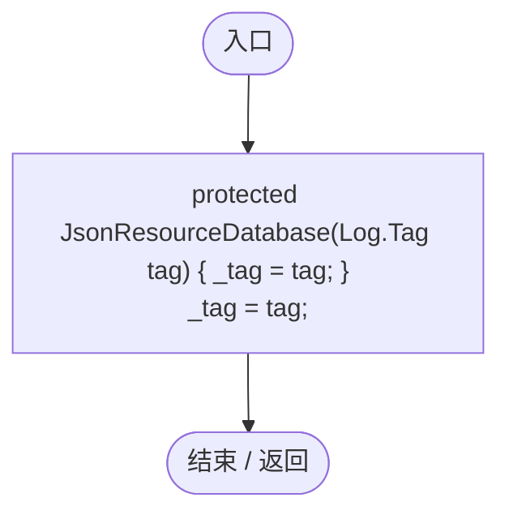
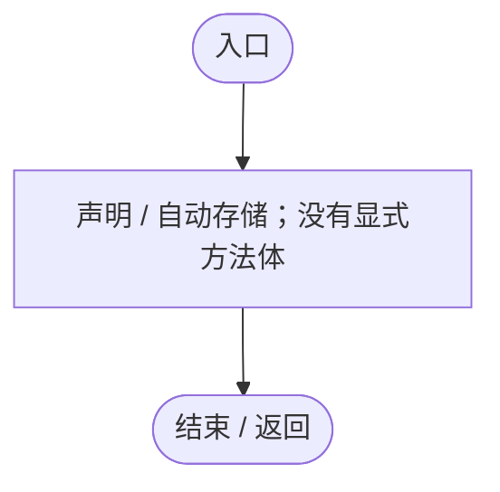
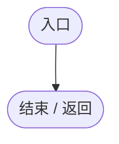
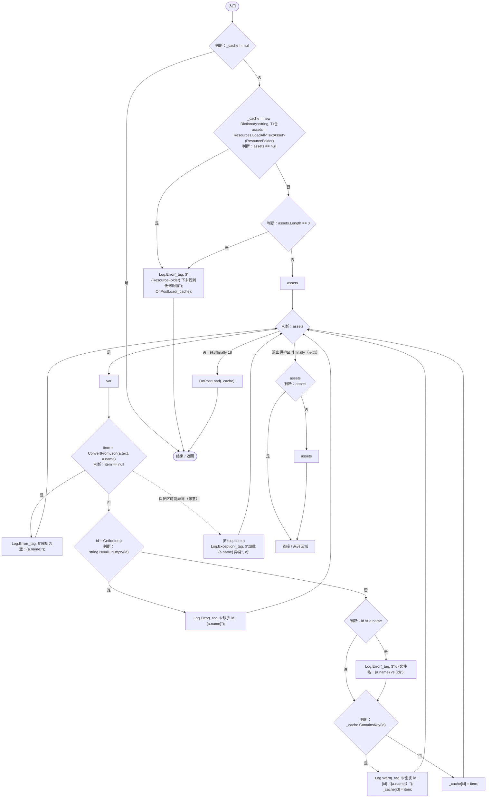
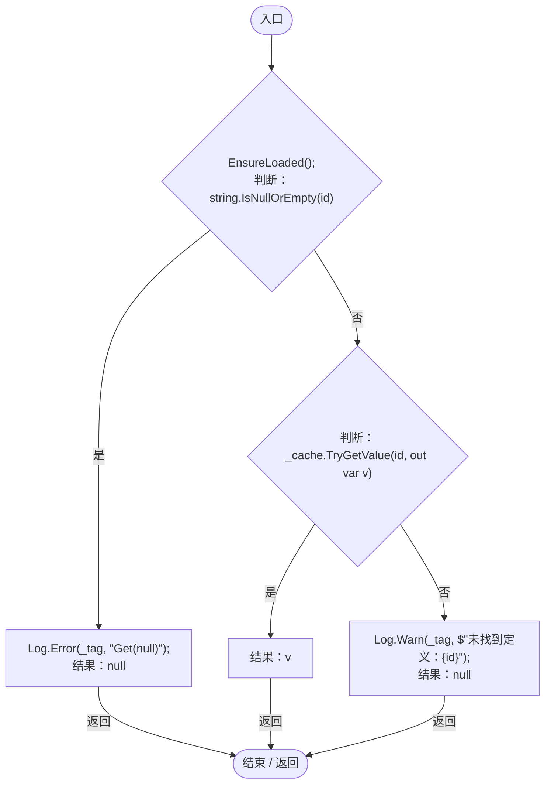
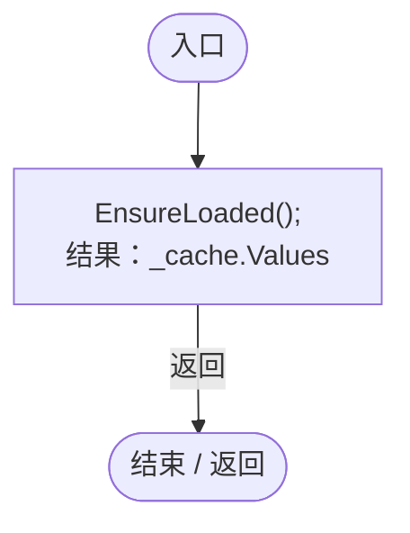
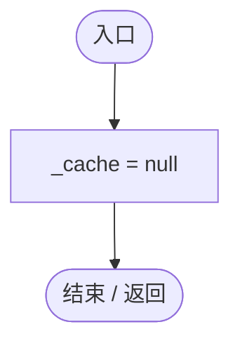
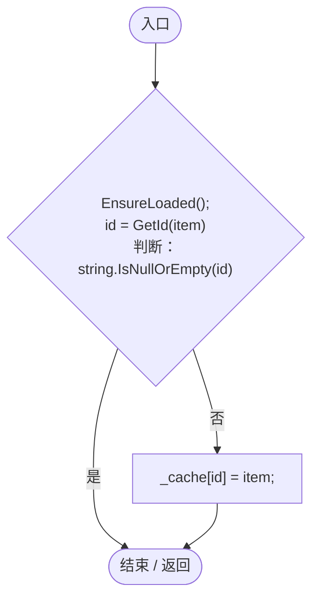

# JsonResourceDatabase.cs

[返回总索引](../README.md) · `Runtime` · `Assets/DarwinPark/Core/Data/JsonResourceDatabase.cs`

[源文件](../../../Assets/DarwinPark/Core/Data/JsonResourceDatabase.cs) · 源码校验：`a7fe1abaf0a3d166ac1002f559b6958d7e5cf5ad51bc80a25b633b06e679c4a7`

方法按源文件位置排列。事件/回调引用不表示立即执行；分支与异常说明见总索引。完整源码与可点击关系图请打开离线手册。

## JsonResourceDatabase.ctor · L17

`protected JsonResourceDatabase(Log.Tag tag)`

### Editor / Player · Roslyn编译器控制流

## ResourceFolder.get · L19

`get`

### Editor / Player · 语法控制结构 / 声明（非CFG）

## GetId · L20

`protected abstract string GetId(T item)`

### Editor / Player · 语法控制结构 / 声明（非CFG）

## ConvertFromJson · L21

`protected abstract T ConvertFromJson(string jsonText, string assetName)`

### Editor / Player · 语法控制结构 / 声明（非CFG）

## OnPostLoad · L22

`protected virtual void OnPostLoad(IReadOnlyDictionary<string, T> all)`

### Editor / Player · Roslyn编译器控制流

## EnsureLoaded · L24

`public void EnsureLoaded()`

### Editor / Player · Roslyn编译器控制流

项目内调用/回调引用：

- [JsonResourceDatabase.ResourceFolder.get · L19](55a3ec07ee308cf8.md#ma3baf7f4ebd91f07)（访问器）
- [Log.Error · L43](735e5abf0df2bddc.md#m2addd5e1d74b000d)（方法）
- [JsonResourceDatabase.OnPostLoad · L22](55a3ec07ee308cf8.md#m7c16e1e10c907b04)（方法）
- [JsonResourceDatabase.ConvertFromJson · L21](55a3ec07ee308cf8.md#mb556c7a5dd7d8ea1)（方法）
- [JsonResourceDatabase.GetId · L20](55a3ec07ee308cf8.md#m1c90341630a020c8)（方法）
- [Log.Warn · L37](735e5abf0df2bddc.md#m25a5d11252901de1)（方法）
- [Log.Exception · L48](735e5abf0df2bddc.md#m523652bd455f6a6f)（方法）

## Get · L69

`public T Get(string id)`

### Editor / Player · Roslyn编译器控制流

项目内调用/回调引用：

- [JsonResourceDatabase.EnsureLoaded · L24](55a3ec07ee308cf8.md#m34d10da4f0c7dd13)（方法）
- [Log.Error · L43](735e5abf0df2bddc.md#m2addd5e1d74b000d)（方法）
- [Log.Warn · L37](735e5abf0df2bddc.md#m25a5d11252901de1)（方法）

## All.get · L78

`get`

### Editor / Player · Roslyn编译器控制流

项目内调用/回调引用：

- [JsonResourceDatabase.EnsureLoaded · L24](55a3ec07ee308cf8.md#m34d10da4f0c7dd13)（方法）

## Reload · L80

`public void Reload()`

### Editor / Player · Roslyn编译器控制流

## Seed · L82

`public void Seed(T item)`

### Editor / Player · Roslyn编译器控制流

项目内调用/回调引用：

- [JsonResourceDatabase.EnsureLoaded · L24](55a3ec07ee308cf8.md#m34d10da4f0c7dd13)（方法）
- [JsonResourceDatabase.GetId · L20](55a3ec07ee308cf8.md#m1c90341630a020c8)（方法）
