# EntityResourcePlan.cs

[返回总索引](../README.md) · `Runtime` · `Assets/DarwinPark/Entities/Ecology/EntityResourcePlan.cs`

[源文件](../../../Assets/DarwinPark/Entities/Ecology/EntityResourcePlan.cs) · 源码校验：`ff37963b6b24eac4ec7bc932fdcd91493eaf71604f7317e1026bfb47b43659a8`

方法按源文件位置排列。事件/回调引用不表示立即执行；分支与异常说明见总索引。完整源码与可点击关系图请打开离线手册。

<a id="m8a943eb46bc10aae"></a>

## IsEmpty.get · L11

`public bool IsEmpty`


### Editor / Player · 语法控制结构 / 声明（非CFG）

```mermaid
flowchart TD
  n2(["入口"])
  n1["(energy==null&#124;&#124;energy.Count==0)&amp;&amp;(corpses==null&#124;&#124;corpses.Count==0)&amp;&amp;energyScan==0&amp;&amp;corpseScan==0"]
  n0(["结束 / 返回"])
  n1 --> n0
  n2 --> n1

```

<a id="m64c8ae125a394115"></a>

## Get · L18

`private static Context Get(EntityGeneController genes)`


### Editor / Player · Roslyn编译器控制流

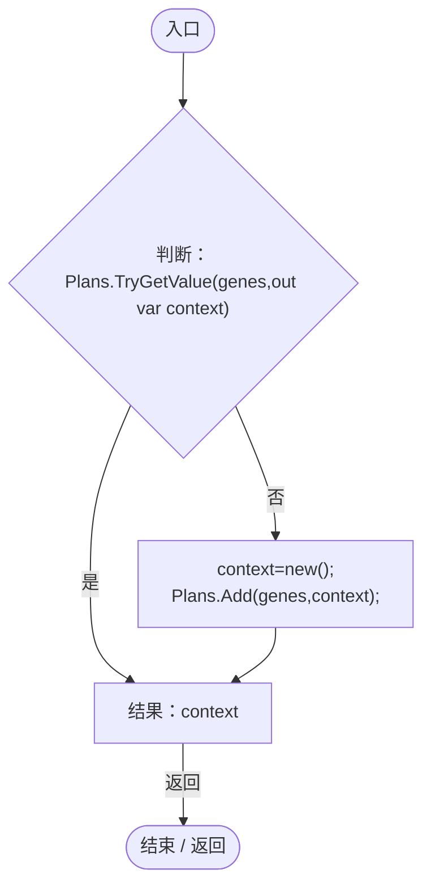

<a id="m722bfeae41676288"></a>

## TickEnergy · L19

`public static void TickEnergy(EntityGeneController genes,float dt)`


### Editor / Player · Roslyn编译器控制流

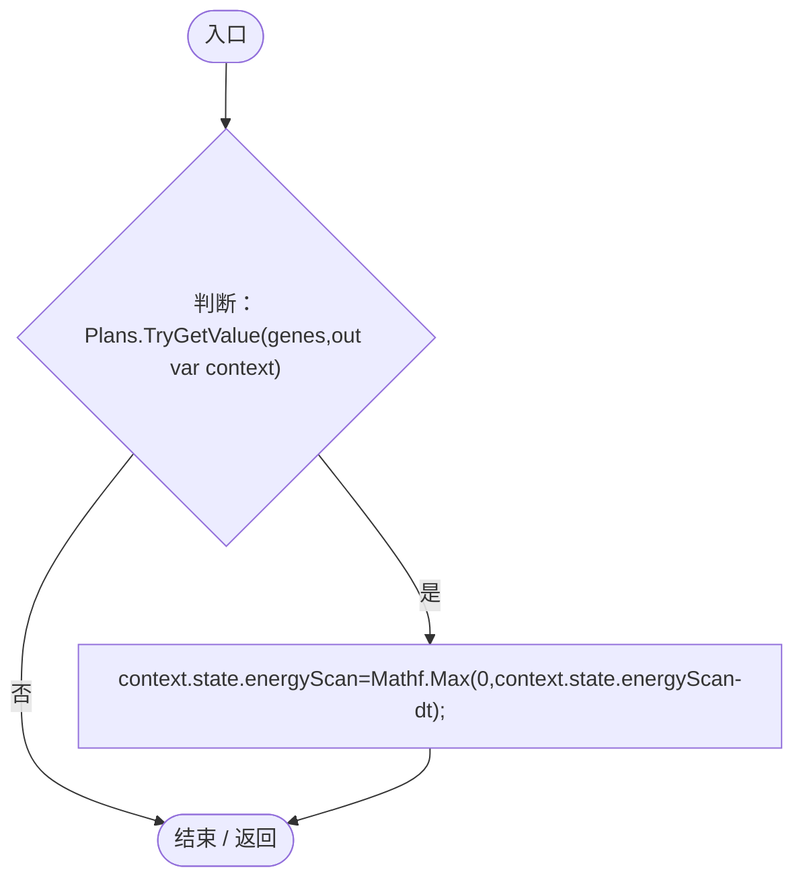

<a id="mb624be37bf7b1104"></a>

## TickCorpse · L20

`public static void TickCorpse(EntityGeneController genes,float dt)`


### Editor / Player · Roslyn编译器控制流

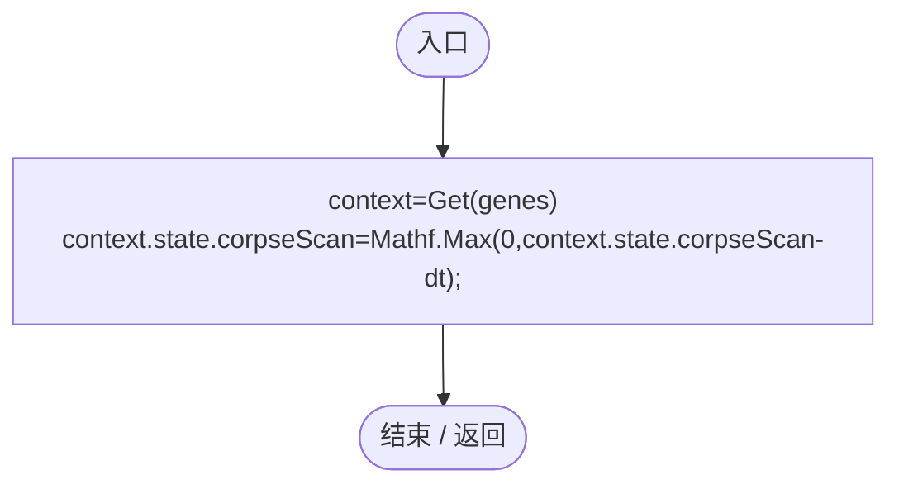

项目内调用/回调引用：

- [EntityResourcePlan.Get · L18](569e8e31d0634370.md#m64c8ae125a394115)（方法）

<a id="m3a73ddaa4ce93378"></a>

## Energy · L21

`private static bool Energy(ColonyResource resource)`


### Editor / Player · Roslyn编译器控制流

```mermaid
flowchart TD
  b0(["入口"])
  b1{"判断：resource!=null"}
  b2{"判断：resource.State.kind!=ColonyResourceKind.Corpse"}
  b3{"判断：resource.State.kind==ColonyResourceKind.Energy"}
  b4{"判断：WorldRuntimeGate.Loading"}
  b5["!ColonyResourceOwnership.HasOwner(resource.State.group)"]
  b6["resource.State.kind==ColonyResourceKind.Energy"]
  b7["resource!=null&amp;&amp;resource.State.kind!=ColonyResourceKind.Corpse&amp;&amp;(resource.State.kind==ColonyResourceKind.Energy&#124;&#124;!WorldRuntimeGate.Loading&amp;&amp;!ColonyResourceOwnership.HasOwner(resource.State.group))"]
  b8["结果：resource!=null&amp;&amp;resource.State.kind!=ColonyResourceKind.Corpse&amp;&amp;(resource.State.kind==ColonyResourceKind.Energy&#124;&#124;!WorldRuntimeGate.Loading&amp;&amp;!ColonyResourceOwnership.HasOwner(resource.State.group))"]
  b9(["结束 / 返回"])
  b0 --> b1
  b1 -->|"是"| b2
  b1 -->|"否"| b7
  b2 -->|"是"| b3
  b2 -->|"否"| b7
  b3 -->|"否"| b4
  b3 -->|"是"| b6
  b4 -->|"否"| b5
  b4 -->|"是"| b7
  b5 --> b8
  b6 --> b8
  b7 --> b8
  b8 -->|"返回"| b9

```

项目内调用/回调引用：

- [ColonyResource.State.get · L24](293dbaecfff4b585.md#m41824f1a0e160aa5)（访问器）
- [ColonyResourceOwnership.HasOwner · L14](2988679fde59fc87.md#mc9fb9c75e5ef3aa5)（方法）

<a id="m16d68ba656e1a41e"></a>

## Corpse · L22

`private static bool Corpse(ColonyResource resource)`


### Editor / Player · Roslyn编译器控制流

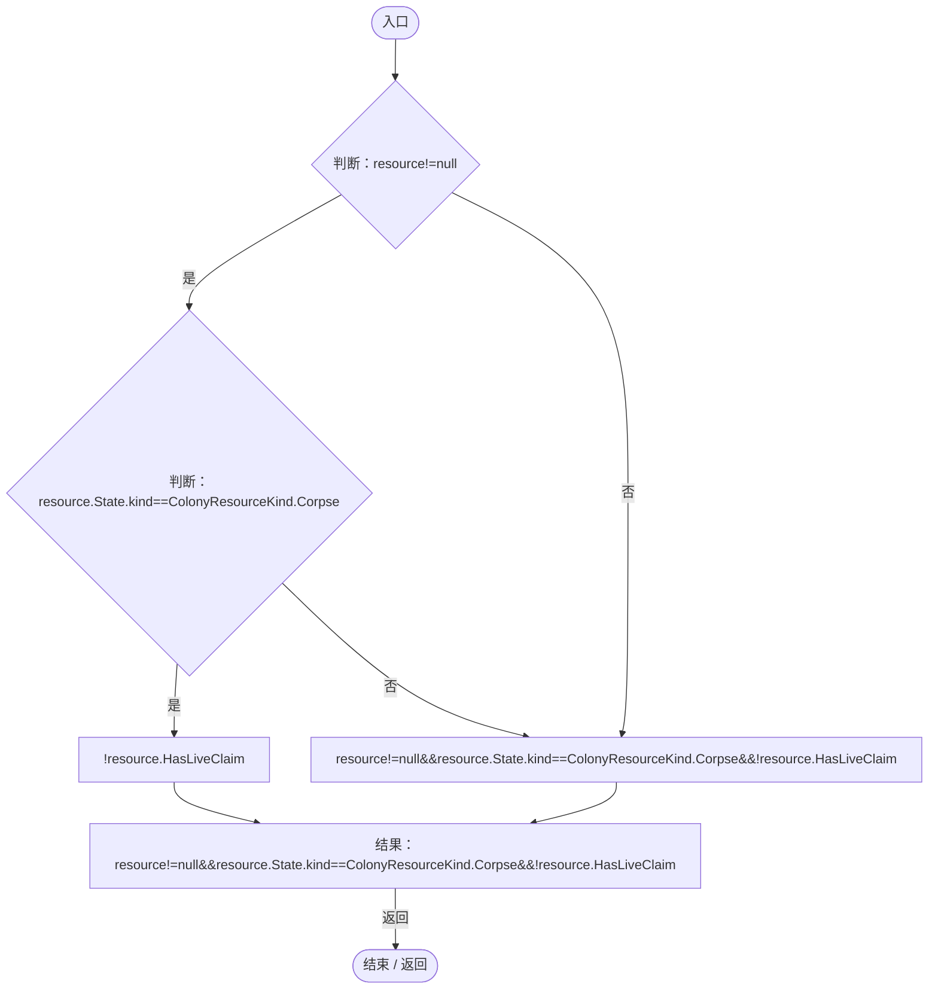

项目内调用/回调引用：

- [ColonyResource.State.get · L24](293dbaecfff4b585.md#m41824f1a0e160aa5)（访问器）

<a id="m8d13c078ead24220"></a>

## Valid · L23

`private static bool Valid(ColonyResource resource,Vector3 point,float radius,bool corpse)`


### Editor / Player · Roslyn编译器控制流

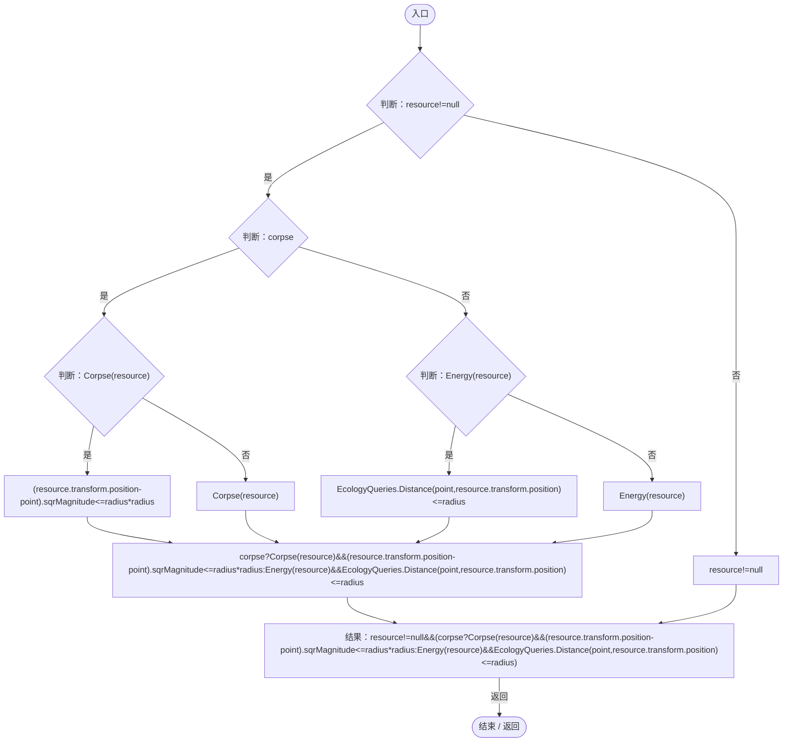

项目内调用/回调引用：

- [EntityResourcePlan.Corpse · L22](569e8e31d0634370.md#m16d68ba656e1a41e)（方法）
- [EntityResourcePlan.Energy · L21](569e8e31d0634370.md#m3a73ddaa4ce93378)（方法）
- [EcologyQueries.Distance · L43](bdf7ccc2c9c0452f.md#m6e395dce655ebcac)（方法）

<a id="m7dd1c9a2fa6548b4"></a>

## Head · L24

`private static ColonyResource Head(List<string> queue,EntityGeneController genes,Vector3 point,float radius,bool corpse)`


### Editor / Player · Roslyn编译器控制流

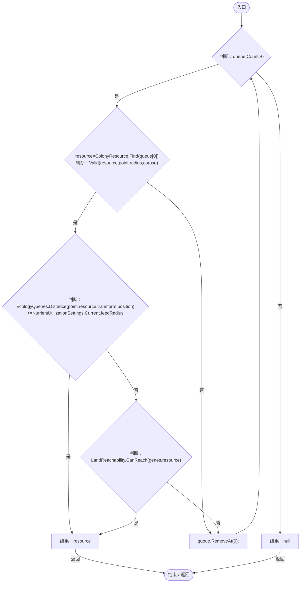

项目内调用/回调引用：

- [ColonyResource.Find · L28](293dbaecfff4b585.md#m1324285ab40ac6f4)（方法）
- [EntityResourcePlan.Valid · L23](569e8e31d0634370.md#m8d13c078ead24220)（方法）
- [EcologyQueries.Distance · L43](bdf7ccc2c9c0452f.md#m6e395dce655ebcac)（方法）
- [NutrientUtilizationSettings.Current.get · L17](276bc943280dcfce.md#mfa1e978a0be0644c)（访问器）
- [LandReachability.CanReach · L13](816416ac988cda79.md#mc2d1a33fc583a4d8)（方法）

<a id="m946240d33e353e81"></a>

## FindEnergy · L28

`public static ColonyResource FindEnergy(EntityGeneController genes,float radius,bool nearby)`


### Editor / Player · Roslyn编译器控制流

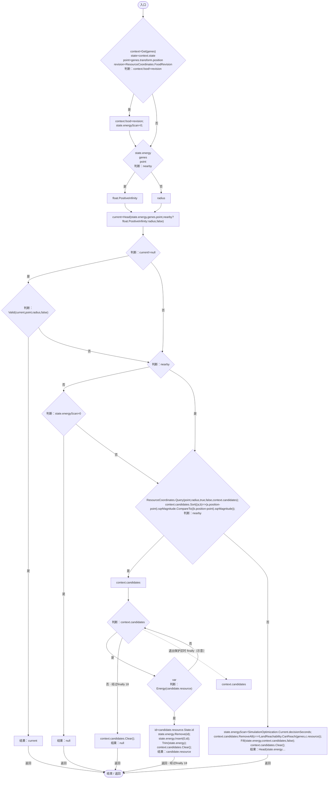

项目内调用/回调引用：

- [EntityResourcePlan.Get · L18](569e8e31d0634370.md#m64c8ae125a394115)（方法）
- [ResourceCoordinates.FoodRevision.get · L22](93d731ac01e3af48.md#m9bf8d14b6b6e158a)（访问器）
- [EntityResourcePlan.Head · L24](569e8e31d0634370.md#m7dd1c9a2fa6548b4)（方法）
- [EntityResourcePlan.Valid · L23](569e8e31d0634370.md#m8d13c078ead24220)（方法）
- [ResourceCoordinates.Query · L58](93d731ac01e3af48.md#md13e92bc2b759c8f)（方法）
- [EntityResourcePlan.Energy · L21](569e8e31d0634370.md#m3a73ddaa4ce93378)（方法）
- [ColonyResource.State.get · L24](293dbaecfff4b585.md#m41824f1a0e160aa5)（访问器）
- [EntityResourcePlan.Trim · L55](569e8e31d0634370.md#m5be6148580e2c3b0)（方法）
- [SimulationOptimization.Current.get · L25](11c9091e70893352.md#mde7abfdc18429e4a)（访问器）
- [EntityResourcePlan.Fill · L50](569e8e31d0634370.md#m3adc4f6e9bb0404b)（方法）
- [EntityResourcePlan.回调@37 · L37](569e8e31d0634370.md#m05d0aa9608452839)（回调/委托）
- [EntityResourcePlan.回调@43 · L43](569e8e31d0634370.md#mab26ba848cd0309d)（回调/委托）

<a id="m05d0aa9608452839"></a>

## 回调@37 · L37

`( … => 回调`


### Editor / Player · Roslyn编译器控制流

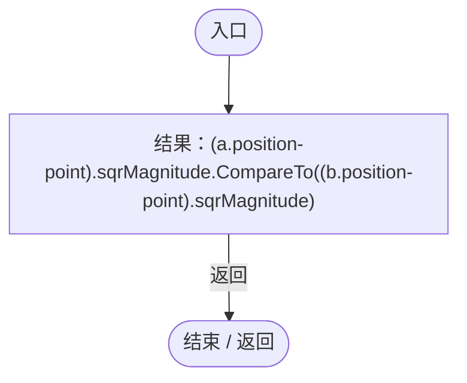

<a id="mab26ba848cd0309d"></a>

## 回调@43 · L43

`c … => 回调`


### Editor / Player · Roslyn编译器控制流

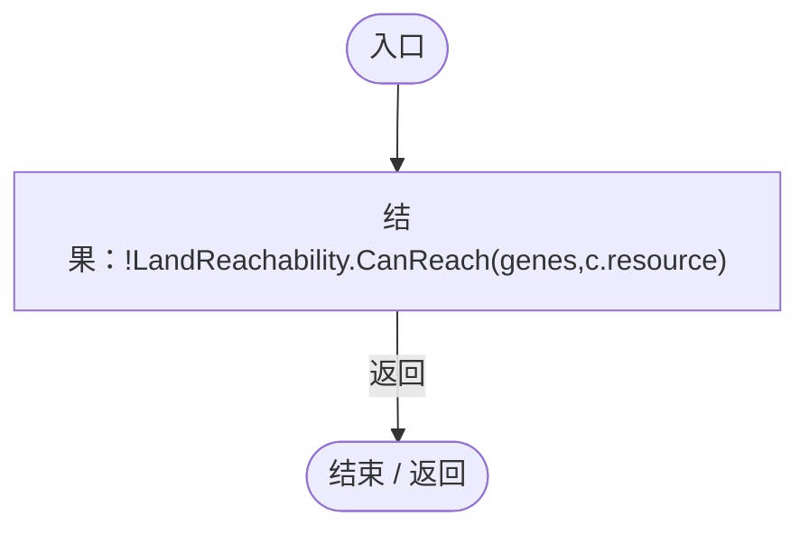

项目内调用/回调引用：

- [LandReachability.CanReach · L13](816416ac988cda79.md#mc2d1a33fc583a4d8)（方法）

<a id="mbe33d1f94c0c03df"></a>

## FindCorpse · L45

`public static ColonyResource FindCorpse(EntityGeneController genes,float radius,float interval)`


### Editor / Player · Roslyn编译器控制流

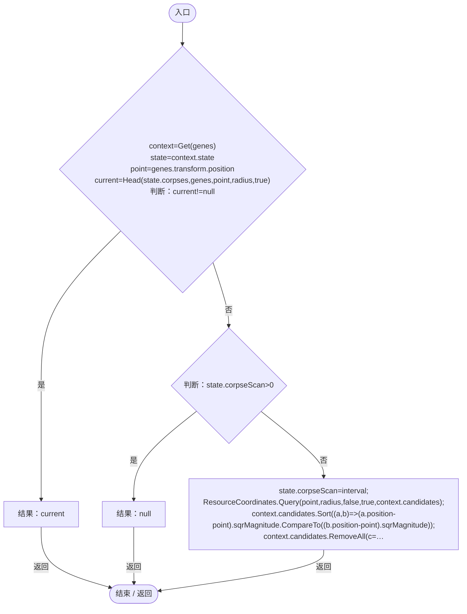

项目内调用/回调引用：

- [EntityResourcePlan.Get · L18](569e8e31d0634370.md#m64c8ae125a394115)（方法）
- [EntityResourcePlan.Head · L24](569e8e31d0634370.md#m7dd1c9a2fa6548b4)（方法）
- [ResourceCoordinates.Query · L58](93d731ac01e3af48.md#md13e92bc2b759c8f)（方法）
- [EntityResourcePlan.Fill · L50](569e8e31d0634370.md#m3adc4f6e9bb0404b)（方法）
- [EntityResourcePlan.回调@48 · L48](569e8e31d0634370.md#m6fd90ab7a1f66937)（回调/委托）
- [EntityResourcePlan.回调@48 · L48](569e8e31d0634370.md#m884f9ddc4b7d532f)（回调/委托）

<a id="m6fd90ab7a1f66937"></a>

## 回调@48 · L48

`( … => 回调`


### Editor / Player · Roslyn编译器控制流


<a id="m884f9ddc4b7d532f"></a>

## 回调@48 · L48

`c … => 回调`


### Editor / Player · Roslyn编译器控制流


项目内调用/回调引用：

- [LandReachability.CanReach · L13](816416ac988cda79.md#mc2d1a33fc583a4d8)（方法）

<a id="m3adc4f6e9bb0404b"></a>

## Fill · L50

`private static void Fill(List<string> queue,List<ResourceCoordinate> candidates,bool corpse)`


### Editor / Player · Roslyn编译器控制流

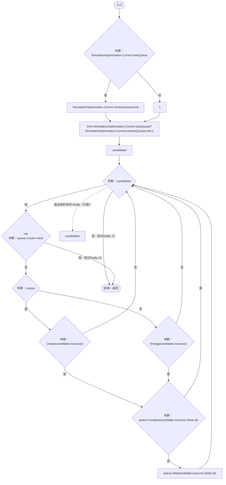

项目内调用/回调引用：

- [SimulationOptimization.Current.get · L25](11c9091e70893352.md#mde7abfdc18429e4a)（访问器）
- [EntityResourcePlan.Corpse · L22](569e8e31d0634370.md#m16d68ba656e1a41e)（方法）
- [EntityResourcePlan.Energy · L21](569e8e31d0634370.md#m3a73ddaa4ce93378)（方法）
- [ColonyResource.State.get · L24](293dbaecfff4b585.md#m41824f1a0e160aa5)（访问器）

<a id="m5be6148580e2c3b0"></a>

## Trim · L55

`private static void Trim(List<string> queue)`


### Editor / Player · Roslyn编译器控制流

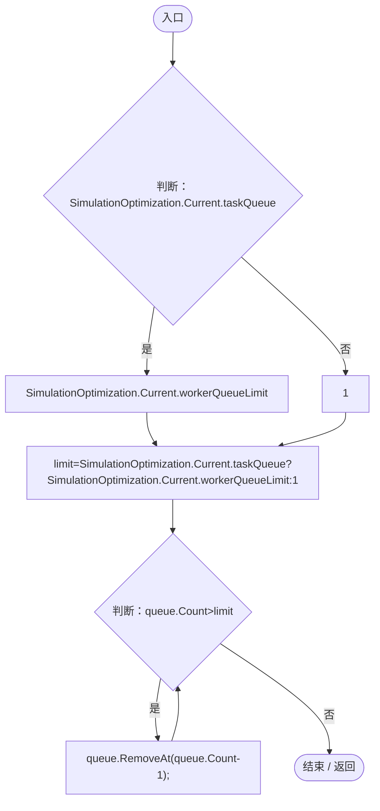

项目内调用/回调引用：

- [SimulationOptimization.Current.get · L25](11c9091e70893352.md#mde7abfdc18429e4a)（访问器）

<a id="mf278ec899873544f"></a>

## Capture · L56

`public static EntityResourcePlanSave Capture(EntityGeneController genes)`


### Editor / Player · Roslyn编译器控制流

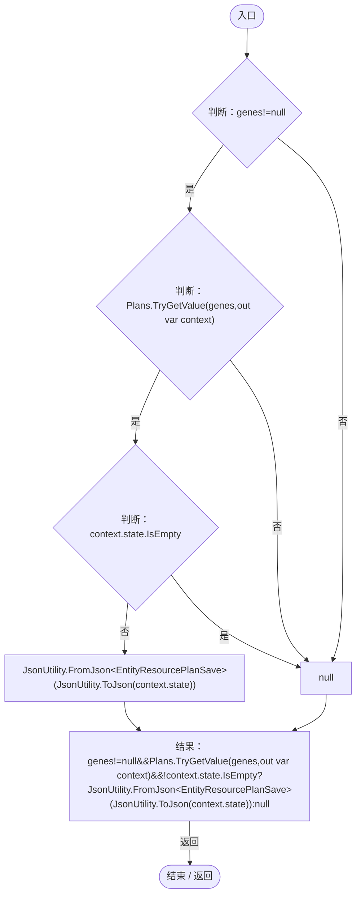

<a id="mf4d9479209b1adf0"></a>

## Restore · L57

`public static void Restore(EntityGeneController genes,EntityResourcePlanSave state)`


### Editor / Player · Roslyn编译器控制流

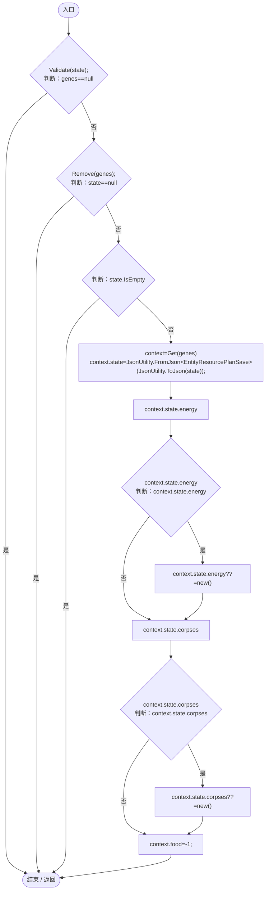

项目内调用/回调引用：

- [EntityResourcePlan.Validate · L59](569e8e31d0634370.md#m710f92fa2a48e771)（方法）
- [EntityResourcePlan.Remove · L67](569e8e31d0634370.md#mab4fd29432365e84)（方法）
- [EntityResourcePlan.Get · L18](569e8e31d0634370.md#m64c8ae125a394115)（方法）

<a id="m710f92fa2a48e771"></a>

## Validate · L59

`public static void Validate(EntityResourcePlanSave state)`


### Editor / Player · Roslyn编译器控制流

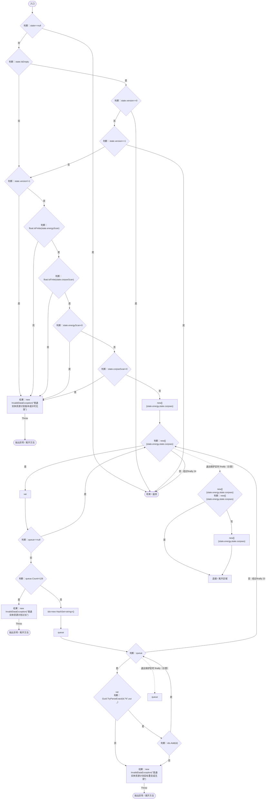

<a id="m05b775fc4a68ab66"></a>

## Token · L65

`public static int Token(EntityGeneController genes)`

★ 适配：任务完成/失效立即打断行动缓存，不等待决策周期到期。

### Editor / Player · Roslyn编译器控制流

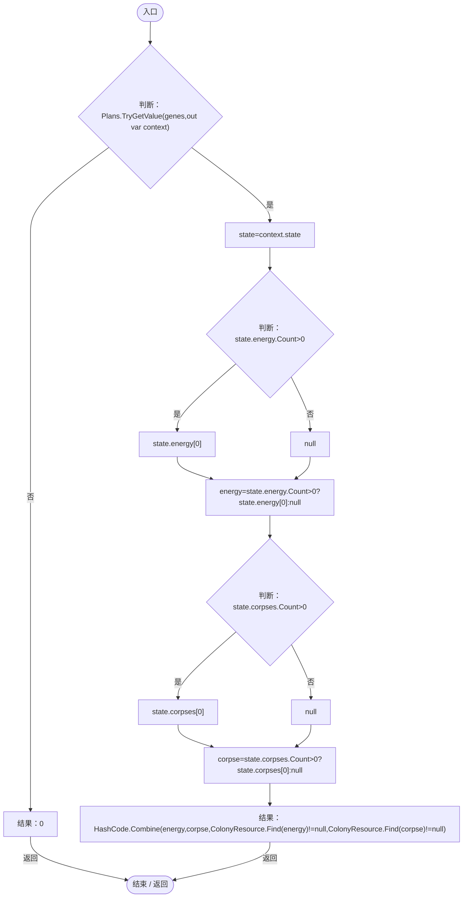

项目内调用/回调引用：

- [ColonyResource.Find · L28](293dbaecfff4b585.md#m1324285ab40ac6f4)（方法）

<a id="mab4fd29432365e84"></a>

## Remove · L67

`public static void Remove(EntityGeneController genes)`


### Editor / Player · Roslyn编译器控制流

```mermaid
flowchart TD
  b0(["入口"])
  b1{"判断：ReferenceEquals(genes,null)"}
  b2["Plans.Remove(genes);"]
  b3(["结束 / 返回"])
  b0 --> b1
  b1 -->|"否"| b2
  b1 -->|"是"| b3
  b2 --> b3

```

<a id="mc9ae902b1982e537"></a>

## Clear · L68

`public static void Clear()`


### Editor / Player · Roslyn编译器控制流

```mermaid
flowchart TD
  b0(["入口"])
  b1["Plans.Clear()"]
  b2(["结束 / 返回"])
  b0 --> b1
  b1 --> b2

```

<a id="m708ce2d6a76c4957"></a>

## Reset · L69

`[RuntimeInitializeOnLoadMethod(RuntimeInitializeLoadType.SubsystemRegistration)]private static void Reset()`


### Editor / Player · Roslyn编译器控制流

```mermaid
flowchart TD
  b0(["入口"])
  b1["Clear()"]
  b2(["结束 / 返回"])
  b0 --> b1
  b1 --> b2

```

项目内调用/回调引用：

- [EntityResourcePlan.Clear · L68](569e8e31d0634370.md#mc9ae902b1982e537)（方法）
