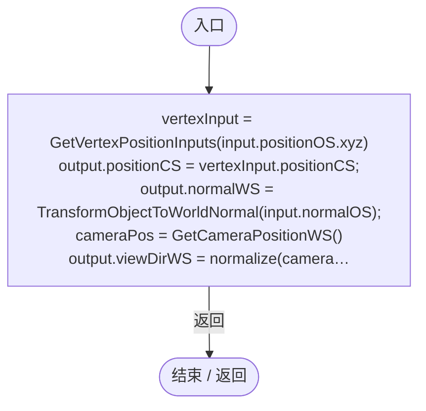
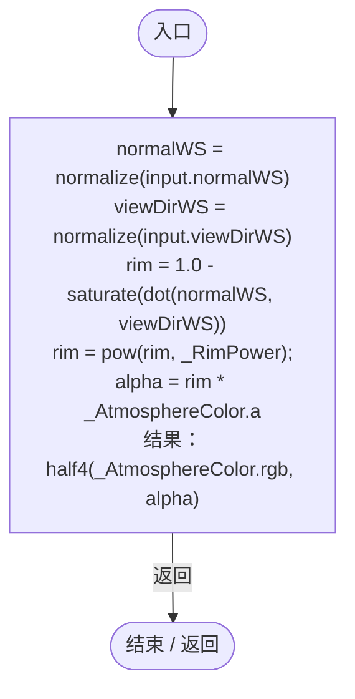

# PlanetAtmosphere.shader

[返回总索引](../README.md) · `GPU` · `Assets/DarwinPark/Planet/PlanetAtmosphere.shader`

[源文件](../../../Assets/DarwinPark/Planet/PlanetAtmosphere.shader) · 源码校验：`361d4bfdaa30c93318b6a3be88799109d9c1d699f2e48b0cb4a163c4e0880222`

方法按源文件位置排列。事件/回调引用不表示立即执行；分支与异常说明见总索引。完整源码与可点击关系图请打开离线手册。

## vert · L40

`Varyings vert(Attributes input)`

### GPU · GPU控制结构（名称链接，不作C#类型推断）

## frag · L53

`half4 frag(Varyings input) : SV_Target`

### GPU · GPU控制结构（名称链接，不作C#类型推断）

