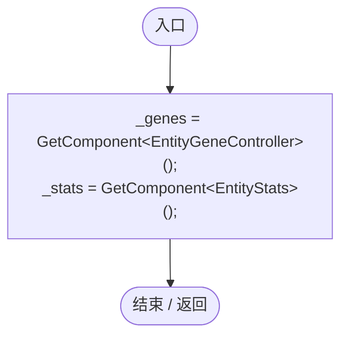
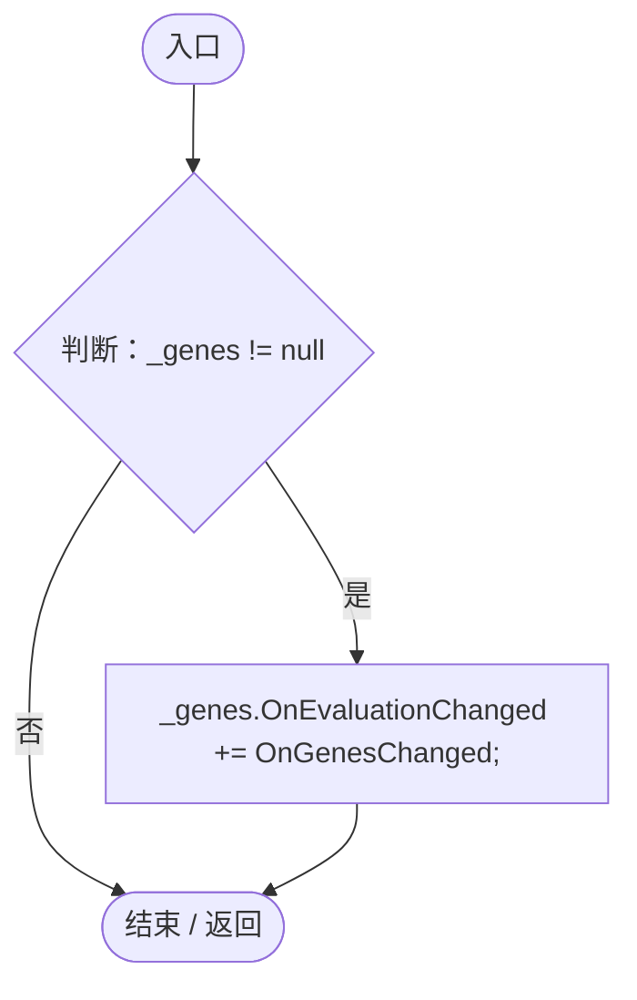
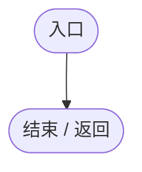

# EntityStatsGeneBridge.cs

[返回总索引](../README.md) · `Runtime` · `Assets/DarwinPark/Entities/Stats/EntityStatsGeneBridge.cs`

[源文件](../../../Assets/DarwinPark/Entities/Stats/EntityStatsGeneBridge.cs) · 源码校验：`fa7b2d7f074c170453a58332ba3ae4541660e5c472f3c5f38e2e0762fa2b3045`

方法按源文件位置排列。事件/回调引用不表示立即执行；分支与异常说明见总索引。完整源码与可点击关系图请打开离线手册。

## Awake · L15

`private void Awake()`

### Editor / Player · Roslyn编译器控制流

## OnEnable · L21

`private void OnEnable()`

### Editor / Player · Roslyn编译器控制流

项目内调用/回调引用：

- [EntityStatsGeneBridge.OnGenesChanged · L31](57e2ec35cce2a9ba.md#m753d8dde206a419c)（方法）

## OnDisable · L26

`private void OnDisable()`

### Editor / Player · Roslyn编译器控制流

项目内调用/回调引用：

- [EntityStatsGeneBridge.OnGenesChanged · L31](57e2ec35cce2a9ba.md#m753d8dde206a419c)（方法）

## OnGenesChanged · L31

`private void OnGenesChanged(GenomeEvaluation eval)`

### Editor / Player · Roslyn编译器控制流

