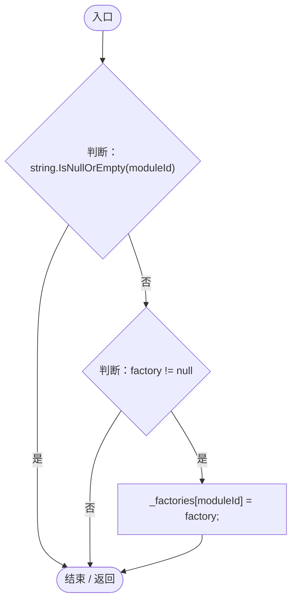
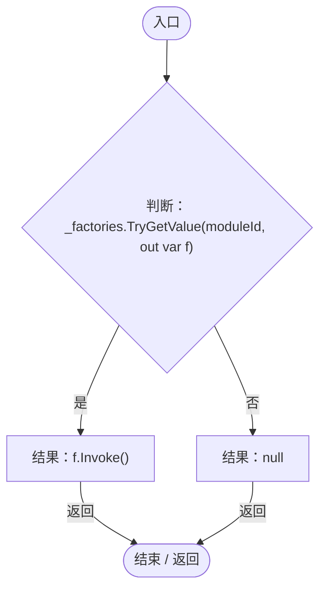
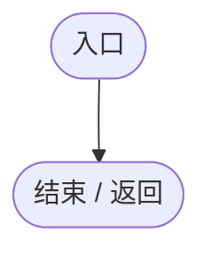

# GeneAIModuleRegistry.cs

[返回总索引](../README.md) · `Runtime` · `Assets/DarwinPark/AI/GeneAIModuleRegistry.cs`

[源文件](../../../Assets/DarwinPark/AI/GeneAIModuleRegistry.cs) · 源码校验：`0a35135953ad6cbe57ae276233311c558cc6be8267eb438b979781447a6ac9b1`

方法按源文件位置排列。事件/回调引用不表示立即执行；分支与异常说明见总索引。完整源码与可点击关系图请打开离线手册。

## Register · L11

`public static void Register(string moduleId, Func<IGeneAIModule> factory)`

### Editor / Player · Roslyn编译器控制流

## Create · L17

`public static IGeneAIModule Create(string moduleId)`

### Editor / Player · Roslyn编译器控制流

## Register · L27

`[RuntimeInitializeOnLoadMethod(RuntimeInitializeLoadType.BeforeSceneLoad)] private static void Register()`

### Editor / Player · Roslyn编译器控制流

