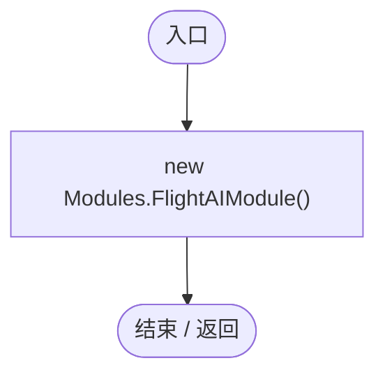
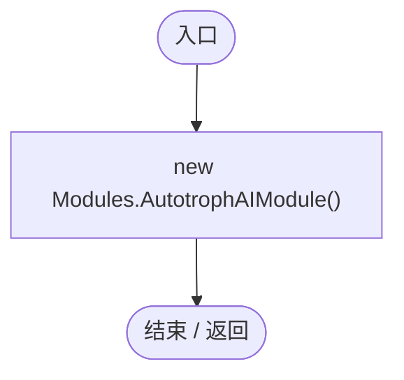
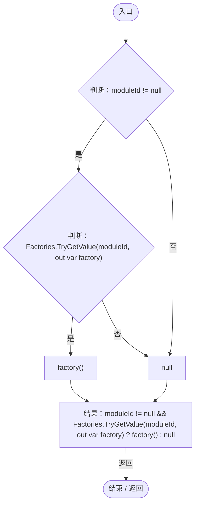
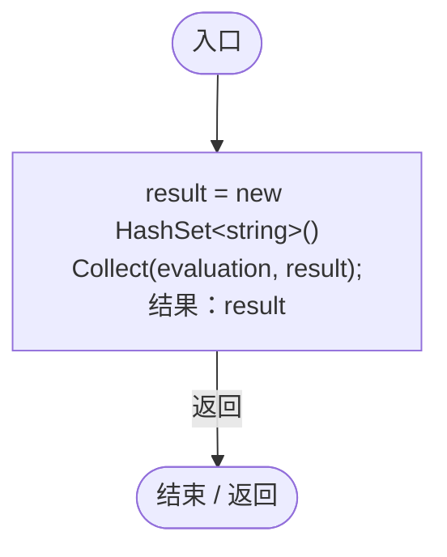
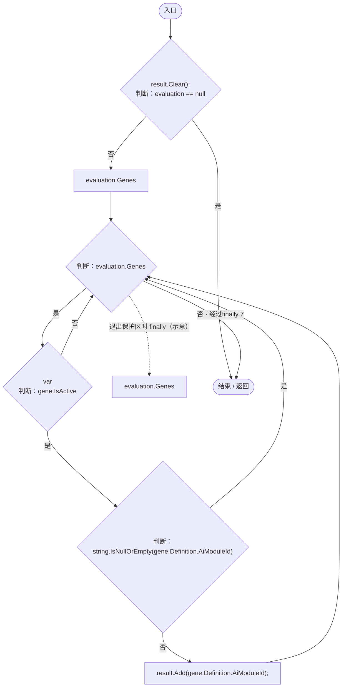

# GeneAIModuleRegistry.cs

[返回总索引](../README.md) · `Runtime` · `Assets/DarwinPark/AI/GeneAIModuleRegistry.cs`

[源文件](../../../Assets/DarwinPark/AI/GeneAIModuleRegistry.cs) · 源码校验：`c97361a535baeb0e7808b7f9d449eb72e73c8a14c80f5333632b9655273bb8ee`

方法按源文件位置排列。事件/回调引用不表示立即执行；分支与异常说明见总索引。完整源码与可点击关系图请打开离线手册。

## 回调@12 · L12

`( … => 回调`

### Editor / Player · 语法控制结构 / 声明（非CFG）

## 回调@13 · L13

`( … => 回调`

### Editor / Player · 语法控制结构 / 声明（非CFG）

## Register · L15

`public static void Register(string moduleId, Func<IGeneAIModule> factory)`

### Editor / Player · Roslyn编译器控制流

## Create · L17

`public static IGeneAIModule Create(string moduleId)`

### Editor / Player · Roslyn编译器控制流

## DecideActiveModules · L24

`public static HashSet<string> DecideActiveModules(GenomeEvaluation evaluation)`

### Editor / Player · Roslyn编译器控制流

项目内调用/回调引用：

- [GeneAIDecisionService.Collect · L26](58bd7c2d48df02e1.md#m4adc27b5d1ec883e)（方法）

## Collect · L26

`public static void Collect(GenomeEvaluation evaluation, HashSet<string> result)`

### Editor / Player · Roslyn编译器控制流

