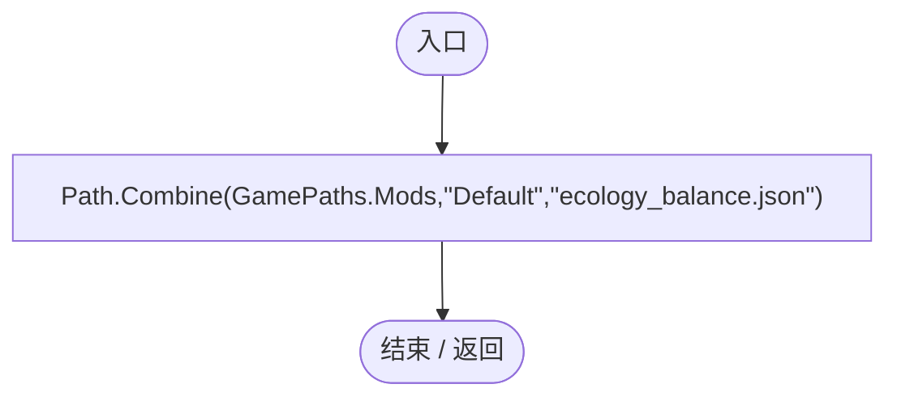
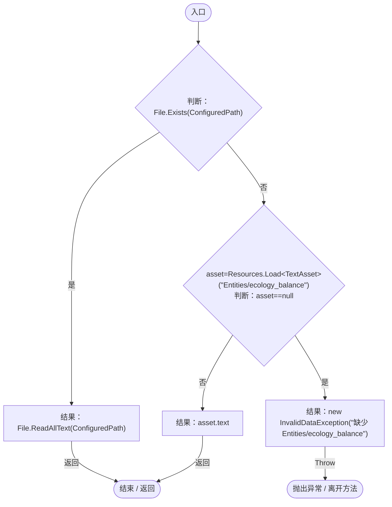
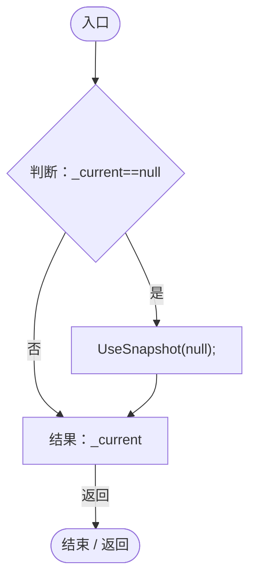
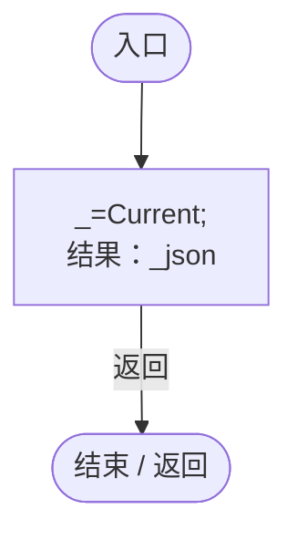
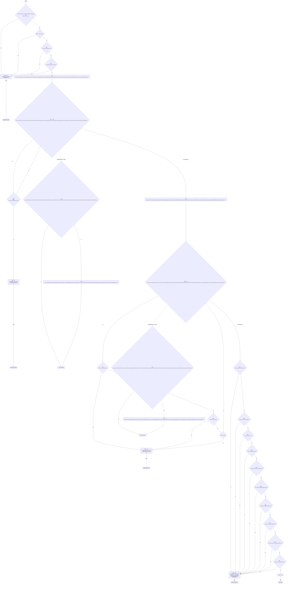
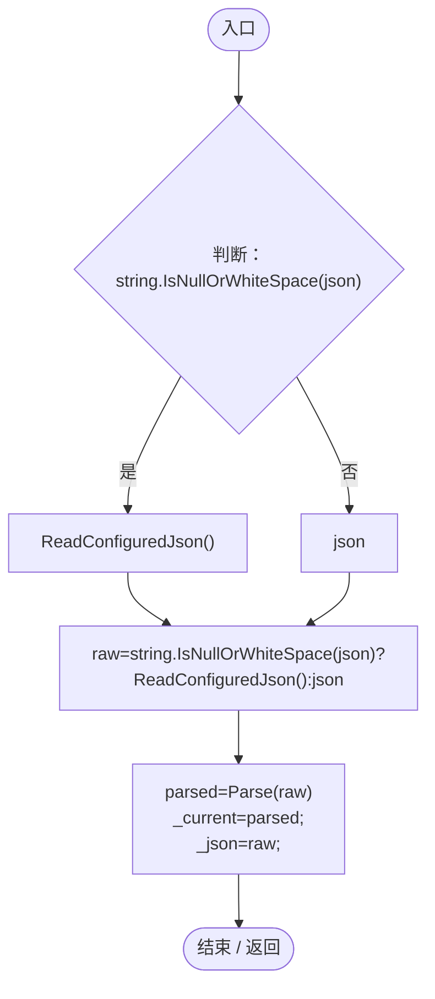
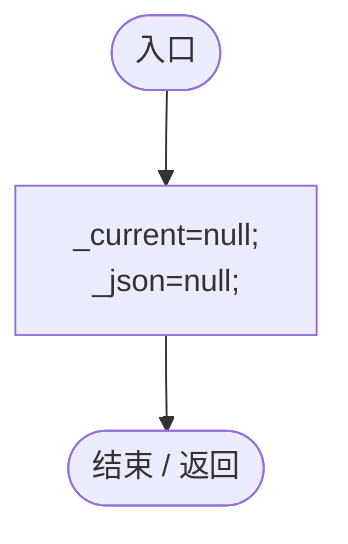

# EcologyBalanceSettings.cs

[返回总索引](../README.md) · `Runtime` · `Assets/DarwinPark/Entities/Ecology/EcologyBalanceSettings.cs`

[源文件](../../../Assets/DarwinPark/Entities/Ecology/EcologyBalanceSettings.cs) · 源码校验：`f0f8431597cebf149013c80ea429efbb17d4150ea894086052e06afe538f22cd`

方法按源文件位置排列。事件/回调引用不表示立即执行；分支与异常说明见总索引。完整源码与可点击关系图请打开离线手册。

## ConfiguredPath.get · L22

`public static string ConfiguredPath`

### Editor / Player · 语法控制结构 / 声明（非CFG）

## ReadConfiguredJson · L23

`public static string ReadConfiguredJson()`

### Editor / Player · Roslyn编译器控制流

## Current.get · L29

`get`

### Editor / Player · Roslyn编译器控制流

项目内调用/回调引用：

- [EcologyBalanceSettings.UseSnapshot · L43](5a37bc79f15f6238.md#mfb6d2d0cbc1cf33d)（方法）

## CurrentJson.get · L30

`get`

### Editor / Player · Roslyn编译器控制流

项目内调用/回调引用：

- [EcologyBalanceSettings.Current.get · L29](5a37bc79f15f6238.md#md33d4c4b8f82540b)（访问器）

## Parse · L31

`public static EcologyBalanceSettings Parse(string json)`

### Editor / Player · Roslyn编译器控制流

## UseSnapshot · L43

`public static void UseSnapshot(string json)`

★ 修复（防Bug回归）：先完整解析再替换，损坏快照不能留下旧数值配新 JSON 的半更新状态。

### Editor / Player · Roslyn编译器控制流

项目内调用/回调引用：

- [EcologyBalanceSettings.ReadConfiguredJson · L23](5a37bc79f15f6238.md#md3cac56b60832ffc)（方法）
- [EcologyBalanceSettings.Parse · L31](5a37bc79f15f6238.md#m044d17a39c22d55a)（方法）

## Clear · L44

`[RuntimeInitializeOnLoadMethod(RuntimeInitializeLoadType.SubsystemRegistration)] public static void Clear()`

### Editor / Player · Roslyn编译器控制流

