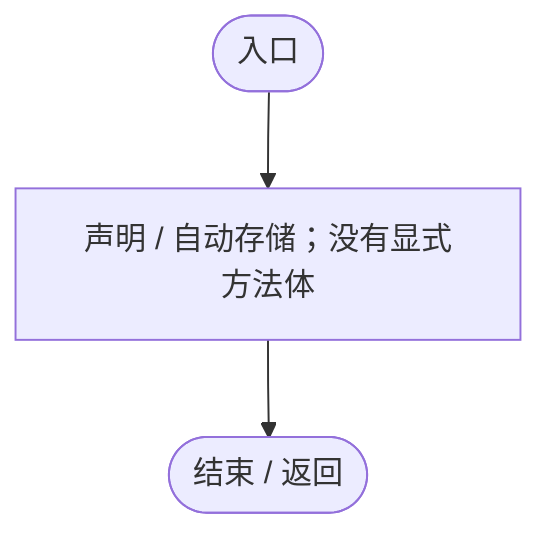
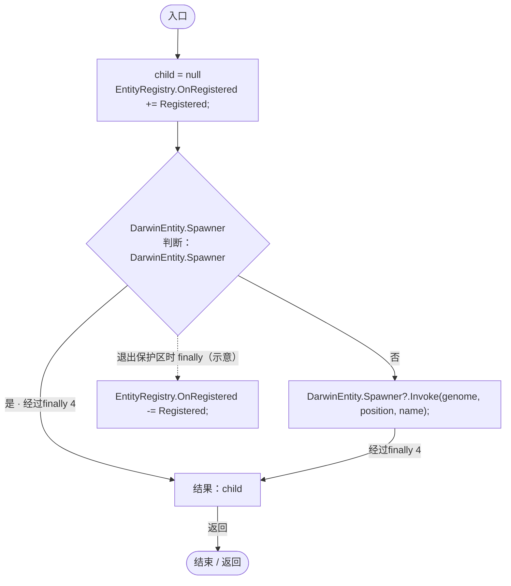
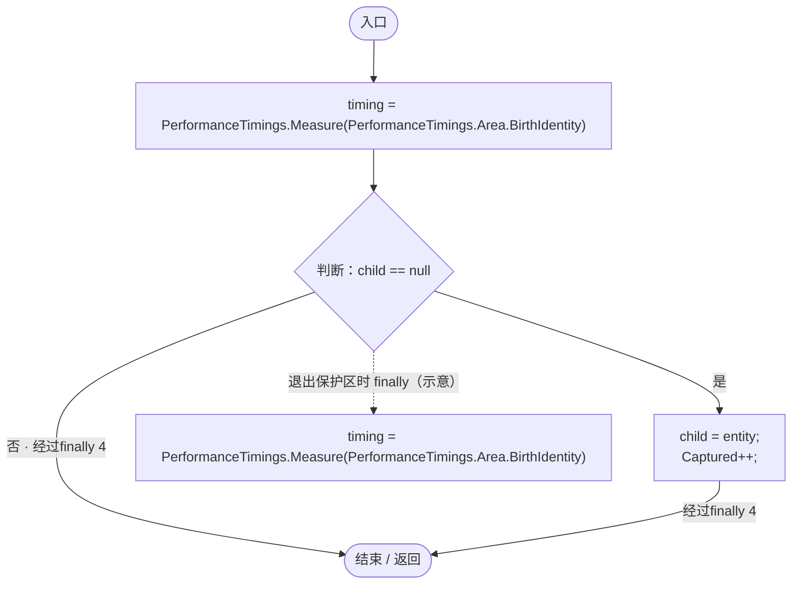
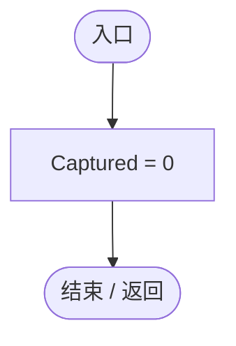

# EntitySpawnCapture.cs

[返回总索引](../README.md) · `Runtime` · `Assets/DarwinPark/Entities/EntitySpawnCapture.cs`

[源文件](../../../Assets/DarwinPark/Entities/EntitySpawnCapture.cs) · 源码校验：`b2b1c49ea35ca4fa448af5e6d563c14e1771fae8b7846231e144163f82b3112f`

方法按源文件位置排列。事件/回调引用不表示立即执行；分支与异常说明见总索引。完整源码与可点击关系图请打开离线手册。

## Captured.get · L10

`get`

### Editor / Player · 语法控制结构 / 声明（非CFG）

## Captured.set · L10

`private set`

### Editor / Player · 语法控制结构 / 声明（非CFG）

## Create · L11

`public static DarwinEntity Create(Genome genome, Vector3 position, string name = "")`

### Editor / Player · Roslyn编译器控制流

项目内调用/回调引用：

- [EntitySpawnCapture.Registered · L14](5a4874756805f604.md#mbfcc5a6245250697)（局部函数）

## Registered · L14

`void Registered(DarwinEntity entity)`

### Editor / Player · Roslyn编译器控制流

项目内调用/回调引用：

- [PerformanceTimings.Measure · L25](a8403a4c7503726d.md#m36fde3c234084192)（方法）
- [EntitySpawnCapture.Captured.set · L10](5a4874756805f604.md#mb2542e9e714853bd)（访问器）
- [EntitySpawnCapture.Captured.get · L10](5a4874756805f604.md#m5a0171000652f2d4)（访问器）

## Reset · L24

`[RuntimeInitializeOnLoadMethod(RuntimeInitializeLoadType.SubsystemRegistration)] private static void Reset()`

### Editor / Player · Roslyn编译器控制流

项目内调用/回调引用：

- [EntitySpawnCapture.Captured.set · L10](5a4874756805f604.md#mb2542e9e714853bd)（访问器）
