# EcologyDefaults.cs

[返回总索引](../README.md) · `Runtime` · `Assets/DarwinPark/Entities/Ecology/EcologyDefaults.cs`

[源文件](../../../Assets/DarwinPark/Entities/Ecology/EcologyDefaults.cs) · 源码校验：`ed10a1211525e012714015df991337b53f528c034a8ea898eb1e5794bd23181a`

方法按源文件位置排列。事件/回调引用不表示立即执行；分支与异常说明见总索引。完整源码与可点击关系图请打开离线手册。

## Recipe · L16

`public RandomSpawnRecipe Recipe()`

### Editor / Player · Roslyn编译器控制流

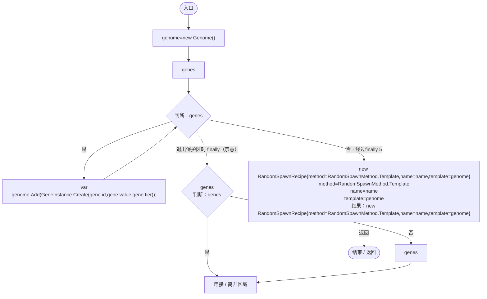

项目内调用/回调引用：

- [Genome.Add · L19](a2ef23f865bc7ee8.md#md9cfdc94b8b8d40f)（方法）
- [GeneInstance.Create · L20](f82e1498d67f5afd.md#m72e94c278de3cf8b)（方法）

## ConfigurationPath.get · L34

`public static string ConfigurationPath`

### Editor / Player · 语法控制结构 / 声明（非CFG）

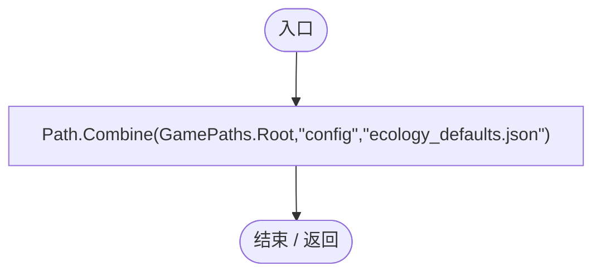

## Current.get · L35

`get`

### Editor / Player · Roslyn编译器控制流

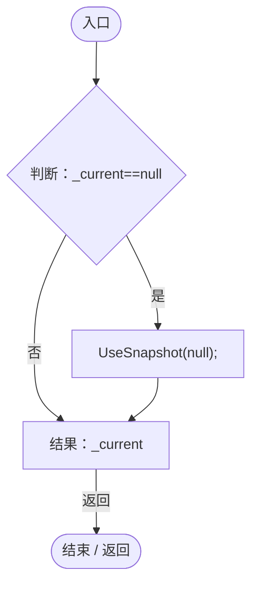

项目内调用/回调引用：

- [EcologyDefaults.UseSnapshot · L67](5b565b57de741d98.md#m5bc9f872fc491c57)（方法）

## CurrentJson.get · L36

`get`

### Editor / Player · Roslyn编译器控制流

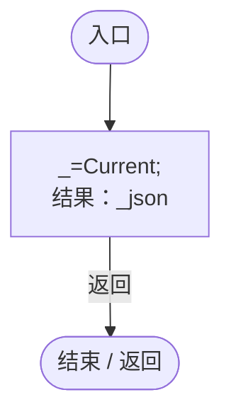

项目内调用/回调引用：

- [EcologyDefaults.Current.get · L35](5b565b57de741d98.md#m75cb60b88e3cc1c7)（访问器）

## ReadConfiguredJson · L37

`public static string ReadConfiguredJson()`

### Editor / Player · Roslyn编译器控制流

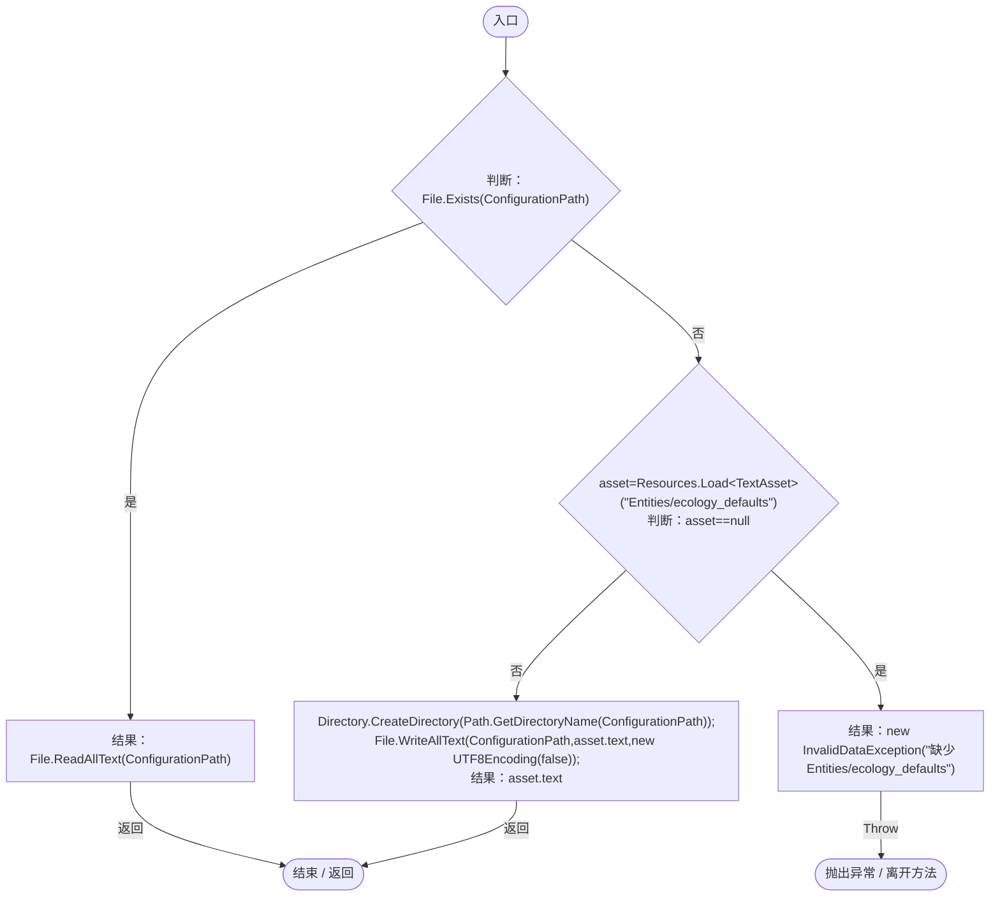

## Parse · L43

`public static EcologyDefaultsSettings Parse(string json)`

### Editor / Player · Roslyn编译器控制流

```mermaid
flowchart TD
  b0(["入口"])
  b1{"value=JsonUtility.FromJson&lt;EcologyDefaultsSettings&gt;(CommentedJson.Strip(json))<br/>判断：value==null"}
  b2{"判断：value.version!=1"}
  b3{"判断：value.minimumPopulation&lt;1"}
  b4{"判断：value.minimumPopulation&gt;100000"}
  b5{"判断：value.minimumWorkers&lt;0"}
  b6{"判断：value.minimumWorkers&gt;16"}
  b7{"判断：value.localProducerTarget&lt;0"}
  b8{"判断：value.localProducerTarget&gt;128"}
  b9{"判断：value.maximumFoundingMembers&lt;1"}
  b10{"判断：Finite(value.producerRatio)"}
  b11{"判断：Finite(value.mobileRatio)"}
  b12{"判断：value.producerRatio&lt;=0"}
  b13{"判断：value.mobileRatio&lt;=0"}
  b14{"判断：Mathf.Abs(value.producerRatio+value.mobileRatio-1)&gt;.00001f"}
  b15{"判断：Finite(value.foundingFood)"}
  b16{"判断：value.foundingFood&lt;0"}
  b17{"判断：Finite(value.plantSpacing)"}
  b18{"判断：value.plantSpacing&lt;=0"}
  b19{"判断：value.templates==null"}
  b20{"判断：value.templates.Length==0"}
  b21["结果：new InvalidDataException(&quot;生态默认比例、创业储粮或数量配置无效&quot;)"]
  x21(["抛出异常 / 离开方法"])
  b22["ids=new HashSet&lt;string&gt;()"]
  b23["value.templates"]
  b24{"判断：value.templates"}
  b25["var"]
  b26{"判断：template==null"}
  b27{"判断：string.IsNullOrWhiteSpace(template.id)"}
  b28{"判断：ids.Add(template.id)"}
  b29{"判断：string.IsNullOrWhiteSpace(template.name)"}
  b30{"判断：template.genes==null"}
  b31{"判断：template.genes.Length==0"}
  b32{"判断：template.genes.Length&gt;PopulationMaintenanceSettings.Current.maximumGenomeGenes"}
  b33["结果：new InvalidDataException(&quot;生态默认模板缺失或重复&quot;)"]
  x33(["抛出异常 / 离开方法"])
  b34["genes=new HashSet&lt;string&gt;()"]
  b35["template.genes"]
  b36{"判断：template.genes"}
  b37{"var<br/>判断：gene==null"}
  b38{"判断：string.IsNullOrWhiteSpace(gene.id)"}
  b39{"判断：genes.Add(gene.id)"}
  b40{"判断：Finite(gene.value)"}
  b41{"判断：gene.value&lt;0"}
  b42{"判断：gene.value&gt;100"}
  b43{"判断：gene.tier&lt;0"}
  b44["结果：new InvalidDataException(&quot;生态默认模板基因无效&quot;)"]
  x44(["抛出异常 / 离开方法"])
  b45{"template.genes<br/>判断：template.genes"}
  b46["template.genes"]
  b47["连接 / 离开区域"]
  b48{"value.templates<br/>判断：value.templates"}
  b49["value.templates"]
  b50["连接 / 离开区域"]
  b51{"判断：ids.Contains(value.producerTemplate)"}
  b52{"判断：ids.Contains(value.mobileTemplate)"}
  b53["结果：new InvalidDataException(&quot;生态默认比例引用未知模板&quot;)"]
  x53(["抛出异常 / 离开方法"])
  b54["结果：value"]
  b55(["结束 / 返回"])
  b0 --> b1
  b1 -->|"否"| b2
  b1 -->|"是"| b21
  b2 -->|"否"| b3
  b2 -->|"是"| b21
  b3 -->|"否"| b4
  b3 -->|"是"| b21
  b4 -->|"否"| b5
  b4 -->|"是"| b21
  b5 -->|"否"| b6
  b5 -->|"是"| b21
  b6 -->|"否"| b7
  b6 -->|"是"| b21
  b7 -->|"否"| b8
  b7 -->|"是"| b21
  b8 -->|"否"| b9
  b8 -->|"是"| b21
  b9 -->|"否"| b10
  b9 -->|"是"| b21
  b10 -->|"是"| b11
  b10 -->|"否"| b21
  b11 -->|"是"| b12
  b11 -->|"否"| b21
  b12 -->|"否"| b13
  b12 -->|"是"| b21
  b13 -->|"否"| b14
  b13 -->|"是"| b21
  b14 -->|"否"| b15
  b14 -->|"是"| b21
  b15 -->|"是"| b16
  b15 -->|"否"| b21
  b16 -->|"否"| b17
  b16 -->|"是"| b21
  b17 -->|"是"| b18
  b17 -->|"否"| b21
  b18 -->|"否"| b19
  b18 -->|"是"| b21
  b19 -->|"否"| b20
  b19 -->|"是"| b21
  b20 -->|"是"| b21
  b20 -->|"否"| b22
  b21 -->|"Throw"| x21
  b22 --> b23
  b23 --> b24
  b24 -->|"是"| b25
  b24 -->|"否 · 经过finally 48"| b51
  b25 --> b26
  b26 -->|"否"| b27
  b26 -->|"是"| b33
  b27 -->|"否"| b28
  b27 -->|"是"| b33
  b28 -->|"是"| b29
  b28 -->|"否"| b33
  b29 -->|"否"| b30
  b29 -->|"是"| b33
  b30 -->|"否"| b31
  b30 -->|"是"| b33
  b31 -->|"否"| b32
  b31 -->|"是"| b33
  b32 -->|"是"| b33
  b32 -->|"否"| b34
  b33 -->|"Throw"| x33
  b34 --> b35
  b35 --> b36
  b36 -->|"是"| b37
  b36 -->|"否 · 经过finally 45"| b24
  b37 -->|"否"| b38
  b37 -->|"是"| b44
  b38 -->|"否"| b39
  b38 -->|"是"| b44
  b39 -->|"是"| b40
  b39 -->|"否"| b44
  b40 -->|"是"| b41
  b40 -->|"否"| b44
  b41 -->|"否"| b42
  b41 -->|"是"| b44
  b42 -->|"否"| b43
  b42 -->|"是"| b44
  b43 -->|"是"| b44
  b43 -->|"否"| b36
  b44 -->|"Throw"| x44
  b45 -->|"否"| b46
  b45 -->|"是"| b47
  b46 --> b47
  b48 -->|"否"| b49
  b48 -->|"是"| b50
  b49 --> b50
  b51 -->|"是"| b52
  b51 -->|"否"| b53
  b52 -->|"否"| b53
  b52 -->|"是"| b54
  b53 -->|"Throw"| x53
  b54 -->|"返回"| b55
  b36 -. "退出保护区时 finally（示意）" .-> b45
  b24 -. "退出保护区时 finally（示意）" .-> b48

```

项目内调用/回调引用：

- [CommentedJson.Strip · L9](f72593057d514ce3.md#mc9c02edd5a7f0a4d)（方法）
- [EcologyDefaults.Finite · L54](5b565b57de741d98.md#m95c671093093ab5c)（方法）
- [PopulationMaintenanceSettings.Current.get · L77](923ccc4e86c4786c.md#ma2442661558e4796)（访问器）

## Finite · L54

`private static bool Finite(float value)`

### Editor / Player · Roslyn编译器控制流

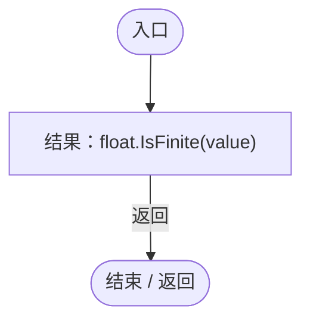

## PrepareSnapshot · L56

`public static ColonyWorldState PrepareSnapshot(ColonyWorldState state)`

★ 新增：旧档缺配置时先校验并固定一次外部默认，不能清场后才读取一份可能无效的配置。

### Editor / Player · Roslyn编译器控制流

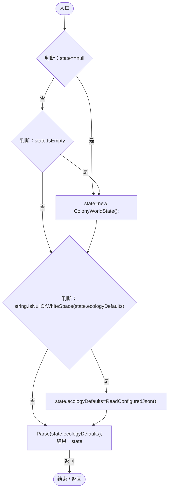

项目内调用/回调引用：

- [EcologyDefaults.ReadConfiguredJson · L37](5b565b57de741d98.md#mc31a88d336ce96b2)（方法）
- [EcologyDefaults.Parse · L43](5b565b57de741d98.md#me86e89216d317f4b)（方法）

## ValidateCatalog · L62

`public static void ValidateCatalog(string json,ICollection<string> catalog)`

### Editor / Player · Roslyn编译器控制流

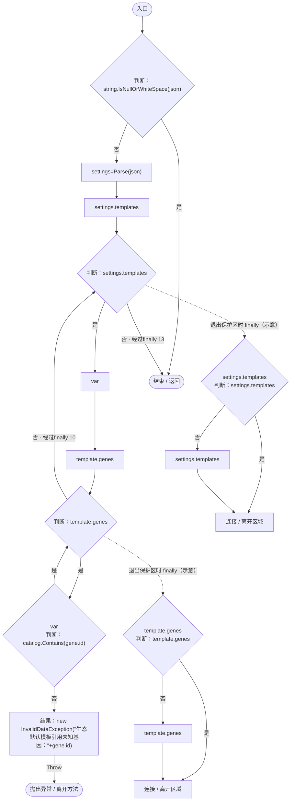

项目内调用/回调引用：

- [EcologyDefaults.Parse · L43](5b565b57de741d98.md#me86e89216d317f4b)（方法）

## UseSnapshot · L67

`public static void UseSnapshot(string json)`

### Editor / Player · Roslyn编译器控制流

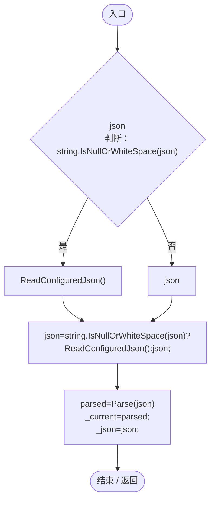

项目内调用/回调引用：

- [EcologyDefaults.ReadConfiguredJson · L37](5b565b57de741d98.md#mc31a88d336ce96b2)（方法）
- [EcologyDefaults.Parse · L43](5b565b57de741d98.md#me86e89216d317f4b)（方法）

## Template · L68

`public static RandomSpawnRecipe Template(string id)`

### Editor / Player · Roslyn编译器控制流

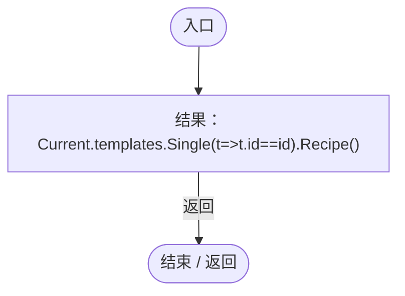

项目内调用/回调引用：

- [EcologyDefaultTemplate.Recipe · L16](5b565b57de741d98.md#m17d9ba8f434671b9)（方法）
- [EcologyDefaults.Current.get · L35](5b565b57de741d98.md#m75cb60b88e3cc1c7)（访问器）
- [EcologyDefaults.回调@68 · L68](5b565b57de741d98.md#m151e5685443d7ffa)（回调/委托）

## 回调@68 · L68

`t … => 回调`

### Editor / Player · Roslyn编译器控制流

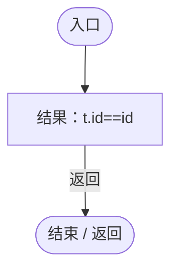

## CreateRules · L69

`public static PopulationMaintenanceState CreateRules(string json=null,bool force=false)`

### Editor / Player · Roslyn编译器控制流

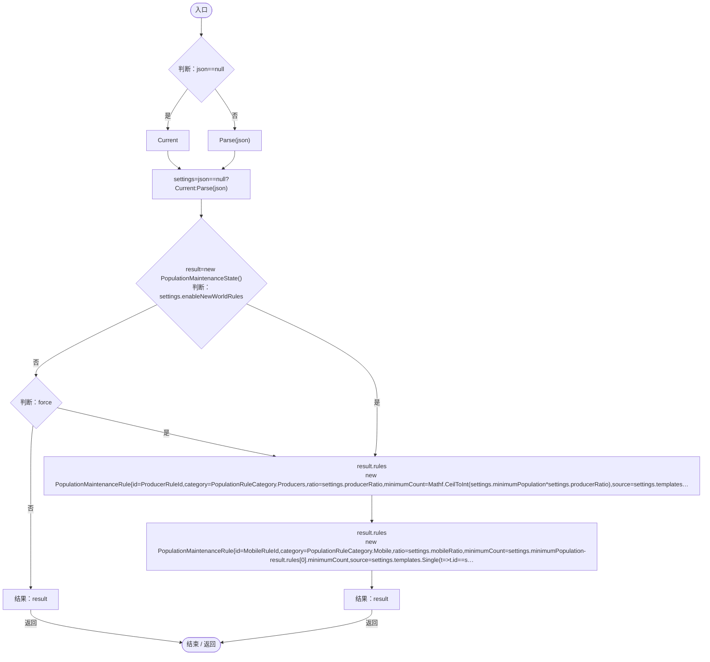

项目内调用/回调引用：

- [EcologyDefaults.Current.get · L35](5b565b57de741d98.md#m75cb60b88e3cc1c7)（访问器）
- [EcologyDefaults.Parse · L43](5b565b57de741d98.md#me86e89216d317f4b)（方法）
- [EcologyDefaultTemplate.Recipe · L16](5b565b57de741d98.md#m17d9ba8f434671b9)（方法）
- [EcologyDefaults.回调@73 · L73](5b565b57de741d98.md#ma89b8aa4f8aac532)（回调/委托）
- [EcologyDefaults.回调@74 · L74](5b565b57de741d98.md#mc5dd9b531b0294dd)（回调/委托）

## 回调@73 · L73

`t … => 回调`

### Editor / Player · Roslyn编译器控制流

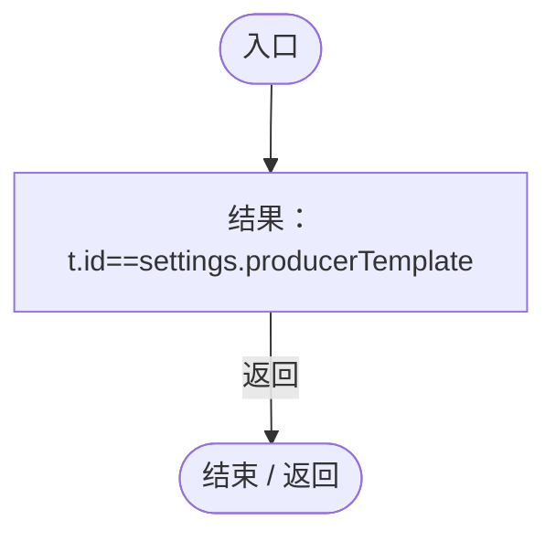

## 回调@74 · L74

`t … => 回调`

### Editor / Player · Roslyn编译器控制流

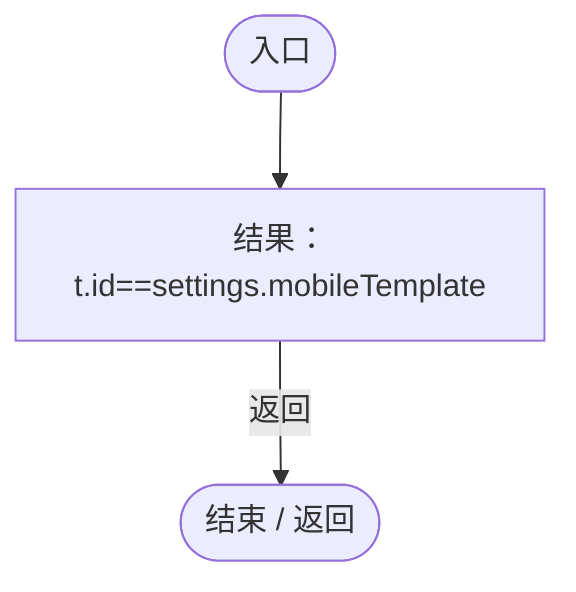

## ApplyRules · L77

`public static bool ApplyRules()`

★ 新增：旧世界从界面显式应用；预先验证整组后原子替换默认两行，保留其他用户规则，失败时不部分写入。

### Editor / Player · Roslyn编译器控制流

```mermaid
flowchart TD
  b0(["入口"])
  b1{"判断：WorldAuthority.IsReplica"}
  b2{"判断：WorldAuthority.CanEdit"}
  b3["结果：false"]
  b4["raw=ReadConfiguredJson()<br/>catalog=GeneDatabase.All.Select(d=&gt;d.Id).ToArray()<br/>ValidateCatalog(raw,catalog);<br/>next=PopulationMaintenance.Capture()<br/>defaults=CreateRules(raw,true)<br/>next.rules.RemoveAll(r=&gt;r.id==ProducerRuleId&#124;&#124;r.id==MobileRuleI…"]
  b5["(Exception ex)<br/>Debug.LogWarning(&quot;[生态默认项] 未应用：&quot;+ex.Message);<br/>结果：false"]
  b6(["结束 / 返回"])
  b0 --> b1
  b1 -->|"否"| b2
  b1 -->|"是"| b3
  b2 -->|"否"| b3
  b2 -->|"是"| b4
  b3 -->|"返回"| b6
  b4 -->|"返回"| b6
  b5 -->|"返回"| b6
  b4 -. "保护区可能异常（示意）" .-> b5

```

项目内调用/回调引用：

- [EcologyDefaults.ReadConfiguredJson · L37](5b565b57de741d98.md#mc31a88d336ce96b2)（方法）
- [GeneDatabase.All.get · L129](ec0a03483435a863.md#m6e0bbdec8f131ed0)（访问器）
- [EcologyDefaults.ValidateCatalog · L62](5b565b57de741d98.md#mccd0da6a4d9f3921)（方法）
- [PopulationMaintenance.Capture · L147](923ccc4e86c4786c.md#m12f4b5c116f566f8)（方法）
- [EcologyDefaults.CreateRules · L69](5b565b57de741d98.md#m7dd7eabbc97d1e15)（方法）
- [PopulationMaintenance.Validate · L148](923ccc4e86c4786c.md#m1e48b23c0e0ff3b0)（方法）
- [EcologyDefaults.UseSnapshot · L67](5b565b57de741d98.md#m5bc9f872fc491c57)（方法）
- [PopulationMaintenance.Restore · L162](923ccc4e86c4786c.md#m23ae054ef57d2624)（方法）
- [EcologyDefaults.回调@82 · L82](5b565b57de741d98.md#m5716ff8a9d91a302)（回调/委托）
- [EcologyDefaults.回调@84 · L84](5b565b57de741d98.md#m4ad362042f2eb570)（回调/委托）

## 回调@82 · L82

`d … => 回调`

### Editor / Player · Roslyn编译器控制流

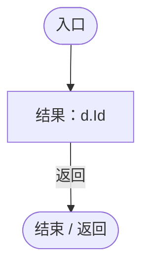

## 回调@84 · L84

`r … => 回调`

### Editor / Player · Roslyn编译器控制流

```mermaid
flowchart TD
  b0(["入口"])
  b1{"判断：r.id==ProducerRuleId"}
  b2["r.id==MobileRuleId"]
  b3["r.id==ProducerRuleId"]
  b4["结果：r.id==ProducerRuleId&#124;&#124;r.id==MobileRuleId"]
  b5(["结束 / 返回"])
  b0 --> b1
  b1 -->|"否"| b2
  b1 -->|"是"| b3
  b2 --> b4
  b3 --> b4
  b4 -->|"返回"| b5

```

## Reset · L89

`[RuntimeInitializeOnLoadMethod(RuntimeInitializeLoadType.SubsystemRegistration)] private static void Reset()`

### Editor / Player · Roslyn编译器控制流

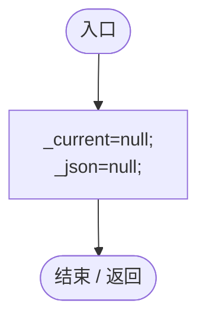
