# EntityEnvironmentHazard.cs

[返回总索引](../README.md) · `Runtime` · `Assets/DarwinPark/Entities/Vitals/EntityEnvironmentHazard.cs`

[源文件](../../../Assets/DarwinPark/Entities/Vitals/EntityEnvironmentHazard.cs) · 源码校验：`9ac51d9bc3c8590d794eee4629a2975e0a20026d0c1b90309e20af2790d81882`

方法按源文件位置排列。事件/回调引用不表示立即执行；分支与异常说明见总索引。完整源码与可点击关系图请打开离线手册。

## CurrentTemperature.get · L25

`get`

### Editor / Player · 语法控制结构 / 声明（非CFG）

## CurrentTemperature.set · L25

`private set`

### Editor / Player · 语法控制结构 / 声明（非CFG）

## CurrentHumidity.get · L26

`get`

### Editor / Player · 语法控制结构 / 声明（非CFG）

## CurrentHumidity.set · L26

`private set`

### Editor / Player · 语法控制结构 / 声明（非CFG）

## IsDrowning.get · L27

`get`

### Editor / Player · 语法控制结构 / 声明（非CFG）

## IsDrowning.set · L27

`private set`

### Editor / Player · 语法控制结构 / 声明（非CFG）

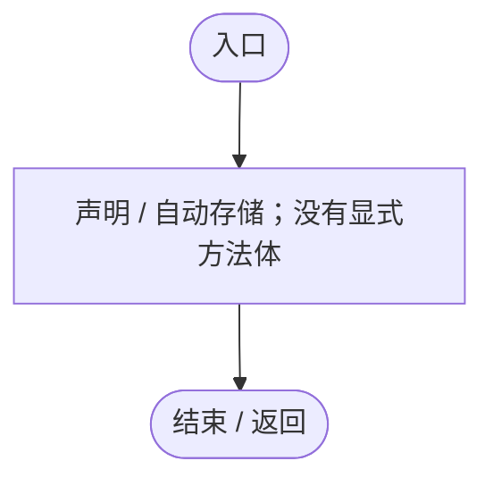

## IsSubmerged.get · L31

`get`

### Editor / Player · Roslyn编译器控制流

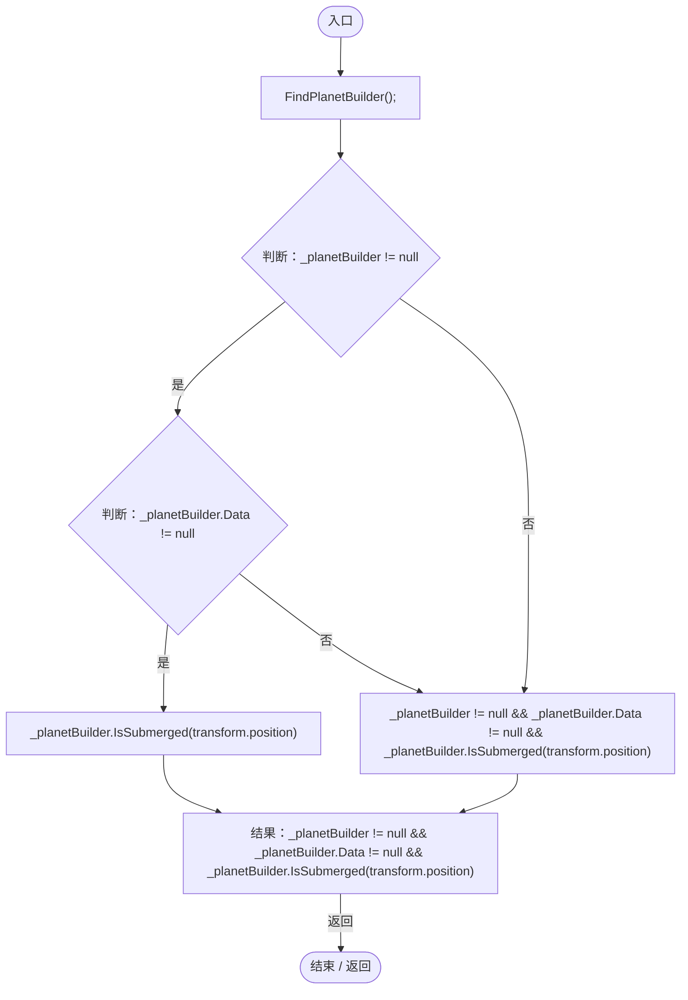

项目内调用/回调引用：

- [EntityEnvironmentHazard.FindPlanetBuilder · L231](5c434d0ba85333b1.md#mffc1c6d5e9097e46)（方法）
- [PlanetTerrainMeshBuilder.Data.get · L78](415285cf043354a9.md#m8382f579717fbc6d)（访问器）
- [PlanetTerrainMeshBuilder.IsSubmerged · L102](415285cf043354a9.md#mba37dcd70e29e11a)（方法）

## StressLevel.get · L34

`get`

### Editor / Player · 语法控制结构 / 声明（非CFG）

## StressLevel.set · L34

`private set`

### Editor / Player · 语法控制结构 / 声明（非CFG）

## Awake · L44

`private void Awake()`

### Editor / Player · Roslyn编译器控制流

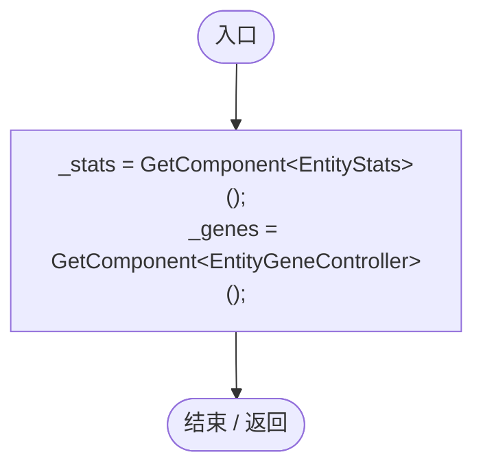

## Start · L50

`private void Start()`

### Editor / Player · Roslyn编译器控制流

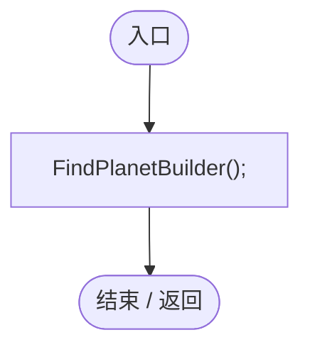

项目内调用/回调引用：

- [EntityEnvironmentHazard.FindPlanetBuilder · L231](5c434d0ba85333b1.md#mffc1c6d5e9097e46)（方法）

## Update · L55

`private void Update()`

### Editor / Player · Roslyn编译器控制流

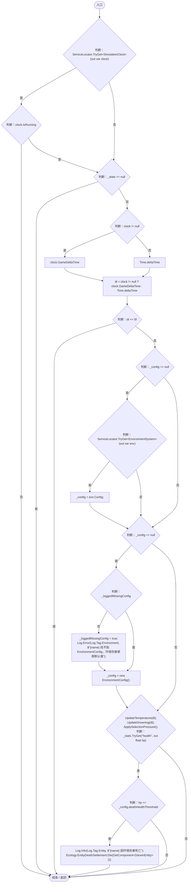

项目内调用/回调引用：

- [ServiceLocator.TryGet · L26](f2fdbe9f9ccd93cb.md#m143b24e6d58471b0)（方法）
- [SimulationClock.IsRunning.get · L22](a8f444aec9614b0a.md#m10f4fe307faca0f0)（访问器）
- [SimulationClock.GameDeltaTime.get · L26](a8f444aec9614b0a.md#me7f11abae18a4f2d)（访问器）
- [EnvironmentSystem.Config.get · L25](bfb4f2987b577f02.md#m89db420c1afba8f5)（访问器）
- [Log.Error · L43](735e5abf0df2bddc.md#m2addd5e1d74b000d)（方法）
- [EntityEnvironmentHazard.UpdateTemperature · L88](5c434d0ba85333b1.md#m1fdba6545a59866d)（方法）
- [EntityEnvironmentHazard.UpdateDrowning · L151](5c434d0ba85333b1.md#mdf844e625a98283e)（方法）
- [EntityEnvironmentHazard.ApplySelectionPressure · L186](5c434d0ba85333b1.md#m849d3b96adf1e7b9)（方法）
- [EntityStats.TryGet · L90](75aa86a368efdf24.md#m24ee1433e4a70d94)（方法）
- [Log.Info · L31](735e5abf0df2bddc.md#md1fe08215a3ce4d3)（方法）
- [EntityDeathSettlement.Die · L11](07fa6bdaadf50796.md#m700276963777d0a6)（方法）

## UpdateTemperature · L88

`private void UpdateTemperature(float dt)`

### Editor / Player · Roslyn编译器控制流

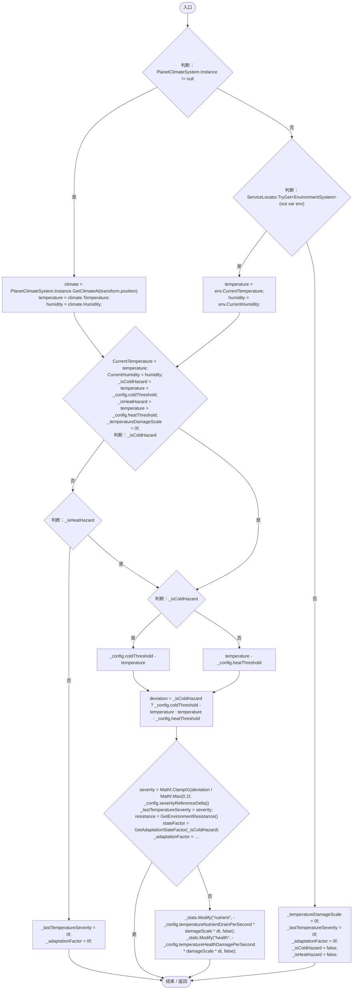

项目内调用/回调引用：

- [PlanetClimateSystem.Instance.get · L32](ba86e31da9b7d0a5.md#mf8e5c7e126d7b598)（访问器）
- [PlanetClimateSystem.GetClimateAt · L69](ba86e31da9b7d0a5.md#m238e7907ac2c7c64)（方法）
- [ServiceLocator.TryGet · L26](f2fdbe9f9ccd93cb.md#m143b24e6d58471b0)（方法）
- [EnvironmentSystem.CurrentTemperature.get · L21](bfb4f2987b577f02.md#m3a0c2df48ae2c37d)（访问器）
- [EnvironmentSystem.CurrentHumidity.get · L22](bfb4f2987b577f02.md#me5d44e71ef36315f)（访问器）
- [EntityEnvironmentHazard.CurrentTemperature.set · L25](5c434d0ba85333b1.md#m0cb161ff53b23621)（访问器）
- [EntityEnvironmentHazard.CurrentHumidity.set · L26](5c434d0ba85333b1.md#m865b15097313e497)（访问器）
- [EntityEnvironmentHazard.GetEnvironmentResistance · L238](5c434d0ba85333b1.md#mc55b3eaa253e9805)（方法）
- [EntityEnvironmentHazard.GetAdaptationStateFactor · L248](5c434d0ba85333b1.md#me86a137e7cf73cc2)（方法）
- [EntityStats.Modify · L111](75aa86a368efdf24.md#m9c837be197158240)（方法）

## UpdateDrowning · L151

`private void UpdateDrowning(float dt)`

### Editor / Player · Roslyn编译器控制流

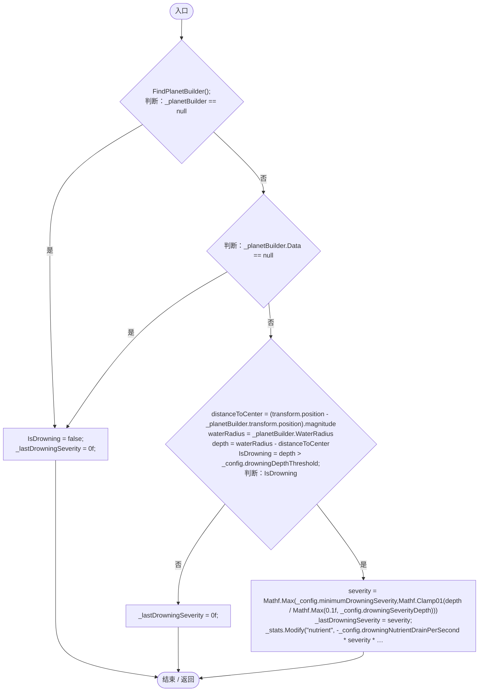

项目内调用/回调引用：

- [EntityEnvironmentHazard.FindPlanetBuilder · L231](5c434d0ba85333b1.md#mffc1c6d5e9097e46)（方法）
- [PlanetTerrainMeshBuilder.Data.get · L78](415285cf043354a9.md#m8382f579717fbc6d)（访问器）
- [EntityEnvironmentHazard.IsDrowning.set · L27](5c434d0ba85333b1.md#m0d5d29bb738351fb)（访问器）
- [PlanetTerrainMeshBuilder.WaterRadius.get · L94](415285cf043354a9.md#m28d8809083881ec1)（访问器）
- [EntityEnvironmentHazard.IsDrowning.get · L27](5c434d0ba85333b1.md#md1684c4e763e2899)（访问器）
- [EntityStats.Modify · L111](75aa86a368efdf24.md#m9c837be197158240)（方法）

## ApplySelectionPressure · L186

`private void ApplySelectionPressure()`

  ★ 修复（防Bug回归）：按有效抵抗能力与温度方向计算适应缺口，  不能仅凭存在耐寒/耐热状态就认定完全适应。环境压力抑制所有基因，  同时提高环境适应基因变异概率；溺水不定向产生耐寒/耐热突变。  

### Editor / Player · Roslyn编译器控制流

```mermaid
flowchart TD
  b0(["入口"])
  b1{"判断：_genes == null"}
  b2{"判断：_config == null"}
  b3["StressLevel = Mathf.Max(_temperatureDamageScale, _lastDrowningSeverity);<br/>suppression = 0f<br/>mutationChance = 0f<br/>targetValue = -1f<br/>temperatureStress = Mathf.Clamp01(_temperatureDamageScale)<br/>adaptationGap = Mathf.Clamp01(1f - _adaptationFactor)"]
  b4{"判断：_isColdHazard"}
  b5["_isHeatHazard"]
  b6["_isColdHazard"]
  b7["hasTemperatureHazard = _isColdHazard &#124;&#124; _isHeatHazard"]
  b8{"判断：hasTemperatureHazard"}
  b9{"判断：adaptationGap &gt; 0.01f"}
  b10{"判断：temperatureStress &gt; _config.environmentStressThreshold"}
  b11{"t = Mathf.InverseLerp( _config.environmentStressThreshold, 1f, temperatureStress)<br/>suppression = t * _config.maxGlobalGeneSuppression * adaptationGap;<br/>mutationChance = _config.adaptationMutationChance * adaptationGap;<br/>判断：_isColdHazard"}
  b12["targetValue = ResolveAdaptationTarget(_config.coldAdaptedStateId, 20f);"]
  b13["targetValue = ResolveAdaptationTarget(_config.heatAdaptedStateId, 80f);"]
  b14["_genes.ApplyEnvironmentPressure( suppression, mutationChance, _config.environmentGeneId, targetValue);"]
  b15(["结束 / 返回"])
  b0 --> b1
  b1 -->|"否"| b2
  b1 -->|"是"| b15
  b2 -->|"是"| b15
  b2 -->|"否"| b3
  b3 --> b4
  b4 -->|"否"| b5
  b4 -->|"是"| b6
  b5 --> b7
  b6 --> b7
  b7 --> b8
  b8 -->|"是"| b9
  b8 -->|"否"| b14
  b9 -->|"是"| b10
  b9 -->|"否"| b14
  b10 -->|"是"| b11
  b10 -->|"否"| b14
  b11 -->|"是"| b12
  b11 -->|"否"| b13
  b12 --> b14
  b13 --> b14
  b14 --> b15

```

项目内调用/回调引用：

- [EntityEnvironmentHazard.StressLevel.set · L34](5c434d0ba85333b1.md#m7896ecdfad9157d0)（访问器）
- [EntityEnvironmentHazard.ResolveAdaptationTarget · L218](5c434d0ba85333b1.md#mbc8f7c7182e47583)（方法）
- [EntityGeneController.ApplyEnvironmentPressure · L187](7494d53178552f0e.md#m2e1f88c0ce587fb8)（方法）

## ResolveAdaptationTarget · L218

`private float ResolveAdaptationTarget(string stateId, float fallback)`

### Editor / Player · Roslyn编译器控制流

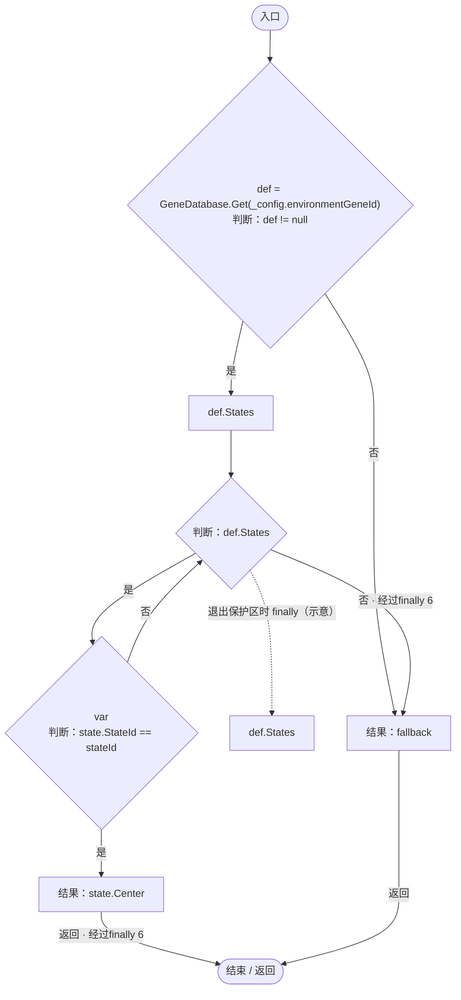

项目内调用/回调引用：

- [GeneDatabase.Get · L135](ec0a03483435a863.md#m8f3bbfb35f3ca397)（方法）

## FindPlanetBuilder · L231

`private void FindPlanetBuilder()`

### Editor / Player · Roslyn编译器控制流

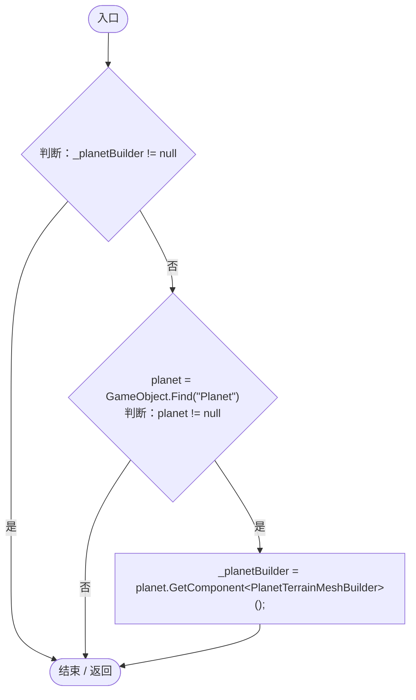

## GetEnvironmentResistance · L238

`private float GetEnvironmentResistance()`

### Editor / Player · Roslyn编译器控制流

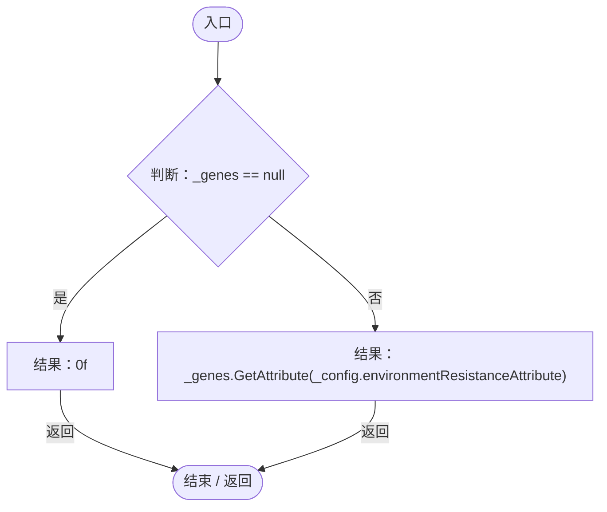

项目内调用/回调引用：

- [EntityGeneController.GetAttribute · L257](7494d53178552f0e.md#m600509f72d274f0c)（方法）

## GetAdaptationStateFactor · L248

`private float GetAdaptationStateFactor(bool isColdHazard)`

  耐寒基因在寒冷环境发挥 100%，在炎热环境只剩配置比例；耐热基因反之。  没有适应基因时返回 0（没有可用的抵抗方向）。  

### Editor / Player · Roslyn编译器控制流

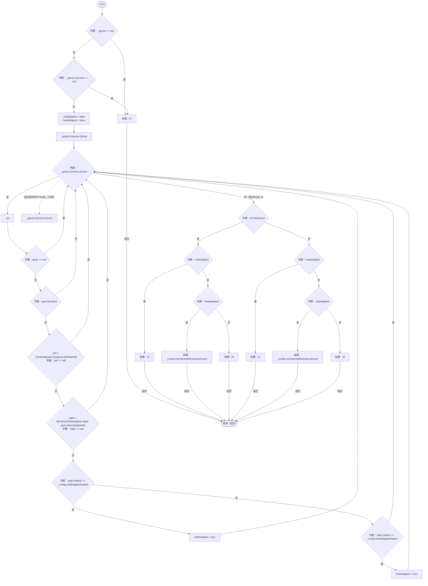

项目内调用/回调引用：

- [GeneDatabase.Get · L135](ec0a03483435a863.md#m8f3bbfb35f3ca397)（方法）
- [GeneDefinition.ResolveState · L83](07f99d5784e3dadb.md#mbaf2c5b1eb1045c5)（方法）

## GetStatusLine · L280

`public string GetStatusLine()`

供基因面板显示当前环境压力，避免玩家只能看到温度却不知道是否受伤。

### Editor / Player · Roslyn编译器控制流

```mermaid
flowchart TD
  b0(["入口"])
  b1{"判断：_genes != null"}
  b2["_genes.EnvironmentGeneSuppression"]
  b3["0f"]
  b4["suppression = _genes != null ? _genes.EnvironmentGeneSuppression : 0f"]
  b5{"判断：suppression &gt; 0.5f"}
  b6["$&quot; &#124; &lt;color=#FF6B6B&gt;适应缺口 {suppression:F0}（所有基因受抑）&lt;/color&gt;&quot;"]
  b7["&quot;&quot;"]
  b8["pressure = suppression &gt; 0.5f ? $&quot; &#124; &lt;color=#FF6B6B&gt;适应缺口 {suppression:F0}（所有基因受抑）&lt;/color&gt;&quot; : &quot;&quot;"]
  b9{"判断：IsDrowning"}
  b10["结果：$&quot;&lt;color=#FF6B6B&gt;溺水 ({_lastDrowningSeverity * 100f:F0}%) &#124; 温度 {CurrentTemperature:F1}°C&lt;/color&gt;{pressure}&quot;"]
  b11{"判断：_isColdHazard"}
  b12["结果：$&quot;&lt;color=#6EC6FF&gt;寒冷 ({_lastTemperatureSeverity * 100f:F0}%) &#124; 温度 {CurrentTemperature:F1}°C&lt;/color&gt;{pressure}&quot;"]
  b13{"判断：_isHeatHazard"}
  b14["结果：$&quot;&lt;color=#FF9A5C&gt;酷热 ({_lastTemperatureSeverity * 100f:F0}%) &#124; 温度 {CurrentTemperature:F1}°C&lt;/color&gt;{pressure}&quot;"]
  b15["结果：$&quot;舒适 &#124; 温度 {CurrentTemperature:F1}°C &#124; 湿度 {CurrentHumidity:F1}%&quot;"]
  b16(["结束 / 返回"])
  b0 --> b1
  b1 -->|"是"| b2
  b1 -->|"否"| b3
  b2 --> b4
  b3 --> b4
  b4 --> b5
  b5 -->|"是"| b6
  b5 -->|"否"| b7
  b6 --> b8
  b7 --> b8
  b8 --> b9
  b9 -->|"是"| b10
  b9 -->|"否"| b11
  b10 -->|"返回"| b16
  b11 -->|"是"| b12
  b11 -->|"否"| b13
  b12 -->|"返回"| b16
  b13 -->|"是"| b14
  b13 -->|"否"| b15
  b14 -->|"返回"| b16
  b15 -->|"返回"| b16

```

项目内调用/回调引用：

- [EntityEnvironmentHazard.IsDrowning.get · L27](5c434d0ba85333b1.md#md1684c4e763e2899)（访问器）
- [EntityEnvironmentHazard.CurrentTemperature.get · L25](5c434d0ba85333b1.md#mdf1bdf8db79f66a8)（访问器）
- [EntityEnvironmentHazard.CurrentHumidity.get · L26](5c434d0ba85333b1.md#mfe330fd1f9ba497a)（访问器）
