# EntityEnvironmentHazard.cs

[返回总索引](../README.md) · `Runtime` · `Assets/DarwinPark/Entities/Vitals/EntityEnvironmentHazard.cs`

[源文件](../../../Assets/DarwinPark/Entities/Vitals/EntityEnvironmentHazard.cs) · 源码校验：`4af56eb530025205db43d7afeed2793b56d808d3d04b292aa0f7df19a93919ad`

方法按源文件位置排列。事件/回调引用不表示立即执行；分支与异常说明见总索引。完整源码与可点击关系图请打开离线手册。

<a id="mdf1bdf8db79f66a8"></a>

## CurrentTemperature.get · L25

`get`


### Editor / Player · 语法控制结构 / 声明（非CFG）


<a id="m0cb161ff53b23621"></a>

## CurrentTemperature.set · L25

`private set`


### Editor / Player · 语法控制结构 / 声明（非CFG）


<a id="mfe330fd1f9ba497a"></a>

## CurrentHumidity.get · L26

`get`


### Editor / Player · 语法控制结构 / 声明（非CFG）

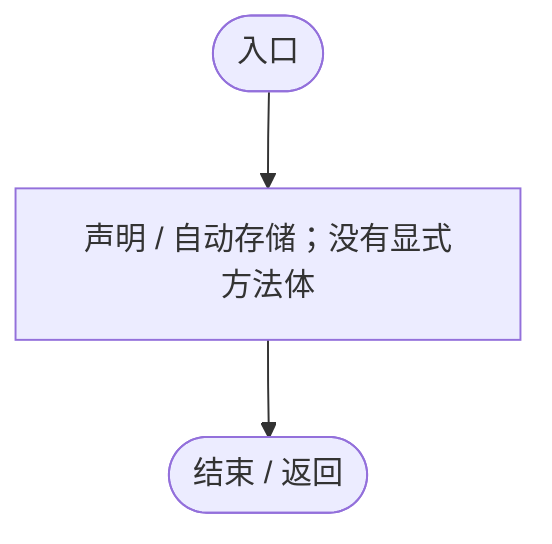

<a id="m865b15097313e497"></a>

## CurrentHumidity.set · L26

`private set`


### Editor / Player · 语法控制结构 / 声明（非CFG）


<a id="md1684c4e763e2899"></a>

## IsDrowning.get · L27

`get`


### Editor / Player · 语法控制结构 / 声明（非CFG）


<a id="m0d5d29bb738351fb"></a>

## IsDrowning.set · L27

`private set`


### Editor / Player · 语法控制结构 / 声明（非CFG）


<a id="mab7b6057b8137739"></a>

## IsSubmerged.get · L31

`get`


### Editor / Player · Roslyn编译器控制流

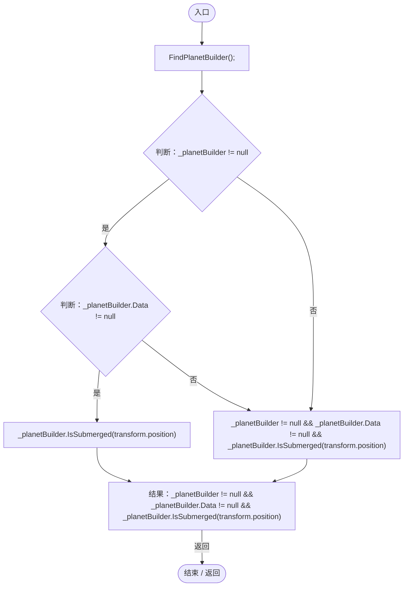

项目内调用/回调引用：

- [EntityEnvironmentHazard.FindPlanetBuilder · L244](5c434d0ba85333b1.md#m3d136815030fd32c)（方法）
- [PlanetTerrainMeshBuilder.Data.get · L78](415285cf043354a9.md#m8382f579717fbc6d)（访问器）
- [PlanetTerrainMeshBuilder.IsSubmerged · L102](415285cf043354a9.md#mba37dcd70e29e11a)（方法）

<a id="m5b49c0526a2393cc"></a>

## StressLevel.get · L34

`get`


### Editor / Player · 语法控制结构 / 声明（非CFG）


<a id="m7896ecdfad9157d0"></a>

## StressLevel.set · L34

`private set`


### Editor / Player · 语法控制结构 / 声明（非CFG）


<a id="m242982ae601ddb6b"></a>

## Awake · L44

`private void Awake()`


### Editor / Player · Roslyn编译器控制流

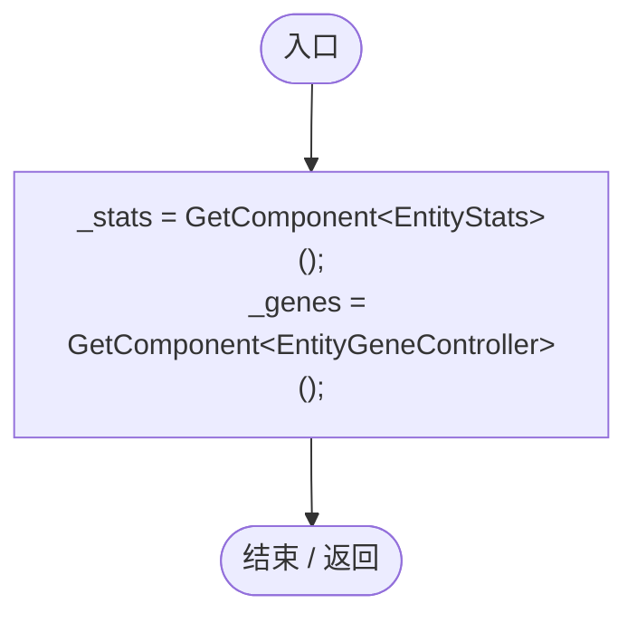

<a id="m5d99dd60a09c5b31"></a>

## Start · L50

`private void Start()`


### Editor / Player · Roslyn编译器控制流

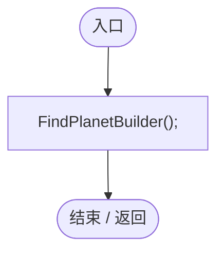

项目内调用/回调引用：

- [EntityEnvironmentHazard.FindPlanetBuilder · L244](5c434d0ba85333b1.md#m3d136815030fd32c)（方法）

<a id="m95bb10a60d65b76e"></a>

## Update · L55

`private void Update()`


### Editor / Player · Roslyn编译器控制流

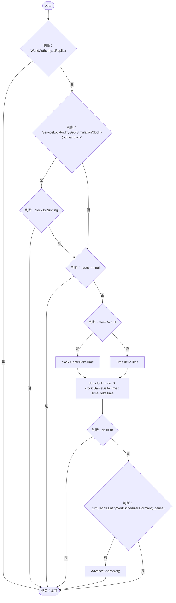

项目内调用/回调引用：

- [ServiceLocator.TryGet · L26](f2fdbe9f9ccd93cb.md#m143b24e6d58471b0)（方法）
- [SimulationClock.IsRunning.get · L22](a8f444aec9614b0a.md#m10f4fe307faca0f0)（访问器）
- [SimulationClock.GameDeltaTime.get · L26](a8f444aec9614b0a.md#me7f11abae18a4f2d)（访问器）
- [EntityWorkScheduler.Dormant · L69](465ccdbb260bcac2.md#md43b98c19bd19e9c)（方法）
- [EntityEnvironmentHazard.AdvanceShared · L74](5c434d0ba85333b1.md#mbfde8d0e75da3c35)（方法）

<a id="mde6babe1d07e4627"></a>

## CopySharedReadings · L69

`public void CopySharedReadings(EntityEnvironmentHazard source)`


### Editor / Player · Roslyn编译器控制流

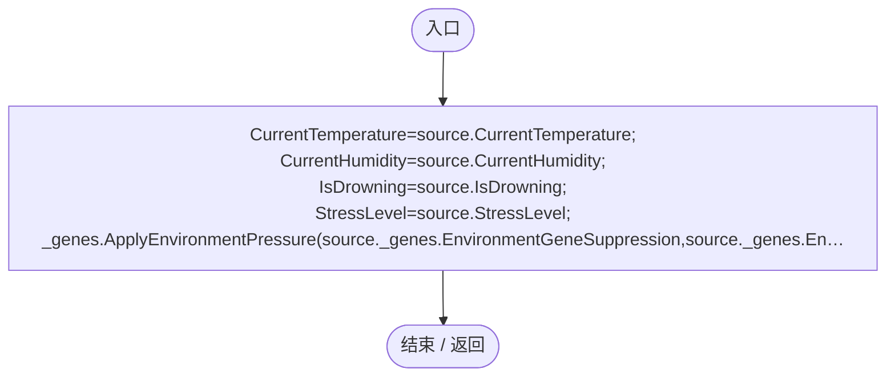

项目内调用/回调引用：

- [EntityEnvironmentHazard.CurrentTemperature.set · L25](5c434d0ba85333b1.md#m0cb161ff53b23621)（访问器）
- [EntityEnvironmentHazard.CurrentTemperature.get · L25](5c434d0ba85333b1.md#mdf1bdf8db79f66a8)（访问器）
- [EntityEnvironmentHazard.CurrentHumidity.set · L26](5c434d0ba85333b1.md#m865b15097313e497)（访问器）
- [EntityEnvironmentHazard.CurrentHumidity.get · L26](5c434d0ba85333b1.md#mfe330fd1f9ba497a)（访问器）
- [EntityEnvironmentHazard.IsDrowning.set · L27](5c434d0ba85333b1.md#m0d5d29bb738351fb)（访问器）
- [EntityEnvironmentHazard.IsDrowning.get · L27](5c434d0ba85333b1.md#md1684c4e763e2899)（访问器）
- [EntityEnvironmentHazard.StressLevel.set · L34](5c434d0ba85333b1.md#m7896ecdfad9157d0)（访问器）
- [EntityEnvironmentHazard.StressLevel.get · L34](5c434d0ba85333b1.md#m5b49c0526a2393cc)（访问器）
- [EntityGeneController.ApplyEnvironmentPressure · L192](7494d53178552f0e.md#mef4fb8745e878479)（方法）

<a id="mbfde8d0e75da3c35"></a>

## AdvanceShared · L74

`public void AdvanceShared(float dt)`


### Editor / Player · Roslyn编译器控制流

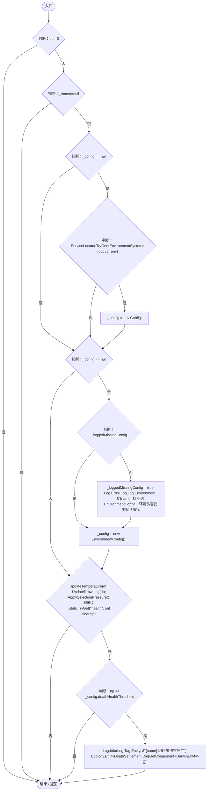

项目内调用/回调引用：

- [ServiceLocator.TryGet · L26](f2fdbe9f9ccd93cb.md#m143b24e6d58471b0)（方法）
- [EnvironmentSystem.Config.get · L25](bfb4f2987b577f02.md#m89db420c1afba8f5)（访问器）
- [Log.Error · L43](735e5abf0df2bddc.md#m2addd5e1d74b000d)（方法）
- [EntityEnvironmentHazard.UpdateTemperature · L101](5c434d0ba85333b1.md#m8ec39a137e29b3d0)（方法）
- [EntityEnvironmentHazard.UpdateDrowning · L164](5c434d0ba85333b1.md#mf06d73fa46b70f9a)（方法）
- [EntityEnvironmentHazard.ApplySelectionPressure · L199](5c434d0ba85333b1.md#m7a8032b61c97ac6c)（方法）
- [EntityStats.TryGet · L90](75aa86a368efdf24.md#m24ee1433e4a70d94)（方法）
- [Log.Info · L31](735e5abf0df2bddc.md#md1fe08215a3ce4d3)（方法）
- [EntityDeathSettlement.Die · L11](07fa6bdaadf50796.md#m700276963777d0a6)（方法）

<a id="m8ec39a137e29b3d0"></a>

## UpdateTemperature · L101

`private void UpdateTemperature(float dt)`


### Editor / Player · Roslyn编译器控制流

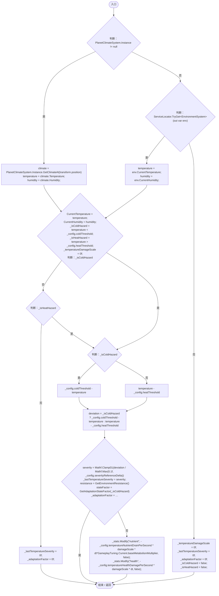

项目内调用/回调引用：

- [PlanetClimateSystem.Instance.get · L32](ba86e31da9b7d0a5.md#mf8e5c7e126d7b598)（访问器）
- [PlanetClimateSystem.GetClimateAt · L69](ba86e31da9b7d0a5.md#m238e7907ac2c7c64)（方法）
- [ServiceLocator.TryGet · L26](f2fdbe9f9ccd93cb.md#m143b24e6d58471b0)（方法）
- [EnvironmentSystem.CurrentTemperature.get · L21](bfb4f2987b577f02.md#m3a0c2df48ae2c37d)（访问器）
- [EnvironmentSystem.CurrentHumidity.get · L22](bfb4f2987b577f02.md#me5d44e71ef36315f)（访问器）
- [EntityEnvironmentHazard.CurrentTemperature.set · L25](5c434d0ba85333b1.md#m0cb161ff53b23621)（访问器）
- [EntityEnvironmentHazard.CurrentHumidity.set · L26](5c434d0ba85333b1.md#m865b15097313e497)（访问器）
- [EntityEnvironmentHazard.GetEnvironmentResistance · L251](5c434d0ba85333b1.md#m5df0e7aadcf0a1d0)（方法）
- [EntityEnvironmentHazard.GetAdaptationStateFactor · L261](5c434d0ba85333b1.md#mb99f663094dea92f)（方法）
- [EntityStats.Modify · L111](75aa86a368efdf24.md#m9c837be197158240)（方法）
- [GameplayTuning.Current.get · L31](db546e5713b32d53.md#m557c9ecc76cc372d)（访问器）

<a id="mf06d73fa46b70f9a"></a>

## UpdateDrowning · L164

`private void UpdateDrowning(float dt)`


### Editor / Player · Roslyn编译器控制流

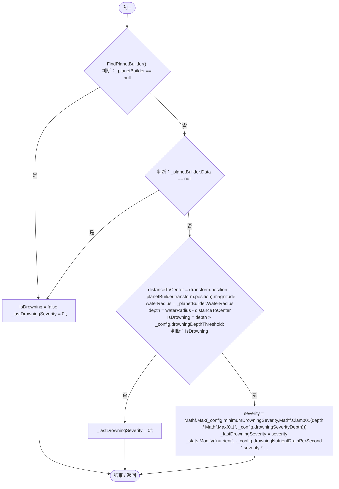

项目内调用/回调引用：

- [EntityEnvironmentHazard.FindPlanetBuilder · L244](5c434d0ba85333b1.md#m3d136815030fd32c)（方法）
- [PlanetTerrainMeshBuilder.Data.get · L78](415285cf043354a9.md#m8382f579717fbc6d)（访问器）
- [EntityEnvironmentHazard.IsDrowning.set · L27](5c434d0ba85333b1.md#m0d5d29bb738351fb)（访问器）
- [PlanetTerrainMeshBuilder.WaterRadius.get · L94](415285cf043354a9.md#m28d8809083881ec1)（访问器）
- [EntityEnvironmentHazard.IsDrowning.get · L27](5c434d0ba85333b1.md#md1684c4e763e2899)（访问器）
- [EntityStats.Modify · L111](75aa86a368efdf24.md#m9c837be197158240)（方法）
- [GameplayTuning.Current.get · L31](db546e5713b32d53.md#m557c9ecc76cc372d)（访问器）

<a id="m7a8032b61c97ac6c"></a>

## ApplySelectionPressure · L199

`private void ApplySelectionPressure()`

<summary>  ★ 修复（防Bug回归）：按有效抵抗能力与温度方向计算适应缺口，  不能仅凭存在耐寒/耐热状态就认定完全适应。环境压力抑制所有基因，  同时提高环境适应基因变异概率；溺水不定向产生耐寒/耐热突变。  </summary>

### Editor / Player · Roslyn编译器控制流

```mermaid
flowchart TD
  b0(["入口"])
  b1{"判断：_genes == null"}
  b2{"判断：_config == null"}
  b3["StressLevel = Mathf.Max(_temperatureDamageScale, _lastDrowningSeverity);<br/>suppression = 0f<br/>mutationChance = 0f<br/>targetValue = -1f<br/>temperatureStress = Mathf.Clamp01(_temperatureDamageScale)<br/>adaptationGap = Mathf.Clamp01(1f - _adaptationFactor)"]
  b4{"判断：_isColdHazard"}
  b5["_isHeatHazard"]
  b6["_isColdHazard"]
  b7["hasTemperatureHazard = _isColdHazard &#124;&#124; _isHeatHazard"]
  b8{"判断：hasTemperatureHazard"}
  b9{"判断：adaptationGap &gt; 0.01f"}
  b10{"判断：temperatureStress &gt; _config.environmentStressThreshold"}
  b11{"t = Mathf.InverseLerp( _config.environmentStressThreshold, 1f, temperatureStress)<br/>suppression = t * _config.maxGlobalGeneSuppression * adaptationGap;<br/>mutationChance = _config.adaptationMutationChance * adaptationGap;<br/>判断：_isColdHazard"}
  b12["targetValue = ResolveAdaptationTarget(_config.coldAdaptedStateId, 20f);"]
  b13["targetValue = ResolveAdaptationTarget(_config.heatAdaptedStateId, 80f);"]
  b14["_genes.ApplyEnvironmentPressure( suppression, mutationChance, _config.environmentGeneId, targetValue);"]
  b15(["结束 / 返回"])
  b0 --> b1
  b1 -->|"否"| b2
  b1 -->|"是"| b15
  b2 -->|"是"| b15
  b2 -->|"否"| b3
  b3 --> b4
  b4 -->|"否"| b5
  b4 -->|"是"| b6
  b5 --> b7
  b6 --> b7
  b7 --> b8
  b8 -->|"是"| b9
  b8 -->|"否"| b14
  b9 -->|"是"| b10
  b9 -->|"否"| b14
  b10 -->|"是"| b11
  b10 -->|"否"| b14
  b11 -->|"是"| b12
  b11 -->|"否"| b13
  b12 --> b14
  b13 --> b14
  b14 --> b15

```

项目内调用/回调引用：

- [EntityEnvironmentHazard.StressLevel.set · L34](5c434d0ba85333b1.md#m7896ecdfad9157d0)（访问器）
- [EntityEnvironmentHazard.ResolveAdaptationTarget · L231](5c434d0ba85333b1.md#m26c345720d3a6192)（方法）
- [EntityGeneController.ApplyEnvironmentPressure · L192](7494d53178552f0e.md#mef4fb8745e878479)（方法）

<a id="m26c345720d3a6192"></a>

## ResolveAdaptationTarget · L231

`private float ResolveAdaptationTarget(string stateId, float fallback)`


### Editor / Player · Roslyn编译器控制流

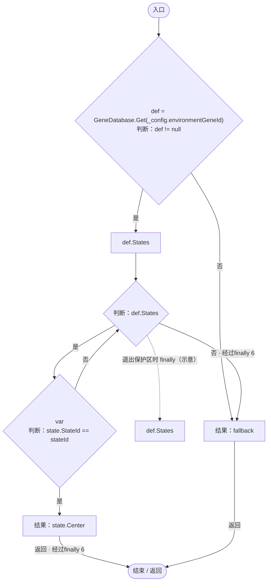

项目内调用/回调引用：

- [GeneDatabase.Get · L136](ec0a03483435a863.md#me6a5fefe6c3492f9)（方法）

<a id="m3d136815030fd32c"></a>

## FindPlanetBuilder · L244

`private void FindPlanetBuilder()`


### Editor / Player · Roslyn编译器控制流

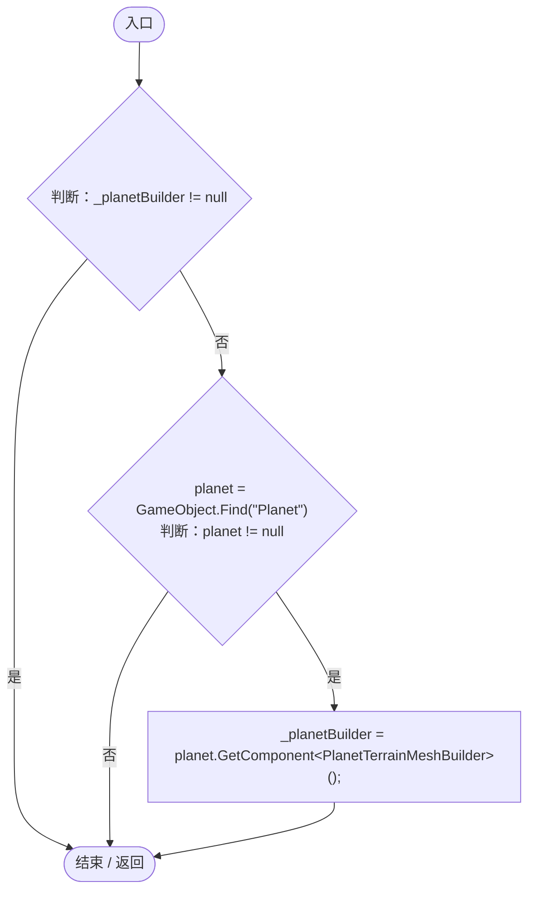

<a id="m5df0e7aadcf0a1d0"></a>

## GetEnvironmentResistance · L251

`private float GetEnvironmentResistance()`


### Editor / Player · Roslyn编译器控制流

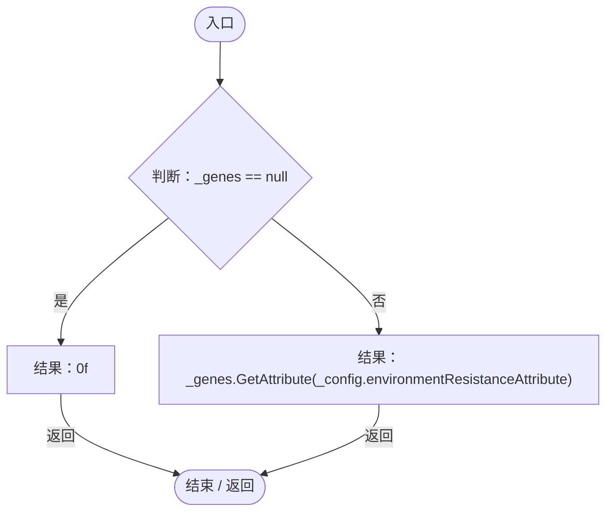

项目内调用/回调引用：

- [EntityGeneController.GetAttribute · L262](7494d53178552f0e.md#mfead0db2249507df)（方法）

<a id="mb99f663094dea92f"></a>

## GetAdaptationStateFactor · L261

`private float GetAdaptationStateFactor(bool isColdHazard)`

<summary>  耐寒基因在寒冷环境发挥 100%，在炎热环境只剩配置比例；耐热基因反之。  没有适应基因时返回 0（没有可用的抵抗方向）。  </summary>

### Editor / Player · Roslyn编译器控制流

```mermaid
flowchart TD
  b0(["入口"])
  b1{"判断：_genes == null"}
  b2{"判断：_genes.Genome == null"}
  b3["结果：0f"]
  b4["coldAdapted = false<br/>heatAdapted = false"]
  b5["_genes.Genome.Genes"]
  b6{"判断：_genes.Genome.Genes"}
  b7["var"]
  b8{"判断：gene == null"}
  b9{"判断：gene.Enabled"}
  b10{"def = GeneDatabase.Get(gene.DefinitionId)<br/>判断：def == null"}
  b11{"state = def.ResolveState(gene.Value, gene.MissingStateIds)<br/>判断：state == null"}
  b12{"判断：state.StateId == _config.coldAdaptedStateId"}
  b13["coldAdapted = true;"]
  b14{"判断：state.StateId == _config.heatAdaptedStateId"}
  b15["heatAdapted = true;"]
  b16["_genes.Genome.Genes"]
  b17{"判断：isColdHazard"}
  b18{"判断：coldAdapted"}
  b19["结果：1f"]
  b20{"判断：heatAdapted"}
  b21["结果：_config.mismatchedResistanceFactor"]
  b22["结果：0f"]
  b23{"判断：heatAdapted"}
  b24["结果：1f"]
  b25{"判断：coldAdapted"}
  b26["结果：_config.mismatchedResistanceFactor"]
  b27["结果：0f"]
  b28(["结束 / 返回"])
  b0 --> b1
  b1 -->|"否"| b2
  b1 -->|"是"| b3
  b2 -->|"是"| b3
  b2 -->|"否"| b4
  b3 -->|"返回"| b28
  b4 --> b5
  b5 --> b6
  b6 -->|"是"| b7
  b6 -->|"否 · 经过finally 16"| b17
  b7 --> b8
  b8 -->|"否"| b9
  b8 -->|"是"| b6
  b9 -->|"否"| b6
  b9 -->|"是"| b10
  b10 -->|"是"| b6
  b10 -->|"否"| b11
  b11 -->|"是"| b6
  b11 -->|"否"| b12
  b12 -->|"是"| b13
  b12 -->|"否"| b14
  b13 --> b6
  b14 -->|"是"| b15
  b14 -->|"否"| b6
  b15 --> b6
  b17 -->|"是"| b18
  b17 -->|"否"| b23
  b18 -->|"是"| b19
  b18 -->|"否"| b20
  b19 -->|"返回"| b28
  b20 -->|"是"| b21
  b20 -->|"否"| b22
  b21 -->|"返回"| b28
  b22 -->|"返回"| b28
  b23 -->|"是"| b24
  b23 -->|"否"| b25
  b24 -->|"返回"| b28
  b25 -->|"是"| b26
  b25 -->|"否"| b27
  b26 -->|"返回"| b28
  b27 -->|"返回"| b28
  b6 -. "退出保护区时 finally（示意）" .-> b16

```

项目内调用/回调引用：

- [GeneDatabase.Get · L136](ec0a03483435a863.md#me6a5fefe6c3492f9)（方法）
- [GeneDefinition.ResolveState · L85](07f99d5784e3dadb.md#mf00205d71765b81f)（方法）

<a id="mcffccb0117befdea"></a>

## GetStatusLine · L293

`public string GetStatusLine()`

<summary>供基因面板显示当前环境压力，避免玩家只能看到温度却不知道是否受伤。</summary>

### Editor / Player · Roslyn编译器控制流

```mermaid
flowchart TD
  b0(["入口"])
  b1{"判断：_genes != null"}
  b2["_genes.EnvironmentGeneSuppression"]
  b3["0f"]
  b4["suppression = _genes != null ? _genes.EnvironmentGeneSuppression : 0f"]
  b5{"判断：suppression &gt; 0.5f"}
  b6["$&quot; &#124; &lt;color=#FF6B6B&gt;适应缺口 {suppression:F0}（所有基因受抑）&lt;/color&gt;&quot;"]
  b7["&quot;&quot;"]
  b8["pressure = suppression &gt; 0.5f ? $&quot; &#124; &lt;color=#FF6B6B&gt;适应缺口 {suppression:F0}（所有基因受抑）&lt;/color&gt;&quot; : &quot;&quot;"]
  b9{"判断：IsDrowning"}
  b10["结果：$&quot;&lt;color=#FF6B6B&gt;溺水 ({_lastDrowningSeverity * 100f:F0}%) &#124; 温度 {CurrentTemperature:F1}°C&lt;/color&gt;{pressure}&quot;"]
  b11{"判断：_isColdHazard"}
  b12["结果：$&quot;&lt;color=#6EC6FF&gt;寒冷 ({_lastTemperatureSeverity * 100f:F0}%) &#124; 温度 {CurrentTemperature:F1}°C&lt;/color&gt;{pressure}&quot;"]
  b13{"判断：_isHeatHazard"}
  b14["结果：$&quot;&lt;color=#FF9A5C&gt;酷热 ({_lastTemperatureSeverity * 100f:F0}%) &#124; 温度 {CurrentTemperature:F1}°C&lt;/color&gt;{pressure}&quot;"]
  b15["结果：$&quot;舒适 &#124; 温度 {CurrentTemperature:F1}°C &#124; 湿度 {CurrentHumidity:F1}%&quot;"]
  b16(["结束 / 返回"])
  b0 --> b1
  b1 -->|"是"| b2
  b1 -->|"否"| b3
  b2 --> b4
  b3 --> b4
  b4 --> b5
  b5 -->|"是"| b6
  b5 -->|"否"| b7
  b6 --> b8
  b7 --> b8
  b8 --> b9
  b9 -->|"是"| b10
  b9 -->|"否"| b11
  b10 -->|"返回"| b16
  b11 -->|"是"| b12
  b11 -->|"否"| b13
  b12 -->|"返回"| b16
  b13 -->|"是"| b14
  b13 -->|"否"| b15
  b14 -->|"返回"| b16
  b15 -->|"返回"| b16

```

项目内调用/回调引用：

- [EntityEnvironmentHazard.IsDrowning.get · L27](5c434d0ba85333b1.md#md1684c4e763e2899)（访问器）
- [EntityEnvironmentHazard.CurrentTemperature.get · L25](5c434d0ba85333b1.md#mdf1bdf8db79f66a8)（访问器）
- [EntityEnvironmentHazard.CurrentHumidity.get · L26](5c434d0ba85333b1.md#mfe330fd1f9ba497a)（访问器）
