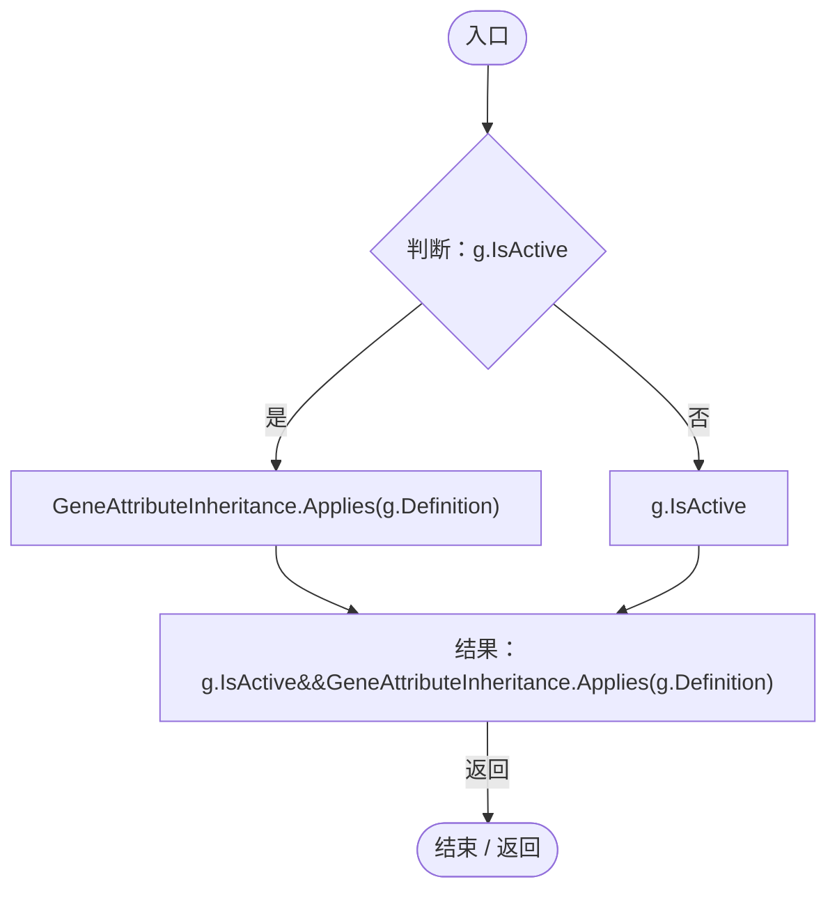
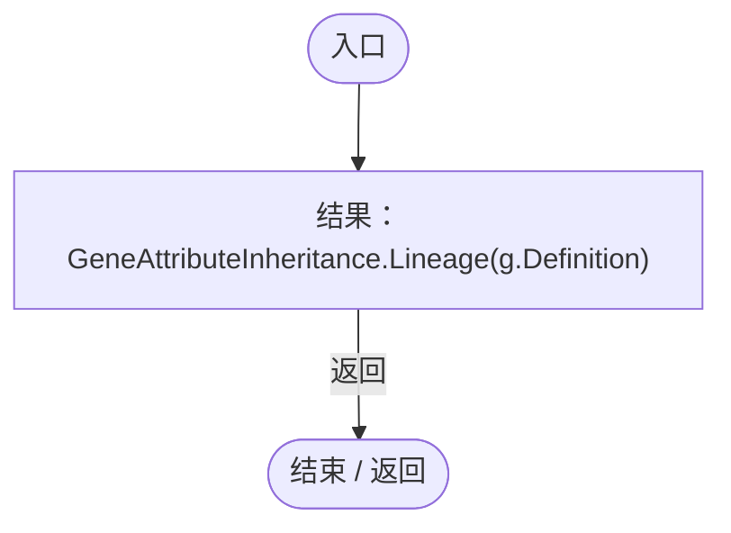
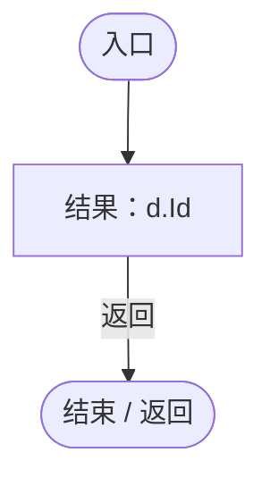
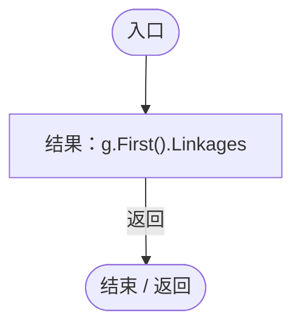
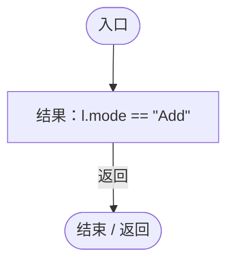
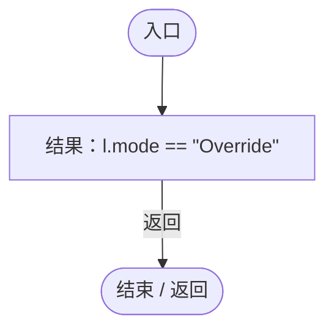

```mermaid
flowchart TD
  b0(["入口"])
  b1["finalAttrs = new Dictionary&lt;string, float&gt;(baseAttributes)"]
  b2{"ageState<br/>判断：AgeState.Infant =&gt; 0.5f"}
  b3["0.5f"]
  b4{"判断：AgeState.Adult =&gt; 1.2f"}
  b5["1.2f"]
  b6{"判断：AgeState.Elder =&gt; 0.8f"}
  b7["0.8f"]
  b8{"判断：_ =&gt; 1.0f"}
  b9["1.0f"]
  b10["结果：ageState switch { AgeState.Infant =&gt; 0.5f, AgeState.Adult =&gt; 1.2f, AgeState.Elder =&gt; 0.8f, _ =&gt; 1.0f }"]
  x10(["抛出异常 / 离开方法"])
  b11["ageMult = ageState switch { AgeState.Infant =&gt; 0.5f, AgeState.Adult =&gt; 1.2f, AgeState.Elder =&gt; 0.8f, _ =&gt; 1.0f }"]
  b12["finalAttrs[&quot;sys_age_mult&quot;] = ageMult;<br/>finalAttrs[&quot;sys_size&quot;] = size;"]
  b13{"finalAttrs[&quot;sys_gestating&quot;]<br/>判断：isGestating"}
  b14["1f"]
  b15["0f"]
  b16["finalAttrs[&quot;sys_gestating&quot;] = isGestating ? 1f : 0f;"]
  b17["activeGenes"]
  b18{"判断：activeGenes"}
  b19{"var<br/>判断：eval.IsActive"}
  b20{"判断：string.IsNullOrEmpty(eval.Definition.Id)"}
  b21{"finalAttrs[eval.Definition.Id] = 1f;<br/>判断：GeneAttributeInheritance.Applies(eval.Definition)"}
  b22["GeneAttributeInheritance.Lineage(eval.Definition)"]
  b23{"判断：GeneAttributeInheritance.Lineage(eval.Definition)"}
  b24["var<br/>finalAttrs[ancestor.Id]=1;"]
  b25{"判断：GeneAttributeInheritance.Lineage(eval.Definition)"}
  b26["GeneAttributeInheritance.Lineage(eval.Definition)"]
  b27["连接 / 离开区域"]
  b28["activeGenes"]
  b29["activeLinkages = new List&lt;AttributeLinkage&gt;()"]
  b30["activeGenes"]
  b31{"判断：activeGenes"}
  b32{"var<br/>判断：eval.IsActive"}
  b33{"判断：eval.Definition.Linkages == null"}
  b34{"判断：GeneAttributeInheritance.Applies(eval.Definition)"}
  b35["activeLinkages.AddRange(eval.Definition.Linkages);"]
  b36["activeGenes"]
  b37["activeLinkages.AddRange(activeGenes.Where(g=&gt;g.IsActive&amp;&amp;GeneAttributeInheritance.Applies(g.Definition)).SelectMany(g=&gt;GeneAttributeInheritance.Lineage(g.Definition)).GroupBy(d=&gt;d.Id).SelectMany(g=&gt;g.First().Linkages).Distinct());"]
  b38["activeLinkages.Where(l =&gt; l.mode == &quot;Add&quot;)"]
  b39{"判断：activeLinkages.Where(l =&gt; l.mode == &quot;Add&quot;)"}
  b40["var"]
  b41{"判断：finalAttrs.TryGetValue(link.sourceAttributeId, out float sourceVal)"}
  b42{"判断：finalAttrs.ContainsKey(link.targetAttributeId)"}
  b43["finalAttrs[link.targetAttributeId] = 0f;"]
  b44["effectVal = sourceVal * link.factor<br/>finalAttrs[link.targetAttributeId] += effectVal;"]
  b45{"判断：activeLinkages.Where(l =&gt; l.mode == &quot;Add&quot;)"}
  b46["activeLinkages.Where(l =&gt; l.mode == &quot;Add&quot;)"]
  b47["连接 / 离开区域"]
  b48["activeLinkages.Where(l =&gt; l.mode == &quot;Multiply&quot; &#124;&#124; l.mode == &quot;Divide&quot;)"]
  b49{"判断：activeLinkages.Where(l =&gt; l.mode == &quot;Multiply&quot; &#124;&#124; l.mode == &quot;Divide&quot;)"}
  b50["var"]
  b51{"判断：finalAttrs.TryGetValue(link.sourceAttributeId, out float sourceVal)"}
  b52{"判断：finalAttrs.ContainsKey(link.targetAttributeId)"}
  b53{"effectVal = sourceVal * link.factor<br/>判断：link.mode == &quot;Multiply&quot;"}
  b54["finalAttrs[link.targetAttributeId] *= effectVal;"]
  b55{"判断：effectVal &gt; 0.01f"}
  b56["finalAttrs[link.targetAttributeId] /= effectVal;"]
  b57{"判断：activeLinkages.Where(l =&gt; l.mode == &quot;Multiply&quot; &#124;&#124; l.mode == &quot;Divide&quot;)"}
  b58["activeLinkages.Where(l =&gt; l.mode == &quot;Multiply&quot; &#124;&#124; l.mode == &quot;Divide&quot;)"]
  b59["连接 / 离开区域"]
  b60["activeLinkages.Where(l =&gt; l.mode == &quot;Override&quot;)"]
  b61{"判断：activeLinkages.Where(l =&gt; l.mode == &quot;Override&quot;)"}
  b62["var"]
  b63{"判断：finalAttrs.TryGetValue(link.sourceAttributeId, out float sourceVal)"}
  b64["finalAttrs[link.targetAttributeId] = sourceVal * link.factor;"]
  b65{"判断：activeLinkages.Where(l =&gt; l.mode == &quot;Override&quot;)"}
  b66["activeLinkages.Where(l =&gt; l.mode == &quot;Override&quot;)"]
  b67["连接 / 离开区域"]
  b68["结果：finalAttrs"]
  b69(["结束 / 返回"])
  b0 --> b1
  b1 --> b2
  b2 -->|"是"| b3
  b2 -->|"否"| b4
  b3 --> b11
  b4 -->|"是"| b5
  b4 -->|"否"| b6
  b5 --> b11
  b6 -->|"是"| b7
  b6 -->|"否"| b8
  b7 --> b11
  b8 -->|"是"| b9
  b8 -->|"否"| b10
  b9 --> b11
  b10 -->|"Throw"| x10
  b11 --> b12
  b12 --> b13
  b13 -->|"是"| b14
  b13 -->|"否"| b15
  b14 --> b16
  b15 --> b16
  b16 --> b17
  b17 --> b18
  b18 -->|"是"| b19
  b18 -->|"否 · 经过finally 28"| b29
  b19 -->|"是"| b20
  b19 -->|"否"| b18
  b20 -->|"否"| b21
  b20 -->|"是"| b18
  b21 -->|"是"| b22
  b21 -->|"否"| b18
  b22 --> b23
  b23 -->|"是"| b24
  b23 -->|"否 · 经过finally 25"| b18
  b24 --> b23
  b25 -->|"否"| b26
  b25 -->|"是"| b27
  b26 --> b27
  b29 --> b30
  b30 --> b31
  b31 -->|"是"| b32
  b31 -->|"否 · 经过finally 36"| b37
  b32 -->|"是"| b33
  b32 -->|"否"| b31
  b33 -->|"是"| b31
  b33 -->|"否"| b34
  b34 -->|"否"| b35
  b34 -->|"是"| b31
  b35 --> b31
  b37 --> b38
  b38 --> b39
  b39 -->|"是"| b40
  b39 -->|"否 · 经过finally 45"| b48
  b40 --> b41
  b41 -->|"否"| b39
  b41 -->|"是"| b42
  b42 -->|"否"| b43
  b42 -->|"是"| b44
  b43 --> b44
  b44 --> b39
  b45 -->|"否"| b46
  b45 -->|"是"| b47
  b46 --> b47
  b48 --> b49
  b49 -->|"是"| b50
  b49 -->|"否 · 经过finally 57"| b60
  b50 --> b51
  b51 -->|"否"| b49
  b51 -->|"是"| b52
  b52 -->|"否"| b49
  b52 -->|"是"| b53
  b53 -->|"是"| b54
  b53 -->|"否"| b55
  b54 --> b49
  b55 -->|"是"| b56
  b55 -->|"否"| b49
  b56 --> b49
  b57 -->|"否"| b58
  b57 -->|"是"| b59
  b58 --> b59
  b60 --> b61
  b61 -->|"是"| b62
  b61 -->|"否 · 经过finally 65"| b68
  b62 --> b63
  b63 -->|"否"| b61
  b63 -->|"是"| b64
  b64 --> b61
  b65 -->|"否"| b66
  b65 -->|"是"| b67
  b66 --> b67
  b68 -->|"返回"| b69
  b23 -. "退出保护区时 finally（示意）" .-> b25
  b18 -. "退出保护区时 finally（示意）" .-> b28
  b31 -. "退出保护区时 finally（示意）" .-> b36
  b39 -. "退出保护区时 finally（示意）" .-> b45
  b49 -. "退出保护区时 finally（示意）" .-> b57
  b61 -. "退出保护区时 finally（示意）" .-> b65

```

# EntityAttributeProcessor.cs

[返回总索引](../README.md) · `Runtime` · `Assets/DarwinPark/Entities/Stats/EntityAttributeProcessor.cs`

[源文件](../../../Assets/DarwinPark/Entities/Stats/EntityAttributeProcessor.cs) · 源码校验：`d50daa2244effe43e8bb1c7bca671ff4ca37de5e04b273988b9b38d650809da8`

方法按源文件位置排列。事件/回调引用不表示立即执行；分支与异常说明见总索引。完整源码与可点击关系图请打开离线手册。

## Process · L10

`public static Dictionary<string, float> Process( Dictionary<string, float> baseAttributes, List<GeneEvaluation> activeGenes, AgeState ageState, float size, bool isGestating)`

### Editor / Player · Roslyn编译器控制流

项目内调用/回调引用：

- [GeneAttributeInheritance.Applies · L13](cbba0870e05d6571.md#ma579d903bfc7580d)（方法）
- [GeneAttributeInheritance.Lineage · L14](cbba0870e05d6571.md#m6845f79005d13ac9)（方法）
- [EntityAttributeProcessor.回调@49 · L49](5c9856aea4a5298c.md#md470c76c589d32fb)（回调/委托）
- [EntityAttributeProcessor.回调@49 · L49](5c9856aea4a5298c.md#mb96da20e3df10c73)（回调/委托）
- [EntityAttributeProcessor.回调@49 · L49](5c9856aea4a5298c.md#m0177701853cc459d)（回调/委托）
- [EntityAttributeProcessor.回调@49 · L49](5c9856aea4a5298c.md#md474883a892b72e9)（回调/委托）
- [EntityAttributeProcessor.回调@55 · L55](5c9856aea4a5298c.md#m13dbe135a0468171)（回调/委托）
- [EntityAttributeProcessor.回调@65 · L65](5c9856aea4a5298c.md#m1ab9f0ac7ef1ab31)（回调/委托）
- [EntityAttributeProcessor.回调@84 · L84](5c9856aea4a5298c.md#mfa2be89b39cd338b)（回调/委托）

## 回调@49 · L49

`g … => 回调`

### Editor / Player · Roslyn编译器控制流

项目内调用/回调引用：

- [GeneAttributeInheritance.Applies · L13](cbba0870e05d6571.md#ma579d903bfc7580d)（方法）

## 回调@49 · L49

`g … => 回调`

### Editor / Player · Roslyn编译器控制流

项目内调用/回调引用：

- [GeneAttributeInheritance.Lineage · L14](cbba0870e05d6571.md#m6845f79005d13ac9)（方法）

## 回调@49 · L49

`d … => 回调`

### Editor / Player · Roslyn编译器控制流

## 回调@49 · L49

`g … => 回调`

### Editor / Player · Roslyn编译器控制流

## 回调@55 · L55

`l … => 回调`

### Editor / Player · Roslyn编译器控制流

## 回调@65 · L65

`l … => 回调`

### Editor / Player · Roslyn编译器控制流

```mermaid
flowchart TD
  b0(["入口"])
  b1{"判断：l.mode == &quot;Multiply&quot;"}
  b2["l.mode == &quot;Divide&quot;"]
  b3["l.mode == &quot;Multiply&quot;"]
  b4["结果：l.mode == &quot;Multiply&quot; &#124;&#124; l.mode == &quot;Divide&quot;"]
  b5(["结束 / 返回"])
  b0 --> b1
  b1 -->|"否"| b2
  b1 -->|"是"| b3
  b2 --> b4
  b3 --> b4
  b4 -->|"返回"| b5

```

## 回调@84 · L84

`l … => 回调`

### Editor / Player · Roslyn编译器控制流

