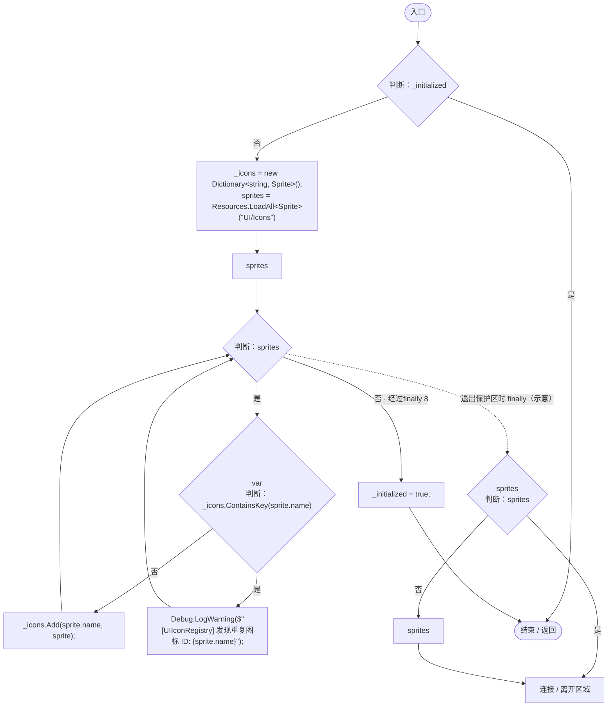
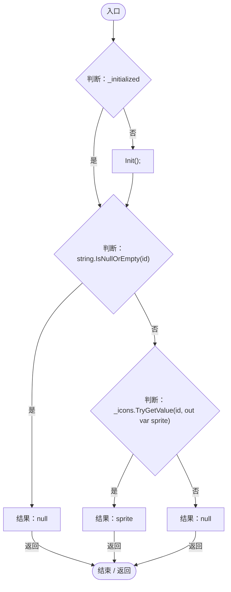
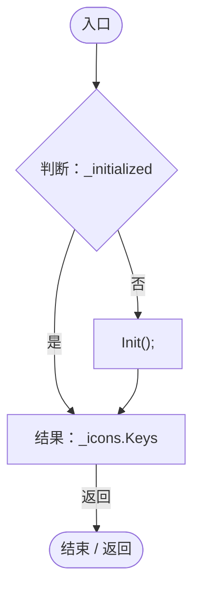

# UIIconRegistry.cs

[返回总索引](../README.md) · `Runtime` · `Assets/DarwinPark/Core/UI/UIIconRegistry.cs`

[源文件](../../../Assets/DarwinPark/Core/UI/UIIconRegistry.cs) · 源码校验：`5ecae9d6b83e22f75476407580b230e55bfbc9f8d26676ac0e4f56ba59d36de4`

方法按源文件位置排列。事件/回调引用不表示立即执行；分支与异常说明见总索引。完整源码与可点击关系图请打开离线手册。

## Init · L16

`public static void Init()`

### Editor / Player · Roslyn编译器控制流

## Get · L38

`public static Sprite Get(string id)`

### Editor / Player · Roslyn编译器控制流

项目内调用/回调引用：

- [UIIconRegistry.Init · L16](5e97f4545b48cac2.md#m33e915a901d1da63)（方法）

## GetAllIds · L52

`public static IEnumerable<string> GetAllIds()`

### Editor / Player · Roslyn编译器控制流

项目内调用/回调引用：

- [UIIconRegistry.Init · L16](5e97f4545b48cac2.md#m33e915a901d1da63)（方法）
