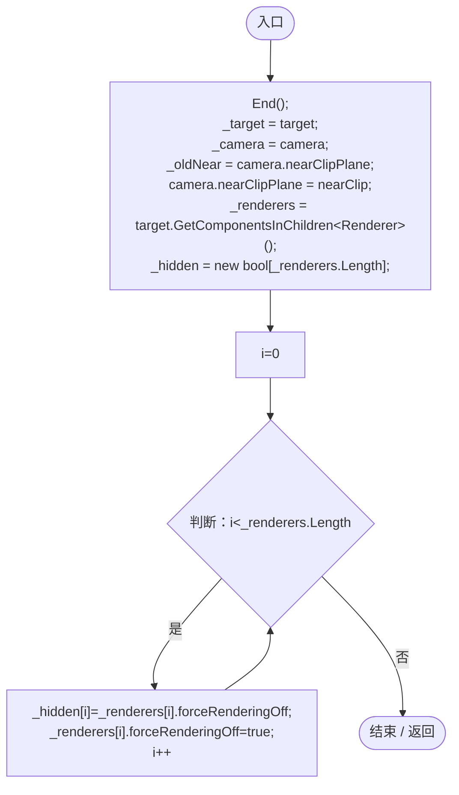
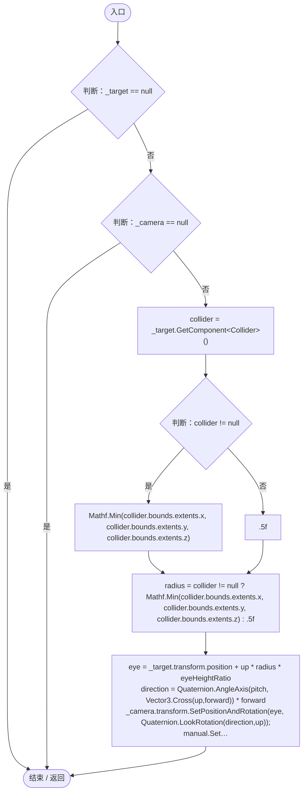
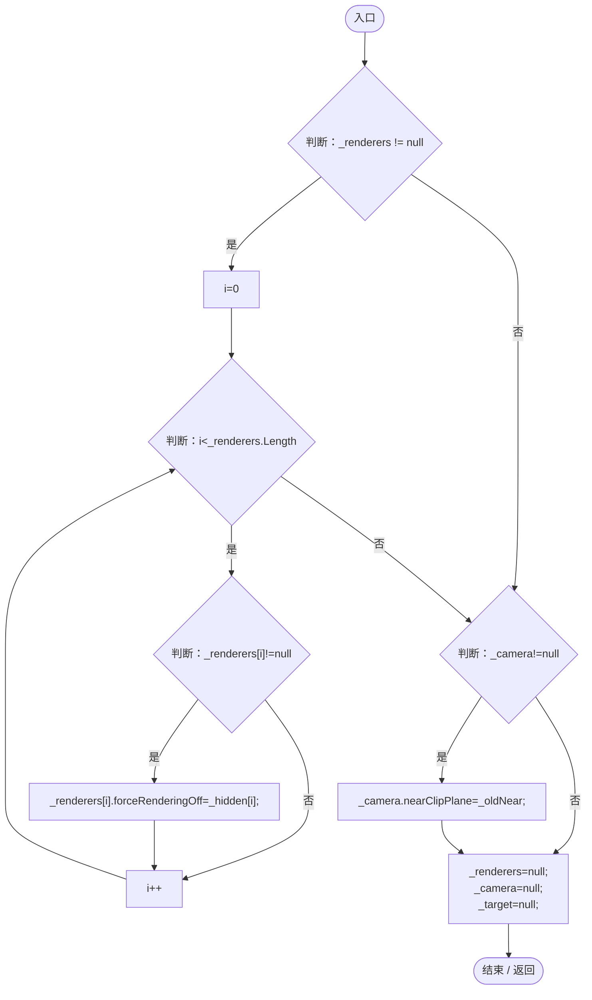
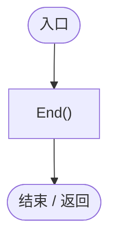

# EntityFirstPersonCamera.cs

[返回总索引](../README.md) · `Runtime` · `Assets/DarwinPark/UI/EntityFirstPersonCamera.cs`

[源文件](../../../Assets/DarwinPark/UI/EntityFirstPersonCamera.cs) · 源码校验：`e6eea93a0617161929c69098ce30f2882847df5334fa072d8d877f42dff60e29`

方法按源文件位置排列。事件/回调引用不表示立即执行；分支与异常说明见总索引。完整源码与可点击关系图请打开离线手册。

## Begin · L15

`public void Begin(DarwinEntity target, Camera camera)`

### Editor / Player · Roslyn编译器控制流

项目内调用/回调引用：

- [EntityFirstPersonCamera.End · L32](5ebdca1d5bf05886.md#m64c101c9d842451a)（方法）

## Apply · L22

`public void Apply(Vector3 up, Vector3 forward, float pitch, EntityManualControl manual)`

### Editor / Player · Roslyn编译器控制流

项目内调用/回调引用：

- [EntityManualControl.SetAim · L27](a6969896da35e1f0.md#m70f09d0090a1fa41)（方法）

## End · L32

`public void End()`

### Editor / Player · Roslyn编译器控制流

## OnDisable · L38

`private void OnDisable()`

### Editor / Player · Roslyn编译器控制流

项目内调用/回调引用：

- [EntityFirstPersonCamera.End · L32](5ebdca1d5bf05886.md#m64c101c9d842451a)（方法）
