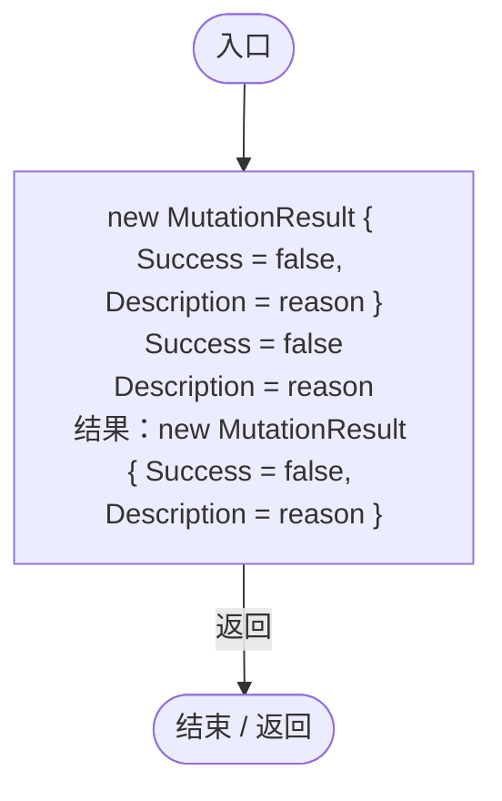
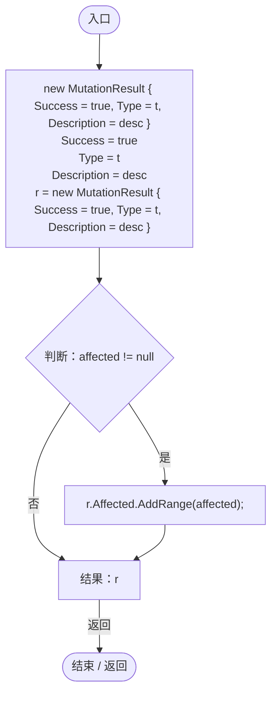

# MutationResult.cs

[返回总索引](../README.md) · `Runtime` · `Assets/DarwinPark/Genetics/Mutation/MutationResult.cs`

[源文件](../../../Assets/DarwinPark/Genetics/Mutation/MutationResult.cs) · 源码校验：`8611baad3275425f226af2ac95cc5085d62d36beb006377e13a95928e44633c9`

方法按源文件位置排列。事件/回调引用不表示立即执行；分支与异常说明见总索引。完整源码与可点击关系图请打开离线手册。

## Fail · L12

`public static MutationResult Fail(string reason)`

### Editor / Player · Roslyn编译器控制流

## Ok · L15

`public static MutationResult Ok(MutationType t, string desc, params GeneInstance[] affected)`

### Editor / Player · Roslyn编译器控制流

