# MapPopulationListUI.cs

[返回总索引](../README.md) · `Runtime` · `Assets/DarwinPark/UI/MapPopulationListUI.cs`

[源文件](../../../Assets/DarwinPark/UI/MapPopulationListUI.cs) · 源码校验：`0995dd124f23aef8bdf15d2da9bf9ea47917dc9a60682e891de91359e0361c87`

方法按源文件位置排列。事件/回调引用不表示立即执行；分支与异常说明见总索引。完整源码与可点击关系图请打开离线手册。

<a id="m3df1195029e09688"></a>

## GroupCount.get · L15

`public int GroupCount`


### Editor / Player · 语法控制结构 / 声明（非CFG）

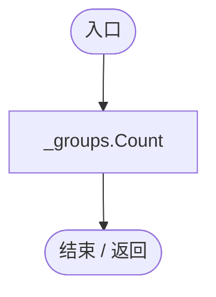

<a id="m47170b40101e966d"></a>

## LivingCount.get · L16

`public int LivingCount`


### Editor / Player · 语法控制结构 / 声明（非CFG）

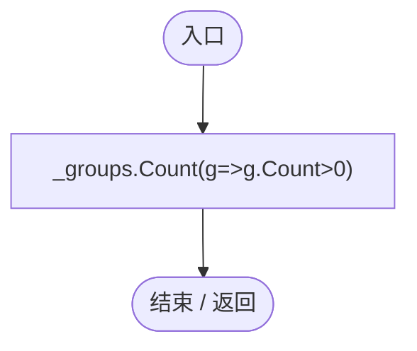

项目内调用/回调引用：

- [MapPopulationListUI.回调@16 · L16](628d691916fbb56b.md#m184415556c10cca3)（回调/委托）

<a id="m184415556c10cca3"></a>

## 回调@16 · L16

`g … => 回调`


### Editor / Player · 语法控制结构 / 声明（非CFG）

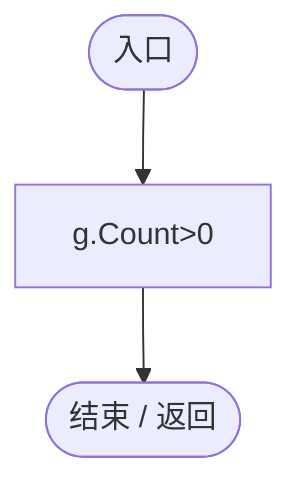

<a id="mb515e04f03d2c251"></a>

## MemberCount.get · L17

`public int MemberCount`


### Editor / Player · 语法控制结构 / 声明（非CFG）

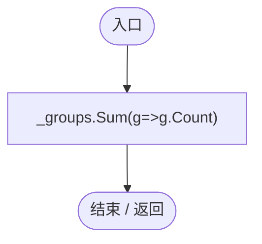

项目内调用/回调引用：

- [MapPopulationListUI.回调@17 · L17](628d691916fbb56b.md#mdb4e85a8eaa5dd68)（回调/委托）

<a id="mdb4e85a8eaa5dd68"></a>

## 回调@17 · L17

`g … => 回调`


### Editor / Player · 语法控制结构 / 声明（非CFG）

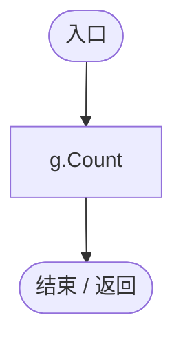

<a id="m5a32568e1f0bafec"></a>

## Card.get · L18

`public RectTransform Card`


### Editor / Player · 语法控制结构 / 声明（非CFG）

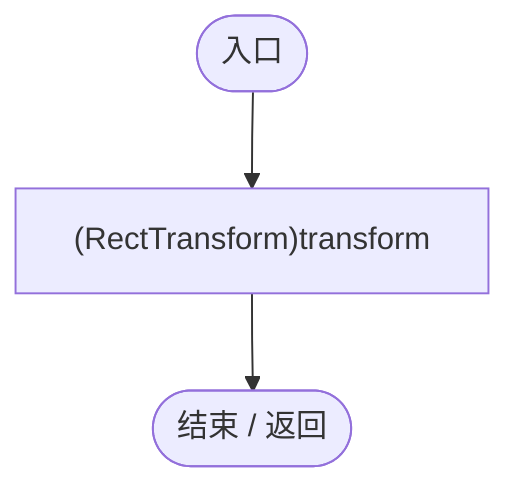

<a id="m358fdba39ffe28da"></a>

## Groups.get · L21

`public IReadOnlyList<GroupRow> Groups`


### Editor / Player · 语法控制结构 / 声明（非CFG）

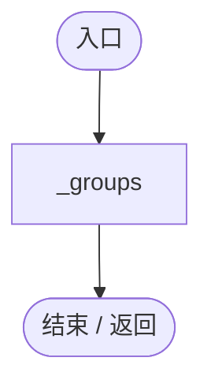

<a id="mb018d1df2071c8c8"></a>

## Start · L23

`private void Start()`


### Editor / Player · Roslyn编译器控制流

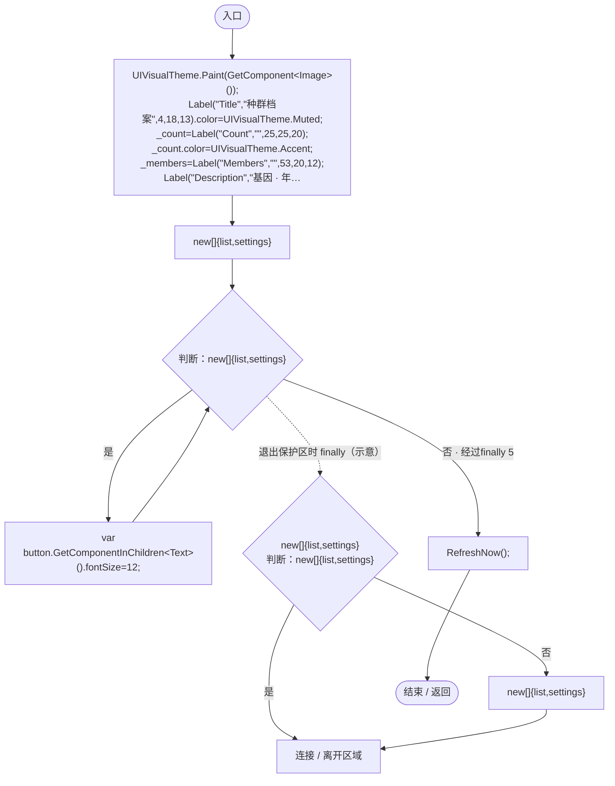

项目内调用/回调引用：

- [UIVisualTheme.Paint · L58](ca525a798a08f966.md#m2d61a6b26ab24980)（方法）
- [MapPopulationListUI.Label · L32](628d691916fbb56b.md#m9203702f805d60f1)（方法）
- [UIFactory.NewButton · L73](dd1096a6995423db.md#m5896f1b097c8bdde)（方法）
- [MapPopulationListUI.Place · L33](628d691916fbb56b.md#m57d2f72f27d5c656)（方法）
- [MapPopulationListUI.RefreshNow · L34](628d691916fbb56b.md#mc66cc8403198e94e)（方法）
- [MapPopulationListUI.回调@29 · L29](628d691916fbb56b.md#mf15fa5786d0a7518)（回调/委托）
- [MapPopulationListUI.OpenList · L46](628d691916fbb56b.md#m0b232c93d49869f2)（方法）

<a id="mf15fa5786d0a7518"></a>

## 回调@29 · L29

`( … => 回调`


### Editor / Player · Roslyn编译器控制流

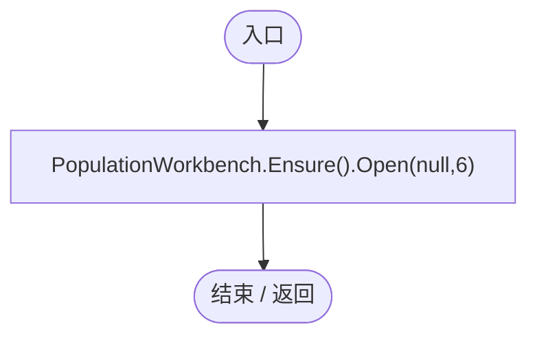

项目内调用/回调引用：

- [PopulationWorkbench.Open · L35](6ca6fcae89e529ec.md#maadc63c62a231ce0)（方法）
- [PopulationWorkbench.Ensure · L30](6ca6fcae89e529ec.md#m8c46b22e3ea6a6c4)（方法）

<a id="m9203702f805d60f1"></a>

## Label · L32

`private Text Label(string name,string value,float y,float height,int font)`


### Editor / Player · Roslyn编译器控制流

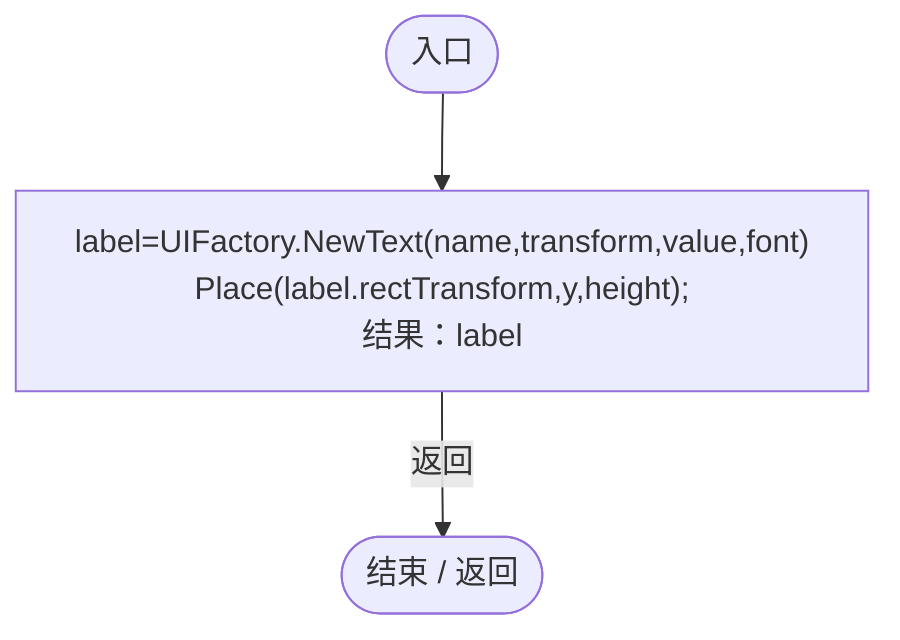

项目内调用/回调引用：

- [UIFactory.NewText · L57](dd1096a6995423db.md#m9dbccb5f0c38189e)（方法）
- [MapPopulationListUI.Place · L33](628d691916fbb56b.md#m57d2f72f27d5c656)（方法）

<a id="m57d2f72f27d5c656"></a>

## Place · L33

`private static void Place(RectTransform rt,float y,float height,float left=0,float right=1)`


### Editor / Player · Roslyn编译器控制流

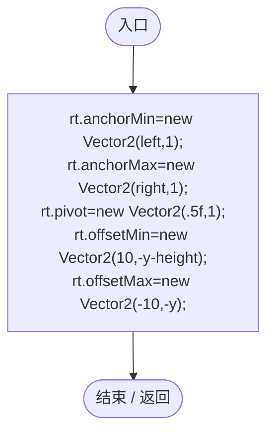

<a id="mc66cc8403198e94e"></a>

## RefreshNow · L34

`public void RefreshNow()`


### Editor / Player · Roslyn编译器控制流

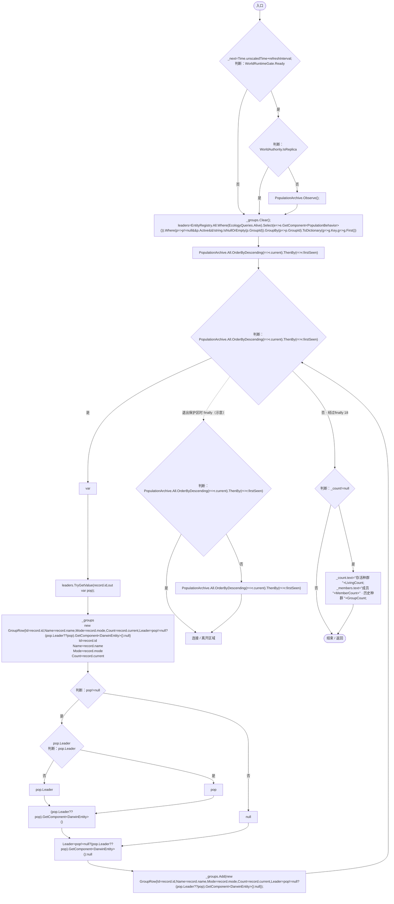

项目内调用/回调引用：

- [PopulationArchive.Observe · L68](084e119b69cdd751.md#m6afd6ec6b661dad6)（方法）
- [MapPopulationListUI.回调@38 · L38](628d691916fbb56b.md#m69fb0c989162200a)（回调/委托）
- [MapPopulationListUI.回调@38 · L38](628d691916fbb56b.md#m8ba6835dd2bb64ef)（回调/委托）
- [MapPopulationListUI.回调@38 · L38](628d691916fbb56b.md#mbf7d5bd76330a8e4)（回调/委托）
- [MapPopulationListUI.回调@38 · L38](628d691916fbb56b.md#meeed741e8147b954)（回调/委托）
- [MapPopulationListUI.回调@38 · L38](628d691916fbb56b.md#mddd40cbeb8942a01)（回调/委托）
- [MapPopulationListUI.回调@39 · L39](628d691916fbb56b.md#m70f135be99ff897d)（回调/委托）
- [MapPopulationListUI.回调@39 · L39](628d691916fbb56b.md#m26870d500179b493)（回调/委托）
- [EcologyQueries.Alive · L38](bdf7ccc2c9c0452f.md#mb2877c487f449970)（方法）

<a id="m69fb0c989162200a"></a>

## 回调@38 · L38

`e … => 回调`


### Editor / Player · Roslyn编译器控制流

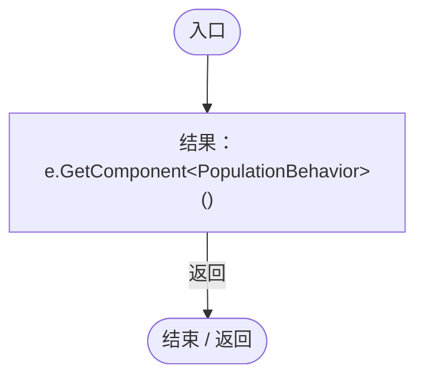

<a id="m8ba6835dd2bb64ef"></a>

## 回调@38 · L38

`p … => 回调`


### Editor / Player · Roslyn编译器控制流

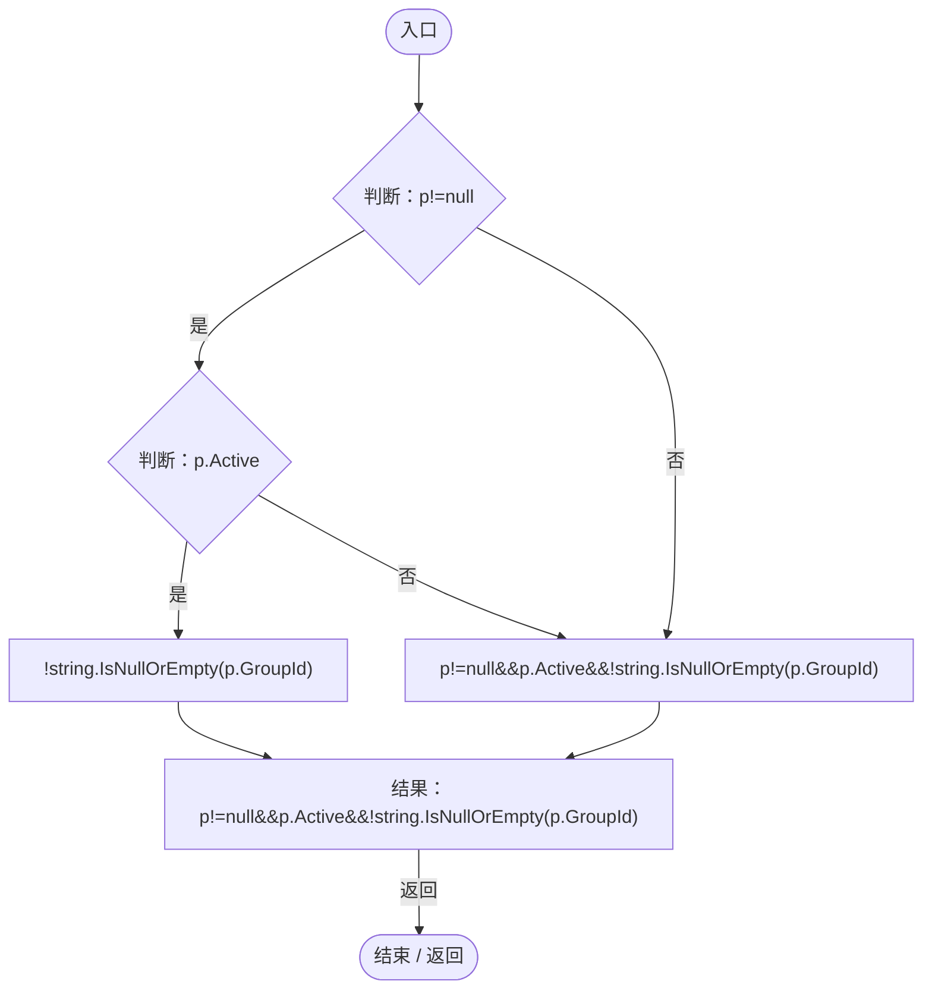

项目内调用/回调引用：

- [PopulationBehavior.GroupId.get · L20](21e4f62f75a9a80f.md#m5145936fa914ba8c)（访问器）

<a id="mbf7d5bd76330a8e4"></a>

## 回调@38 · L38

`p … => 回调`


### Editor / Player · Roslyn编译器控制流

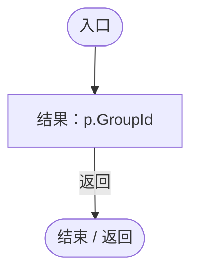

项目内调用/回调引用：

- [PopulationBehavior.GroupId.get · L20](21e4f62f75a9a80f.md#m5145936fa914ba8c)（访问器）

<a id="meeed741e8147b954"></a>

## 回调@38 · L38

`g … => 回调`


### Editor / Player · Roslyn编译器控制流

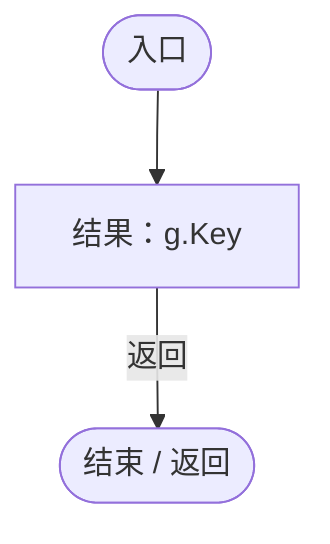

<a id="mddd40cbeb8942a01"></a>

## 回调@38 · L38

`g … => 回调`


### Editor / Player · Roslyn编译器控制流

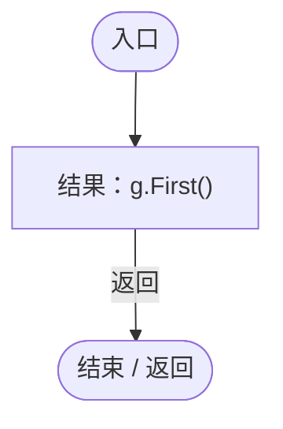

<a id="m70f135be99ff897d"></a>

## 回调@39 · L39

`r … => 回调`


### Editor / Player · Roslyn编译器控制流

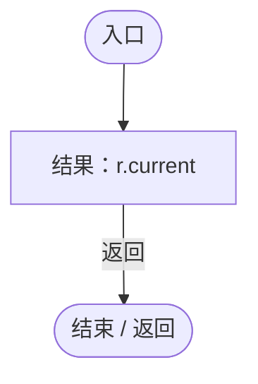

<a id="m26870d500179b493"></a>

## 回调@39 · L39

`r … => 回调`


### Editor / Player · Roslyn编译器控制流

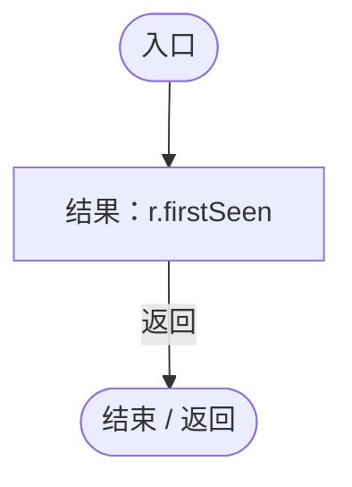

<a id="m0b232c93d49869f2"></a>

## OpenList · L46

`public void OpenList()`


### Editor / Player · Roslyn编译器控制流

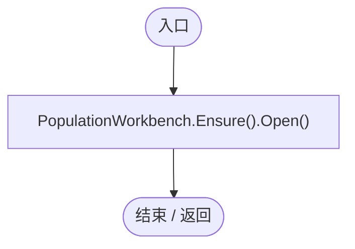

项目内调用/回调引用：

- [PopulationWorkbench.Open · L35](6ca6fcae89e529ec.md#maadc63c62a231ce0)（方法）
- [PopulationWorkbench.Ensure · L30](6ca6fcae89e529ec.md#m8c46b22e3ea6a6c4)（方法）

<a id="mdbc1fbb4bd81af1a"></a>

## Locate · L47

`public bool Locate(int index)`


### Editor / Player · Roslyn编译器控制流

```mermaid
flowchart TD
  b0(["入口"])
  b1{"判断：index&lt;0"}
  b2{"判断：index&gt;=_groups.Count"}
  b3{"判断：EcologyQueries.Alive(_groups[index].Leader)"}
  b4{"判断：GameInputGate.Blocked"}
  b5["结果：false"]
  b6{"EntityViewController.Instance<br/>判断：EntityViewController.Instance"}
  b7["EntityViewController.Instance?.ExitView();"]
  b8{"Camera.main<br/>判断：Camera.main"}
  b9[".GetComponent&lt;OrbitCamera&gt;()"]
  b10{"判断：.GetComponent&lt;OrbitCamera&gt;()"}
  b11["Camera.main?.GetComponent&lt;OrbitCamera&gt;()?.FocusOn(_groups[index].Leader.transform.position);"]
  b12["结果：true"]
  b13(["结束 / 返回"])
  b0 --> b1
  b1 -->|"否"| b2
  b1 -->|"是"| b5
  b2 -->|"否"| b3
  b2 -->|"是"| b5
  b3 -->|"是"| b4
  b3 -->|"否"| b5
  b4 -->|"是"| b5
  b4 -->|"否"| b6
  b5 -->|"返回"| b13
  b6 -->|"否"| b7
  b6 -->|"是"| b8
  b7 --> b8
  b8 -->|"否"| b9
  b8 -->|"是"| b12
  b9 --> b10
  b10 -->|"否"| b11
  b10 -->|"是"| b12
  b11 --> b12
  b12 -->|"返回"| b13

```

项目内调用/回调引用：

- [EcologyQueries.Alive · L38](bdf7ccc2c9c0452f.md#mb2877c487f449970)（方法）
- [GameInputGate.Blocked.get · L8](52955daae7e592ab.md#m765763b665829633)（访问器）
- [EntityViewController.Instance.get · L15](0ad0345f83229ef0.md#mb3b8144b56e80842)（访问器）
- [EntityViewController.ExitView · L105](0ad0345f83229ef0.md#mca8619c7f27942c9)（方法）
- [OrbitCamera.FocusOn · L170](42eb429559b42bcb.md#m90f6d4818e064f1d)（方法）

<a id="m72ca54b027e8a3cb"></a>

## LateUpdate · L52

`private void LateUpdate()`


### Editor / Player · Roslyn编译器控制流

```mermaid
flowchart TD
  b0(["入口"])
  b1{"parent=(RectTransform)transform.parent<br/>anchor=new Vector2(0,1)<br/>判断：Card.anchorMin!=anchor"}
  b2{"判断：Card.anchorMax!=anchor"}
  b3{"判断：Card.pivot!=anchor"}
  b4["Card.anchorMin=Card.anchorMax=Card.pivot=anchor;"]
  b5{"point=new Vector2(Mathf.Min(leftOffset,Mathf.Max(12,parent.rect.width-cardWidth-12)),0)<br/>size=new Vector2(cardWidth,cardHeight)<br/>判断：Card.anchoredPosition!=point"}
  b6["Card.anchoredPosition=point;"]
  b7{"判断：Card.sizeDelta!=size"}
  b8["Card.sizeDelta=size;"]
  b9{"判断：Time.unscaledTime&gt;=_next"}
  b10["RefreshNow();"]
  b11(["结束 / 返回"])
  b0 --> b1
  b1 -->|"否"| b2
  b1 -->|"是"| b4
  b2 -->|"否"| b3
  b2 -->|"是"| b4
  b3 -->|"是"| b4
  b3 -->|"否"| b5
  b4 --> b5
  b5 -->|"是"| b6
  b5 -->|"否"| b7
  b6 --> b7
  b7 -->|"是"| b8
  b7 -->|"否"| b9
  b8 --> b9
  b9 -->|"是"| b10
  b9 -->|"否"| b11
  b10 --> b11

```

项目内调用/回调引用：

- [MapPopulationListUI.RefreshNow · L34](628d691916fbb56b.md#mc66cc8403198e94e)（方法）
