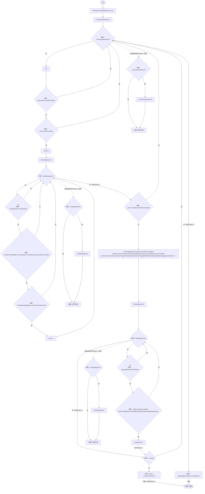
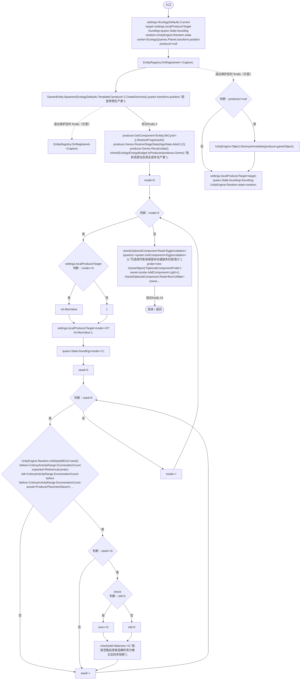
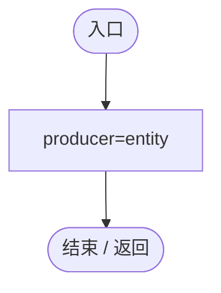

# ProducerPlacementChecks.cs

[返回总索引](../README.md) · `Editor` · `Assets/DarwinPark/Editor/ProducerPlacementChecks.cs`

[源文件](../../../Assets/DarwinPark/Editor/ProducerPlacementChecks.cs) · 源码校验：`c9e819d272dd37ab80e2cefa5429fe06018850f1edaf09ac4e554612949a4431`

方法按源文件位置排列。事件/回调引用不表示立即执行；分支与异常说明见总索引。完整源码与可点击关系图请打开离线手册。

## Reference · L13

`private static Vector3 Reference(Vector3 center)`

### Editor · Roslyn编译器控制流

项目内调用/回调引用：

- [EcologyDefaults.Current.get · L35](5b565b57de741d98.md#m75cb60b88e3cc1c7)（访问器）
- [AntColonyMember.Role.get · L39](baebd85c05598377.md#mbe541ad55a93b0dd)（访问器）
- [AntColonyMember.State.get · L33](baebd85c05598377.md#ma804eb9f68138343)（访问器）
- [EcologyQueries.Alive · L39](bdf7ccc2c9c0452f.md#m8352bfacbe2996a8)（方法）
- [ColonyActivityRange.Contains · L21](e8d854132f563257.md#m535d817473d6a256)（方法）
- [AntColonyMember.Population.get · L36](baebd85c05598377.md#m3fa1d6d15c7c95ba)（访问器）
- [EcologyEnergyBudget.IsProducer · L27](06a91c8201f26593.md#mdf11c493dfe1c754)（方法）
- [DarwinEntity.Genes.get · L14](70798dde169f2e8b.md#m622eb1adf401d431)（访问器）
- [EcologyQueries.Up · L42](bdf7ccc2c9c0452f.md#ma73e6bbbc726282f)（方法）

## Verify · L28

`internal static void Verify(AntColonyMember queen,Action<bool,string> check)`

### Editor · Roslyn编译器控制流

项目内调用/回调引用：

- [EcologyDefaults.Current.get · L35](5b565b57de741d98.md#m75cb60b88e3cc1c7)（访问器）
- [AntColonyMember.State.get · L33](baebd85c05598377.md#ma804eb9f68138343)（访问器）
- [RandomSpawnRecipe.CreateGenome · L25](923ccc4e86c4786c.md#m2612c79fe3848e08)（方法）
- [EcologyDefaults.Template · L68](5b565b57de741d98.md#m98d16ffadd19320f)（方法）
- [EntityLifeCycle.RestoreProgress · L52](9f4138bfbae654b7.md#m007c73a0c714c238)（方法）
- [EntityGeneController.RestoreStageState · L56](7494d53178552f0e.md#m37c1dbfa64e7c2ce)（方法）
- [DarwinEntity.Genes.get · L14](70798dde169f2e8b.md#m622eb1adf401d431)（访问器）
- [EntityGeneController.Recalculate · L118](7494d53178552f0e.md#m707d9a56b0c7c609)（方法）
- [EcologyEnergyBudget.IsProducer · L27](06a91c8201f26593.md#mdf11c493dfe1c754)（方法）
- [ColonyActivityRange.EnumerationCount.get · L15](e8d854132f563257.md#m8f570fb70a02e1cc)（访问器）
- [ProducerPlacementChecks.Reference · L13](639f07f7d384b725.md#m29ae94d0b5108240)（方法）
- [ProducerPlacementSearch.Direction · L7](68c6f349d3942cc4.md#m4014353f2ebec5a7)（方法）
- [OptionalComponent.Read · L7](806c46b42ced4d36.md#m69622a4dee165c5a)（方法）
- [ProducerPlacementChecks.Capture · L33](639f07f7d384b725.md#m7100ca7e68b5f08e)（局部函数）

## Capture · L33

`void Capture(DarwinEntity entity)`

### Editor · Roslyn编译器控制流

