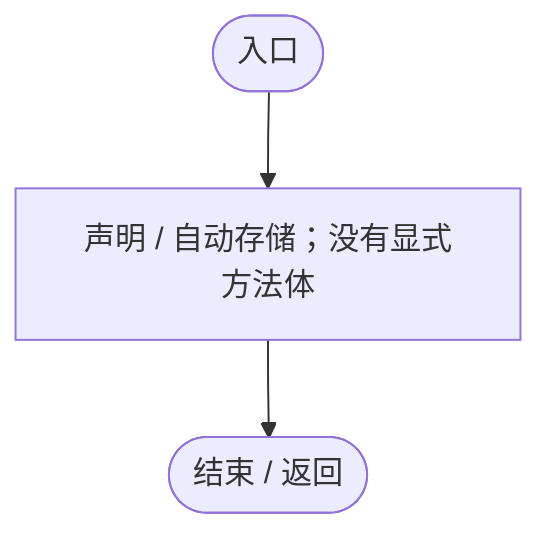
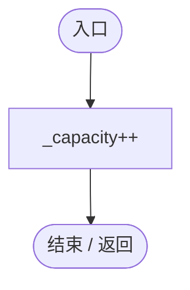
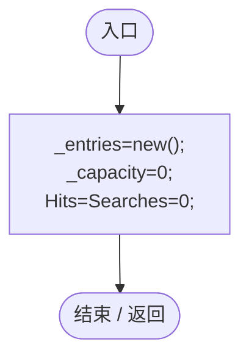

```mermaid
flowchart TD
  b0(["入口"])
  b1{"entry=_entries.GetOrCreateValue(member)<br/>queen=member.Queen<br/>判断：entry.queen!=queen"}
  b2["entry.queen=queen;"]
  b3{"entry.queenStats<br/>判断：queen!=null"}
  b4["queen.GetComponent&lt;EntityStats&gt;()"]
  b5["null"]
  b6["entry.queenStats=queen!=null?queen.GetComponent&lt;EntityStats&gt;():null;"]
  b7{"queenReserve=0<br/>判断：member.Role!=AntRole.Queen"}
  b8{"判断：entry.queenStats!=null"}
  b9["entry.queenStats.TryGet(&quot;nutrient&quot;,out float food);<br/>entry.queenStats.TryGet(&quot;storedNutrient&quot;,out float reserve);<br/>queenReserve=Mathf.Max(0,AntColonySettings.Current.queenFeedThreshold-food-reserve);"]
  b10{"判断：nearby"}
  b11["entry.near"]
  b12["entry.far"]
  b13["cached=nearby?entry.near:entry.far"]
  b14["point=ResourceCoordinates.RelativePoint(member.transform.position)<br/>young=member.Young<br/>urgent=ColonyFoodSources.Urgent(member)<br/>tuning=GameplayTuning.Current<br/>settings=AntColonySettings.Current<br/>revision=ResourceCoordinates.FoodRevision<br/>grou…"]
  b15{"判断：cached.frame==Time.frameCount"}
  b16{"判断：Time.unscaledTime&lt;cached.next"}
  b17{"判断：cached.foodRevision==revision"}
  b18{"判断：cached.groups==groups"}
  b19{"判断：cached.capacity==_capacity"}
  b20{"判断：(cached.point-point).sqrMagnitude&lt;=SimulationOptimization.Current.foodSearchMoveTolerance*SimulationOptimization.Current.foodSearchMoveTolerance"}
  b21{"判断：cached.group==member.GroupId"}
  b22{"判断：cached.role==member.Role"}
  b23{"判断：cached.young==young"}
  b24{"判断：cached.urgent==urgent"}
  b25{"判断：cached.queenReserve==queenReserve"}
  b26{"判断：cached.feedRadius==settings.feedRadius"}
  b27{"判断：cached.queenLine==settings.queenFeedThreshold"}
  b28{"判断：cached.ownerRange==settings.transportSearchRadius"}
  b29{"判断：cached.share==tuning.colonyShareBackupFood"}
  b30{"判断：ReferenceEquals(cached.tuning,tuning)"}
  b31["ReferenceEquals(cached.settings,settings)"]
  b32["(cached.frame==Time.frameCount&#124;&#124;Time.unscaledTime&lt;cached.next)&amp;&amp;cached.foodRevision==revision&amp;&amp;cached.groups==groups&amp;&amp;cached.capacity==_capacity&amp;&amp;(cached.point-point).sqrMagnitude&lt;=SimulationOptimization.Current.foodSearchMoveTolerance*S…"]
  b33["key=(cached.frame==Time.frameCount&#124;&#124;Time.unscaledTime&lt;cached.next)&amp;&amp;cached.foodRevision==revision&amp;&amp;cached.groups==groups&amp;&amp;cached.capacity==_capacity&amp;&amp;(cached.point-point).sqrMagnitude&lt;=SimulationOptimization.Current.foodSearchMoveToleran…"]
  b34{"判断：key"}
  b35{"判断：ReferenceEquals(cached.value,null)"}
  b36{"判断：cached.value!=null"}
  b37{"判断：ColonyFoodSources.Usable(cached.value,member)"}
  b38{"判断：nearby"}
  b39{"判断：EcologyQueries.Distance(cached.value.transform.position,member.transform.position)&lt;=settings.feedRadius"}
  b40["Hits++;<br/>结果：cached.value"]
  b41["cached.value=ColonyFoodSources.Search(member,nearby);<br/>Searches++;<br/>cached.frame=Time.frameCount;<br/>cached.next=Time.unscaledTime+SimulationOptimization.Current.decisionSeconds;<br/>cached.foodRevision=revision;<br/>cached.groups=groups;<br/>cached.capa…"]
  b42(["结束 / 返回"])
  b0 --> b1
  b1 -->|"是"| b2
  b1 -->|"否"| b7
  b2 --> b3
  b3 -->|"是"| b4
  b3 -->|"否"| b5
  b4 --> b6
  b5 --> b6
  b6 --> b7
  b7 -->|"是"| b8
  b7 -->|"否"| b10
  b8 -->|"是"| b9
  b8 -->|"否"| b10
  b9 --> b10
  b10 -->|"是"| b11
  b10 -->|"否"| b12
  b11 --> b13
  b12 --> b13
  b13 --> b14
  b14 --> b15
  b15 -->|"否"| b16
  b15 -->|"是"| b17
  b16 -->|"是"| b17
  b16 -->|"否"| b32
  b17 -->|"是"| b18
  b17 -->|"否"| b32
  b18 -->|"是"| b19
  b18 -->|"否"| b32
  b19 -->|"是"| b20
  b19 -->|"否"| b32
  b20 -->|"是"| b21
  b20 -->|"否"| b32
  b21 -->|"是"| b22
  b21 -->|"否"| b32
  b22 -->|"是"| b23
  b22 -->|"否"| b32
  b23 -->|"是"| b24
  b23 -->|"否"| b32
  b24 -->|"是"| b25
  b24 -->|"否"| b32
  b25 -->|"是"| b26
  b25 -->|"否"| b32
  b26 -->|"是"| b27
  b26 -->|"否"| b32
  b27 -->|"是"| b28
  b27 -->|"否"| b32
  b28 -->|"是"| b29
  b28 -->|"否"| b32
  b29 -->|"是"| b30
  b29 -->|"否"| b32
  b30 -->|"是"| b31
  b30 -->|"否"| b32
  b31 --> b33
  b32 --> b33
  b33 --> b34
  b34 -->|"是"| b35
  b34 -->|"否"| b41
  b35 -->|"否"| b36
  b35 -->|"是"| b40
  b36 -->|"是"| b37
  b36 -->|"否"| b41
  b37 -->|"是"| b38
  b37 -->|"否"| b41
  b38 -->|"是"| b39
  b38 -->|"否"| b40
  b39 -->|"是"| b40
  b39 -->|"否"| b41
  b40 -->|"返回"| b42
  b41 -->|"返回"| b42

```

# ColonyFoodQueryCache.cs

[返回总索引](../README.md) · `Runtime` · `Assets/DarwinPark/Entities/Ecology/ColonyFoodQueryCache.cs`

[源文件](../../../Assets/DarwinPark/Entities/Ecology/ColonyFoodQueryCache.cs) · 源码校验：`1bae66d9af92b8696afa56ebb5c486f203f0a2a435a75796e44f5bf6a7000da0`

方法按源文件位置排列。事件/回调引用不表示立即执行；分支与异常说明见总索引。完整源码与可点击关系图请打开离线手册。

## Hits.get · L16

`get`

### Editor / Player · 语法控制结构 / 声明（非CFG）

## Hits.set · L16

`private set`

### Editor / Player · 语法控制结构 / 声明（非CFG）

## Searches.get · L16

`get`

### Editor / Player · 语法控制结构 / 声明（非CFG）

## Searches.set · L16

`private set`

### Editor / Player · 语法控制结构 / 声明（非CFG）

## AddedEnergy · L17

`public static void AddedEnergy()`

### Editor / Player · Roslyn编译器控制流

## Nearest · L18

`public static ColonyResource Nearest(AntColonyMember member,bool nearby)`

### Editor / Player · Roslyn编译器控制流

项目内调用/回调引用：

- [AntColonyMember.Role.get · L40](baebd85c05598377.md#m382545c3d4092bf1)（访问器）
- [EntityStats.TryGet · L93](75aa86a368efdf24.md#m03cef847022eee28)（方法）
- [AntColonySettings.Current.get · L31](cb0a937e97c8fbb3.md#mcd121159f407ccdf)（访问器）
- [ResourceCoordinates.RelativePoint · L25](93d731ac01e3af48.md#mfa95c41000df4811)（方法）
- [ColonyFoodSources.Urgent · L28](4c419a1a067d428c.md#m724338338b658ae8)（方法）
- [GameplayTuning.Current.get · L46](db546e5713b32d53.md#m4fa691bd8a3b9618)（访问器）
- [ResourceCoordinates.FoodRevision.get · L29](93d731ac01e3af48.md#m440fe2044b08481a)（访问器）
- [PopulationGroupIndex.Revision.get · L20](6bb343d8be5beae5.md#m54a3b3992914501f)（访问器）
- [SimulationOptimization.Current.get · L30](11c9091e70893352.md#mcfa8eb2e650e57b1)（访问器）
- [ColonyFoodSources.Usable · L26](4c419a1a067d428c.md#m130e4fc5e6874ffc)（方法）
- [EcologyQueries.Distance · L43](bdf7ccc2c9c0452f.md#m6e395dce655ebcac)（方法）
- [ColonyFoodQueryCache.Hits.set · L16](63cd90165719dbff.md#m832e7c1d618fe319)（访问器）
- [ColonyFoodQueryCache.Hits.get · L16](63cd90165719dbff.md#m871ae7a0cf96f22d)（访问器）
- [ColonyFoodSources.Search · L31](4c419a1a067d428c.md#mb620770d7d07340d)（方法）
- [ColonyFoodQueryCache.Searches.set · L16](63cd90165719dbff.md#m59bf99db3324516f)（访问器）
- [ColonyFoodQueryCache.Searches.get · L16](63cd90165719dbff.md#m2faafc4a4fd9a504)（访问器）

## Reset · L27

`[RuntimeInitializeOnLoadMethod(RuntimeInitializeLoadType.SubsystemRegistration)]private static void Reset()`

### Editor / Player · Roslyn编译器控制流

项目内调用/回调引用：

- [ColonyFoodQueryCache.Hits.set · L16](63cd90165719dbff.md#m832e7c1d618fe319)（访问器）
- [ColonyFoodQueryCache.Searches.set · L16](63cd90165719dbff.md#m59bf99db3324516f)（访问器）
