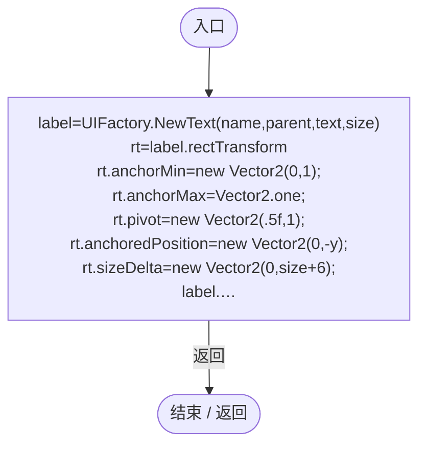
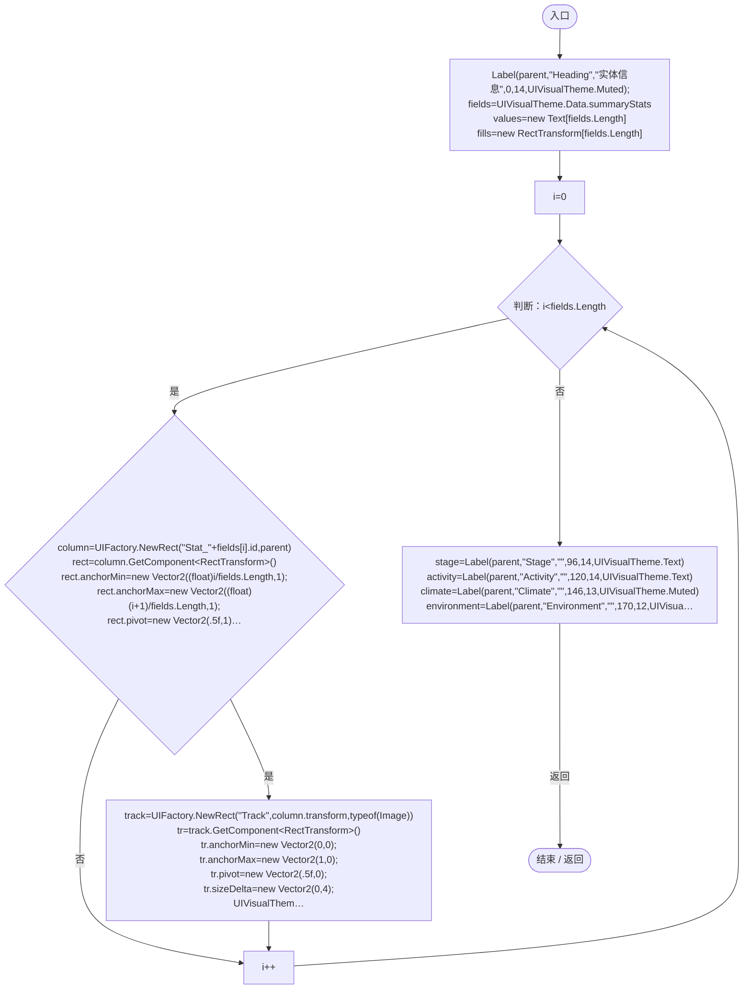
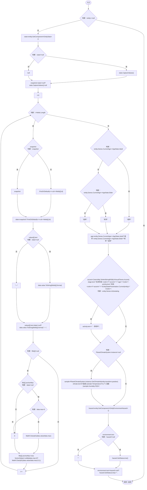
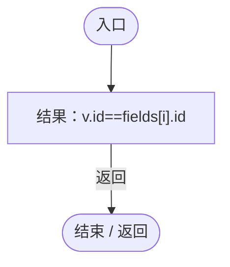

# EntitySummaryView.cs

[返回总索引](../README.md) · `Runtime` · `Assets/DarwinPark/UI/EntitySummaryView.cs`

[源文件](../../../Assets/DarwinPark/UI/EntitySummaryView.cs) · 源码校验：`9dec864079b75b961173cc3d49f27182a041fb171d970e8d7336760729de0734`

方法按源文件位置排列。事件/回调引用不表示立即执行；分支与异常说明见总索引。完整源码与可点击关系图请打开离线手册。

## Label · L17

`private static Text Label(Transform parent,string name,string text,float y,int size,Color color)`

### Editor / Player · Roslyn编译器控制流

项目内调用/回调引用：

- [UIFactory.NewText · L57](dd1096a6995423db.md#m9dbccb5f0c38189e)（方法）

## Build · L24

`public static Action Build(Transform parent,DarwinEntity entity)`

### Editor / Player · Roslyn编译器控制流

项目内调用/回调引用：

- [EntitySummaryView.Label · L17](64394436d1ceb729.md#m47a107ccb0a81bbc)（方法）
- [UIVisualTheme.Data.get · L26](ca525a798a08f966.md#m6c42bdb45a1d9916)（访问器）
- [UIFactory.NewRect · L33](dd1096a6995423db.md#med612116f3152344)（方法）
- [UIVisualTheme.Paint · L58](ca525a798a08f966.md#m2d61a6b26ab24980)（方法）
- [UIFactory.Stretch · L150](dd1096a6995423db.md#m11d8f6c6d00cc047)（方法）
- [EntitySummaryView.回调@46 · L46](64394436d1ceb729.md#m3ee555bb686e98dd)（回调/委托）

## 回调@46 · L46

`( … => 回调`

### Editor / Player · Roslyn编译器控制流

项目内调用/回调引用：

- [EntityStats.CaptureValues · L86](75aa86a368efdf24.md#mbf54fc67f0d07a99)（方法）
- [EntityGeneController.CurrentAge.get · L34](7494d53178552f0e.md#m83a42c16950b22a4)（访问器）
- [DarwinEntity.Genes.get · L14](70798dde169f2e8b.md#m622eb1adf401d431)（访问器）
- [EntityStatePresentation.Current · L11](cedd13b7a8825ed4.md#mb284f7b351983ca5)（方法）
- [PlanetClimateSystem.Instance.get · L32](ba86e31da9b7d0a5.md#mf8e5c7e126d7b598)（访问器）
- [PlanetClimateSystem.GetClimateAt · L69](ba86e31da9b7d0a5.md#m238e7907ac2c7c64)（方法）
- [EntityEnvironmentHazard.GetStatusLine · L280](5c434d0ba85333b1.md#me0ae27569ae96aca)（方法）
- [EntitySummaryView.回调@53 · L53](64394436d1ceb729.md#ma968ac9d26cbe980)（回调/委托）

## 回调@53 · L53

`v … => 回调`

### Editor / Player · Roslyn编译器控制流

