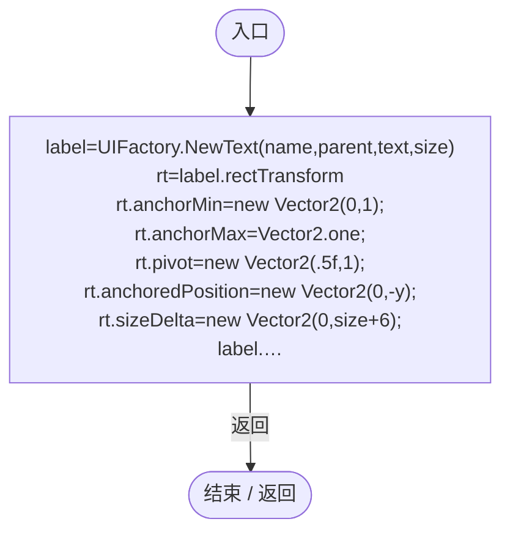
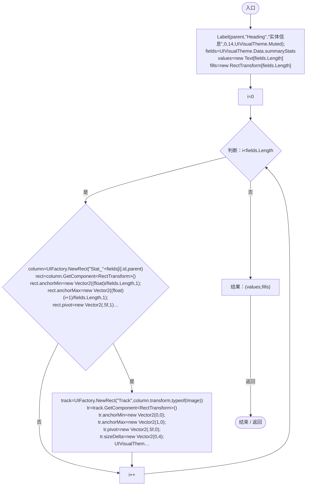
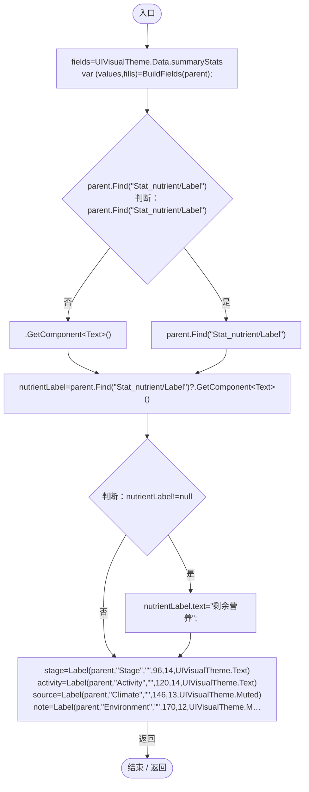
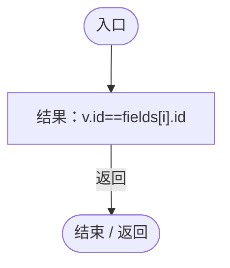
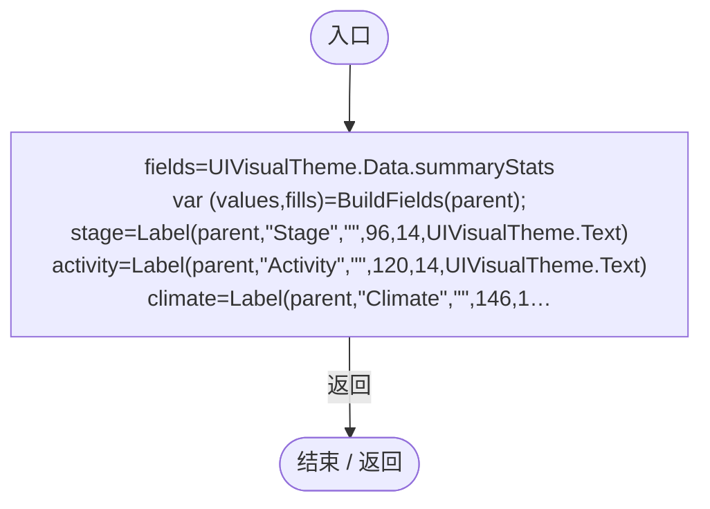
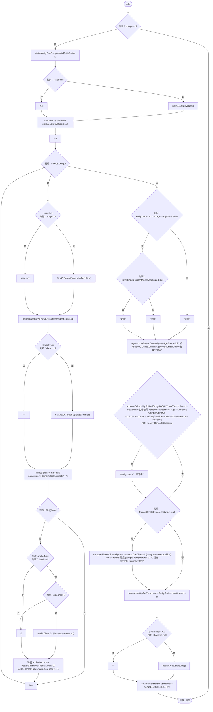

```mermaid
flowchart TD
  b0(["入口"])
  b1{"判断：corpse==null"}
  b2["archive=corpse.State.source"]
  b3["i=0"]
  b4{"判断：i&lt;fields.Length"}
  b5{"archive<br/>判断：archive"}
  b6[".stats.Find(v=&gt;v.id==fields[i].id)"]
  b7["archive"]
  b8["data=archive?.stats.Find(v=&gt;v.id==fields[i].id)"]
  b9{"判断：fields[i].id==&quot;health&quot;"}
  b10["0"]
  b11{"判断：fields[i].id==&quot;nutrient&quot;"}
  b12["corpse.State.energy"]
  b13{"判断：fields[i].id==&quot;size&quot;"}
  b14["corpse.State.sourceSize"]
  b15{"data<br/>判断：data"}
  b16[".value"]
  b17["data"]
  b18{"判断：data?.value"}
  b19["data?.value"]
  b20["0"]
  b21["value=fields[i].id==&quot;health&quot;?0:fields[i].id==&quot;nutrient&quot;?corpse.State.energy:fields[i].id==&quot;size&quot;?corpse.State.sourceSize:data?.value??0"]
  b22{"values[i].text<br/>判断：data!=null"}
  b23{"判断：fields[i].id==&quot;health&quot;"}
  b24{"判断：fields[i].id==&quot;nutrient&quot;"}
  b25{"判断：fields[i].id==&quot;size&quot;"}
  b26{"判断：corpse.State.sourceSize&gt;0"}
  b27["value.ToString(fields[i].format)"]
  b28["&quot;—&quot;"]
  b29["values[i].text=data!=null&#124;&#124;fields[i].id==&quot;health&quot;&#124;&#124;fields[i].id==&quot;nutrient&quot;&#124;&#124;fields[i].id==&quot;size&quot;&amp;&amp;corpse.State.sourceSize&gt;0?value.ToString(fields[i].format):&quot;—&quot;;"]
  b30{"判断：fills[i]!=null"}
  b31{"fills[i].anchorMax<br/>判断：data!=null"}
  b32{"判断：data.max&gt;0"}
  b33["Mathf.Clamp01(value/data.max)"]
  b34["0"]
  b35["fills[i].anchorMax=new Vector2(data!=null&amp;&amp;data.max&gt;0?Mathf.Clamp01(value/data.max):0,1);"]
  b36["i++"]
  b37{"stage.text<br/>&quot;生前阶段 &quot;<br/>判断：archive==null"}
  b38["&quot;旧存档未记录&quot;"]
  b39{"判断：archive.age==AgeState.Infant"}
  b40["&quot;幼年&quot;"]
  b41{"判断：archive.age==AgeState.Adult"}
  b42["&quot;成年&quot;"]
  b43["&quot;老年&quot;"]
  b44["stage.text=&quot;生前阶段 &quot;+(archive==null?&quot;旧存档未记录&quot;:archive.age==AgeState.Infant?&quot;幼年&quot;:archive.age==AgeState.Adult?&quot;成年&quot;:&quot;老年&quot;);"]
  b45{"activity.text<br/>&quot;状态 已死亡 · &quot;<br/>判断：string.IsNullOrEmpty(corpse.State.claim)"}
  b46["&quot;等待搬运&quot;"]
  b47["&quot;已被工匠领取&quot;"]
  b48["activity.text=&quot;状态 已死亡 · &quot;+(string.IsNullOrEmpty(corpse.State.claim)?&quot;等待搬运&quot;:&quot;已被工匠领取&quot;);"]
  b49{"source.text<br/>&quot;生前名称 &quot;<br/>判断：string.IsNullOrEmpty(corpse.State.sourceName)"}
  b50["&quot;旧存档未记录&quot;"]
  b51["corpse.State.sourceName"]
  b52["source.text=&quot;生前名称 &quot;+(string.IsNullOrEmpty(corpse.State.sourceName)?&quot;旧存档未记录&quot;:corpse.State.sourceName);"]
  b53["note.text=&quot;尸体营养随搬运及食腐实际变化&quot;;"]
  b54(["结束 / 返回"])
  b0 --> b1
  b1 -->|"是"| b54
  b1 -->|"否"| b2
  b2 --> b3
  b3 --> b4
  b4 -->|"是"| b5
  b4 -->|"否"| b37
  b5 -->|"否"| b6
  b5 -->|"是"| b7
  b6 --> b8
  b7 --> b8
  b8 --> b9
  b9 -->|"是"| b10
  b9 -->|"否"| b11
  b10 --> b21
  b11 -->|"是"| b12
  b11 -->|"否"| b13
  b12 --> b21
  b13 -->|"是"| b14
  b13 -->|"否"| b15
  b14 --> b21
  b15 -->|"否"| b16
  b15 -->|"是"| b17
  b16 --> b18
  b17 --> b18
  b18 -->|"否"| b19
  b18 -->|"是"| b20
  b19 --> b21
  b20 --> b21
  b21 --> b22
  b22 -->|"否"| b23
  b22 -->|"是"| b27
  b23 -->|"否"| b24
  b23 -->|"是"| b27
  b24 -->|"否"| b25
  b24 -->|"是"| b27
  b25 -->|"是"| b26
  b25 -->|"否"| b28
  b26 -->|"是"| b27
  b26 -->|"否"| b28
  b27 --> b29
  b28 --> b29
  b29 --> b30
  b30 -->|"是"| b31
  b30 -->|"否"| b36
  b31 -->|"是"| b32
  b31 -->|"否"| b34
  b32 -->|"是"| b33
  b32 -->|"否"| b34
  b33 --> b35
  b34 --> b35
  b35 --> b36
  b36 --> b4
  b37 -->|"是"| b38
  b37 -->|"否"| b39
  b38 --> b44
  b39 -->|"是"| b40
  b39 -->|"否"| b41
  b40 --> b44
  b41 -->|"是"| b42
  b41 -->|"否"| b43
  b42 --> b44
  b43 --> b44
  b44 --> b45
  b45 -->|"是"| b46
  b45 -->|"否"| b47
  b46 --> b48
  b47 --> b48
  b48 --> b49
  b49 -->|"是"| b50
  b49 -->|"否"| b51
  b50 --> b52
  b51 --> b52
  b52 --> b53
  b53 --> b54

```

# EntitySummaryView.cs

[返回总索引](../README.md) · `Runtime` · `Assets/DarwinPark/UI/EntitySummaryView.cs`

[源文件](../../../Assets/DarwinPark/UI/EntitySummaryView.cs) · 源码校验：`be4b4a572df43e1d20d0dec0aa98772cd5d8a8fcb2547ae33d999499f345ecaa`

方法按源文件位置排列。事件/回调引用不表示立即执行；分支与异常说明见总索引。完整源码与可点击关系图请打开离线手册。

## Label · L17

`private static Text Label(Transform parent,string name,string text,float y,int size,Color color)`

### Editor / Player · Roslyn编译器控制流

项目内调用/回调引用：

- [UIFactory.NewText · L57](dd1096a6995423db.md#m9dbccb5f0c38189e)（方法）

## BuildFields · L24

`private static (Text[] values,RectTransform[] fills) BuildFields(Transform parent)`

### Editor / Player · Roslyn编译器控制流

项目内调用/回调引用：

- [EntitySummaryView.Label · L17](64394436d1ceb729.md#m47a107ccb0a81bbc)（方法）
- [UIVisualTheme.Data.get · L26](ca525a798a08f966.md#m6c42bdb45a1d9916)（访问器）
- [UIFactory.NewRect · L33](dd1096a6995423db.md#med612116f3152344)（方法）
- [UIVisualTheme.Paint · L58](ca525a798a08f966.md#m2d61a6b26ab24980)（方法）
- [UIFactory.Stretch · L150](dd1096a6995423db.md#m11d8f6c6d00cc047)（方法）

## BuildCorpse · L45

`public static Action BuildCorpse(Transform parent,DarwinPark.Entities.Ecology.ColonyResource corpse)`

★ 新增：尸体复用相同摘要列、进度条和生命阶段位置，旧档缺失的信息明确标记，不伪造活实体。

### Editor / Player · Roslyn编译器控制流

项目内调用/回调引用：

- [UIVisualTheme.Data.get · L26](ca525a798a08f966.md#m6c42bdb45a1d9916)（访问器）
- [EntitySummaryView.BuildFields · L24](64394436d1ceb729.md#mdeeb2d604785442c)（方法）
- [EntitySummaryView.Label · L17](64394436d1ceb729.md#m47a107ccb0a81bbc)（方法）
- [EntitySummaryView.回调@51 · L51](64394436d1ceb729.md#m2e7af65c7685aa96)（回调/委托）

## 回调@51 · L51

`( … => 回调`

### Editor / Player · Roslyn编译器控制流

项目内调用/回调引用：

- [ColonyResource.State.get · L24](293dbaecfff4b585.md#m41824f1a0e160aa5)（访问器）
- [EntitySummaryView.回调@56 · L56](64394436d1ceb729.md#mbecee129cb3a85cc)（回调/委托）

## 回调@56 · L56

`v … => 回调`

### Editor / Player · Roslyn编译器控制流

## Build · L65

`public static Action Build(Transform parent,DarwinEntity entity)`

### Editor / Player · Roslyn编译器控制流

项目内调用/回调引用：

- [UIVisualTheme.Data.get · L26](ca525a798a08f966.md#m6c42bdb45a1d9916)（访问器）
- [EntitySummaryView.BuildFields · L24](64394436d1ceb729.md#mdeeb2d604785442c)（方法）
- [EntitySummaryView.Label · L17](64394436d1ceb729.md#m47a107ccb0a81bbc)（方法）
- [EntitySummaryView.回调@72 · L72](64394436d1ceb729.md#me11e9f68771fa855)（回调/委托）

## 回调@72 · L72

`( … => 回调`

### Editor / Player · Roslyn编译器控制流

项目内调用/回调引用：

- [EntityStats.CaptureValues · L86](75aa86a368efdf24.md#mbf54fc67f0d07a99)（方法）
- [EntityGeneController.CurrentAge.get · L37](7494d53178552f0e.md#md08823d8f9a2fa16)（访问器）
- [DarwinEntity.Genes.get · L14](70798dde169f2e8b.md#m622eb1adf401d431)（访问器）
- [EntityStatePresentation.Current · L11](cedd13b7a8825ed4.md#mb284f7b351983ca5)（方法）
- [PlanetClimateSystem.Instance.get · L32](ba86e31da9b7d0a5.md#mf8e5c7e126d7b598)（访问器）
- [PlanetClimateSystem.GetClimateAt · L69](ba86e31da9b7d0a5.md#m238e7907ac2c7c64)（方法）
- [EntityEnvironmentHazard.GetStatusLine · L295](5c434d0ba85333b1.md#meeeb336b49e3b3f7)（方法）
- [EntitySummaryView.回调@79 · L79](64394436d1ceb729.md#mc637c60a3bda58db)（回调/委托）

## 回调@79 · L79

`v … => 回调`

### Editor / Player · Roslyn编译器控制流

