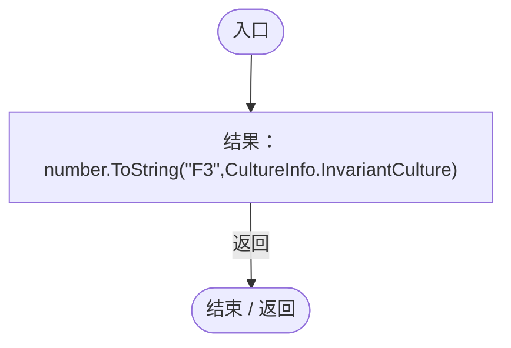
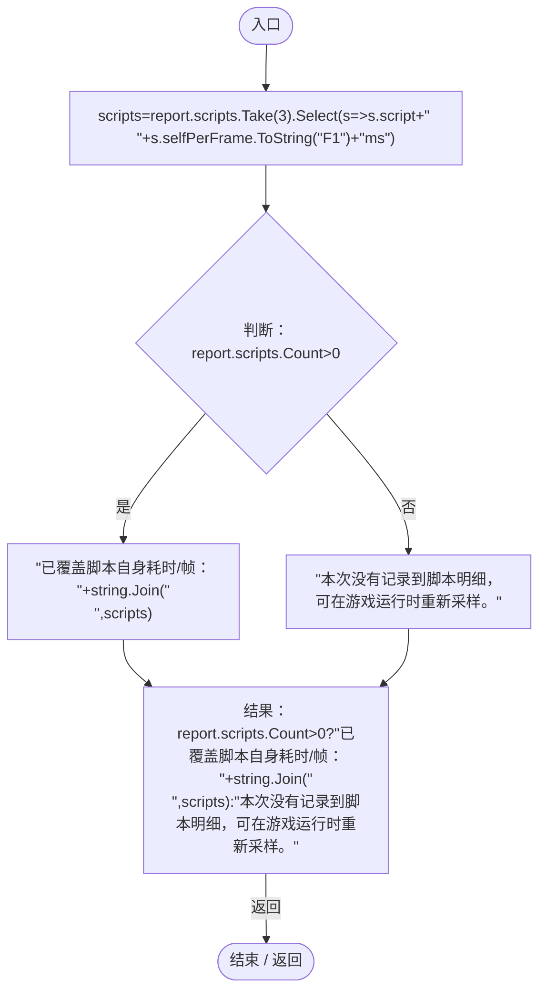
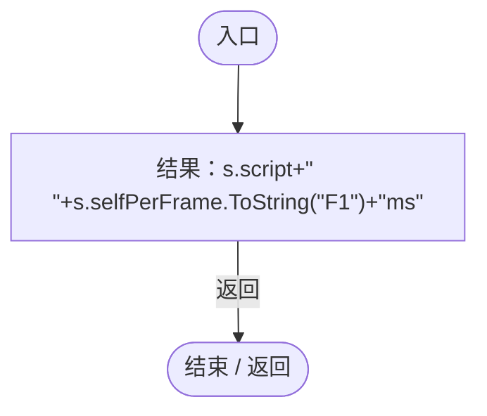
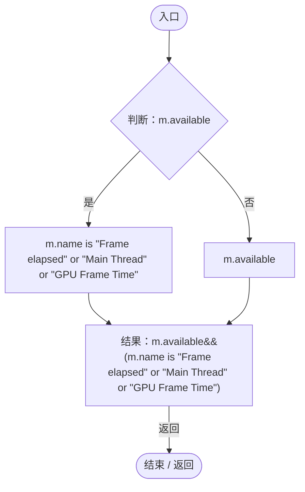
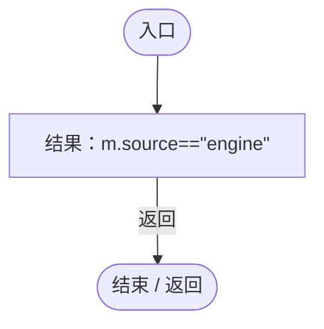
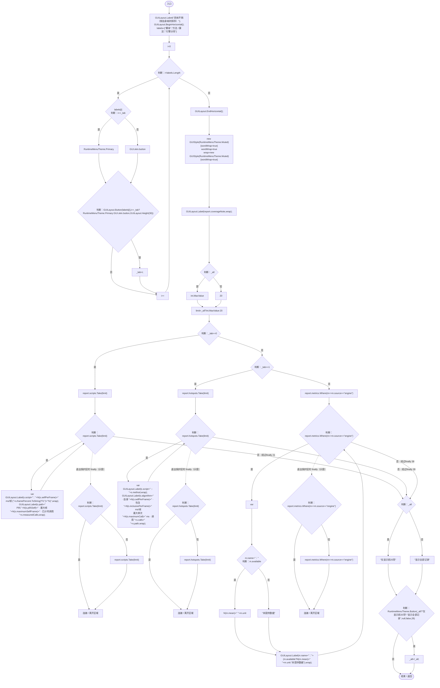
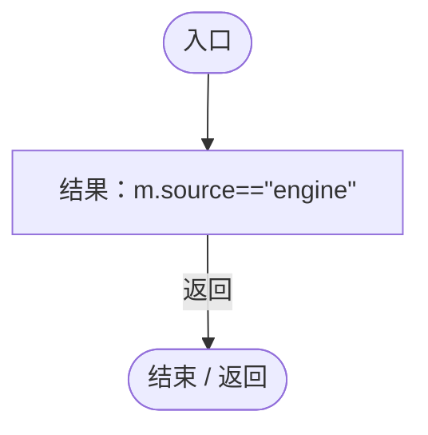

```mermaid
flowchart TD
  b0(["入口"])
  b1["b=new StringBuilder(&quot;# 游戏性能采样\n\n&quot;)<br/>b.AppendLine(report.context).AppendLine().AppendLine(report.coverageNote).AppendLine();"]
  b2["report.metrics.Where(m=&gt;m.available&amp;&amp;(m.name is &quot;Frame elapsed&quot; or &quot;Main Thread&quot; or &quot;GPU Frame Time&quot;))"]
  b3{"判断：report.metrics.Where(m=&gt;m.available&amp;&amp;(m.name is &quot;Frame elapsed&quot; or &quot;Main Thread&quot; or &quot;GPU Frame Time&quot;))"}
  b4["var<br/>b.AppendLine(metric.name+&quot;：平均 &quot;+N(metric.mean)+&quot; ms，P95 &quot;+N(metric.p95)+&quot; ms，最大 &quot;+N(metric.maximum)+&quot; ms。&quot;);"]
  b5{"判断：report.metrics.Where(m=&gt;m.available&amp;&amp;(m.name is &quot;Frame elapsed&quot; or &quot;Main Thread&quot; or &quot;GPU Frame Time&quot;))"}
  b6["report.metrics.Where(m=&gt;m.available&amp;&amp;(m.name is &quot;Frame elapsed&quot; or &quot;Main Thread&quot; or &quot;GPU Frame Time&quot;))"]
  b7["连接 / 离开区域"]
  b8["b.AppendLine(&quot;\n## 脚本自身开销排行\n\n&#124; 脚本 &#124; 平均ms/帧 &#124; P95 &#124; 最大帧 &#124; 帧占比 &#124; 已计时调用 &#124;\n&#124; --- &#124; ---: &#124; ---: &#124; ---: &#124; ---: &#124; ---: &#124;&quot;);"]
  b9["report.scripts"]
  b10{"判断：report.scripts"}
  b11["var<br/>b.AppendLine($&quot;&#124; {s.path} &#124; {N(s.selfPerFrame)} &#124; {N(s.p95Self)} &#124; {N(s.maximumSelfFrame)} &#124; {N(s.framePercent)}% &#124; {s.measuredCalls} &#124;&quot;);"]
  b12["report.scripts"]
  b13["b.AppendLine(&quot;\n## 方法与算法排行\n\n&#124; 方法 &#124; 算法范围 &#124; 自身ms/帧 &#124; 包含ms/帧 &#124; P95自身 &#124; 最大单次 &#124; 调用 &#124;\n&#124; --- &#124; --- &#124; ---: &#124; ---: &#124; ---: &#124; ---: &#124; ---: &#124;&quot;);"]
  b14["report.hotspots"]
  b15{"判断：report.hotspots"}
  b16["var<br/>b.AppendLine($&quot;&#124; {s.path}::{s.method} &#124; {s.algorithm} &#124; {N(s.selfPerFrame)} &#124; {N(s.inclusivePerFrame)} &#124; {N(s.p95Self)} &#124; {N(s.maximumCall)} &#124; {s.calls} &#124;&quot;);"]
  b17["report.hotspots"]
  b18["b.AppendLine(&quot;\n## 引擎分项（包含关系，不能直接相加）\n&quot;);"]
  b19["report.metrics.Where(m=&gt;m.source==&quot;engine&quot;)"]
  b20{"判断：report.metrics.Where(m=&gt;m.source==&quot;engine&quot;)"}
  b21["var"]
  b22{"b<br/>m.name+&quot;：&quot;<br/>判断：m.available"}
  b23["$&quot;{N(m.mean)} {m.unit}，最大 {N(m.maximum)}&quot;"]
  b24["&quot;本平台未提供有效数据&quot;"]
  b25["b.AppendLine(m.name+&quot;：&quot;+(m.available?$&quot;{N(m.mean)} {m.unit}，最大 {N(m.maximum)}&quot;:&quot;本平台未提供有效数据&quot;));"]
  b26{"判断：report.metrics.Where(m=&gt;m.source==&quot;engine&quot;)"}
  b27["report.metrics.Where(m=&gt;m.source==&quot;engine&quot;)"]
  b28["连接 / 离开区域"]
  b29["结果：b.ToString()"]
  b30(["结束 / 返回"])
  b0 --> b1
  b1 --> b2
  b2 --> b3
  b3 -->|"是"| b4
  b3 -->|"否 · 经过finally 5"| b8
  b4 --> b3
  b5 -->|"否"| b6
  b5 -->|"是"| b7
  b6 --> b7
  b8 --> b9
  b9 --> b10
  b10 -->|"是"| b11
  b10 -->|"否 · 经过finally 12"| b13
  b11 --> b10
  b13 --> b14
  b14 --> b15
  b15 -->|"是"| b16
  b15 -->|"否 · 经过finally 17"| b18
  b16 --> b15
  b18 --> b19
  b19 --> b20
  b20 -->|"是"| b21
  b20 -->|"否 · 经过finally 26"| b29
  b21 --> b22
  b22 -->|"是"| b23
  b22 -->|"否"| b24
  b23 --> b25
  b24 --> b25
  b25 --> b20
  b26 -->|"否"| b27
  b26 -->|"是"| b28
  b27 --> b28
  b29 -->|"返回"| b30
  b3 -. "退出保护区时 finally（示意）" .-> b5
  b10 -. "退出保护区时 finally（示意）" .-> b12
  b15 -. "退出保护区时 finally（示意）" .-> b17
  b20 -. "退出保护区时 finally（示意）" .-> b26

```

# RuntimePerformanceDetails.cs

[返回总索引](../README.md) · `Runtime` · `Assets/DarwinPark/UI/RuntimePerformanceDetails.cs`

[源文件](../../../Assets/DarwinPark/UI/RuntimePerformanceDetails.cs) · 源码校验：`b181732eb13257f3fb2231398ca84ee4f3b8a7ab0877830b8bcbcbd336d14f57`

方法按源文件位置排列。事件/回调引用不表示立即执行；分支与异常说明见总索引。完整源码与可点击关系图请打开离线手册。

## N · L13

`private static string N(double number)`

### Editor / Player · Roslyn编译器控制流

## Summary · L14

`public static string Summary(PerformanceReport report)`

### Editor / Player · Roslyn编译器控制流

项目内调用/回调引用：

- [RuntimePerformanceDetails.回调@15 · L15](64a9a186be88560e.md#ma66b9aa8b9620bf2)（回调/委托）

## 回调@15 · L15

`s … => 回调`

### Editor / Player · Roslyn编译器控制流

## Markdown · L16

`public static string Markdown(PerformanceReport report)`

### Editor / Player · Roslyn编译器控制流

项目内调用/回调引用：

- [RuntimePerformanceDetails.N · L13](64a9a186be88560e.md#mc621448626e0459f)（方法）
- [RuntimePerformanceDetails.回调@19 · L19](64a9a186be88560e.md#m449167ea4481c92a)（回调/委托）
- [RuntimePerformanceDetails.回调@24 · L24](64a9a186be88560e.md#m065141806cc5177a)（回调/委托）

## 回调@19 · L19

`m … => 回调`

### Editor / Player · Roslyn编译器控制流

## 回调@24 · L24

`m … => 回调`

### Editor / Player · Roslyn编译器控制流

## Draw · L27

`public static void Draw(PerformanceReport report)`

### Editor / Player · Roslyn编译器控制流

项目内调用/回调引用：

- [RuntimeMenuTheme.Primary.get · L10](b9d8455882f2a532.md#med9b3baaef6ef78a)（访问器）
- [RuntimeMenuTheme.Muted.get · L13](b9d8455882f2a532.md#meeaba271eb4ad2ed)（访问器）
- [RuntimePerformanceDetails.N · L13](64a9a186be88560e.md#mc621448626e0459f)（方法）
- [RuntimeMenuTheme.Button · L90](b9d8455882f2a532.md#mc7e1580ab0f51b0b)（方法）
- [RuntimePerformanceDetails.回调@33 · L33](64a9a186be88560e.md#md41dccbb258ed022)（回调/委托）

## 回调@33 · L33

`m … => 回调`

### Editor / Player · Roslyn编译器控制流

