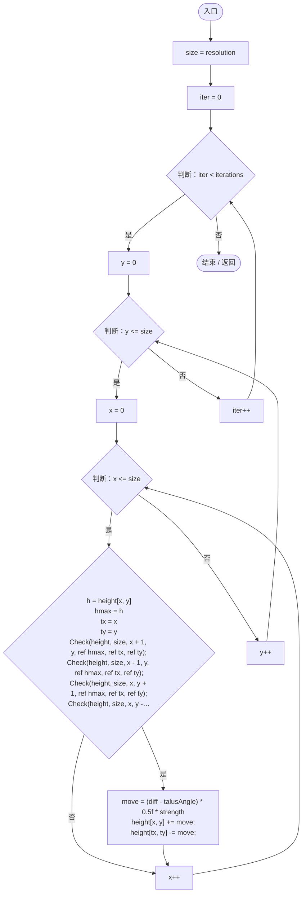
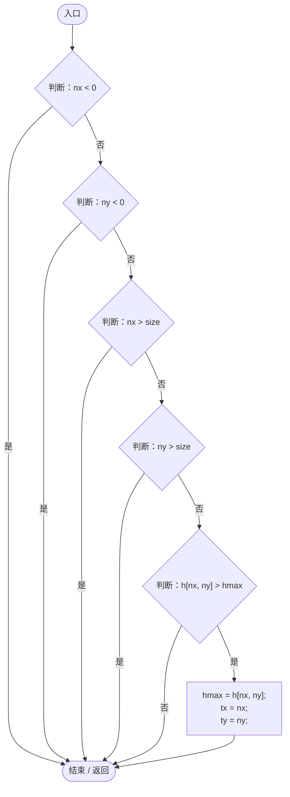

# ThermalErosion.cs

[返回总索引](../README.md) · `Runtime` · `Assets/DarwinPark/Planet/Erosion/ThermalErosion.cs`

[源文件](../../../Assets/DarwinPark/Planet/Erosion/ThermalErosion.cs) · 源码校验：`cdb4d29a4671cb93e6a30f69b0aa60bd78eb5343e256a454a0d917152e42c93e`

方法按源文件位置排列。事件/回调引用不表示立即执行；分支与异常说明见总索引。完整源码与可点击关系图请打开离线手册。

## Apply · L11

`public static void Apply(float[,] height, int resolution, int iterations, float talusAngle, float strength)`

### Editor / Player · Roslyn编译器控制流

项目内调用/回调引用：

- [ThermalErosion.Check · L39](6648fb3132139fb8.md#m45a51fc893b01346)（方法）

## Check · L39

`private static void Check(float[,] h, int size, int nx, int ny, ref float hmax, ref int tx, ref int ty)`

### Editor / Player · Roslyn编译器控制流

