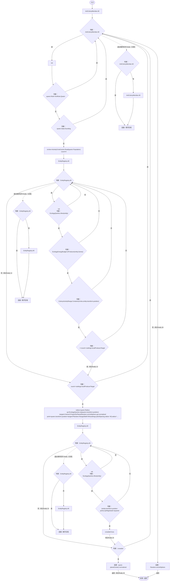

# ProducerPlacementSearch.cs

[返回总索引](../README.md) · `Runtime` · `Assets/DarwinPark/Entities/Ecology/ProducerPlacementSearch.cs`

[源文件](../../../Assets/DarwinPark/Entities/Ecology/ProducerPlacementSearch.cs) · 源码校验：`3f91f40c8a4fff36c36156f152426b59c3198d40e6ea2e4901357e65dedf5dc5`

方法按源文件位置排列。事件/回调引用不表示立即执行；分支与异常说明见总索引。完整源码与可点击关系图请打开离线手册。

## Direction · L7

`public static Vector3 Direction(Vector3 planetCenter,EcologyDefaultsSettings settings)`

### Editor / Player · Roslyn编译器控制流

项目内调用/回调引用：

- [AntColonyMember.Role.get · L39](baebd85c05598377.md#mbe541ad55a93b0dd)（访问器）
- [AntColonyMember.State.get · L33](baebd85c05598377.md#ma804eb9f68138343)（访问器）
- [ActivityCircleCache.Read · L24](97a3c8522367343a.md#mef9553f88695636c)（方法）
- [AntColonyMember.Population.get · L36](baebd85c05598377.md#m3fa1d6d15c7c95ba)（访问器）
- [EcologyQueries.Alive · L39](bdf7ccc2c9c0452f.md#m8352bfacbe2996a8)（方法）
- [EcologyEnergyBudget.IsProducer · L27](06a91c8201f26593.md#mdf11c493dfe1c754)（方法）
- [DarwinEntity.Genes.get · L14](70798dde169f2e8b.md#m622eb1adf401d431)（访问器）
- [ColonyActivityRange.Contains · L27](e8d854132f563257.md#m75fd40dfa1ab2aec)（方法）
- [EcologyQueries.Up · L42](bdf7ccc2c9c0452f.md#ma73e6bbbc726282f)（方法）
