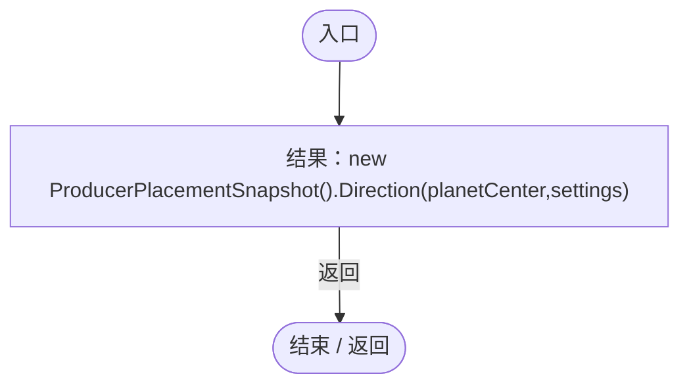

# ProducerPlacementSearch.cs

[返回总索引](../README.md) · `Runtime` · `Assets/DarwinPark/Entities/Ecology/ProducerPlacementSearch.cs`

[源文件](../../../Assets/DarwinPark/Entities/Ecology/ProducerPlacementSearch.cs) · 源码校验：`d65d0ed0ceeed76c33a3ee5610e800113db3e24a7951ca785d341298977f4d0b`

方法按源文件位置排列。事件/回调引用不表示立即执行；分支与异常说明见总索引。完整源码与可点击关系图请打开离线手册。

## Direction · L7

`public static Vector3 Direction(Vector3 planetCenter,EcologyDefaultsSettings settings)`

### Editor / Player · Roslyn编译器控制流

项目内调用/回调引用：

- [ProducerPlacementSnapshot.Direction · L35](94d51265e18d4726.md#m8842824e6d6626a9)（方法）
