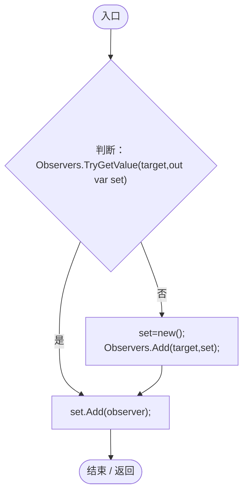
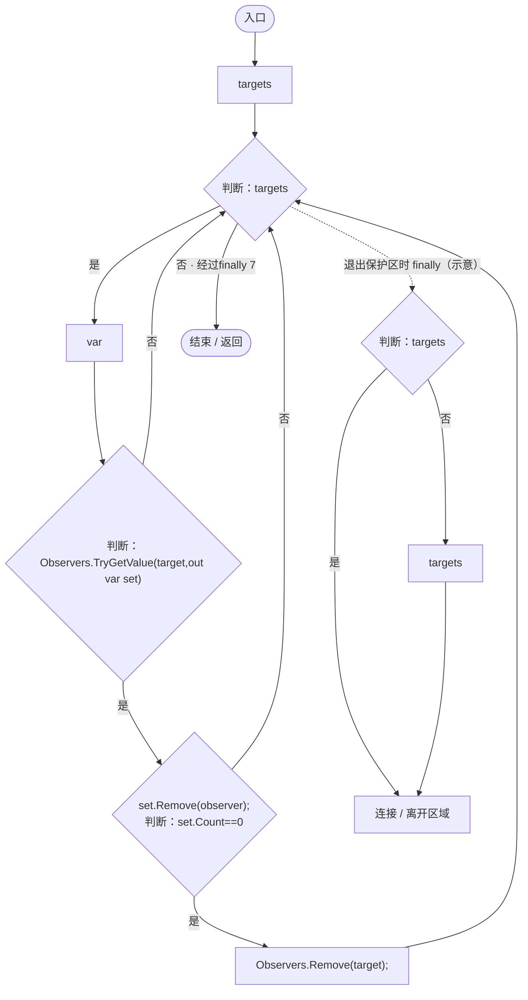
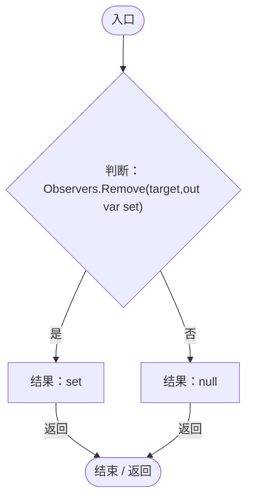
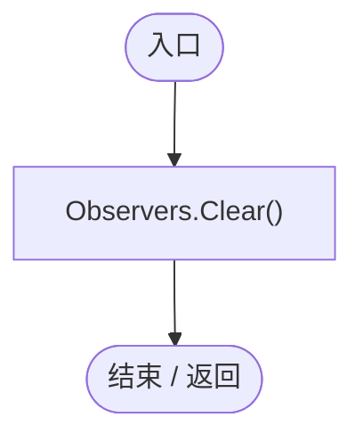
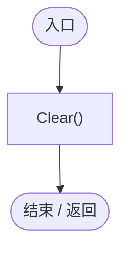

# PerceptionSubscriptions.cs

[返回总索引](../README.md) · `Runtime` · `Assets/DarwinPark/Entities/Ecology/PerceptionSubscriptions.cs`

[源文件](../../../Assets/DarwinPark/Entities/Ecology/PerceptionSubscriptions.cs) · 源码校验：`ca4b2d4af4cc2c46160038a9c21534bc7c0fc381001d899783cfe56f259afee3`

方法按源文件位置排列。事件/回调引用不表示立即执行；分支与异常说明见总索引。完整源码与可点击关系图请打开离线手册。

## Attach · L9

`public static void Attach(EntityGeneController observer,DarwinEntity target)`

### Editor / Player · Roslyn编译器控制流

## Forget · L10

`public static void Forget(EntityGeneController observer,IEnumerable<DarwinEntity> targets)`

### Editor / Player · Roslyn编译器控制流

## Take · L11

`public static HashSet<EntityGeneController> Take(DarwinEntity target)`

### Editor / Player · Roslyn编译器控制流

## Clear · L12

`public static void Clear()`

### Editor / Player · Roslyn编译器控制流

## Reset · L13

`[RuntimeInitializeOnLoadMethod(RuntimeInitializeLoadType.SubsystemRegistration)]private static void Reset()`

### Editor / Player · Roslyn编译器控制流

项目内调用/回调引用：

- [PerceptionSubscriptions.Clear · L12](69ad03522af4e9d9.md#mee8b670a83bc365e)（方法）
