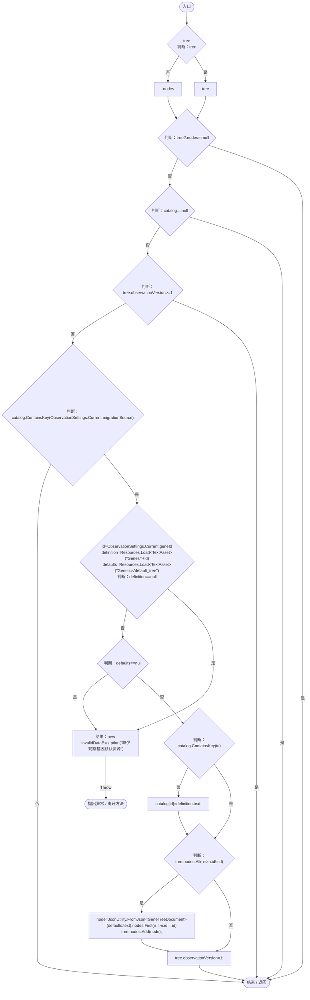
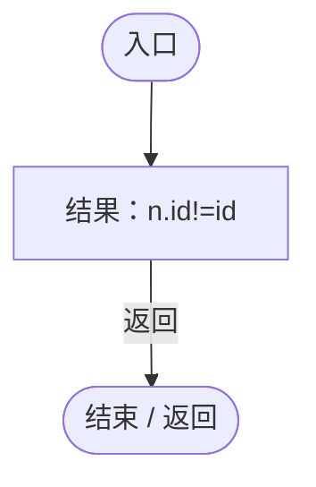
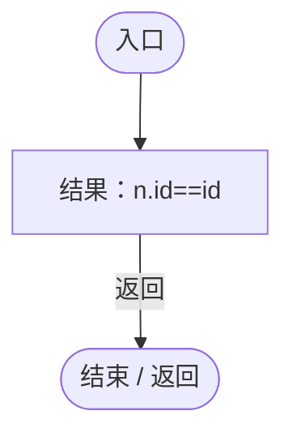

# ObservationGeneUpgrade.cs

[返回总索引](../README.md) · `Runtime` · `Assets/DarwinPark/Genetics/ObservationGeneUpgrade.cs`

[源文件](../../../Assets/DarwinPark/Genetics/ObservationGeneUpgrade.cs) · 源码校验：`51b2ed02aa7e4ed7925f46446baaf588bc695c18fb1f84394e291ed232b007ec`

方法按源文件位置排列。事件/回调引用不表示立即执行；分支与异常说明见总索引。完整源码与可点击关系图请打开离线手册。

## Apply · L10

`public static void Apply(GeneTreeDocument tree,Dictionary<string,string> catalog)`

### Editor / Player · Roslyn编译器控制流

项目内调用/回调引用：

- [ObservationSettings.Current.get · L16](fde4b9e3a289b4e6.md#m3eb41cdee2818913)（访问器）
- [ObservationGeneUpgrade.回调@15 · L15](6a35b0da69b3773b.md#m195b2ff97ca3320b)（回调/委托）
- [ObservationGeneUpgrade.回调@15 · L15](6a35b0da69b3773b.md#m0d39afda205f0240)（回调/委托）

## 回调@15 · L15

`n … => 回调`

### Editor / Player · Roslyn编译器控制流

## 回调@15 · L15

`n … => 回调`

### Editor / Player · Roslyn编译器控制流

