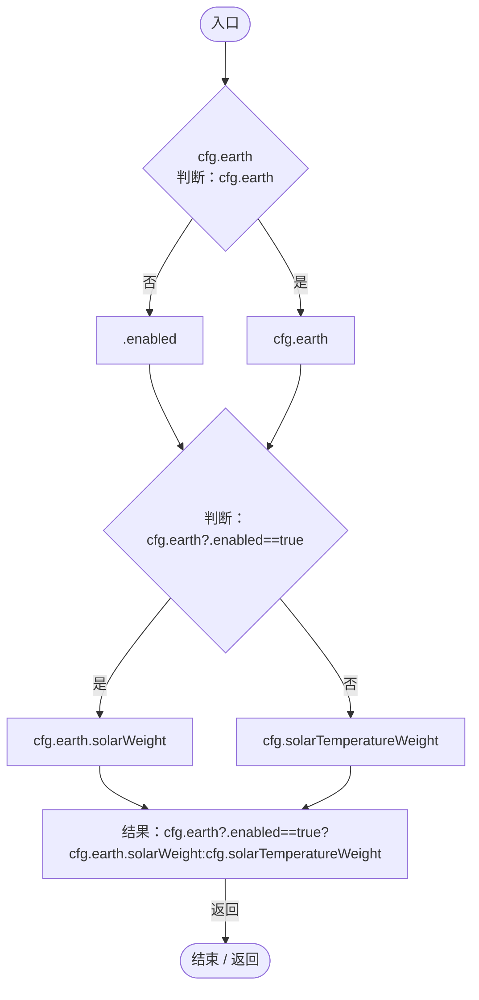
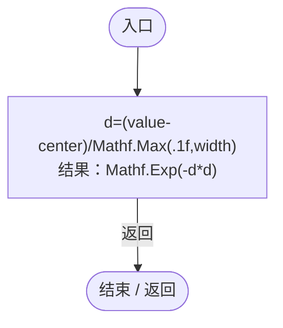
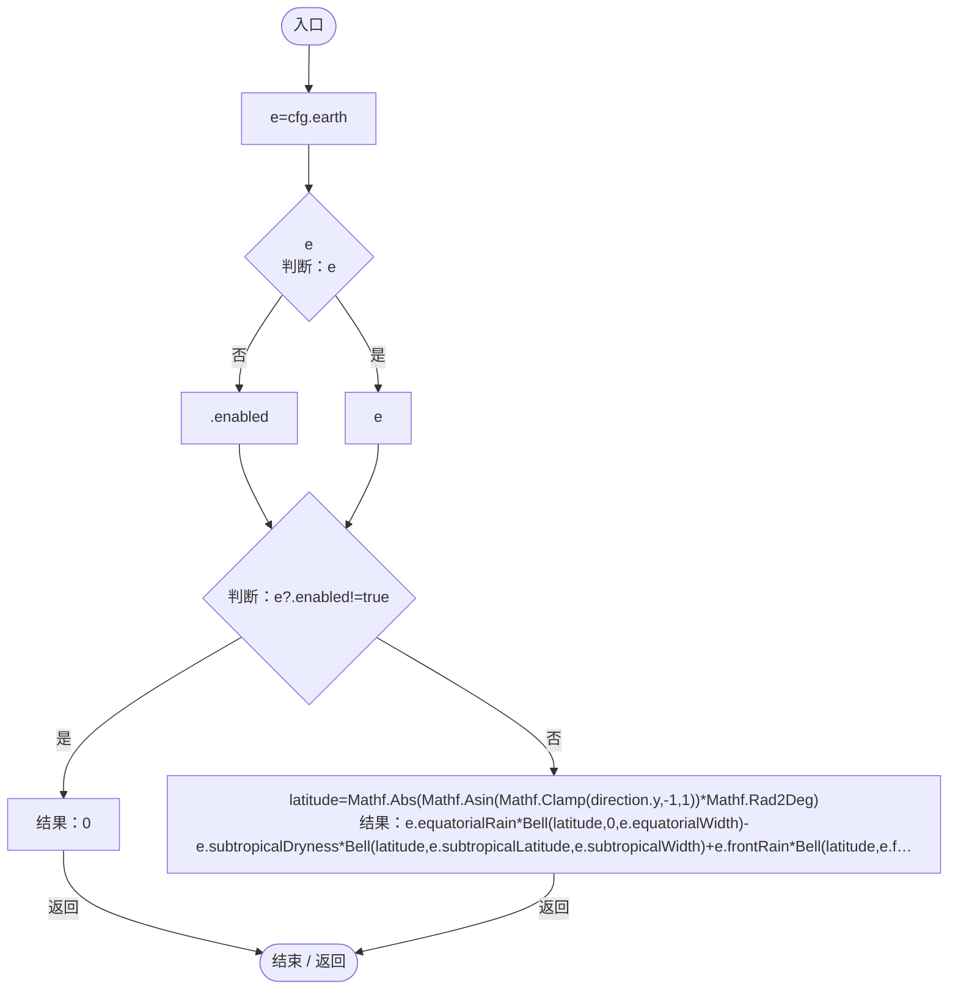
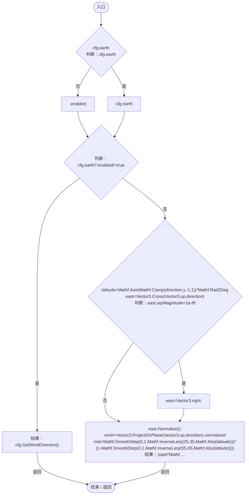
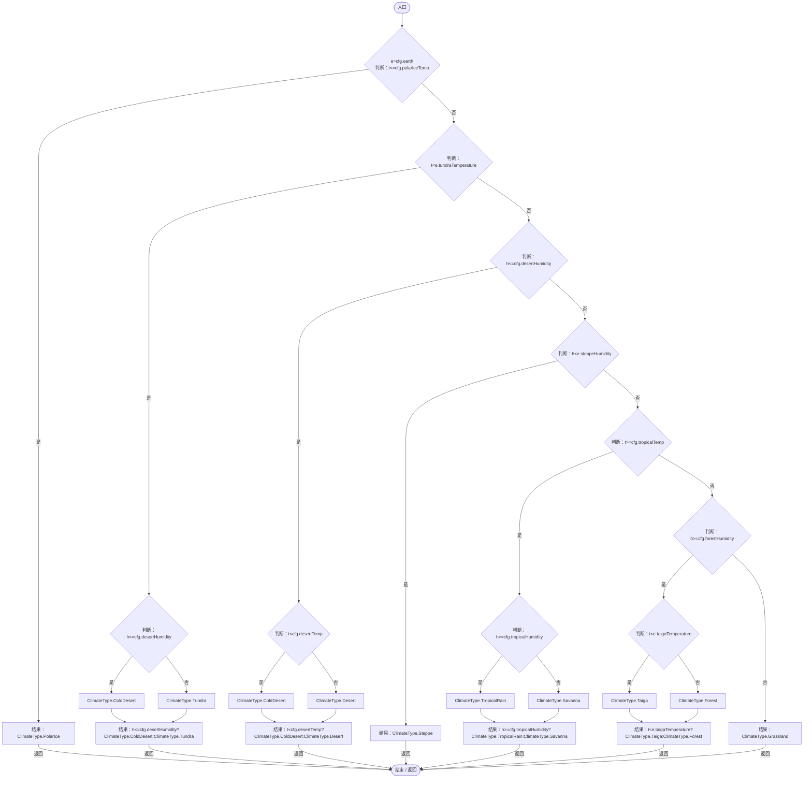
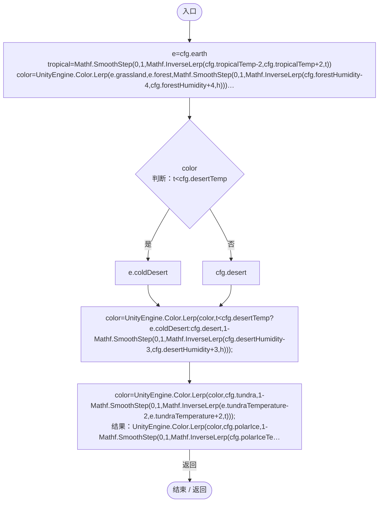

# EarthClimateRules.cs

[返回总索引](../README.md) · `Runtime` · `Assets/DarwinPark/Planet/EarthClimateRules.cs`

[源文件](../../../Assets/DarwinPark/Planet/EarthClimateRules.cs) · 源码校验：`8ba59ccdb77bd0c08a45321d101a0fa2dee8069b72f52ae425e577ec99784b7a`

方法按源文件位置排列。事件/回调引用不表示立即执行；分支与异常说明见总索引。完整源码与可点击关系图请打开离线手册。

## SolarWeight · L15

`public static float SolarWeight(PlanetClimateConfig cfg)`

### Editor / Player · Roslyn编译器控制流

## Bell · L16

`private static float Bell(float value,float center,float width)`

### Editor / Player · Roslyn编译器控制流

## Humidity · L17

`public static float Humidity(Vector3 direction,PlanetClimateConfig cfg)`

### Editor / Player · Roslyn编译器控制流

项目内调用/回调引用：

- [EarthClimateRules.Bell · L16](6a91ff043f0ebb5f.md#mf042ba88232ab3f1)（方法）

## Wind · L19

`public static Vector3 Wind(Vector3 direction,PlanetClimateConfig cfg)`

### Editor / Player · Roslyn编译器控制流

项目内调用/回调引用：

- [PlanetClimateConfig.GetWindDirection · L117](caa5d97c52b00485.md#m0440487b6defbca3)（方法）

## Classify · L21

`public static ClimateType Classify(float t,float h,PlanetClimateConfig cfg)`

### Editor / Player · Roslyn编译器控制流

## Color · L24

`public static Color Color(float t,float h,PlanetClimateConfig cfg)`

独立色板以较窄连续过渡区混合，雨林深青绿、热带草原金黄、森林鲜绿易区分。

### Editor / Player · Roslyn编译器控制流

