# NutritionEcologyRegression.cs

[返回总索引](../README.md) · `Editor` · `Assets/DarwinPark/Editor/NutritionEcologyRegression.cs`

[源文件](../../../Assets/DarwinPark/Editor/NutritionEcologyRegression.cs) · 源码校验：`dc24851fd9916f201ee466f6d7a694afef6bcd030a208f7ca9a606c99eb4f93e`

方法按源文件位置排列。事件/回调引用不表示立即执行；分支与异常说明见总索引。完整源码与可点击关系图请打开离线手册。

<a id="mdf837cd9011d6bb8"></a>

## Folder.get · L30

`private static string Folder`


### Editor · 语法控制结构 / 声明（非CFG）

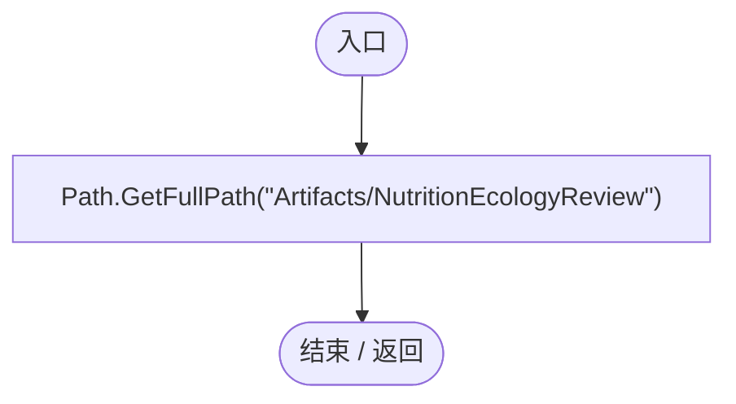

<a id="m068690cd6eade3e2"></a>

## NutritionEcologyRegression.ctor · L31

`static NutritionEcologyRegression()`


### Editor · Roslyn编译器控制流

```mermaid
flowchart TD
  b0(["入口"])
  b1["EditorApplication.update+=()=&gt; { if(_started&#124;&#124;!Application.isPlaying&#124;&#124;!SessionState.GetBool(Key,false)&#124;&#124;LanSession.Instance==null)return; _started=true;LanSession.Instance.StartCoroutine(Guard()); };"]
  b2(["结束 / 返回"])
  b0 --> b1
  b1 --> b2

```

项目内调用/回调引用：

- [NutritionEcologyRegression.回调@33 · L33](6ba59357fc88cff0.md#m2275f60b2ccd7183)（回调/委托）

<a id="m2275f60b2ccd7183"></a>

## 回调@33 · L33

`( … => 回调`


### Editor · Roslyn编译器控制流

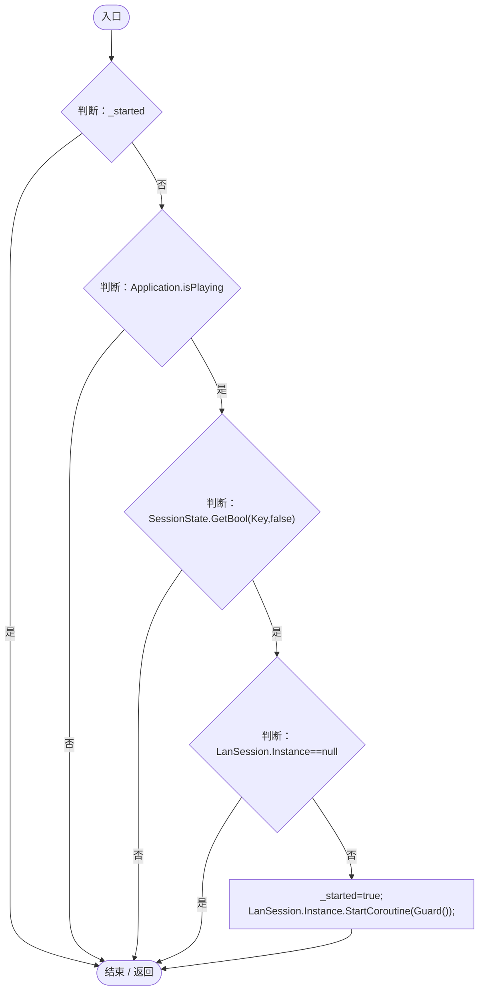

项目内调用/回调引用：

- [LanSession.Instance.get · L23](9fb633eebffe669c.md#mbf83306994878383)（访问器）
- [NutritionEcologyRegression.Guard · L46](6ba59357fc88cff0.md#m6beb149ece5ac17d)（方法）

<a id="ma7fb5c7211c81b85"></a>

## RunBatch · L39

`public static void RunBatch()`


### Editor · Roslyn编译器控制流

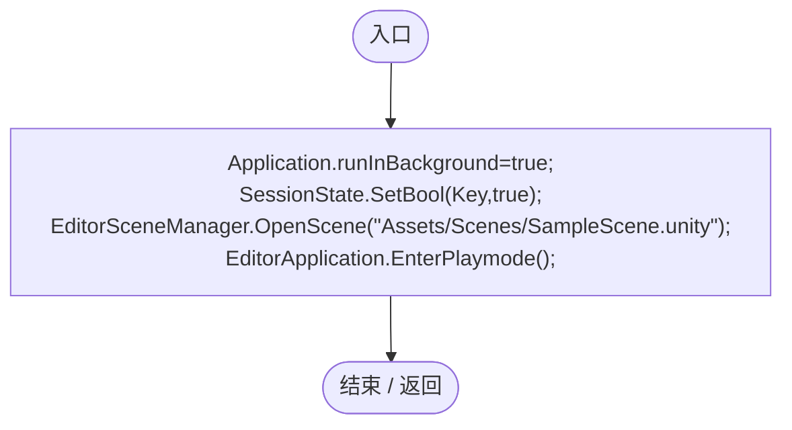

<a id="m0fc720f56463fe86"></a>

## Check · L44

`private static void Check(bool value,string message)`


### Editor · Roslyn编译器控制流

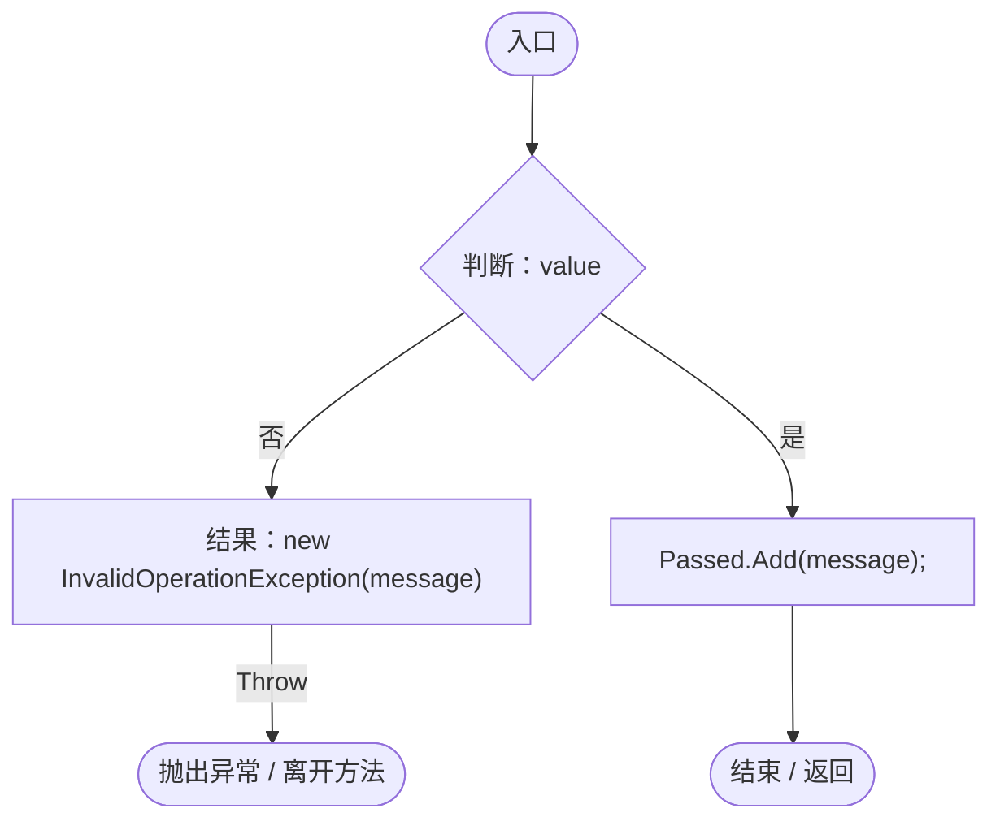

<a id="m7a8da6dc88751de8"></a>

## Near · L45

`private static void Near(float a,float b,string message)`


### Editor · Roslyn编译器控制流

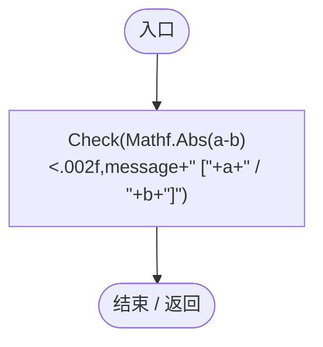

项目内调用/回调引用：

- [NutritionEcologyRegression.Check · L44](6ba59357fc88cff0.md#m0fc720f56463fe86)（方法）

<a id="m6beb149ece5ac17d"></a>

## Guard · L46

`private static IEnumerator Guard()`


### Editor · Roslyn编译器控制流

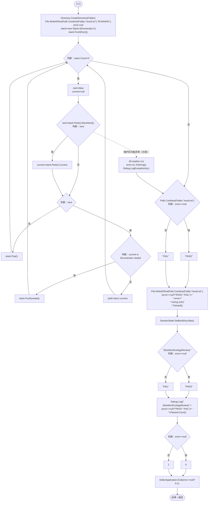

项目内调用/回调引用：

- [NutritionEcologyRegression.Run · L77](6ba59357fc88cff0.md#m1832fd43e8b82aae)（方法）

<a id="md2af88be801f806b"></a>

## Spawn · L62

`private static DarwinEntity Spawn(Vector3 point,params (string id,float value)[] definitions)`


### Editor · Roslyn编译器控制流

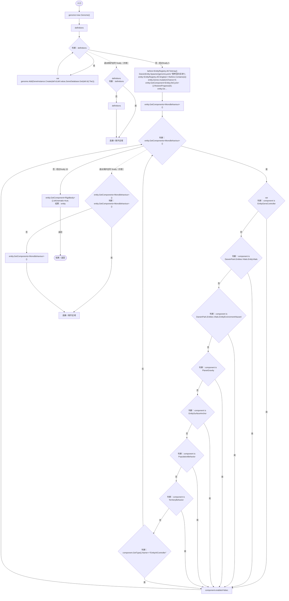

项目内调用/回调引用：

- [Genome.Add · L19](a2ef23f865bc7ee8.md#md9cfdc94b8b8d40f)（方法）
- [GeneInstance.Create · L20](f82e1498d67f5afd.md#m72e94c278de3cf8b)（方法）
- [GeneDatabase.Get · L135](ec0a03483435a863.md#m8f3bbfb35f3ca397)（方法）
- [DarwinEntity.Genes.get · L14](70798dde169f2e8b.md#m622eb1adf401d431)（访问器）
- [EntityLifeCycle.RestoreProgress · L48](9f4138bfbae654b7.md#mfc75121476d49679)（方法）
- [EntityGeneController.RestoreStageState · L51](7494d53178552f0e.md#m6264213de2a5ca6f)（方法）
- [EntityGeneController.Recalculate · L97](7494d53178552f0e.md#m65ea735c1e0e37a1)（方法）
- [NutritionEcologyRegression.回调@65 · L65](6ba59357fc88cff0.md#m8d99d7750761a099)（回调/委托）

<a id="m8d99d7750761a099"></a>

## 回调@65 · L65

`e … => 回调`


### Editor · Roslyn编译器控制流

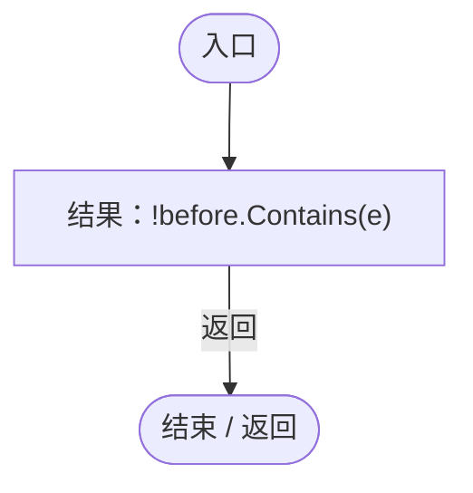

<a id="m1e0e7d318c9034af"></a>

## Stats · L71

`private static EntityStats Stats(DarwinEntity entity)`


### Editor · Roslyn编译器控制流

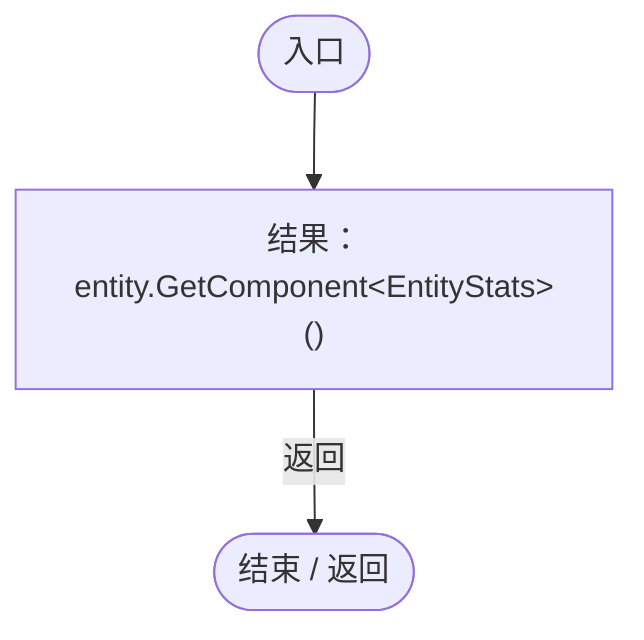

<a id="m397ec2a7c74f3607"></a>

## Food · L72

`private static float Food(DarwinEntity entity)`


### Editor · Roslyn编译器控制流

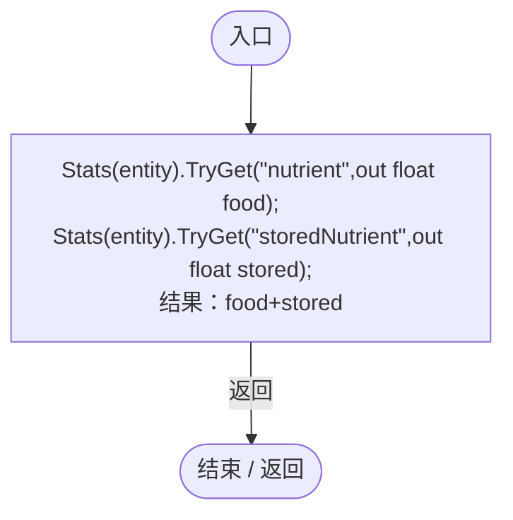

项目内调用/回调引用：

- [EntityStats.TryGet · L90](75aa86a368efdf24.md#m24ee1433e4a70d94)（方法）
- [NutritionEcologyRegression.Stats · L71](6ba59357fc88cff0.md#m1e0e7d318c9034af)（方法）

<a id="mfac1426e7cc665bf"></a>

## Fill · L73

`private static void Fill(DarwinEntity entity,float food,float stored=0)`


### Editor · Roslyn编译器控制流

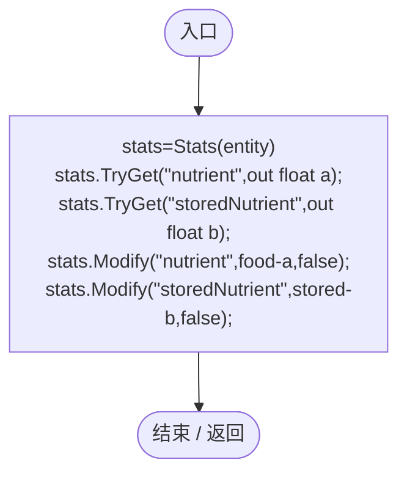

项目内调用/回调引用：

- [NutritionEcologyRegression.Stats · L71](6ba59357fc88cff0.md#m1e0e7d318c9034af)（方法）
- [EntityStats.TryGet · L90](75aa86a368efdf24.md#m24ee1433e4a70d94)（方法）
- [EntityStats.Modify · L111](75aa86a368efdf24.md#m9c837be197158240)（方法）

<a id="m25ed005a0cb9f2b0"></a>

## Clear · L75

`private static void Clear()`


### Editor · Roslyn编译器控制流

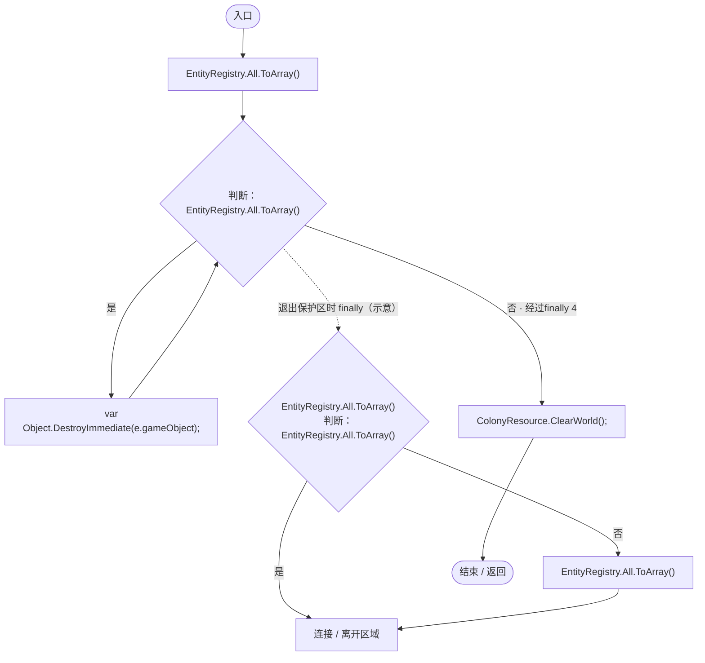

项目内调用/回调引用：

- [ColonyResource.ClearWorld · L100](293dbaecfff4b585.md#m634e84088b7cf78c)（方法）

<a id="me2b513f13d5b343f"></a>

## Capture · L76

`private static IEnumerator Capture(string name)`


### Editor · Roslyn编译器控制流

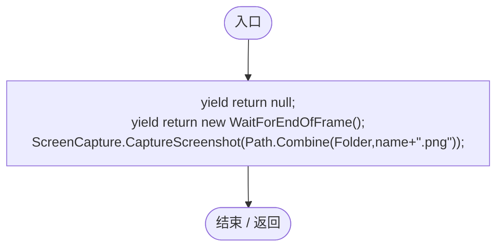

<a id="m1832fd43e8b82aae"></a>

## Run · L77

`private static IEnumerator Run()`


### Editor · Roslyn编译器控制流

```mermaid
flowchart TD
  b0(["入口"])
  b1["yield return null;<br/>session=Object.FindFirstObjectByType&lt;WorldSessionManager&gt;()<br/>builder=Object.FindFirstObjectByType&lt;PlanetTerrainMeshBuilder&gt;()<br/>clock=ServiceLocator.Get&lt;SimulationClock&gt;()<br/>builder.subdivisions=24;<br/>typeof(WorldSessionManag…"]
  b2{"判断：session.Busy"}
  b3{"判断：EditorApplication.timeSinceStartup-start&gt;100"}
  b4["结果：new TimeoutException(&quot;生成世界超时&quot;)"]
  x4(["抛出异常 / 离开方法"])
  b5["yield return null;"]
  b6["Check(session.Current!=null,&quot;真实世界初始化&quot;);<br/>clock.Pause();<br/>Clear();<br/>home=EcologyQueries.Surface(builder.transform.position+Vector3.up*(builder.radius+builder.heightScale))<br/>catalog=GeneTreeStorage.ReadCatalog()<br/>oldTree=JsonUtility.FromJson&lt;Ge…"]
  b7{"判断：oldTree.edges.Any(e=&gt;e.from==&quot;gene_nutrition&quot;&amp;&amp;e.to==&quot;gene_heterotrophy&quot;&amp;&amp;e.kind==&quot;evolution&quot;)"}
  b8["oldTree.edges.Any(e=&gt;e.from==&quot;gene_heterotrophy&quot;&amp;&amp;e.to==&quot;gene_scavenging&quot;&amp;&amp;e.kind==&quot;error&quot;)"]
  b9["oldTree.edges.Any(e=&gt;e.from==&quot;gene_nutrition&quot;&amp;&amp;e.to==&quot;gene_heterotrophy&quot;&amp;&amp;e.kind==&quot;evolution&quot;)"]
  b10["Check(oldTree.edges.Any(e=&gt;e.from==&quot;gene_nutrition&quot;&amp;&amp;e.to==&quot;gene_heterotrophy&quot;&amp;&amp;e.kind==&quot;evolution&quot;)&amp;&amp;oldTree.edges.Any(e=&gt;e.from==&quot;gene_heterotrophy&quot;&amp;&amp;e.to==&quot;gene_scavenging&quot;&amp;&amp;e.kind==&quot;error&quot;),&quot;旧树在基因库已包含新基因时仍补齐分支&quot;);"]
  b11["count=oldTree.edges.Count<br/>NutritionEvolutionUpgrade.Apply(oldTree,catalog);<br/>Check(oldTree.edges.Count==count,&quot;重复迁移不复制连线&quot;);<br/>oldTree.edges.RemoveAll(e=&gt;e.to==&quot;gene_scavenging&quot;);<br/>Check(oldTree.edges.All(e=&gt;e.to!=&quot;gene_scavenging&quot;),&quot;完成迁移后保留用…"]
  b12{"判断：GeneEvolutionRules.Allows(&quot;gene_heterotrophy&quot;,&quot;gene_scavenging&quot;,&quot;error&quot;,50)"}
  b13["!GeneEvolutionRules.Allows(&quot;gene_nutrition&quot;,&quot;gene_scavenging&quot;,&quot;evolution&quot;,80)"]
  b14["GeneEvolutionRules.Allows(&quot;gene_heterotrophy&quot;,&quot;gene_scavenging&quot;,&quot;error&quot;,50)"]
  b15["Check(GeneEvolutionRules.Allows(&quot;gene_heterotrophy&quot;,&quot;gene_scavenging&quot;,&quot;error&quot;,50)&amp;&amp;!GeneEvolutionRules.Allows(&quot;gene_nutrition&quot;,&quot;gene_scavenging&quot;,&quot;evolution&quot;,80),&quot;食腐只能来自异养出错路径&quot;);"]
  b16["mutationGenome=new Genome()<br/>mutationGenome.Add(GeneInstance.Create(&quot;gene_heterotrophy&quot;,75,1));"]
  b17["mutationGenome<br/>new GeneMutationSettings{ErrorWeight=1,DuplicateWeight=0,DeletionWeight=0}<br/>ErrorWeight=1<br/>DuplicateWeight=0<br/>DeletionWeight=0<br/>GeneMutator.Mutate(mutationGenome,new GeneMutationSettings{ErrorWeight=1,DuplicateWeight=0,Deletio…"]
  b18["Check(mutationGenome.Genes[0].DefinitionId==&quot;gene_scavenging&quot;,&quot;真实出错变异产生食腐基因&quot;);<br/>natural=Spawn(At(0),(&quot;gene_growth&quot;,50))<br/>biomass=ColonyResource.Biomass(natural)<br/>corpse=EntityDeathSettlement.Die(natural)<br/>Near(corpse.State.energy,biomass,&quot;自然…"]
  b19{"判断：EntityDeathSettlement.Die(natural)==null"}
  b20["ColonyResource.All.Count()==1"]
  b21["EntityDeathSettlement.Die(natural)==null"]
  b22["Check(EntityDeathSettlement.Die(natural)==null&amp;&amp;ColonyResource.All.Count()==1,&quot;同帧重复死亡只留一具尸体&quot;);"]
  b23["eater=Spawn(At(1),(&quot;gene_growth&quot;,50),(&quot;gene_heterotrophy&quot;,75),(&quot;gene_locomotion&quot;,75))<br/>Fill(eater,0);<br/>prey=Spawn(At(2),(&quot;gene_growth&quot;,50))<br/>available=ColonyResource.Biomass(prey)<br/>beforeFood=Food(eater)<br/>EntityCombat.Ensure(prey.gameObject).…"]
  b24{"判断：NutritionTransfer.FoodTargetAllowed(eater.Genes,mover)"}
  b25["NutritionTransfer.FoodTargetAllowed(eater.Genes,Spawn(At(6),(&quot;gene_growth&quot;,50)))"]
  b26["!NutritionTransfer.FoodTargetAllowed(eater.Genes,mover)"]
  b27["Check(!NutritionTransfer.FoodTargetAllowed(eater.Genes,mover)&amp;&amp;NutritionTransfer.FoodTargetAllowed(eater.Genes,Spawn(At(6),(&quot;gene_growth&quot;,50))),&quot;食草倾向只选择静止猎物&quot;);"]
  b28["eater.Genes.Genome.Genes.Single(g=&gt;g.DefinitionId==&quot;gene_locomotion&quot;).Value=75;<br/>eater.Genes.Recalculate();<br/>Check(NutritionTransfer.FoodTargetAllowed(eater.Genes,mover),&quot;捕猎倾向可选择移动猎物&quot;);<br/>Clear();<br/>host=Spawn(At(0),(&quot;gene_growth&quot;,50))<br/>Stats(h…"]
  b29{"判断：parasite.GetComponentsInChildren&lt;Renderer&gt;(true).All(r=&gt;!r.enabled)"}
  b30["parasite.GetComponentsInChildren&lt;Collider&gt;(true).All(c=&gt;!c.enabled)"]
  b31["parasite.GetComponentsInChildren&lt;Renderer&gt;(true).All(r=&gt;!r.enabled)"]
  b32["Check(parasite.GetComponentsInChildren&lt;Renderer&gt;(true).All(r=&gt;!r.enabled)&amp;&amp;parasite.GetComponentsInChildren&lt;Collider&gt;(true).All(c=&gt;!c.enabled),&quot;寄生取消渲染和碰撞&quot;);"]
  b33{"判断：EcologyMotion.Immobilized(parasite.Genes)"}
  b34{"判断：parasite.Genes.GetAttribute(&quot;moveSpeed&quot;)==0"}
  b35["parasite.Genes.GetAttribute(&quot;attack&quot;)==0"]
  b36["EcologyMotion.Immobilized(parasite.Genes)&amp;&amp;parasite.Genes.GetAttribute(&quot;moveSpeed&quot;)==0&amp;&amp;parasite.Genes.GetAttribute(&quot;attack&quot;)==0"]
  b37["Check(EcologyMotion.Immobilized(parasite.Genes)&amp;&amp;parasite.Genes.GetAttribute(&quot;moveSpeed&quot;)==0&amp;&amp;parasite.Genes.GetAttribute(&quot;attack&quot;)==0,&quot;寄生期间不能移动攻击或跳跃&quot;);"]
  b38["Check(EntityStatePresentation.Current(host).EndsWith(&quot;（被寄生）&quot;),&quot;宿主状态以括号标记被寄生&quot;);<br/>host.transform.position=At(4);<br/>feeding.Advance(1);<br/>Near(Vector3.Distance(host.transform.position,parasite.transform.position),0,&quot;寄生体只随宿主移动&quot;);<br/>Near(Food(host)+…"]
  b39{"判断：protectedFood&gt;=NutritionEcologySettings.Current.hostProtectedNutrient"}
  b40["hp==100"]
  b41["protectedFood&gt;=NutritionEcologySettings.Current.hostProtectedNutrient"]
  b42["Check(protectedFood&gt;=NutritionEcologySettings.Current.hostProtectedNutrient&amp;&amp;hp==100,&quot;持续寄生保留宿主安全口粮且不直接致死&quot;);"]
  b43["parasite.Genes.CurrentAge=AgeState.Adult;<br/>parasite.Genes.Recalculate();<br/>feeding.Advance(0);"]
  b44{"判断：feeding.Host==null"}
  b45{"判断：NutritionParasite.CountOn(host)==0"}
  b46{"判断：parasite.GetComponentsInChildren&lt;Collider&gt;(true).Any(c=&gt;c.enabled)"}
  b47["parasite.GetComponentsInChildren&lt;Renderer&gt;(true).Any(r=&gt;r.enabled)"]
  b48["feeding.Host==null&amp;&amp;NutritionParasite.CountOn(host)==0&amp;&amp;parasite.GetComponentsInChildren&lt;Collider&gt;(true).Any(c=&gt;c.enabled)&amp;&amp;parasite.GetComponentsInChildren&lt;Renderer&gt;(true).Any(r=&gt;r.enabled)"]
  b49["Check(feeding.Host==null&amp;&amp;NutritionParasite.CountOn(host)==0&amp;&amp;parasite.GetComponentsInChildren&lt;Collider&gt;(true).Any(c=&gt;c.enabled)&amp;&amp;parasite.GetComponentsInChildren&lt;Renderer&gt;(true).Any(r=&gt;r.enabled),&quot;成年自动脱离并恢复渲染碰撞&quot;);"]
  b50["Check(NutritionTransfer.CanDigest(parasite.Genes),&quot;成年寄生食性转为独立消化&quot;);<br/>parasite.Genes.CurrentAge=AgeState.Infant;<br/>parasite.Genes.Recalculate();<br/>parasite.transform.position=host.transform.position;<br/>Check(feeding.TryAttach(host),&quot;重建寄生用于失效回归&quot;);…"]
  b51{"判断：feeding.Host==null"}
  b52["parasite.gameObject.activeSelf"]
  b53["feeding.Host==null"]
  b54["Check(feeding.Host==null&amp;&amp;parasite.gameObject.activeSelf,&quot;宿主死亡后寄生体独立存活并脱离&quot;);"]
  b55["Clear();<br/>workerEntity=Spawn(At(0),(&quot;gene_growth&quot;,50),(&quot;gene_population&quot;,20))<br/>workerEntity.Genes.CurrentAge=AgeState.Adult;<br/>workerEntity.Genes.Recalculate();<br/>worker=workerEntity.GetComponent&lt;AntColonyMember&gt;()<br/>worker.Assign(AntRole.Worker…"]
  b56{"判断：worker.State.carriedResource==neutralCorpse.State.id"}
  b57["neutralCorpse.HasLiveClaim"]
  b58["worker.State.carriedResource==neutralCorpse.State.id"]
  b59["Check(worker.State.carriedResource==neutralCorpse.State.id&amp;&amp;neutralCorpse.HasLiveClaim,&quot;工匠实际领取中立自然死亡尸体&quot;);"]
  b60["beforeFood=Food(scavenger);<br/>scavenging.Advance(1);<br/>Near(Food(scavenger),beforeFood,&quot;食腐不抢食已被工匠领取的尸体&quot;);<br/>worker.transform.position=EcologyQueries.ToWorld(worker.State.deliveryPoint);<br/>worker.Advance(.1f);<br/>block=ColonyResource.All.Single(r=&gt;r…"]
  b61["i=0"]
  b62{"判断：i&lt;192"}
  b63{"y=1-2*(i+.5f)/192<br/>angle=i*2.399963f<br/>dir=new Vector3(Mathf.Sqrt(1-y*y)*Mathf.Cos(angle),y,Mathf.Sqrt(1-y*y)*Mathf.Sin(angle))<br/>point=EcologyQueries.Surface(builder.transform.position+dir*(builder.radius+builder.heightScale))<br/>判断：(point-buil…"}
  b64["liveHome=point;"]
  b65["i++"]
  b66["axis=Vector3.Cross(EcologyQueries.Up(liveHome),Vector3.forward).normalized<br/>liveGroup=Guid.NewGuid().ToString(&quot;N&quot;)<br/>queenEntity=Spawn(LiveAt(0),(&quot;gene_growth&quot;,50),(&quot;gene_population&quot;,20))<br/>queenEntity.Genes.CurrentAge=AgeState.Adult;<br/>queenEn…"]
  b67{"判断：ColonyResource.Find(liveCorpseId)!=null"}
  b68{"pickedUp&#124;=worker.State.carriedResource==liveCorpseId;<br/>判断：EditorApplication.timeSinceStartup-start&gt;35"}
  b69["结果：new TimeoutException(&quot;工匠真实运输超时：&quot;+worker.Activity+&quot; 距尸体=&quot;+EcologyQueries.Distance(worker.transform.position,liveCorpse.transform.position))"]
  x69(["抛出异常 / 离开方法"])
  b70["yield return null;"]
  b71["clock.Pause();"]
  b72{"判断：pickedUp"}
  b73["EcologyQueries.Distance(workerStart,worker.transform.position)&gt;.5f"]
  b74["pickedUp"]
  b75["Check(pickedUp&amp;&amp;EcologyQueries.Distance(workerStart,worker.transform.position)&gt;.5f,&quot;工匠真实行走接近、拾取并搬运尸体&quot;);"]
  b76["Near(ColonyResource.All.Sum(r=&gt;r.State.energy),liveEnergy,&quot;真实运输交付能量守恒&quot;);<br/>Clear();<br/>host=Spawn(At(0),(&quot;gene_growth&quot;,50));<br/>Stats(host).Modify(&quot;size&quot;,3,false);<br/>parasite=Spawn(host.transform.position,(&quot;gene_heterotrophy&quot;,25),(&quot;gene_growth&quot;,50…"]
  b77{"判断：pregnancy!=null"}
  b78{"判断：pregnancy.Count==1"}
  b79["!host.Genes.IsGestating"]
  b80["pregnancy!=null&amp;&amp;pregnancy.Count==1&amp;&amp;!host.Genes.IsGestating"]
  b81["Check(pregnancy!=null&amp;&amp;pregnancy.Count==1&amp;&amp;!host.Genes.IsGestating,&quot;宿主获得独立外来孕育状态&quot;);"]
  b82{"判断：pregnancy.Capture()[0].genome.Genes[0].Value==72"}
  b83["host.Genes.Genome.Genes[0].Value==50"]
  b84["pregnancy.Capture()[0].genome.Genes[0].Value==72"]
  b85["Check(pregnancy.Capture()[0].genome.Genes[0].Value==72&amp;&amp;host.Genes.Genome.Genes[0].Value==50,&quot;卵使用亲本后代基因，与宿主基因无关&quot;);"]
  b86["Check(EntityStatePresentation.Current(host).Contains(&quot;卵寄生孕育&quot;),&quot;宿主显示特殊卵寄生孕育状态&quot;);<br/>offspring.Genes[0].Value=1;<br/>Check(pregnancy.Capture()[0].genome.Genes[0].Value==72,&quot;存放外来卵时深拷贝基因，避免别名改写&quot;);<br/>hostId=EcologyIdentity.Of(host)<br/>parasiteId=EcologyI…"]
  b87{"判断：data.entities.Single(e=&gt;e.ecology.id==hostId).ecology.foreignEggs.Count==1"}
  b88["data.entities.Single(e=&gt;e.ecology.id==parasiteId).ecology.nutritionParasite.host==hostId"]
  b89["data.entities.Single(e=&gt;e.ecology.id==hostId).ecology.foreignEggs.Count==1"]
  b90["Check(data.entities.Single(e=&gt;e.ecology.id==hostId).ecology.foreignEggs.Count==1&amp;&amp;data.entities.Single(e=&gt;e.ecology.id==parasiteId).ecology.nutritionParasite.host==hostId,&quot;真实写盘读回外来卵与寄生宿主关系&quot;);"]
  b91["invalid=JsonUtility.FromJson&lt;WorldSaveData&gt;(JsonUtility.ToJson(data))<br/>invalid.entities.Single(e=&gt;e.ecology.id==hostId).ecology.foreignEggs[0].remaining=float.NaN;<br/>rejected=false"]
  b92["WorldSaveStore.Validate(invalid);"]
  b93["rejected=true;"]
  b94["Check(rejected,&quot;坏卵计时在清场前拒绝&quot;);<br/>data.entities.Reverse();<br/>session.Open(data);<br/>start=EditorApplication.timeSinceStartup;"]
  b95{"判断：session.Busy"}
  b96{"判断：EditorApplication.timeSinceStartup-start&gt;100"}
  b97["结果：new TimeoutException(&quot;读档超时&quot;)"]
  x97(["抛出异常 / 离开方法"])
  b98["yield return null;"]
  b99["clock.Pause();<br/>host=EcologyIdentity.Find(hostId);<br/>parasite=EcologyIdentity.Find(parasiteId);"]
  b100{"判断：parasite.GetComponent&lt;NutritionParasite&gt;().Host==host"}
  b101["NutritionParasite.CountOn(host)==1"]
  b102["parasite.GetComponent&lt;NutritionParasite&gt;().Host==host"]
  b103["Check(parasite.GetComponent&lt;NutritionParasite&gt;().Host==host&amp;&amp;NutritionParasite.CountOn(host)==1,&quot;逆序读档恢复隐藏寄生与宿主计数&quot;);"]
  b104["pregnancy=host.GetComponent&lt;EggHostPregnancy&gt;();<br/>Near(pregnancy.Capture()[0].remaining,remaining,&quot;读档保留外来卵孕育计时&quot;);<br/>entities=EntityRegistry.All.Count<br/>pregnancy.Advance(remaining+1);"]
  b105{"判断：pregnancy.Count==0"}
  b106["EntityRegistry.All.Count==entities+1"]
  b107["pregnancy.Count==0"]
  b108["Check(pregnancy.Count==0&amp;&amp;EntityRegistry.All.Count==entities+1,&quot;外来卵实际孵化并移除载荷&quot;);"]
  b109["child=EntityRegistry.All.Last()<br/>Check(child.Genes.Genome.Genes.Single().Value==72,&quot;孵化后代保留外来卵基因&quot;);<br/>replicaState=EcologySaveState.Capture(parasite)<br/>NutritionReplicaPresentation.Apply(child,replicaState);"]
  b110{"判断：child.GetComponentsInChildren&lt;Renderer&gt;().All(r=&gt;!r.enabled)"}
  b111["child.GetComponentsInChildren&lt;Collider&gt;().All(c=&gt;!c.enabled)"]
  b112["child.GetComponentsInChildren&lt;Renderer&gt;().All(r=&gt;!r.enabled)"]
  b113["Check(child.GetComponentsInChildren&lt;Renderer&gt;().All(r=&gt;!r.enabled)&amp;&amp;child.GetComponentsInChildren&lt;Collider&gt;().All(c=&gt;!c.enabled),&quot;成员副本隐藏寄生渲染与碰撞&quot;);"]
  b114["NutritionReplicaPresentation.Apply(child,new EcologySaveState());"]
  b115{"判断：child.GetComponentsInChildren&lt;Renderer&gt;().Any(r=&gt;r.enabled)"}
  b116["child.GetComponentsInChildren&lt;Collider&gt;().Any(c=&gt;c.enabled)"]
  b117["child.GetComponentsInChildren&lt;Renderer&gt;().Any(r=&gt;r.enabled)"]
  b118["Check(child.GetComponentsInChildren&lt;Renderer&gt;().Any(r=&gt;r.enabled)&amp;&amp;child.GetComponentsInChildren&lt;Collider&gt;().Any(c=&gt;c.enabled),&quot;副本解除寄生恢复渲染与碰撞&quot;);"]
  b119["display=FrameRateDisplay.Instance"]
  b120{"判断：display!=null"}
  b121["display.backgroundOpacity&lt;=.25f"]
  b122["display!=null"]
  b123["Check(display!=null&amp;&amp;display.backgroundOpacity&lt;=.25f,&quot;FPS默认背景半透明&quot;);"]
  b124["display.backgroundOpacity=0;<br/>yield return Capture(&quot;fps-transparent&quot;);<br/>display.backgroundOpacity=.18f;<br/>filter=Object.FindFirstObjectByType&lt;MapEntityGeneFilterUI&gt;(FindObjectsInactive.Include)<br/>filter.minimumWidth=0;<br/>yield return null;<br/>dropd…"]
  b125(["结束 / 返回"])
  b0 --> b1
  b1 --> b2
  b2 -->|"是"| b3
  b2 -->|"否"| b6
  b3 -->|"是"| b4
  b3 -->|"否"| b5
  b4 -->|"Throw"| x4
  b5 --> b2
  b6 --> b7
  b7 -->|"是"| b8
  b7 -->|"否"| b9
  b8 --> b10
  b9 --> b10
  b10 --> b11
  b11 --> b12
  b12 -->|"是"| b13
  b12 -->|"否"| b14
  b13 --> b15
  b14 --> b15
  b15 --> b16
  b16 --> b17
  b17 --> b18
  b18 --> b19
  b19 -->|"是"| b20
  b19 -->|"否"| b21
  b20 --> b22
  b21 --> b22
  b22 --> b23
  b23 --> b24
  b24 -->|"否"| b25
  b24 -->|"是"| b26
  b25 --> b27
  b26 --> b27
  b27 --> b28
  b28 --> b29
  b29 -->|"是"| b30
  b29 -->|"否"| b31
  b30 --> b32
  b31 --> b32
  b32 --> b33
  b33 -->|"是"| b34
  b33 -->|"否"| b36
  b34 -->|"是"| b35
  b34 -->|"否"| b36
  b35 --> b37
  b36 --> b37
  b37 --> b38
  b38 --> b39
  b39 -->|"是"| b40
  b39 -->|"否"| b41
  b40 --> b42
  b41 --> b42
  b42 --> b43
  b43 --> b44
  b44 -->|"是"| b45
  b44 -->|"否"| b48
  b45 -->|"是"| b46
  b45 -->|"否"| b48
  b46 -->|"是"| b47
  b46 -->|"否"| b48
  b47 --> b49
  b48 --> b49
  b49 --> b50
  b50 --> b51
  b51 -->|"是"| b52
  b51 -->|"否"| b53
  b52 --> b54
  b53 --> b54
  b54 --> b55
  b55 --> b56
  b56 -->|"是"| b57
  b56 -->|"否"| b58
  b57 --> b59
  b58 --> b59
  b59 --> b60
  b60 --> b61
  b61 --> b62
  b62 -->|"是"| b63
  b62 -->|"否"| b66
  b63 -->|"是"| b64
  b63 -->|"否"| b65
  b64 --> b66
  b65 --> b62
  b66 --> b67
  b67 -->|"是"| b68
  b67 -->|"否"| b71
  b68 -->|"是"| b69
  b68 -->|"否"| b70
  b69 -->|"Throw"| x69
  b70 --> b67
  b71 --> b72
  b72 -->|"是"| b73
  b72 -->|"否"| b74
  b73 --> b75
  b74 --> b75
  b75 --> b76
  b76 --> b77
  b77 -->|"是"| b78
  b77 -->|"否"| b80
  b78 -->|"是"| b79
  b78 -->|"否"| b80
  b79 --> b81
  b80 --> b81
  b81 --> b82
  b82 -->|"是"| b83
  b82 -->|"否"| b84
  b83 --> b85
  b84 --> b85
  b85 --> b86
  b86 --> b87
  b87 -->|"是"| b88
  b87 -->|"否"| b89
  b88 --> b90
  b89 --> b90
  b90 --> b91
  b91 --> b92
  b92 --> b94
  b93 --> b94
  b94 --> b95
  b95 -->|"是"| b96
  b95 -->|"否"| b99
  b96 -->|"是"| b97
  b96 -->|"否"| b98
  b97 -->|"Throw"| x97
  b98 --> b95
  b99 --> b100
  b100 -->|"是"| b101
  b100 -->|"否"| b102
  b101 --> b103
  b102 --> b103
  b103 --> b104
  b104 --> b105
  b105 -->|"是"| b106
  b105 -->|"否"| b107
  b106 --> b108
  b107 --> b108
  b108 --> b109
  b109 --> b110
  b110 -->|"是"| b111
  b110 -->|"否"| b112
  b111 --> b113
  b112 --> b113
  b113 --> b114
  b114 --> b115
  b115 -->|"是"| b116
  b115 -->|"否"| b117
  b116 --> b118
  b117 --> b118
  b118 --> b119
  b119 --> b120
  b120 -->|"是"| b121
  b120 -->|"否"| b122
  b121 --> b123
  b122 --> b123
  b123 --> b124
  b124 --> b125
  b92 -. "保护区可能异常（示意）" .-> b93

```

项目内调用/回调引用：

- [ServiceLocator.Get · L33](f2fdbe9f9ccd93cb.md#m2ae625299520c56d)（方法）
- [PlanetClimateMap.Instance.get · L16](b4e9726c1bcf4c37.md#m3add54a419aeef9f)（访问器）
- [PlanetOreSystem.Instance.get · L8](86b3fbb4d9436121.md#m53f6a6af4b6dc252)（访问器）
- [WorldSessionManager.Create · L41](08741c7b7b9d9344.md#m6aadfeee8b90aacd)（方法）
- [WorldSessionManager.Busy.get · L24](08741c7b7b9d9344.md#m4483e2e4f28f7c85)（访问器）
- [NutritionEcologyRegression.Check · L44](6ba59357fc88cff0.md#m0fc720f56463fe86)（方法）
- [WorldSessionManager.Current.get · L21](08741c7b7b9d9344.md#m5d26a5eb846a8504)（访问器）
- [SimulationClock.Pause · L79](a8f444aec9614b0a.md#m30929d45a885d0f1)（方法）
- [NutritionEcologyRegression.Clear · L75](6ba59357fc88cff0.md#m25ed005a0cb9f2b0)（方法）
- [EcologyQueries.Surface · L47](bdf7ccc2c9c0452f.md#m2f1f6873ee5fc8df)（方法）
- [GeneTreeStorage.ReadCatalog · L27](a885bad0d7dedee8.md#m89083f320ec287c0)（方法）
- [NutritionEvolutionUpgrade.Apply · L10](02dbee4dabe4bc85.md#md1d08580fa5cdf72)（方法）
- [GeneEvolutionRules.Allows · L25](95d3abc5e23f05d3.md#m56e7f05bb0fe9159)（方法）
- [Genome.Add · L19](a2ef23f865bc7ee8.md#md9cfdc94b8b8d40f)（方法）
- [GeneInstance.Create · L20](f82e1498d67f5afd.md#m72e94c278de3cf8b)（方法）
- [GeneMutator.Mutate · L18](f297edbfb98ef475.md#m4444eb9ce9b6a55a)（方法）
- [NutritionEcologyRegression.Spawn · L62](6ba59357fc88cff0.md#md2af88be801f806b)（方法）
- [NutritionEcologyRegression.At · L87](6ba59357fc88cff0.md#mfd7183df52fba823)（局部函数）
- [ColonyResource.Biomass · L30](293dbaecfff4b585.md#m98b1ac7eb3c22aaf)（方法）
- [EntityDeathSettlement.Die · L11](07fa6bdaadf50796.md#m700276963777d0a6)（方法）
- [NutritionEcologyRegression.Near · L45](6ba59357fc88cff0.md#m7a8da6dc88751de8)（方法）
- [ColonyResource.State.get · L22](293dbaecfff4b585.md#m341a1355f4d657bf)（访问器）
- [NutritionEcologyRegression.Fill · L73](6ba59357fc88cff0.md#mfac1426e7cc665bf)（方法）
- [NutritionEcologyRegression.Food · L72](6ba59357fc88cff0.md#m397ec2a7c74f3607)（方法）
- [EntityCombat.Receive · L12](a5b5b46ac6c197ae.md#mcdb8fa72b26b29f2)（方法）
- [EntityCombat.Ensure · L11](a5b5b46ac6c197ae.md#m1b9e5f59cedd143e)（方法）
- [EntityStats.SetMax · L128](75aa86a368efdf24.md#mdf2b4879a69febb3)（方法）
- [NutritionEcologyRegression.Stats · L71](6ba59357fc88cff0.md#m1e0e7d318c9034af)（方法）
- [DarwinEntity.Genes.get · L14](70798dde169f2e8b.md#m622eb1adf401d431)（访问器）
- [EntityGeneController.Recalculate · L97](7494d53178552f0e.md#m65ea735c1e0e37a1)（方法）
- [NutritionTransfer.CanHuntForFood · L26](081d3b8ff683e442.md#m2962d3f47f91a266)（方法）
- [NutritionTransfer.FoodTargetAllowed · L31](081d3b8ff683e442.md#m9a5b5e120aa5f815)（方法）
- [EntityStats.Modify · L111](75aa86a368efdf24.md#m9c837be197158240)（方法）
- [NutritionParasite.TryAttach · L53](4a18785b7c1e1484.md#mb366b3d9a5de3d82)（方法）
- [EcologyMotion.Immobilized · L9](6ed9d0eedb456d32.md#mff3eeb8fb207a31e)（方法）
- [EntityGeneController.GetAttribute · L257](7494d53178552f0e.md#m600509f72d274f0c)（方法）
- [EntityStatePresentation.Current · L11](cedd13b7a8825ed4.md#mb284f7b351983ca5)（方法）
- [NutritionParasite.Advance · L33](4a18785b7c1e1484.md#mf60afdf9561ee9ff)（方法）
- [EntityStats.TryGet · L90](75aa86a368efdf24.md#m24ee1433e4a70d94)（方法）
- [NutritionEcologySettings.Current.get · L19](846a17351dbd6aa4.md#mb3eb930022e314f3)（访问器）
- [EntityGeneController.CurrentAge.set · L34](7494d53178552f0e.md#me616ca96310ad01c)（访问器）
- [NutritionParasite.Host.get · L19](4a18785b7c1e1484.md#me3131db9b6e16399)（访问器）
- [NutritionParasite.CountOn · L22](4a18785b7c1e1484.md#m3b1e8683dc9deed4)（方法）
- [NutritionTransfer.CanDigest · L17](081d3b8ff683e442.md#m9a2dc0866fe95262)（方法）
- [AntColonyMember.Assign · L54](baebd85c05598377.md#mda0fe308acecb8f2)（方法）
- [CorpseFeeding.Advance · L16](0494eed2004cafc6.md#mf6e53f77f4b102f3)（方法）
- [AntColonyMember.Advance · L77](baebd85c05598377.md#m29cff578dd85ff16)（方法）
- [AntColonyMember.State.get · L27](baebd85c05598377.md#mc8282e8cc823ceeb)（访问器）
- [EcologyQueries.ToWorld · L40](bdf7ccc2c9c0452f.md#m320932c05ccecbf7)（方法）
- [ColonyResource.Claim · L65](293dbaecfff4b585.md#mdee42e4bd6fb5563)（方法）
- [ColonyResource.Release · L76](293dbaecfff4b585.md#m8e4d3a531b8701e8)（方法）
- [PlanetTerrainMeshBuilder.WaterRadius.get · L94](415285cf043354a9.md#m28d8809083881ec1)（访问器）
- [EcologyQueries.Up · L41](bdf7ccc2c9c0452f.md#maca7070196f125fd)（方法）
- [NutritionEcologyRegression.LiveAt · L149](6ba59357fc88cff0.md#m9bb9ee174132c633)（局部函数）
- [AntColonyMember.Genes.get · L28](baebd85c05598377.md#m3b8445af6c82650a)（访问器）
- [AntColonyMember.Population.get · L30](baebd85c05598377.md#m688c2c0dfb5a66d6)（访问器）
- [SimulationClock.SetTimeScale · L81](a8f444aec9614b0a.md#mecaa463a0561aca3)（方法）
- [SimulationClock.Play · L78](a8f444aec9614b0a.md#m7aa9e64b7de60ed0)（方法）
- [ColonyResource.Find · L26](293dbaecfff4b585.md#m8e52e678f4038a50)（方法）
- [AntColonyMember.Activity.get · L43](baebd85c05598377.md#m033aa4a066e4fd8c)（访问器）
- [EcologyQueries.Distance · L42](bdf7ccc2c9c0452f.md#mba9c3e3c95d0f2dd)（方法）
- [EggHostPregnancy.TryDeposit · L16](b0ff4b8259f98b85.md#mbf3d4ddb9cabb30c)（方法）
- [EggHostPregnancy.Capture · L44](b0ff4b8259f98b85.md#mb7562dd5d24d11a7)（方法）
- [EcologyIdentity.Of · L21](bdf7ccc2c9c0452f.md#m1143cf9570a93b72)（方法）
- [WorldSessionManager.SaveNow · L157](08741c7b7b9d9344.md#mbecd8b5c222ba46b)（方法）
- [WorldSaveStore.FileFor · L48](d67a35e5e3814c15.md#m419a625e2bcc70f8)（方法）
- [WorldSaveStore.Read · L72](d67a35e5e3814c15.md#mca362c7675a5800c)（方法）
- [WorldSaveStore.Validate · L73](d67a35e5e3814c15.md#mb2f88d55be126f07)（方法）
- [WorldSessionManager.Open · L58](08741c7b7b9d9344.md#m0a8e69a8a4fbc512)（方法）
- [EcologyIdentity.Find · L20](bdf7ccc2c9c0452f.md#m58f756a3ba9ec990)（方法）
- [EggHostPregnancy.Advance · L31](b0ff4b8259f98b85.md#mda130466ea18eb54)（方法）
- [EcologySaveState.Capture · L29](dd1dde4b4c192659.md#m25ad9f5dc9a5059e)（方法）
- [NutritionReplicaPresentation.Apply · L14](a956a3ed597cf878.md#m6b9a951c280292a7)（方法）
- [FrameRateDisplay.Instance.get · L13](4e898f3c11cb4578.md#m7dff03e4b726493b)（访问器）
- [NutritionEcologyRegression.Capture · L76](6ba59357fc88cff0.md#me2b513f13d5b343f)（方法）
- [NutritionEcologyRegression.回调@90 · L90](6ba59357fc88cff0.md#m6082eb4f6ee9134d)（回调/委托）
- [NutritionEcologyRegression.回调@90 · L90](6ba59357fc88cff0.md#m2dfe9059dcee0172)（回调/委托）
- [NutritionEcologyRegression.回调@92 · L92](6ba59357fc88cff0.md#m0c937613802d24dc)（回调/委托）
- [NutritionEcologyRegression.回调@92 · L92](6ba59357fc88cff0.md#m077e74f9aafe01e7)（回调/委托）
- [NutritionEcologyRegression.回调@94 · L94](6ba59357fc88cff0.md#m00ad4bf35ce98da6)（回调/委托）
- [NutritionEcologyRegression.回调@94 · L94](6ba59357fc88cff0.md#m9c5885d9f2174aaf)（回调/委托）
- [NutritionEcologyRegression.回调@106 · L106](6ba59357fc88cff0.md#mf268b95bbd32c14b)（回调/委托）
- [NutritionEcologyRegression.回调@110 · L110](6ba59357fc88cff0.md#ma5a45e9857d82e94)（回调/委托）
- [NutritionEcologyRegression.回调@113 · L113](6ba59357fc88cff0.md#mb87fb5c7185ee51d)（回调/委托）
- [NutritionEcologyRegression.回调@115 · L115](6ba59357fc88cff0.md#m3a4f29209ff542af)（回调/委托）
- [NutritionEcologyRegression.回调@120 · L120](6ba59357fc88cff0.md#m0d78ac0ce00cbc22)（回调/委托）
- [NutritionEcologyRegression.回调@120 · L120](6ba59357fc88cff0.md#m9762b4ce552799db)（回调/委托）
- [NutritionEcologyRegression.回调@126 · L126](6ba59357fc88cff0.md#mb9a2d083423f7689)（回调/委托）
- [NutritionEcologyRegression.回调@126 · L126](6ba59357fc88cff0.md#m3427d4a825189bd4)（回调/委托）
- [NutritionEcologyRegression.回调@128 · L128](6ba59357fc88cff0.md#m370c457f6cc6ed3f)（回调/委托）
- [NutritionEcologyRegression.回调@129 · L129](6ba59357fc88cff0.md#mb560030d9eea6b7e)（回调/委托）
- [NutritionEcologyRegression.回调@136 · L136](6ba59357fc88cff0.md#m131d1e6bc538d81a)（回调/委托）
- [NutritionEcologyRegression.回调@137 · L137](6ba59357fc88cff0.md#m4b0c4774fe3bae4b)（回调/委托）
- [NutritionEcologyRegression.回调@161 · L161](6ba59357fc88cff0.md#m8bef882465af5691)（回调/委托）
- [NutritionEcologyRegression.回调@170 · L170](6ba59357fc88cff0.md#m8f5f1018cb35d091)（回调/委托）
- [NutritionEcologyRegression.回调@170 · L170](6ba59357fc88cff0.md#m1fc5437e9cc1e096)（回调/委托）
- [NutritionEcologyRegression.回调@171 · L171](6ba59357fc88cff0.md#m2b607d7a03c74838)（回调/委托）
- [NutritionEcologyRegression.回调@175 · L175](6ba59357fc88cff0.md#mf037699f1b796fc0)（回调/委托）
- [NutritionEcologyRegression.回调@175 · L175](6ba59357fc88cff0.md#m820ee232e7d23c58)（回调/委托）
- [NutritionEcologyRegression.回调@175 · L175](6ba59357fc88cff0.md#ma0e8b2dacdf4a55d)（回调/委托）
- [NutritionEcologyRegression.回调@175 · L175](6ba59357fc88cff0.md#mc424459f8473f437)（回调/委托）
- [NutritionEcologyRegression.回调@179 · L179](6ba59357fc88cff0.md#m23415c06998457bb)（回调/委托）
- [NutritionEcologyRegression.回调@179 · L179](6ba59357fc88cff0.md#m12b182a64cf29d71)（回调/委托）

<a id="mfd7183df52fba823"></a>

## At · L87

`Vector3 At(float x)`


### Editor · Roslyn编译器控制流

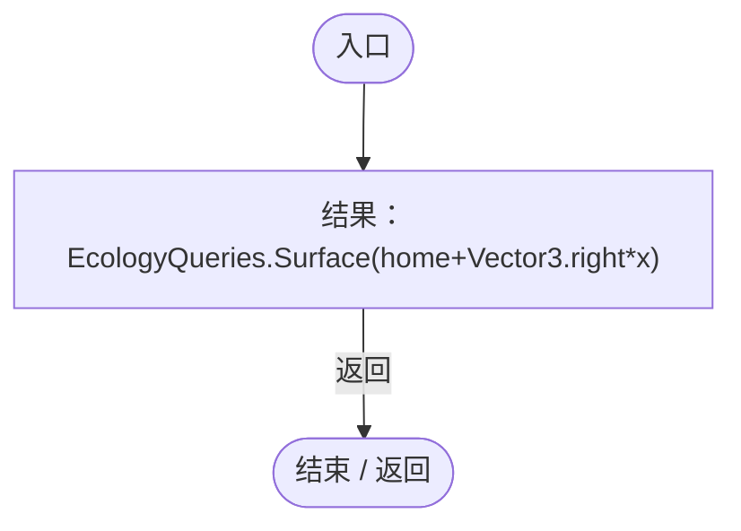

项目内调用/回调引用：

- [EcologyQueries.Surface · L47](bdf7ccc2c9c0452f.md#m2f1f6873ee5fc8df)（方法）

<a id="m6082eb4f6ee9134d"></a>

## 回调@90 · L90

`n … => 回调`


### Editor · Roslyn编译器控制流

```mermaid
flowchart TD
  b0(["入口"])
  b1{"判断：n.id==&quot;gene_heterotrophy&quot;"}
  b2["n.id==&quot;gene_scavenging&quot;"]
  b3["n.id==&quot;gene_heterotrophy&quot;"]
  b4["结果：n.id==&quot;gene_heterotrophy&quot;&#124;&#124;n.id==&quot;gene_scavenging&quot;"]
  b5(["结束 / 返回"])
  b0 --> b1
  b1 -->|"否"| b2
  b1 -->|"是"| b3
  b2 --> b4
  b3 --> b4
  b4 -->|"返回"| b5

```

<a id="m2dfe9059dcee0172"></a>

## 回调@90 · L90

`e … => 回调`


### Editor · Roslyn编译器控制流


<a id="m0c937613802d24dc"></a>

## 回调@92 · L92

`e … => 回调`


### Editor · Roslyn编译器控制流

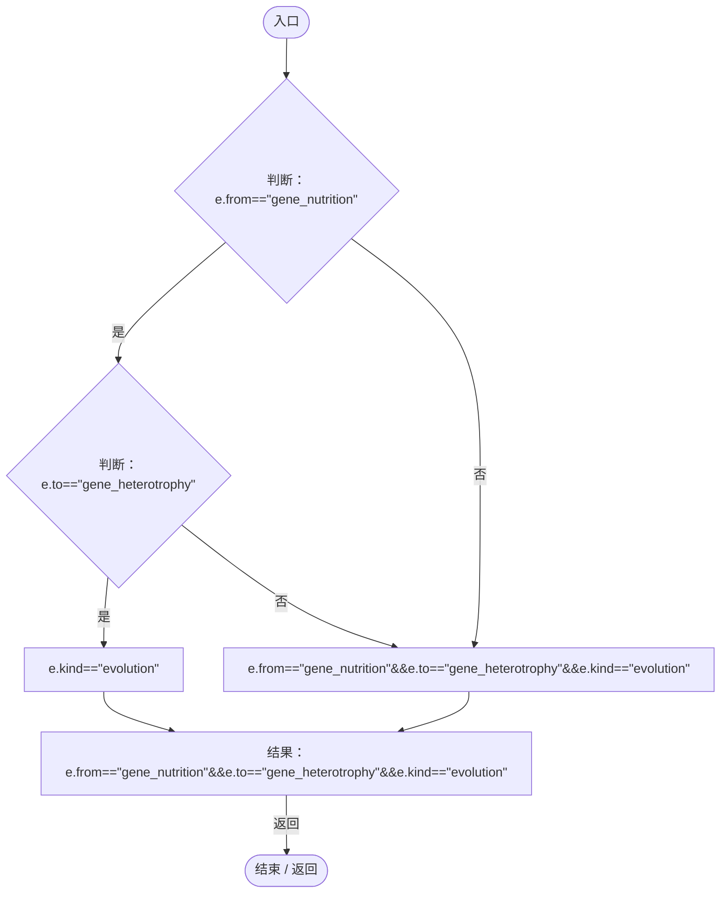

<a id="m077e74f9aafe01e7"></a>

## 回调@92 · L92

`e … => 回调`


### Editor · Roslyn编译器控制流

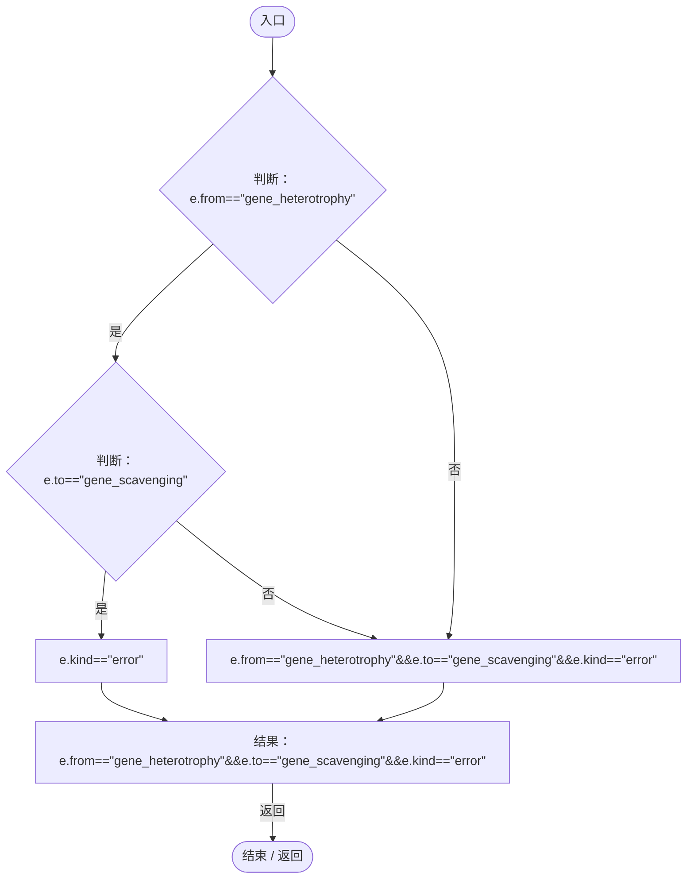

<a id="m00ad4bf35ce98da6"></a>

## 回调@94 · L94

`e … => 回调`


### Editor · Roslyn编译器控制流

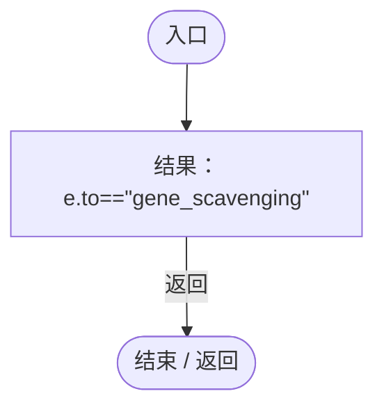

<a id="m9c5885d9f2174aaf"></a>

## 回调@94 · L94

`e … => 回调`


### Editor · Roslyn编译器控制流

```mermaid
flowchart TD
  b0(["入口"])
  b1["结果：e.to!=&quot;gene_scavenging&quot;"]
  b2(["结束 / 返回"])
  b0 --> b1
  b1 -->|"返回"| b2

```

<a id="mf268b95bbd32c14b"></a>

## 回调@106 · L106

`r … => 回调`


### Editor · Roslyn编译器控制流

```mermaid
flowchart TD
  b0(["入口"])
  b1["结果：r!=corpse"]
  b2(["结束 / 返回"])
  b0 --> b1
  b1 -->|"返回"| b2

```

<a id="ma5a45e9857d82e94"></a>

## 回调@110 · L110

`g … => 回调`


### Editor · Roslyn编译器控制流

```mermaid
flowchart TD
  b0(["入口"])
  b1["结果：g.DefinitionId==&quot;gene_heterotrophy&quot;"]
  b2(["结束 / 返回"])
  b0 --> b1
  b1 -->|"返回"| b2

```

<a id="mb87fb5c7185ee51d"></a>

## 回调@113 · L113

`g … => 回调`


### Editor · Roslyn编译器控制流

```mermaid
flowchart TD
  b0(["入口"])
  b1["结果：g.DefinitionId==&quot;gene_locomotion&quot;"]
  b2(["结束 / 返回"])
  b0 --> b1
  b1 -->|"返回"| b2

```

<a id="m3a4f29209ff542af"></a>

## 回调@115 · L115

`g … => 回调`


### Editor · Roslyn编译器控制流

```mermaid
flowchart TD
  b0(["入口"])
  b1["结果：g.DefinitionId==&quot;gene_locomotion&quot;"]
  b2(["结束 / 返回"])
  b0 --> b1
  b1 -->|"返回"| b2

```

<a id="m0d78ac0ce00cbc22"></a>

## 回调@120 · L120

`r … => 回调`


### Editor · Roslyn编译器控制流

```mermaid
flowchart TD
  b0(["入口"])
  b1["结果：!r.enabled"]
  b2(["结束 / 返回"])
  b0 --> b1
  b1 -->|"返回"| b2

```

<a id="m9762b4ce552799db"></a>

## 回调@120 · L120

`c … => 回调`


### Editor · Roslyn编译器控制流

```mermaid
flowchart TD
  b0(["入口"])
  b1["结果：!c.enabled"]
  b2(["结束 / 返回"])
  b0 --> b1
  b1 -->|"返回"| b2

```

<a id="mb9a2d083423f7689"></a>

## 回调@126 · L126

`c … => 回调`


### Editor · Roslyn编译器控制流

```mermaid
flowchart TD
  b0(["入口"])
  b1["结果：c.enabled"]
  b2(["结束 / 返回"])
  b0 --> b1
  b1 -->|"返回"| b2

```

<a id="m3427d4a825189bd4"></a>

## 回调@126 · L126

`r … => 回调`


### Editor · Roslyn编译器控制流

```mermaid
flowchart TD
  b0(["入口"])
  b1["结果：r.enabled"]
  b2(["结束 / 返回"])
  b0 --> b1
  b1 -->|"返回"| b2

```

<a id="m370c457f6cc6ed3f"></a>

## 回调@128 · L128

`g … => 回调`


### Editor · Roslyn编译器控制流

```mermaid
flowchart TD
  b0(["入口"])
  b1["结果：g.DefinitionId==&quot;gene_heterotrophy&quot;"]
  b2(["结束 / 返回"])
  b0 --> b1
  b1 -->|"返回"| b2

```

<a id="mb560030d9eea6b7e"></a>

## 回调@129 · L129

`g … => 回调`


### Editor · Roslyn编译器控制流

```mermaid
flowchart TD
  b0(["入口"])
  b1["结果：g.DefinitionId==&quot;gene_heterotrophy&quot;"]
  b2(["结束 / 返回"])
  b0 --> b1
  b1 -->|"返回"| b2

```

<a id="m131d1e6bc538d81a"></a>

## 回调@136 · L136

`r … => 回调`


### Editor · Roslyn编译器控制流

```mermaid
flowchart TD
  b0(["入口"])
  b1{"判断：r.State.kind==ColonyResourceKind.Nursery"}
  b2["r.State.kind==ColonyResourceKind.Supply"]
  b3["r.State.kind==ColonyResourceKind.Nursery"]
  b4["结果：r.State.kind==ColonyResourceKind.Nursery&#124;&#124;r.State.kind==ColonyResourceKind.Supply"]
  b5(["结束 / 返回"])
  b0 --> b1
  b1 -->|"否"| b2
  b1 -->|"是"| b3
  b2 --> b4
  b3 --> b4
  b4 -->|"返回"| b5

```

项目内调用/回调引用：

- [ColonyResource.State.get · L22](293dbaecfff4b585.md#m341a1355f4d657bf)（访问器）

<a id="m4b0c4774fe3bae4b"></a>

## 回调@137 · L137

`r … => 回调`


### Editor · Roslyn编译器控制流

```mermaid
flowchart TD
  b0(["入口"])
  b1["结果：r.State.kind!=ColonyResourceKind.Corpse"]
  b2(["结束 / 返回"])
  b0 --> b1
  b1 -->|"返回"| b2

```

项目内调用/回调引用：

- [ColonyResource.State.get · L22](293dbaecfff4b585.md#m341a1355f4d657bf)（访问器）

<a id="m9bb9ee174132c633"></a>

## LiveAt · L149

`Vector3 LiveAt(float distance)`


### Editor · Roslyn编译器控制流

```mermaid
flowchart TD
  b0(["入口"])
  b1["结果：EcologyQueries.Surface(liveHome+axis*distance)"]
  b2(["结束 / 返回"])
  b0 --> b1
  b1 -->|"返回"| b2

```

项目内调用/回调引用：

- [EcologyQueries.Surface · L47](bdf7ccc2c9c0452f.md#m2f1f6873ee5fc8df)（方法）

<a id="m8bef882465af5691"></a>

## 回调@161 · L161

`r … => 回调`


### Editor · Roslyn编译器控制流

```mermaid
flowchart TD
  b0(["入口"])
  b1["结果：r.State.energy"]
  b2(["结束 / 返回"])
  b0 --> b1
  b1 -->|"返回"| b2

```

项目内调用/回调引用：

- [ColonyResource.State.get · L22](293dbaecfff4b585.md#m341a1355f4d657bf)（访问器）

<a id="m8f5f1018cb35d091"></a>

## 回调@170 · L170

`e … => 回调`


### Editor · Roslyn编译器控制流

```mermaid
flowchart TD
  b0(["入口"])
  b1["结果：e.ecology.id==hostId"]
  b2(["结束 / 返回"])
  b0 --> b1
  b1 -->|"返回"| b2

```

<a id="m1fc5437e9cc1e096"></a>

## 回调@170 · L170

`e … => 回调`


### Editor · Roslyn编译器控制流

```mermaid
flowchart TD
  b0(["入口"])
  b1["结果：e.ecology.id==parasiteId"]
  b2(["结束 / 返回"])
  b0 --> b1
  b1 -->|"返回"| b2

```

<a id="m2b607d7a03c74838"></a>

## 回调@171 · L171

`e … => 回调`


### Editor · Roslyn编译器控制流

```mermaid
flowchart TD
  b0(["入口"])
  b1["结果：e.ecology.id==hostId"]
  b2(["结束 / 返回"])
  b0 --> b1
  b1 -->|"返回"| b2

```

<a id="mf037699f1b796fc0"></a>

## 回调@175 · L175

`r … => 回调`


### Editor · Roslyn编译器控制流

```mermaid
flowchart TD
  b0(["入口"])
  b1["结果：!r.enabled"]
  b2(["结束 / 返回"])
  b0 --> b1
  b1 -->|"返回"| b2

```

<a id="m820ee232e7d23c58"></a>

## 回调@175 · L175

`c … => 回调`


### Editor · Roslyn编译器控制流

```mermaid
flowchart TD
  b0(["入口"])
  b1["结果：!c.enabled"]
  b2(["结束 / 返回"])
  b0 --> b1
  b1 -->|"返回"| b2

```

<a id="ma0e8b2dacdf4a55d"></a>

## 回调@175 · L175

`r … => 回调`


### Editor · Roslyn编译器控制流

```mermaid
flowchart TD
  b0(["入口"])
  b1["结果：r.enabled"]
  b2(["结束 / 返回"])
  b0 --> b1
  b1 -->|"返回"| b2

```

<a id="mc424459f8473f437"></a>

## 回调@175 · L175

`c … => 回调`


### Editor · Roslyn编译器控制流

```mermaid
flowchart TD
  b0(["入口"])
  b1["结果：c.enabled"]
  b2(["结束 / 返回"])
  b0 --> b1
  b1 -->|"返回"| b2

```

<a id="m23415c06998457bb"></a>

## 回调@179 · L179

`t … => 回调`


### Editor · Roslyn编译器控制流

```mermaid
flowchart TD
  b0(["入口"])
  b1{"判断：t.graphic==null"}
  b2["!t.graphic.enabled"]
  b3["t.graphic==null"]
  b4["结果：t.graphic==null&#124;&#124;!t.graphic.enabled"]
  b5(["结束 / 返回"])
  b0 --> b1
  b1 -->|"否"| b2
  b1 -->|"是"| b3
  b2 --> b4
  b3 --> b4
  b4 -->|"返回"| b5

```

<a id="m12b182a64cf29d71"></a>

## 回调@179 · L179

`s … => 回调`


### Editor · Roslyn编译器控制流

```mermaid
flowchart TD
  b0(["入口"])
  b1{"判断：s.GetComponent&lt;Image&gt;().sprite!=null"}
  b2["s.handleRect.GetComponent&lt;Image&gt;().sprite!=null"]
  b3["s.GetComponent&lt;Image&gt;().sprite!=null"]
  b4["结果：s.GetComponent&lt;Image&gt;().sprite!=null&amp;&amp;s.handleRect.GetComponent&lt;Image&gt;().sprite!=null"]
  b5(["结束 / 返回"])
  b0 --> b1
  b1 -->|"是"| b2
  b1 -->|"否"| b3
  b2 --> b4
  b3 --> b4
  b4 -->|"返回"| b5

```
