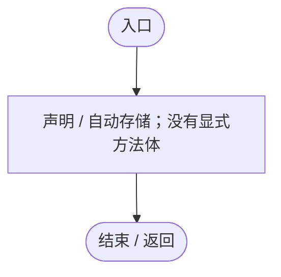
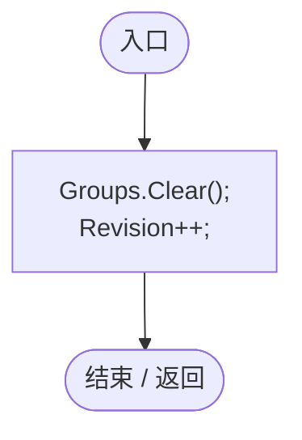
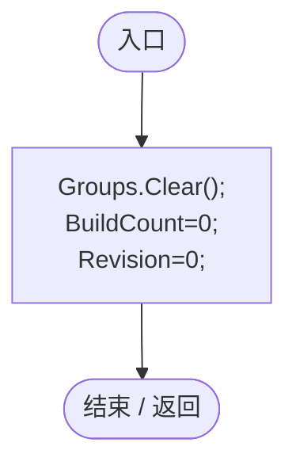
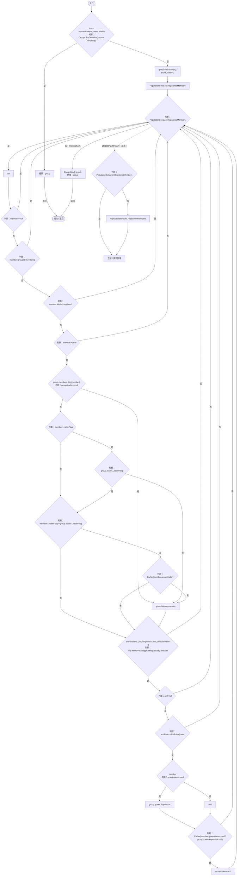
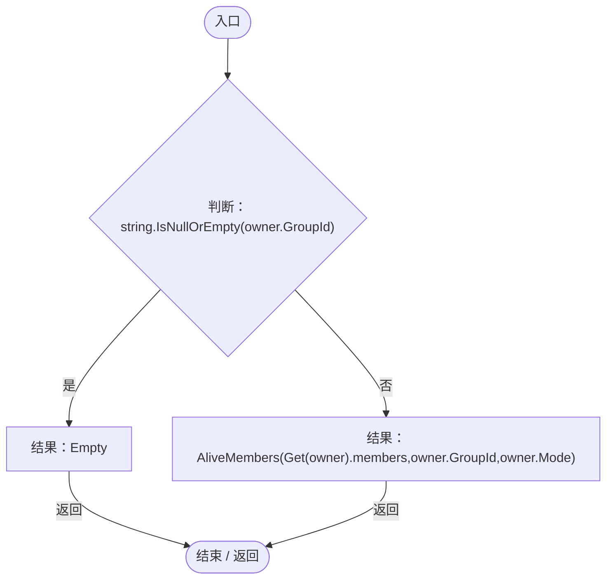
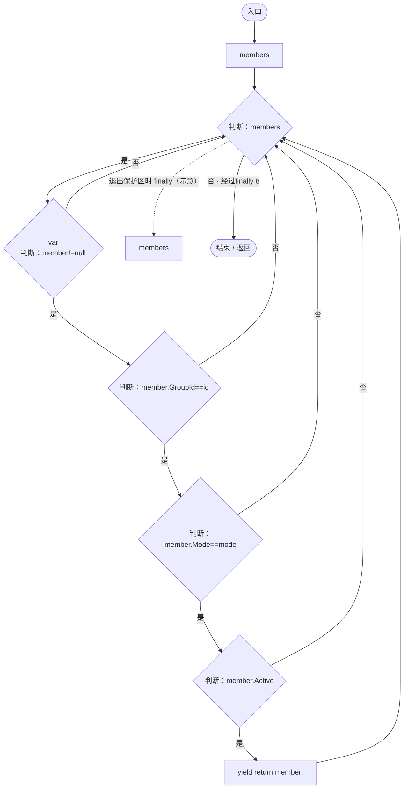
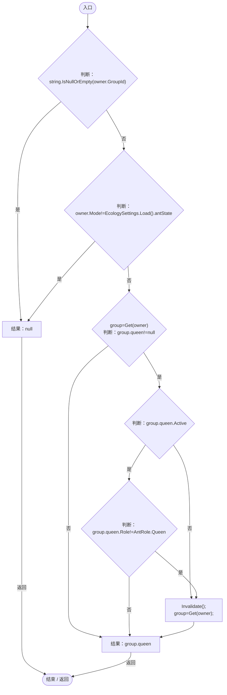
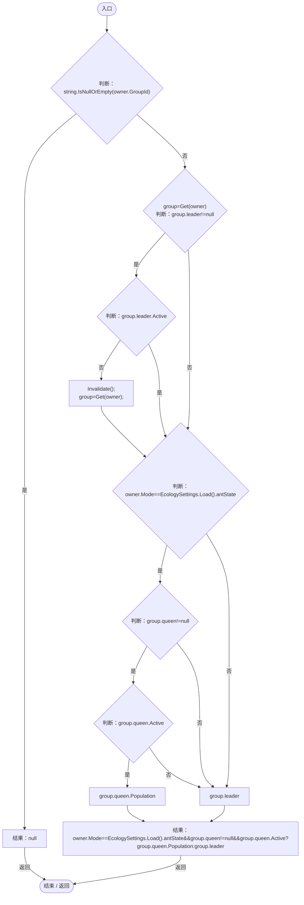

```mermaid
flowchart TD
  b0(["入口"])
  b1{"判断：b==null"}
  b2{"判断：a.JoinOrder&lt;b.JoinOrder"}
  b3{"判断：a.JoinOrder==b.JoinOrder"}
  b4["string.CompareOrdinal(EcologyIdentity.Of(a.GetComponent&lt;DarwinEntity&gt;()),EcologyIdentity.Of(b.GetComponent&lt;DarwinEntity&gt;()))&lt;0"]
  b5["a.JoinOrder==b.JoinOrder"]
  b6["b==null&#124;&#124;a.JoinOrder&lt;b.JoinOrder&#124;&#124;a.JoinOrder==b.JoinOrder&amp;&amp;string.CompareOrdinal(EcologyIdentity.Of(a.GetComponent&lt;DarwinEntity&gt;()),EcologyIdentity.Of(b.GetComponent&lt;DarwinEntity&gt;()))&lt;0"]
  b7["结果：b==null&#124;&#124;a.JoinOrder&lt;b.JoinOrder&#124;&#124;a.JoinOrder==b.JoinOrder&amp;&amp;string.CompareOrdinal(EcologyIdentity.Of(a.GetComponent&lt;DarwinEntity&gt;()),EcologyIdentity.Of(b.GetComponent&lt;DarwinEntity&gt;()))&lt;0"]
  b8(["结束 / 返回"])
  b0 --> b1
  b1 -->|"否"| b2
  b1 -->|"是"| b6
  b2 -->|"否"| b3
  b2 -->|"是"| b6
  b3 -->|"是"| b4
  b3 -->|"否"| b5
  b4 --> b7
  b5 --> b7
  b6 --> b7
  b7 -->|"返回"| b8

```

# PopulationGroupIndex.cs

[返回总索引](../README.md) · `Runtime` · `Assets/DarwinPark/Entities/Ecology/PopulationGroupIndex.cs`

[源文件](../../../Assets/DarwinPark/Entities/Ecology/PopulationGroupIndex.cs) · 源码校验：`98a5c15c3dfc6fd1c4fad66b754d223ff219a77fd9e4884d28a8cf4dd32a71dc`

方法按源文件位置排列。事件/回调引用不表示立即执行；分支与异常说明见总索引。完整源码与可点击关系图请打开离线手册。

## BuildCount.get · L17

`get`

### Editor / Player · 语法控制结构 / 声明（非CFG）

## BuildCount.set · L17

`private set`

### Editor / Player · 语法控制结构 / 声明（非CFG）

## Revision.get · L19

`get`

### Editor / Player · 语法控制结构 / 声明（非CFG）

## Revision.set · L19

`private set`

### Editor / Player · 语法控制结构 / 声明（非CFG）

## Invalidate · L20

`public static void Invalidate()`

### Editor / Player · Roslyn编译器控制流

项目内调用/回调引用：

- [PopulationGroupIndex.Revision.set · L19](6bb343d8be5beae5.md#m51047157d7761a13)（访问器）
- [PopulationGroupIndex.Revision.get · L19](6bb343d8be5beae5.md#m42c682636166d39b)（访问器）

## Reset · L21

`[RuntimeInitializeOnLoadMethod(RuntimeInitializeLoadType.SubsystemRegistration)] private static void Reset()`

### Editor / Player · Roslyn编译器控制流

项目内调用/回调引用：

- [PopulationGroupIndex.BuildCount.set · L17](6bb343d8be5beae5.md#m631c88183f8fb2a5)（访问器）
- [PopulationGroupIndex.Revision.set · L19](6bb343d8be5beae5.md#m51047157d7761a13)（访问器）

## Earlier · L23

`private static bool Earlier(PopulationBehavior a,PopulationBehavior b)`

### Editor / Player · Roslyn编译器控制流

项目内调用/回调引用：

- [PopulationBehavior.JoinOrder.get · L21](21e4f62f75a9a80f.md#m83871a50fb1160fd)（访问器）
- [EcologyIdentity.Of · L21](bdf7ccc2c9c0452f.md#m1143cf9570a93b72)（方法）

## Get · L24

`private static Group Get(PopulationBehavior owner)`

### Editor / Player · Roslyn编译器控制流

项目内调用/回调引用：

- [PopulationBehavior.GroupId.get · L20](21e4f62f75a9a80f.md#m5145936fa914ba8c)（访问器）
- [PopulationGroupIndex.BuildCount.set · L17](6bb343d8be5beae5.md#m631c88183f8fb2a5)（访问器）
- [PopulationGroupIndex.BuildCount.get · L17](6bb343d8be5beae5.md#mbb4bfaa8b0e1b169)（访问器）
- [PopulationBehavior.LeaderFlag.get · L22](21e4f62f75a9a80f.md#m381bf45ebdf091a9)（访问器）
- [PopulationGroupIndex.Earlier · L23](6bb343d8be5beae5.md#me1ad939202c72295)（方法）
- [EcologySettings.Load · L18](90428a275d065ef6.md#mb0575490373edaf2)（方法）
- [AntColonyMember.Role.get · L33](baebd85c05598377.md#mdf6df89f7116c7a3)（访问器）
- [AntColonyMember.Population.get · L30](baebd85c05598377.md#m688c2c0dfb5a66d6)（访问器）

## Members · L39

`public static IEnumerable<PopulationBehavior> Members(PopulationBehavior owner)`

### Editor / Player · Roslyn编译器控制流

项目内调用/回调引用：

- [PopulationBehavior.GroupId.get · L20](21e4f62f75a9a80f.md#m5145936fa914ba8c)（访问器）
- [PopulationGroupIndex.AliveMembers · L44](6bb343d8be5beae5.md#m787c400f7c4d5979)（方法）
- [PopulationGroupIndex.Get · L24](6bb343d8be5beae5.md#mc5dd4eb8610431ea)（方法）

## AliveMembers · L44

`private static IEnumerable<PopulationBehavior> AliveMembers(List<PopulationBehavior> members,string id,string mode)`

### Editor / Player · Roslyn编译器控制流

项目内调用/回调引用：

- [PopulationBehavior.GroupId.get · L20](21e4f62f75a9a80f.md#m5145936fa914ba8c)（访问器）

## Queen · L46

`public static AntColonyMember Queen(PopulationBehavior owner)`

### Editor / Player · Roslyn编译器控制流

项目内调用/回调引用：

- [PopulationBehavior.GroupId.get · L20](21e4f62f75a9a80f.md#m5145936fa914ba8c)（访问器）
- [EcologySettings.Load · L18](90428a275d065ef6.md#mb0575490373edaf2)（方法）
- [PopulationGroupIndex.Get · L24](6bb343d8be5beae5.md#mc5dd4eb8610431ea)（方法）
- [AntColonyMember.Role.get · L33](baebd85c05598377.md#mdf6df89f7116c7a3)（访问器）
- [PopulationGroupIndex.Invalidate · L20](6bb343d8be5beae5.md#m5e79b5692d858f7a)（方法）

## Leader · L53

`public static PopulationBehavior Leader(PopulationBehavior owner)`

### Editor / Player · Roslyn编译器控制流

项目内调用/回调引用：

- [PopulationBehavior.GroupId.get · L20](21e4f62f75a9a80f.md#m5145936fa914ba8c)（访问器）
- [PopulationGroupIndex.Get · L24](6bb343d8be5beae5.md#mc5dd4eb8610431ea)（方法）
- [PopulationGroupIndex.Invalidate · L20](6bb343d8be5beae5.md#m5e79b5692d858f7a)（方法）
- [EcologySettings.Load · L18](90428a275d065ef6.md#mb0575490373edaf2)（方法）
- [AntColonyMember.Population.get · L30](baebd85c05598377.md#m688c2c0dfb5a66d6)（访问器）
