# PopulationWorkbench.cs

[返回总索引](../README.md) · `Runtime` · `Assets/DarwinPark/UI/PopulationWorkbench.cs`

[源文件](../../../Assets/DarwinPark/UI/PopulationWorkbench.cs) · 源码校验：`cfeeddd79ab7078c9742c88b16965abaa6bf4544cabcfcf71154c2e51d3a1e88`

方法按源文件位置排列。事件/回调引用不表示立即执行；分支与异常说明见总索引。完整源码与可点击关系图请打开离线手册。

<a id="m82395c4f7e743e70"></a>

## Instance.get · L14

`get`


### Editor / Player · 语法控制结构 / 声明（非CFG）


<a id="m38d0ef815d1ef7f5"></a>

## Instance.set · L14

`private set`


### Editor / Player · 语法控制结构 / 声明（非CFG）


<a id="mbe13c2d3e85c0b85"></a>

## Visible.get · L15

`get`


### Editor / Player · 语法控制结构 / 声明（非CFG）


<a id="m725640a27d0c6df1"></a>

## Visible.set · L15

`private set`


### Editor / Player · 语法控制结构 / 声明（非CFG）


<a id="mef0f87781fb55d79"></a>

## SelectedId.get · L16

`get`


### Editor / Player · 语法控制结构 / 声明（非CFG）

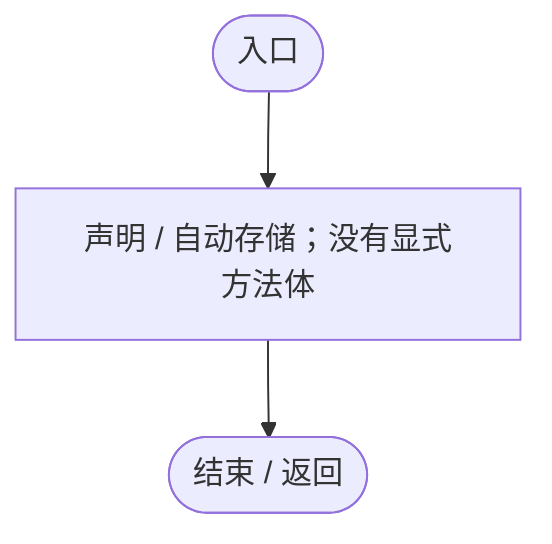

<a id="ma27d5bcc014992b5"></a>

## SelectedId.set · L16

`private set`


### Editor / Player · 语法控制结构 / 声明（非CFG）


<a id="m2b8cb54cab37da88"></a>

## SelectedTab.get · L17

`get`


### Editor / Player · 语法控制结构 / 声明（非CFG）


<a id="m92d0005788d9d94a"></a>

## SelectedTab.set · L17

`private set`


### Editor / Player · 语法控制结构 / 声明（非CFG）


<a id="m8c46b22e3ea6a6c4"></a>

## Ensure · L30

`public static PopulationWorkbench Ensure()`


### Editor / Player · Roslyn编译器控制流

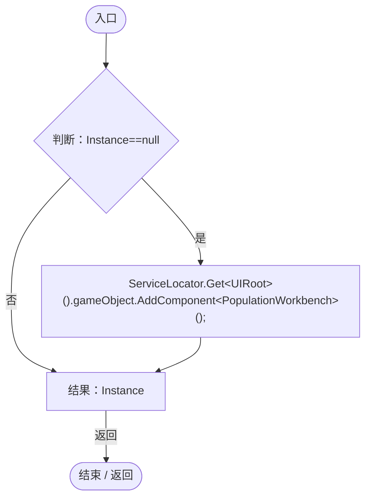

项目内调用/回调引用：

- [PopulationWorkbench.Instance.get · L14](6ca6fcae89e529ec.md#m82395c4f7e743e70)（访问器）
- [ServiceLocator.Get · L33](f2fdbe9f9ccd93cb.md#m2ae625299520c56d)（方法）

<a id="m3136060e3cc06430"></a>

## Awake · L34

`private void Awake()`


### Editor / Player · Roslyn编译器控制流

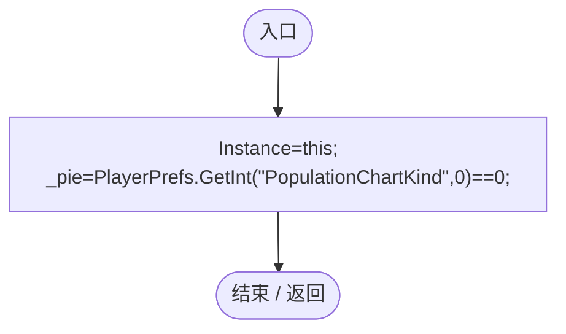

项目内调用/回调引用：

- [PopulationWorkbench.Instance.set · L14](6ca6fcae89e529ec.md#m38d0ef815d1ef7f5)（访问器）

<a id="maadc63c62a231ce0"></a>

## Open · L35

`public void Open(string id=null,int tab=0)`


### Editor / Player · Roslyn编译器控制流

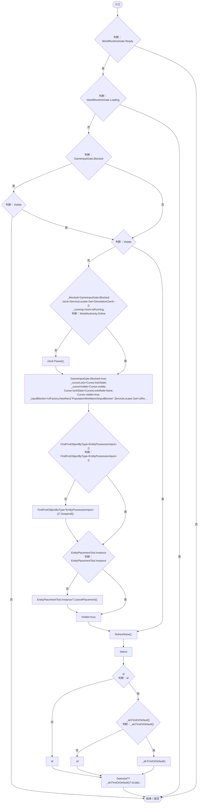

项目内调用/回调引用：

- [GameInputGate.Blocked.get · L8](52955daae7e592ab.md#m765763b665829633)（访问器）
- [PopulationWorkbench.Visible.get · L15](6ca6fcae89e529ec.md#mbe13c2d3e85c0b85)（访问器）
- [ServiceLocator.Get · L33](f2fdbe9f9ccd93cb.md#m2ae625299520c56d)（方法）
- [SimulationClock.IsRunning.get · L22](a8f444aec9614b0a.md#m10f4fe307faca0f0)（访问器）
- [SimulationClock.Pause · L79](a8f444aec9614b0a.md#m30929d45a885d0f1)（方法）
- [GameInputGate.Blocked.set · L8](52955daae7e592ab.md#m578697f6379686f4)（访问器）
- [UIFactory.NewRect · L33](dd1096a6995423db.md#med612116f3152344)（方法）
- [UIRoot.MainCanvas.get · L14](9c1421378791f0e0.md#maa2cc9baf1248477)（访问器）
- [UIFactory.Stretch · L150](dd1096a6995423db.md#m11d8f6c6d00cc047)（方法）
- [EntityPossessionInput.Suspend · L98](4c12d3ae76941d37.md#m782dbd96037fc73f)（方法）
- [EntityPlacementTool.Instance.get · L13](2ca993947b0a7e7a.md#mafb26991c0dfcb86)（访问器）
- [EntityPlacementTool.CancelPlacement · L81](2ca993947b0a7e7a.md#m5a9374d2c71f0a2d)（方法）
- [PopulationWorkbench.Visible.set · L15](6ca6fcae89e529ec.md#m725640a27d0c6df1)（访问器）
- [PopulationWorkbench.RefreshNow · L53](6ca6fcae89e529ec.md#m68743b38d8bdd235)（方法）
- [PopulationWorkbench.Select · L48](6ca6fcae89e529ec.md#mc59a9aa8a225893b)（方法）

<a id="mc59a9aa8a225893b"></a>

## Select · L48

`public void Select(string id,int tab=0)`


### Editor / Player · Roslyn编译器控制流

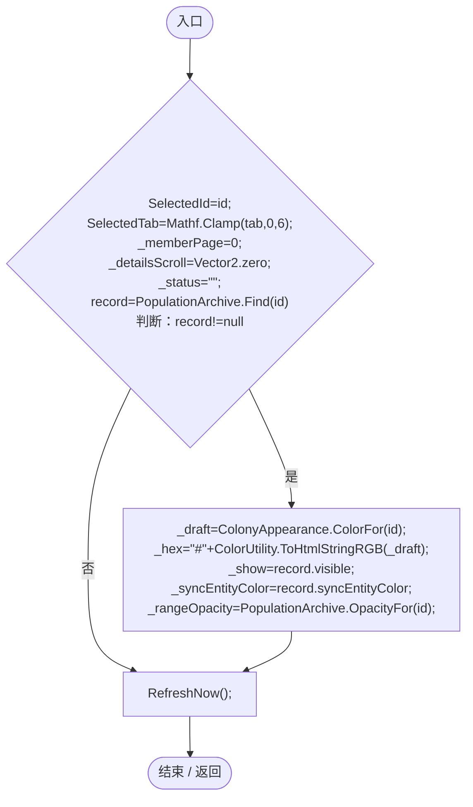

项目内调用/回调引用：

- [PopulationWorkbench.SelectedId.set · L16](6ca6fcae89e529ec.md#ma27d5bcc014992b5)（访问器）
- [PopulationWorkbench.SelectedTab.set · L17](6ca6fcae89e529ec.md#m92d0005788d9d94a)（访问器）
- [PopulationArchive.Find · L49](084e119b69cdd751.md#mf1aef4e3d3c3efca)（方法）
- [ColonyAppearance.ColorFor · L9](e51c7c842d87a26d.md#m0ea090c43edf8334)（方法）
- [PopulationArchive.OpacityFor · L107](084e119b69cdd751.md#m97824b788cf7f2ff)（方法）
- [PopulationWorkbench.RefreshNow · L53](6ca6fcae89e529ec.md#m68743b38d8bdd235)（方法）

<a id="m68743b38d8bdd235"></a>

## RefreshNow · L53

`public void RefreshNow()`


### Editor / Player · Roslyn编译器控制流

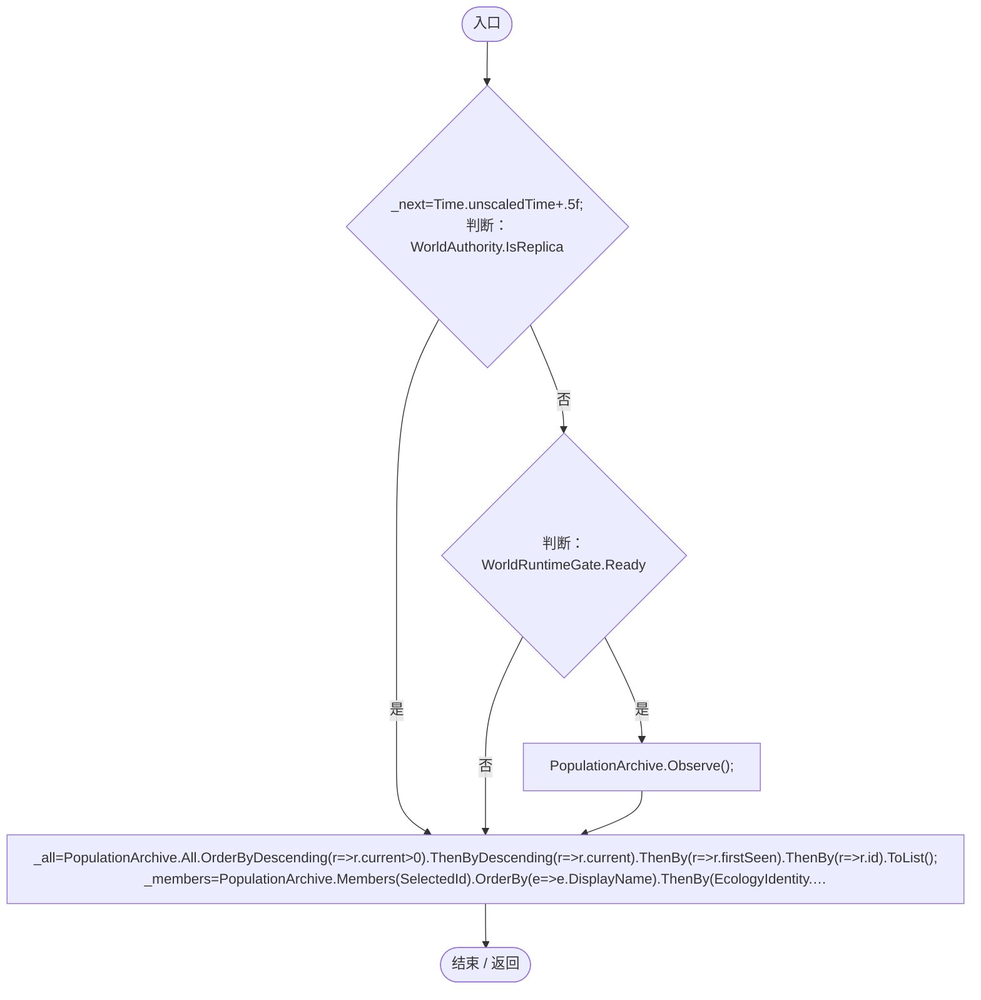

项目内调用/回调引用：

- [PopulationArchive.Observe · L68](084e119b69cdd751.md#m6afd6ec6b661dad6)（方法）
- [PopulationArchive.Members · L67](084e119b69cdd751.md#mdcf18c899b26b92b)（方法）
- [PopulationWorkbench.SelectedId.get · L16](6ca6fcae89e529ec.md#mef0f87781fb55d79)（访问器）
- [PopulationDistributions.Genes · L15](eed554ca8394b767.md#m35a197f85f9669ee)（方法）
- [PopulationDistributions.Ages · L26](eed554ca8394b767.md#m97f91f8b937c972c)（方法）
- [PopulationWorkbench.回调@56 · L56](6ca6fcae89e529ec.md#mec14c4d9b37a77f9)（回调/委托）
- [PopulationWorkbench.回调@56 · L56](6ca6fcae89e529ec.md#mb6fdedc8201dc9db)（回调/委托）
- [PopulationWorkbench.回调@56 · L56](6ca6fcae89e529ec.md#m8d8d530ea5049fe0)（回调/委托）
- [PopulationWorkbench.回调@56 · L56](6ca6fcae89e529ec.md#m547f63e24d973cea)（回调/委托）
- [PopulationWorkbench.回调@57 · L57](6ca6fcae89e529ec.md#m04c297186c6bfce2)（回调/委托）
- [EcologyIdentity.Of · L21](bdf7ccc2c9c0452f.md#m1143cf9570a93b72)（方法）

<a id="mec14c4d9b37a77f9"></a>

## 回调@56 · L56

`r … => 回调`


### Editor / Player · Roslyn编译器控制流

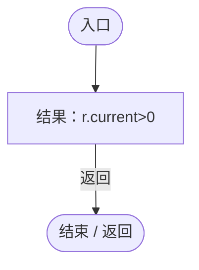

<a id="mb6fdedc8201dc9db"></a>

## 回调@56 · L56

`r … => 回调`


### Editor / Player · Roslyn编译器控制流

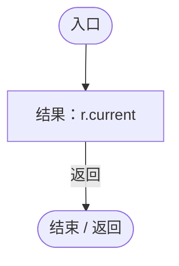

<a id="m8d8d530ea5049fe0"></a>

## 回调@56 · L56

`r … => 回调`


### Editor / Player · Roslyn编译器控制流

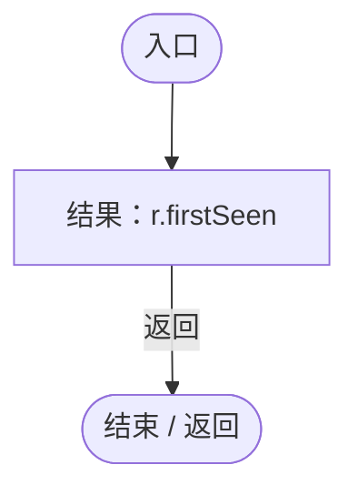

<a id="m547f63e24d973cea"></a>

## 回调@56 · L56

`r … => 回调`


### Editor / Player · Roslyn编译器控制流

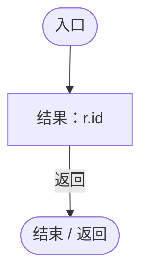

<a id="m04c297186c6bfce2"></a>

## 回调@57 · L57

`e … => 回调`


### Editor / Player · Roslyn编译器控制流

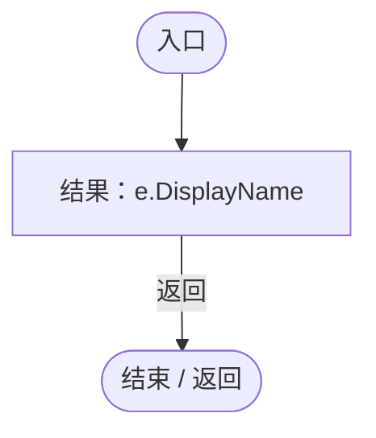

<a id="m18ac26079e999d24"></a>

## ApplyDisplay · L59

`public bool ApplyDisplay(string color,bool visible,bool? syncEntityColor=null,float? rangeOpacity=null)`


### Editor / Player · Roslyn编译器控制流

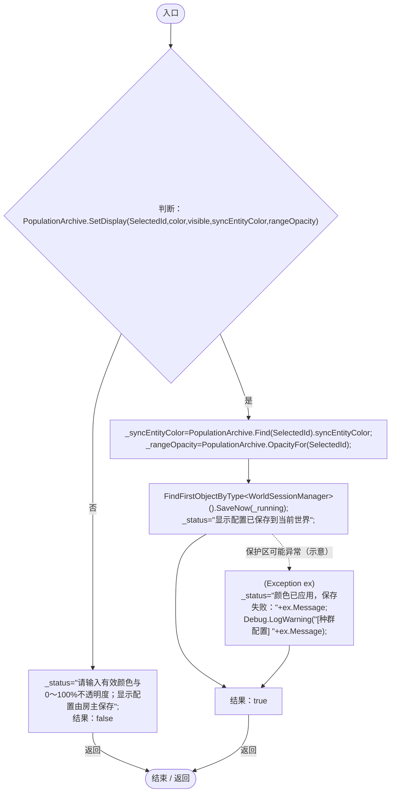

项目内调用/回调引用：

- [PopulationArchive.SetDisplay · L102](084e119b69cdd751.md#mb232e2fc42b6a7ff)（方法）
- [PopulationWorkbench.SelectedId.get · L16](6ca6fcae89e529ec.md#mef0f87781fb55d79)（访问器）
- [PopulationArchive.Find · L49](084e119b69cdd751.md#mf1aef4e3d3c3efca)（方法）
- [PopulationArchive.OpacityFor · L107](084e119b69cdd751.md#m97824b788cf7f2ff)（方法）
- [WorldSessionManager.SaveNow · L157](08741c7b7b9d9344.md#mbecd8b5c222ba46b)（方法）

<a id="m09bed70d853d69f9"></a>

## Close · L68

`public void Close()`


### Editor / Player · Roslyn编译器控制流

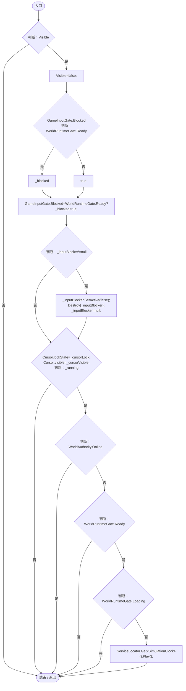

项目内调用/回调引用：

- [PopulationWorkbench.Visible.get · L15](6ca6fcae89e529ec.md#mbe13c2d3e85c0b85)（访问器）
- [PopulationWorkbench.Visible.set · L15](6ca6fcae89e529ec.md#m725640a27d0c6df1)（访问器）
- [GameInputGate.Blocked.set · L8](52955daae7e592ab.md#m578697f6379686f4)（访问器）
- [SimulationClock.Play · L78](a8f444aec9614b0a.md#m7aa9e64b7de60ed0)（方法）
- [ServiceLocator.Get · L33](f2fdbe9f9ccd93cb.md#m2ae625299520c56d)（方法）

<a id="m70c2d453d76a21bd"></a>

## Update · L75

`private void Update()`


### Editor / Player · Roslyn编译器控制流

```mermaid
flowchart TD
  b0(["入口"])
  b1{"判断：Visible"}
  b2{"判断：WorldRuntimeGate.Ready"}
  b3{"判断：WorldRuntimeGate.Loading"}
  b4["Close();"]
  b5{"判断：Input.GetKeyDown(KeyCode.Escape)"}
  b6["GameInputGate.ConsumeEscape();<br/>Close();"]
  b7{"判断：Time.unscaledTime&gt;=_next"}
  b8["RefreshNow();"]
  b9(["结束 / 返回"])
  b0 --> b1
  b1 -->|"否"| b9
  b1 -->|"是"| b2
  b2 -->|"是"| b3
  b2 -->|"否"| b4
  b3 -->|"是"| b4
  b3 -->|"否"| b5
  b4 --> b9
  b5 -->|"是"| b6
  b5 -->|"否"| b7
  b6 --> b9
  b7 -->|"是"| b8
  b7 -->|"否"| b9
  b8 --> b9

```

项目内调用/回调引用：

- [PopulationWorkbench.Visible.get · L15](6ca6fcae89e529ec.md#mbe13c2d3e85c0b85)（访问器）
- [PopulationWorkbench.Close · L68](6ca6fcae89e529ec.md#m09bed70d853d69f9)（方法）
- [GameInputGate.ConsumeEscape · L9](52955daae7e592ab.md#m5b050ac6f014de67)（方法）
- [PopulationWorkbench.RefreshNow · L53](6ca6fcae89e529ec.md#m68743b38d8bdd235)（方法）

<a id="m78df65cd26ea3613"></a>

## OnDisable · L81

`private void OnDisable()`


### Editor / Player · Roslyn编译器控制流

```mermaid
flowchart TD
  b0(["入口"])
  b1["Close()"]
  b2(["结束 / 返回"])
  b0 --> b1
  b1 --> b2

```

项目内调用/回调引用：

- [PopulationWorkbench.Close · L68](6ca6fcae89e529ec.md#m09bed70d853d69f9)（方法）

<a id="mbf51d22f0586f248"></a>

## OnDestroy · L82

`private void OnDestroy()`


### Editor / Player · Roslyn编译器控制流

```mermaid
flowchart TD
  b0(["入口"])
  b1{"Close();<br/>_charts.Dispose();<br/>判断：Instance==this"}
  b2["Instance=null;"]
  b3(["结束 / 返回"])
  b0 --> b1
  b1 -->|"是"| b2
  b1 -->|"否"| b3
  b2 --> b3

```

项目内调用/回调引用：

- [PopulationWorkbench.Close · L68](6ca6fcae89e529ec.md#m09bed70d853d69f9)（方法）
- [PopulationCharts.Dispose · L69](eed554ca8394b767.md#mbc81ebe149deb581)（方法）
- [PopulationWorkbench.Instance.get · L14](6ca6fcae89e529ec.md#m82395c4f7e743e70)（访问器）
- [PopulationWorkbench.Instance.set · L14](6ca6fcae89e529ec.md#m38d0ef815d1ef7f5)（访问器）

<a id="mb41ce087d8855c42"></a>

## Day · L84

`public static string Day(float time)`

★ 修复（防Bug回归）：档案日期沿用底栏的游戏日历（10秒/天、365天/年、30天/月），避免显示累计小数天数。

### Editor / Player · Roslyn编译器控制流

```mermaid
flowchart TD
  b0(["入口"])
  b1["totalDays=Mathf.FloorToInt(Mathf.Max(0,time)/10f)<br/>dayOfYear=totalDays%365<br/>结果：$&quot;第 {totalDays/365} 年 {dayOfYear/30+1} 月 {dayOfYear%30+1} 日&quot;"]
  b2(["结束 / 返回"])
  b0 --> b1
  b1 -->|"返回"| b2

```

<a id="m3eff9fea3fbe5d69"></a>

## OnGUI · L89

`private void OnGUI()`


### Editor / Player · Roslyn编译器控制流

```mermaid
flowchart TD
  b0(["入口"])
  b1{"判断：Visible"}
  b2{"GUI.depth=-950;<br/>RuntimeMenuTheme.Apply();<br/>previous=GUI.color<br/>GUI.color=new Color(0,0,0,.65f);<br/>GUI.DrawTexture(new Rect(0,0,Screen.width,Screen.height),Texture2D.whiteTexture);<br/>GUI.color=previous;<br/>width=Mathf.Min(windowSize.x,Screen.width…"}
  b3["Close();"]
  b4["listWidth=Mathf.Min(250,width*.28f)<br/>GUILayout.BeginArea(new Rect(left+12,top+58,listWidth,height-72));<br/>DrawList();<br/>GUILayout.EndArea();<br/>GUILayout.BeginArea(new Rect(left+listWidth+28,top+58,width-listWidth-44,height-72));<br/>DrawDetails(wid…"]
  b5(["结束 / 返回"])
  b0 --> b1
  b1 -->|"否"| b5
  b1 -->|"是"| b2
  b2 -->|"是"| b3
  b2 -->|"否"| b4
  b3 --> b5
  b4 --> b5

```

项目内调用/回调引用：

- [PopulationWorkbench.Visible.get · L15](6ca6fcae89e529ec.md#mbe13c2d3e85c0b85)（访问器）
- [RuntimeMenuTheme.Apply · L39](b9d8455882f2a532.md#m587a63eff5a85605)（方法）
- [RuntimeMenuTheme.Title.get · L14](b9d8455882f2a532.md#m0b3a4a9f7e8e69ae)（访问器）
- [PopulationWorkbench.Close · L68](6ca6fcae89e529ec.md#m09bed70d853d69f9)（方法）
- [PopulationWorkbench.DrawList · L100](6ca6fcae89e529ec.md#m16a5f33593deeadc)（方法）
- [PopulationWorkbench.DrawDetails · L118](6ca6fcae89e529ec.md#m3cd0d06bb36e898e)（方法）

<a id="m16a5f33593deeadc"></a>

## DrawList · L100

`private void DrawList()`


### Editor / Player · Roslyn编译器控制流

```mermaid
flowchart TD
  b0(["入口"])
  b1{"GUILayout.Label(&quot;存活 &quot;+_all.Count(r=&gt;r.current&gt;0)+&quot; / 已记录 &quot;+_all.Count,RuntimeMenuTheme.Muted);<br/>search=GUILayout.TextField(_search,80)<br/>判断：search!=_search"}
  b2["_search=search;<br/>_page=0;"]
  b3["&quot;按名称或种群标识搜索&quot;<br/>new GUIStyle(RuntimeMenuTheme.Muted){fontSize=11}<br/>fontSize=11<br/>GUILayout.Label(&quot;按名称或种群标识搜索&quot;,new GUIStyle(RuntimeMenuTheme.Muted){fontSize=11});"]
  b4{"filter=GUILayout.Toolbar(_filter,new[]{&quot;全部&quot;,&quot;存活&quot;,&quot;灭绝&quot;})<br/>判断：filter!=_filter"}
  b5["_filter=filter;<br/>_page=0;"]
  b6["records=_all.Where(r=&gt;(_filter==0&#124;&#124;(_filter==1?r.current&gt;0:r.current==0))&amp;&amp;(string.IsNullOrWhiteSpace(_search)&#124;&#124;r.name.IndexOf(_search,StringComparison.OrdinalIgnoreCase)&gt;=0&#124;&#124;r.id.IndexOf(_search,StringComparison.OrdinalIgnoreCase)&gt;=0)).…"]
  b7["records.Skip(_page*groupsPerPage).Take(groupsPerPage)"]
  b8{"判断：records.Skip(_page*groupsPerPage).Take(groupsPerPage)"}
  b9["var"]
  b10{"判断：record.id==SelectedId"}
  b11["RuntimeMenuTheme.Selected"]
  b12["GUI.skin.button"]
  b13["new GUIStyle(record.id==SelectedId?RuntimeMenuTheme.Selected:GUI.skin.button){alignment=TextAnchor.MiddleLeft,wordWrap=true,fontSize=14}"]
  b14["alignment=TextAnchor.MiddleLeft<br/>wordWrap=true<br/>fontSize=14<br/>style=new GUIStyle(record.id==SelectedId?RuntimeMenuTheme.Selected:GUI.skin.button){alignment=TextAnchor.MiddleLeft,wordWrap=true,fontSize=14}"]
  b15{"record.name+&quot; · &quot;+record.id.Substring(0,6)+&quot;\n&quot;+Mode(record)+&quot; &quot;<br/>判断：record.current&gt;0"}
  b16["record.current+&quot;个体&quot;"]
  b17["&quot;已灭绝&quot;"]
  b18{"判断：GUILayout.Button(record.name+&quot; · &quot;+record.id.Substring(0,6)+&quot;\n&quot;+Mode(record)+&quot; &quot;+(record.current&gt;0?record.current+&quot;个体&quot;:&quot;已灭绝&quot;),style,GUILayout.Height(52))"}
  b19["Select(record.id,SelectedTab);"]
  b20{"判断：records.Skip(_page*groupsPerPage).Take(groupsPerPage)"}
  b21["records.Skip(_page*groupsPerPage).Take(groupsPerPage)"]
  b22["连接 / 离开区域"]
  b23{"判断：records.Count==0"}
  b24["GUILayout.Label(&quot;没有符合条件的种群&quot;);"]
  b25{"GUILayout.EndScrollView();<br/>GUILayout.BeginHorizontal();<br/>判断：GUILayout.Button(&quot;上一页&quot;)"}
  b26["_page=Mathf.Max(0,_page-1);"]
  b27{"GUILayout.Label((_page+1)+&quot; / &quot;+pages,GUILayout.Width(55));<br/>判断：GUILayout.Button(&quot;下一页&quot;)"}
  b28["_page=Mathf.Min(pages-1,_page+1);"]
  b29["GUILayout.EndHorizontal();"]
  b30(["结束 / 返回"])
  b0 --> b1
  b1 -->|"是"| b2
  b1 -->|"否"| b3
  b2 --> b3
  b3 --> b4
  b4 -->|"是"| b5
  b4 -->|"否"| b6
  b5 --> b6
  b6 --> b7
  b7 --> b8
  b8 -->|"是"| b9
  b8 -->|"否 · 经过finally 20"| b23
  b9 --> b10
  b10 -->|"是"| b11
  b10 -->|"否"| b12
  b11 --> b13
  b12 --> b13
  b13 --> b14
  b14 --> b15
  b15 -->|"是"| b16
  b15 -->|"否"| b17
  b16 --> b18
  b17 --> b18
  b18 -->|"是"| b19
  b18 -->|"否"| b8
  b19 --> b8
  b20 -->|"否"| b21
  b20 -->|"是"| b22
  b21 --> b22
  b23 -->|"是"| b24
  b23 -->|"否"| b25
  b24 --> b25
  b25 -->|"是"| b26
  b25 -->|"否"| b27
  b26 --> b27
  b27 -->|"是"| b28
  b27 -->|"否"| b29
  b28 --> b29
  b29 --> b30
  b8 -. "退出保护区时 finally（示意）" .-> b20

```

项目内调用/回调引用：

- [RuntimeMenuTheme.Muted.get · L13](b9d8455882f2a532.md#meeaba271eb4ad2ed)（访问器）
- [PopulationWorkbench.SelectedId.get · L16](6ca6fcae89e529ec.md#mef0f87781fb55d79)（访问器）
- [RuntimeMenuTheme.Selected.get · L12](b9d8455882f2a532.md#m0db940502f53ec10)（访问器）
- [PopulationWorkbench.Mode · L117](6ca6fcae89e529ec.md#m0dda969479fe6eab)（方法）
- [PopulationWorkbench.Select · L48](6ca6fcae89e529ec.md#mc59a9aa8a225893b)（方法）
- [PopulationWorkbench.SelectedTab.get · L17](6ca6fcae89e529ec.md#m2b8cb54cab37da88)（访问器）
- [PopulationWorkbench.回调@102 · L102](6ca6fcae89e529ec.md#m32d2e55bd45c3e22)（回调/委托）
- [PopulationWorkbench.回调@106 · L106](6ca6fcae89e529ec.md#m4e24f657940510de)（回调/委托）

<a id="m32d2e55bd45c3e22"></a>

## 回调@102 · L102

`r … => 回调`


### Editor / Player · Roslyn编译器控制流

```mermaid
flowchart TD
  b0(["入口"])
  b1["结果：r.current&gt;0"]
  b2(["结束 / 返回"])
  b0 --> b1
  b1 -->|"返回"| b2

```

<a id="m4e24f657940510de"></a>

## 回调@106 · L106

`r … => 回调`


### Editor / Player · Roslyn编译器控制流

```mermaid
flowchart TD
  b0(["入口"])
  b1{"判断：_filter==0"}
  b2{"判断：_filter==1"}
  b3{"判断：r.current&gt;0"}
  b4{"判断：r.current==0"}
  b5{"判断：string.IsNullOrWhiteSpace(_search)"}
  b6{"判断：r.name.IndexOf(_search,StringComparison.OrdinalIgnoreCase)&gt;=0"}
  b7["r.id.IndexOf(_search,StringComparison.OrdinalIgnoreCase)&gt;=0"]
  b8["string.IsNullOrWhiteSpace(_search)&#124;&#124;r.name.IndexOf(_search,StringComparison.OrdinalIgnoreCase)&gt;=0&#124;&#124;r.id.IndexOf(_search,StringComparison.OrdinalIgnoreCase)&gt;=0"]
  b9["(_filter==0&#124;&#124;(_filter==1?r.current&gt;0:r.current==0))&amp;&amp;(string.IsNullOrWhiteSpace(_search)&#124;&#124;r.name.IndexOf(_search,StringComparison.OrdinalIgnoreCase)&gt;=0&#124;&#124;r.id.IndexOf(_search,StringComparison.OrdinalIgnoreCase)&gt;=0)"]
  b10["结果：(_filter==0&#124;&#124;(_filter==1?r.current&gt;0:r.current==0))&amp;&amp;(string.IsNullOrWhiteSpace(_search)&#124;&#124;r.name.IndexOf(_search,StringComparison.OrdinalIgnoreCase)&gt;=0&#124;&#124;r.id.IndexOf(_search,StringComparison.OrdinalIgnoreCase)&gt;=0)"]
  b11(["结束 / 返回"])
  b0 --> b1
  b1 -->|"否"| b2
  b1 -->|"是"| b5
  b2 -->|"是"| b3
  b2 -->|"否"| b4
  b3 -->|"是"| b5
  b3 -->|"否"| b9
  b4 -->|"是"| b5
  b4 -->|"否"| b9
  b5 -->|"否"| b6
  b5 -->|"是"| b8
  b6 -->|"否"| b7
  b6 -->|"是"| b8
  b7 --> b10
  b8 --> b10
  b9 --> b10
  b10 -->|"返回"| b11

```

<a id="m0dda969479fe6eab"></a>

## Mode · L117

`private static string Mode(PopulationRecord record)`


### Editor / Player · Roslyn编译器控制流

```mermaid
flowchart TD
  b0(["入口"])
  b1{"判断：record.mode==EcologySettings.Load().antState"}
  b2["&quot;蚁群&quot;"]
  b3["&quot;狼群&quot;"]
  b4["结果：record.mode==EcologySettings.Load().antState?&quot;蚁群&quot;:&quot;狼群&quot;"]
  b5(["结束 / 返回"])
  b0 --> b1
  b1 -->|"是"| b2
  b1 -->|"否"| b3
  b2 --> b4
  b3 --> b4
  b4 -->|"返回"| b5

```

项目内调用/回调引用：

- [EcologySettings.Load · L18](90428a275d065ef6.md#mb0575490373edaf2)（方法）

<a id="m3cd0d06bb36e898e"></a>

## DrawDetails · L118

`private void DrawDetails(float width,float height)`


### Editor / Player · Roslyn编译器控制流

```mermaid
flowchart TD
  b0(["入口"])
  b1{"record=PopulationArchive.Find(SelectedId)<br/>判断：record==null"}
  b2["&quot;从左侧选择种群。已灭绝种群也会保留历史档案。&quot;<br/>new GUIStyle(GUI.skin.label){wordWrap=true}<br/>wordWrap=true<br/>GUILayout.Label(&quot;从左侧选择种群。已灭绝种群也会保留历史档案。&quot;,new GUIStyle(GUI.skin.label){wordWrap=true});"]
  b3["record.name+&quot; · &quot;+Mode(record)<br/>new GUIStyle(RuntimeMenuTheme.Title){fontSize=22}<br/>fontSize=22<br/>GUILayout.Label(record.name+&quot; · &quot;+Mode(record),new GUIStyle(RuntimeMenuTheme.Title){fontSize=22});"]
  b4["GUILayout.Label(&quot;种群编号 &quot;+record.id.Substring(0,6),RuntimeMenuTheme.Muted);<br/>tabs={&quot;概览&quot;,&quot;基因&quot;,&quot;年龄&quot;,&quot;发展历史&quot;,&quot;衍生种群&quot;,&quot;成员&quot;,&quot;显示设置&quot;}"]
  b5{"SelectedTab<br/>tabs<br/>判断：width&gt;=670"}
  b6["7"]
  b7["4"]
  b8{"GUILayout.SelectionGrid(SelectedTab,tabs,width&gt;=670?7:4,GUILayout.Height(width&gt;=670?32:66))<br/>判断：width&gt;=670"}
  b9["32"]
  b10["66"]
  b11["tab=GUILayout.SelectionGrid(SelectedTab,tabs,width&gt;=670?7:4,GUILayout.Height(width&gt;=670?32:66))"]
  b12{"判断：tab!=SelectedTab"}
  b13["SelectedTab=tab;<br/>_detailsScroll=Vector2.zero;"]
  b14{"_detailsScroll=GUILayout.BeginScrollView(_detailsScroll);<br/>判断：SelectedTab==0"}
  b15["DrawOverview(record);"]
  b16{"判断：SelectedTab==1"}
  b17["DrawGenes(record,width-20);"]
  b18{"判断：SelectedTab==2"}
  b19["DrawAges(record,width-20);"]
  b20{"判断：SelectedTab==3"}
  b21["DrawHistory(record,width-20);"]
  b22{"判断：SelectedTab==4"}
  b23["DrawDescendants(record);"]
  b24{"判断：SelectedTab==5"}
  b25["DrawMembers();"]
  b26["DrawSettings(record);"]
  b27{"判断：string.IsNullOrEmpty(_status)"}
  b28["_status<br/>new GUIStyle(GUI.skin.label){wordWrap=true}<br/>wordWrap=true<br/>GUILayout.Label(_status,new GUIStyle(GUI.skin.label){wordWrap=true});"]
  b29["GUILayout.EndScrollView();"]
  b30(["结束 / 返回"])
  b0 --> b1
  b1 -->|"是"| b2
  b1 -->|"否"| b3
  b2 --> b30
  b3 --> b4
  b4 --> b5
  b5 -->|"是"| b6
  b5 -->|"否"| b7
  b6 --> b8
  b7 --> b8
  b8 -->|"是"| b9
  b8 -->|"否"| b10
  b9 --> b11
  b10 --> b11
  b11 --> b12
  b12 -->|"是"| b13
  b12 -->|"否"| b14
  b13 --> b14
  b14 -->|"是"| b15
  b14 -->|"否"| b16
  b15 --> b27
  b16 -->|"是"| b17
  b16 -->|"否"| b18
  b17 --> b27
  b18 -->|"是"| b19
  b18 -->|"否"| b20
  b19 --> b27
  b20 -->|"是"| b21
  b20 -->|"否"| b22
  b21 --> b27
  b22 -->|"是"| b23
  b22 -->|"否"| b24
  b23 --> b27
  b24 -->|"是"| b25
  b24 -->|"否"| b26
  b25 --> b27
  b26 --> b27
  b27 -->|"否"| b28
  b27 -->|"是"| b29
  b28 --> b29
  b29 --> b30

```

项目内调用/回调引用：

- [PopulationArchive.Find · L49](084e119b69cdd751.md#mf1aef4e3d3c3efca)（方法）
- [PopulationWorkbench.SelectedId.get · L16](6ca6fcae89e529ec.md#mef0f87781fb55d79)（访问器）
- [PopulationWorkbench.Mode · L117](6ca6fcae89e529ec.md#m0dda969479fe6eab)（方法）
- [RuntimeMenuTheme.Title.get · L14](b9d8455882f2a532.md#m0b3a4a9f7e8e69ae)（访问器）
- [RuntimeMenuTheme.Muted.get · L13](b9d8455882f2a532.md#meeaba271eb4ad2ed)（访问器）
- [PopulationWorkbench.SelectedTab.get · L17](6ca6fcae89e529ec.md#m2b8cb54cab37da88)（访问器）
- [PopulationWorkbench.SelectedTab.set · L17](6ca6fcae89e529ec.md#m92d0005788d9d94a)（访问器）
- [PopulationWorkbench.DrawOverview · L135](6ca6fcae89e529ec.md#m2ebeff68a3d371ab)（方法）
- [PopulationWorkbench.DrawGenes · L155](6ca6fcae89e529ec.md#m53a1b2036d5477df)（方法）
- [PopulationWorkbench.DrawAges · L161](6ca6fcae89e529ec.md#mf4696d869975a50a)（方法）
- [PopulationWorkbench.DrawHistory · L177](6ca6fcae89e529ec.md#m6d413a58b4be4788)（方法）
- [PopulationWorkbench.DrawDescendants · L187](6ca6fcae89e529ec.md#m08f235ce50ff8cf7)（方法）
- [PopulationWorkbench.DrawMembers · L196](6ca6fcae89e529ec.md#m83c778d805f5166d)（方法）
- [PopulationWorkbench.DrawSettings · L206](6ca6fcae89e529ec.md#m8fdf376ec8da7e06)（方法）

<a id="m2ebeff68a3d371ab"></a>

## DrawOverview · L135

`private void DrawOverview(PopulationRecord record)`


### Editor / Player · Roslyn编译器控制流

```mermaid
flowchart TD
  b0(["入口"])
  b1["GUILayout.Space(8);<br/>GUILayout.Label(&quot;当前成员 &quot;+record.current+&quot; 历史峰值 &quot;+record.peak+&quot; 直接衍生种群 &quot;+_all.Count(r=&gt;r.parentId==record.id));"]
  b2{"判断：record.originKnown"}
  b3["&quot;成立于 &quot;"]
  b4["&quot;首次观察于 &quot;"]
  b5["GUILayout.Label((record.originKnown?&quot;成立于 &quot;:&quot;首次观察于 &quot;)+Day(record.firstSeen)+&quot; 最后存活记录 &quot;+Day(record.lastSeen));"]
  b6{"判断：record.originKnown"}
  b7["GUILayout.Label(&quot;此前的历史未记录，旧档不推测成立时间或来源。&quot;,RuntimeMenuTheme.Muted);"]
  b8{"GUILayout.Label(&quot;累计成员增加 &quot;+record.increases+&quot; / 流失 &quot;+record.decreases+&quot;（包含出生、死亡和迁移）&quot;,RuntimeMenuTheme.Muted);<br/>判断：string.IsNullOrEmpty(record.parentId)"}
  b9{"判断：PopulationArchive.Find(record.parentId) is PopulationRecord parent"}
  b10{"判断：GUILayout.Button(&quot;来源种群：&quot;+parent.name+&quot; →&quot;)"}
  b11["Select(parent.id,4);"]
  b12{"判断：record.originKnown"}
  b13["&quot;来源：独立建立或来源未记录&quot;"]
  b14["&quot;来源：此前未记录&quot;"]
  b15["GUILayout.Label(record.originKnown?&quot;来源：独立建立或来源未记录&quot;:&quot;来源：此前未记录&quot;);"]
  b16{"判断：record.current&gt;0"}
  b17{"判断：RuntimeMenuTheme.Button(&quot;定位王后 / 领袖&quot;,null,false,36)"}
  b18["LocateLeader(record.id);"]
  b19["GUILayout.Space(10);<br/>GUILayout.Label(&quot;最近发展&quot;,RuntimeMenuTheme.Muted);"]
  b20["record.events.Skip(Mathf.Max(0,record.events.Count-5)).Reverse()"]
  b21{"判断：record.events.Skip(Mathf.Max(0,record.events.Count-5)).Reverse()"}
  b22["var"]
  b23["Day(item.time)+&quot; &quot;+item.text<br/>new GUIStyle(GUI.skin.label){wordWrap=true}<br/>wordWrap=true<br/>GUILayout.Label(Day(item.time)+&quot; &quot;+item.text,new GUIStyle(GUI.skin.label){wordWrap=true});"]
  b24{"判断：record.events.Skip(Mathf.Max(0,record.events.Count-5)).Reverse()"}
  b25["record.events.Skip(Mathf.Max(0,record.events.Count-5)).Reverse()"]
  b26["连接 / 离开区域"]
  b27(["结束 / 返回"])
  b0 --> b1
  b1 --> b2
  b2 -->|"是"| b3
  b2 -->|"否"| b4
  b3 --> b5
  b4 --> b5
  b5 --> b6
  b6 -->|"否"| b7
  b6 -->|"是"| b8
  b7 --> b8
  b8 -->|"否"| b9
  b8 -->|"是"| b12
  b9 -->|"是"| b10
  b9 -->|"否"| b12
  b10 -->|"是"| b11
  b10 -->|"否"| b16
  b11 --> b16
  b12 -->|"是"| b13
  b12 -->|"否"| b14
  b13 --> b15
  b14 --> b15
  b15 --> b16
  b16 -->|"是"| b17
  b16 -->|"否"| b19
  b17 -->|"是"| b18
  b17 -->|"否"| b19
  b18 --> b19
  b19 --> b20
  b20 --> b21
  b21 -->|"是"| b22
  b21 -->|"否 · 经过finally 24"| b27
  b22 --> b23
  b23 --> b21
  b24 -->|"否"| b25
  b24 -->|"是"| b26
  b25 --> b26
  b21 -. "退出保护区时 finally（示意）" .-> b24

```

项目内调用/回调引用：

- [PopulationWorkbench.Day · L84](6ca6fcae89e529ec.md#mb41ce087d8855c42)（方法）
- [RuntimeMenuTheme.Muted.get · L13](b9d8455882f2a532.md#meeaba271eb4ad2ed)（访问器）
- [PopulationArchive.Find · L49](084e119b69cdd751.md#mf1aef4e3d3c3efca)（方法）
- [PopulationWorkbench.Select · L48](6ca6fcae89e529ec.md#mc59a9aa8a225893b)（方法）
- [RuntimeMenuTheme.Button · L90](b9d8455882f2a532.md#mc7e1580ab0f51b0b)（方法）
- [PopulationWorkbench.LocateLeader · L147](6ca6fcae89e529ec.md#m9f7eb6eb02b64e22)（方法）
- [PopulationWorkbench.回调@137 · L137](6ca6fcae89e529ec.md#mb449ff84211ddc1c)（回调/委托）

<a id="mb449ff84211ddc1c"></a>

## 回调@137 · L137

`r … => 回调`


### Editor / Player · Roslyn编译器控制流

```mermaid
flowchart TD
  b0(["入口"])
  b1["结果：r.parentId==record.id"]
  b2(["结束 / 返回"])
  b0 --> b1
  b1 -->|"返回"| b2

```

<a id="m9f7eb6eb02b64e22"></a>

## LocateLeader · L147

`public bool LocateLeader(string id)`


### Editor / Player · Roslyn编译器控制流

```mermaid
flowchart TD
  b0(["入口"])
  b1{"member=PopulationArchive.Members(id).FirstOrDefault()<br/>判断：member==null"}
  b2["结果：false"]
  b3["pop=member.GetComponent&lt;PopulationBehavior&gt;()"]
  b4{"pop.Leader<br/>判断：pop.Leader"}
  b5["pop.Leader"]
  b6["pop"]
  b7["point=(pop.Leader??pop).transform.position"]
  b8["Close();"]
  b9{"EntityViewController.Instance<br/>判断：EntityViewController.Instance"}
  b10["EntityViewController.Instance?.ExitView();"]
  b11{"Camera.main<br/>判断：Camera.main"}
  b12[".GetComponent&lt;OrbitCamera&gt;()"]
  b13{"判断：.GetComponent&lt;OrbitCamera&gt;()"}
  b14["Camera.main?.GetComponent&lt;OrbitCamera&gt;()?.FocusOn(point);"]
  b15["结果：true"]
  b16(["结束 / 返回"])
  b0 --> b1
  b1 -->|"是"| b2
  b1 -->|"否"| b3
  b2 -->|"返回"| b16
  b3 --> b4
  b4 -->|"否"| b5
  b4 -->|"是"| b6
  b5 --> b7
  b6 --> b7
  b7 --> b8
  b8 --> b9
  b9 -->|"否"| b10
  b9 -->|"是"| b11
  b10 --> b11
  b11 -->|"否"| b12
  b11 -->|"是"| b15
  b12 --> b13
  b13 -->|"否"| b14
  b13 -->|"是"| b15
  b14 --> b15
  b15 -->|"返回"| b16

```

项目内调用/回调引用：

- [PopulationArchive.Members · L67](084e119b69cdd751.md#mdcf18c899b26b92b)（方法）
- [PopulationWorkbench.Close · L68](6ca6fcae89e529ec.md#m09bed70d853d69f9)（方法）
- [EntityViewController.Instance.get · L15](0ad0345f83229ef0.md#mb3b8144b56e80842)（访问器）
- [EntityViewController.ExitView · L105](0ad0345f83229ef0.md#mca8619c7f27942c9)（方法）
- [OrbitCamera.FocusOn · L170](42eb429559b42bcb.md#m90f6d4818e064f1d)（方法）

<a id="mb29b44848dbf7f08"></a>

## ChartMode · L151

`private void ChartMode()`


### Editor / Player · Roslyn编译器控制流

```mermaid
flowchart TD
  b0(["入口"])
  b1{"判断：_pie"}
  b2["0"]
  b3["1"]
  b4["mode=GUILayout.Toolbar(_pie?0:1,new[]{&quot;扇形图&quot;,&quot;柱状图&quot;},GUILayout.Width(220))"]
  b5{"判断：(mode==0)!=_pie"}
  b6["_pie=mode==0;<br/>PlayerPrefs.SetInt(&quot;PopulationChartKind&quot;,mode);<br/>PlayerPrefs.Save();"]
  b7(["结束 / 返回"])
  b0 --> b1
  b1 -->|"是"| b2
  b1 -->|"否"| b3
  b2 --> b4
  b3 --> b4
  b4 --> b5
  b5 -->|"是"| b6
  b5 -->|"否"| b7
  b6 --> b7

```

<a id="m53a1b2036d5477df"></a>

## DrawGenes · L155

`private void DrawGenes(PopulationRecord record,float width)`


### Editor / Player · Roslyn编译器控制流

```mermaid
flowchart TD
  b0(["入口"])
  b1{"expressed=GUILayout.Toggle(_expressed,&quot;只统计生效基因&quot;)<br/>判断：expressed!=_expressed"}
  b2["_expressed=expressed;<br/>RefreshNow();"]
  b3["ChartMode();"]
  b4{"判断：_pie"}
  b5["&quot;扇形：各基因携带 / 生效人次构成（同一实体可携带多种基因）&quot;"]
  b6["&quot;柱状：各基因携带 / 生效个体数&quot;"]
  b7["new GUIStyle(RuntimeMenuTheme.Muted){wordWrap=true}<br/>wordWrap=true<br/>GUILayout.Label(_pie?&quot;扇形：各基因携带 / 生效人次构成（同一实体可携带多种基因）&quot;:&quot;柱状：各基因携带 / 生效个体数&quot;,new GUIStyle(RuntimeMenuTheme.Muted){wordWrap=true});"]
  b8["DrawDistribution(record,_genes,width,true);"]
  b9(["结束 / 返回"])
  b0 --> b1
  b1 -->|"是"| b2
  b1 -->|"否"| b3
  b2 --> b3
  b3 --> b4
  b4 -->|"是"| b5
  b4 -->|"否"| b6
  b5 --> b7
  b6 --> b7
  b7 --> b8
  b8 --> b9

```

项目内调用/回调引用：

- [PopulationWorkbench.RefreshNow · L53](6ca6fcae89e529ec.md#m68743b38d8bdd235)（方法）
- [PopulationWorkbench.ChartMode · L151](6ca6fcae89e529ec.md#mb29b44848dbf7f08)（方法）
- [RuntimeMenuTheme.Muted.get · L13](b9d8455882f2a532.md#meeaba271eb4ad2ed)（访问器）
- [PopulationWorkbench.DrawDistribution · L166](6ca6fcae89e529ec.md#m242bd5cc5a512465)（方法）

<a id="mf4696d869975a50a"></a>

## DrawAges · L161

`private void DrawAges(PopulationRecord record,float width)`


### Editor / Player · Roslyn编译器控制流

```mermaid
flowchart TD
  b0(["入口"])
  b1{"ChartMode();<br/>GUILayout.Label(&quot;年龄阶段分布&quot;,RuntimeMenuTheme.Muted);<br/>DrawDistribution(record,_ages,width,false);<br/>判断：_members.Count&gt;0"}
  b2["average=_members.Average(e=&gt;e.GetComponent&lt;EntityLifeCycle&gt;()?.Progress??0)<br/>GUILayout.Label(&quot;平均寿命进度 &quot;+(100*average/Mathf.Max(.01f,LifeCycleSettings.Load().deathProgress)).ToString(&quot;F1&quot;)+&quot;%&quot;);"]
  b3(["结束 / 返回"])
  b0 --> b1
  b1 -->|"是"| b2
  b1 -->|"否"| b3
  b2 --> b3

```

项目内调用/回调引用：

- [PopulationWorkbench.ChartMode · L151](6ca6fcae89e529ec.md#mb29b44848dbf7f08)（方法）
- [RuntimeMenuTheme.Muted.get · L13](b9d8455882f2a532.md#meeaba271eb4ad2ed)（访问器）
- [PopulationWorkbench.DrawDistribution · L166](6ca6fcae89e529ec.md#m242bd5cc5a512465)（方法）
- [LifeCycleSettings.Load · L16](ace76969fe8f61de.md#mbd2925785484f343)（方法）
- [PopulationWorkbench.回调@164 · L164](6ca6fcae89e529ec.md#m3bb1ee5eaa3900c5)（回调/委托）

<a id="m3bb1ee5eaa3900c5"></a>

## 回调@164 · L164

`e … => 回调`


### Editor / Player · Roslyn编译器控制流

```mermaid
flowchart TD
  b0(["入口"])
  b1{"e.GetComponent&lt;EntityLifeCycle&gt;()<br/>判断：e.GetComponent&lt;EntityLifeCycle&gt;()"}
  b2[".Progress"]
  b3["e.GetComponent&lt;EntityLifeCycle&gt;()"]
  b4{"判断：e.GetComponent&lt;EntityLifeCycle&gt;()?.Progress"}
  b5["e.GetComponent&lt;EntityLifeCycle&gt;()?.Progress"]
  b6["0"]
  b7["结果：e.GetComponent&lt;EntityLifeCycle&gt;()?.Progress??0"]
  b8(["结束 / 返回"])
  b0 --> b1
  b1 -->|"否"| b2
  b1 -->|"是"| b3
  b2 --> b4
  b3 --> b4
  b4 -->|"否"| b5
  b4 -->|"是"| b6
  b5 --> b7
  b6 --> b7
  b7 -->|"返回"| b8

```

项目内调用/回调引用：

- [EntityLifeCycle.Progress.get · L10](9f4138bfbae654b7.md#m178185fd5f5a0d74)（访问器）

<a id="m242bd5cc5a512465"></a>

## DrawDistribution · L166

`private void DrawDistribution(PopulationRecord record,List<PopulationChartValue> values,float width,bool genes)`


### Editor / Player · Roslyn编译器控制流

```mermaid
flowchart TD
  b0(["入口"])
  b1{"判断：_members.Count&gt;0"}
  b2["_members.Count"]
  b3["record.lastLiving"]
  b4["denominator=_members.Count&gt;0?_members.Count:record.lastLiving"]
  b5{"判断：record.current==0"}
  b6["GUILayout.Label(&quot;已灭绝：显示最后一次存活记录（&quot;+denominator+&quot;个体）&quot;,RuntimeMenuTheme.Muted);"]
  b7{"判断：_pie"}
  b8["240"]
  b9["Mathf.Max(120,values.Count*28)"]
  b10["height=_pie?240:Mathf.Max(120,values.Count*28)"]
  b11["area=GUILayoutUtility.GetRect(width,height,GUILayout.ExpandWidth(true))<br/>_charts.Draw(area,values,_pie);"]
  b12["values"]
  b13{"判断：values"}
  b14["var"]
  b15{"判断：denominator==0"}
  b16["0"]
  b17["100f*value.Count/denominator"]
  b18["rate=denominator==0?0:100f*value.Count/denominator"]
  b19{"判断：genes"}
  b20{"判断：_expressed"}
  b21["&quot;生效率 &quot;"]
  b22["&quot;携带率 &quot;"]
  b23["(_expressed?&quot;生效率 &quot;:&quot;携带率 &quot;)+rate.ToString(&quot;F1&quot;)+&quot;%&quot;"]
  b24["rate.ToString(&quot;F1&quot;)+&quot;%&quot;"]
  b25["ratio=genes?(_expressed?&quot;生效率 &quot;:&quot;携带率 &quot;)+rate.ToString(&quot;F1&quot;)+&quot;%&quot;:rate.ToString(&quot;F1&quot;)+&quot;%&quot;"]
  b26{"判断：genes"}
  b27{"判断：_pie"}
  b28["ratio+=&quot; · 构成 &quot;+(100f*value.Count/Mathf.Max(1,values.Sum(v=&gt;v.Count))).ToString(&quot;F1&quot;)+&quot;%&quot;;"]
  b29["old=GUI.color<br/>GUI.color=value.Color;<br/>GUILayout.Label(&quot;■ &quot;+value.Label+&quot; &quot;+value.Count+&quot;个体 &quot;+ratio);<br/>GUI.color=old;"]
  b30["values"]
  b31(["结束 / 返回"])
  b0 --> b1
  b1 -->|"是"| b2
  b1 -->|"否"| b3
  b2 --> b4
  b3 --> b4
  b4 --> b5
  b5 -->|"是"| b6
  b5 -->|"否"| b7
  b6 --> b7
  b7 -->|"是"| b8
  b7 -->|"否"| b9
  b8 --> b10
  b9 --> b10
  b10 --> b11
  b11 --> b12
  b12 --> b13
  b13 -->|"是"| b14
  b13 -->|"否 · 经过finally 30"| b31
  b14 --> b15
  b15 -->|"是"| b16
  b15 -->|"否"| b17
  b16 --> b18
  b17 --> b18
  b18 --> b19
  b19 -->|"是"| b20
  b19 -->|"否"| b24
  b20 -->|"是"| b21
  b20 -->|"否"| b22
  b21 --> b23
  b22 --> b23
  b23 --> b25
  b24 --> b25
  b25 --> b26
  b26 -->|"是"| b27
  b26 -->|"否"| b29
  b27 -->|"是"| b28
  b27 -->|"否"| b29
  b28 --> b29
  b29 --> b13
  b13 -. "退出保护区时 finally（示意）" .-> b30

```

项目内调用/回调引用：

- [RuntimeMenuTheme.Muted.get · L13](b9d8455882f2a532.md#meeaba271eb4ad2ed)（访问器）
- [PopulationCharts.Draw · L38](eed554ca8394b767.md#me8148828032e8615)（方法）
- [PopulationWorkbench.回调@173 · L173](6ca6fcae89e529ec.md#mc6cdcda32a10714f)（回调/委托）

<a id="mc6cdcda32a10714f"></a>

## 回调@173 · L173

`v … => 回调`


### Editor / Player · Roslyn编译器控制流

```mermaid
flowchart TD
  b0(["入口"])
  b1["结果：v.Count"]
  b2(["结束 / 返回"])
  b0 --> b1
  b1 -->|"返回"| b2

```

<a id="m6d413a58b4be4788"></a>

## DrawHistory · L177

`private void DrawHistory(PopulationRecord record,float width)`


### Editor / Player · Roslyn编译器控制流

```mermaid
flowchart TD
  b0(["入口"])
  b1["GUILayout.Label(&quot;成员规模随模拟时间变化（压缩采样保留起点和最新记录）&quot;,RuntimeMenuTheme.Muted);<br/>samples=record.samples.Skip(Mathf.Max(0,record.samples.Count-16)).ToList()<br/>values=samples.Select(s=&gt;new PopulationChartValue{Label=Day(s.time),Count=s.members,Color=Co…"]
  b2["record.events.AsEnumerable().Reverse()"]
  b3{"判断：record.events.AsEnumerable().Reverse()"}
  b4["var"]
  b5["Day(item.time)+&quot; &quot;+item.text<br/>new GUIStyle(GUI.skin.label){wordWrap=true}<br/>wordWrap=true<br/>GUILayout.Label(Day(item.time)+&quot; &quot;+item.text,new GUIStyle(GUI.skin.label){wordWrap=true});"]
  b6{"判断：record.events.AsEnumerable().Reverse()"}
  b7["record.events.AsEnumerable().Reverse()"]
  b8["连接 / 离开区域"]
  b9["GUILayout.Space(8);<br/>GUILayout.Label(&quot;采样明细：时间 / 总数 / 幼年 / 成年 / 老年&quot;,RuntimeMenuTheme.Muted);"]
  b10["record.samples.AsEnumerable().Reverse()"]
  b11{"判断：record.samples.AsEnumerable().Reverse()"}
  b12["var<br/>GUILayout.Label(Day(item.time)+&quot; &quot;+item.members+&quot; / &quot;+item.infants+&quot; / &quot;+item.adults+&quot; / &quot;+item.elders);"]
  b13{"判断：record.samples.AsEnumerable().Reverse()"}
  b14["record.samples.AsEnumerable().Reverse()"]
  b15["连接 / 离开区域"]
  b16(["结束 / 返回"])
  b0 --> b1
  b1 --> b2
  b2 --> b3
  b3 -->|"是"| b4
  b3 -->|"否 · 经过finally 6"| b9
  b4 --> b5
  b5 --> b3
  b6 -->|"否"| b7
  b6 -->|"是"| b8
  b7 --> b8
  b9 --> b10
  b10 --> b11
  b11 -->|"是"| b12
  b11 -->|"否 · 经过finally 13"| b16
  b12 --> b11
  b13 -->|"否"| b14
  b13 -->|"是"| b15
  b14 --> b15
  b3 -. "退出保护区时 finally（示意）" .-> b6
  b11 -. "退出保护区时 finally（示意）" .-> b13

```

项目内调用/回调引用：

- [RuntimeMenuTheme.Muted.get · L13](b9d8455882f2a532.md#meeaba271eb4ad2ed)（访问器）
- [PopulationCharts.Draw · L38](eed554ca8394b767.md#me8148828032e8615)（方法）
- [PopulationArchiveSettings.Current.get · L33](084e119b69cdd751.md#m4f74ce7c65d8f1cf)（访问器）
- [PopulationWorkbench.Day · L84](6ca6fcae89e529ec.md#mb41ce087d8855c42)（方法）
- [PopulationWorkbench.回调@180 · L180](6ca6fcae89e529ec.md#m546102e0a49e199c)（回调/委托）

<a id="m546102e0a49e199c"></a>

## 回调@180 · L180

`s … => 回调`


### Editor / Player · Roslyn编译器控制流

```mermaid
flowchart TD
  b0(["入口"])
  b1["new PopulationChartValue{Label=Day(s.time),Count=s.members,Color=ColonyAppearance.ColorFor(record.id)}<br/>Label=Day(s.time)<br/>Count=s.members<br/>Color=ColonyAppearance.ColorFor(record.id)<br/>结果：new PopulationChartValue{Label=Day(s.time),Count=s.mem…"]
  b2(["结束 / 返回"])
  b0 --> b1
  b1 -->|"返回"| b2

```

项目内调用/回调引用：

- [PopulationWorkbench.Day · L84](6ca6fcae89e529ec.md#mb41ce087d8855c42)（方法）
- [ColonyAppearance.ColorFor · L9](e51c7c842d87a26d.md#m0ea090c43edf8334)（方法）

<a id="m08f235ce50ff8cf7"></a>

## DrawDescendants · L187

`private void DrawDescendants(PopulationRecord record)`


### Editor / Player · Roslyn编译器控制流

```mermaid
flowchart TD
  b0(["入口"])
  b1{"判断：string.IsNullOrEmpty(record.parentId)"}
  b2{"判断：PopulationArchive.Find(record.parentId) is PopulationRecord parent"}
  b3{"判断：GUILayout.Button(&quot;← 来源：&quot;+parent.name)"}
  b4["Select(parent.id,4);"]
  b5["descendants=new List&lt;(PopulationRecord,int)&gt;()<br/>queue=new Queue&lt;(string,int)&gt;()"]
  b6["new HashSet&lt;string&gt;{record.id}<br/>record.id<br/>visited=new HashSet&lt;string&gt;{record.id}"]
  b7["queue.Enqueue((record.id,0));"]
  b8{"判断：queue.Count&gt;0"}
  b9["item=queue.Dequeue()"]
  b10["_all.Where(r=&gt;r.parentId==item.Item1)"]
  b11{"判断：_all.Where(r=&gt;r.parentId==item.Item1)"}
  b12{"var<br/>判断：visited.Add(child.id)"}
  b13["descendants.Add((child,item.Item2+1));<br/>queue.Enqueue((child.id,item.Item2+1));"]
  b14{"判断：_all.Where(r=&gt;r.parentId==item.Item1)"}
  b15["_all.Where(r=&gt;r.parentId==item.Item1)"]
  b16["连接 / 离开区域"]
  b17["GUILayout.Label(&quot;衍生种群 &quot;+descendants.Count+&quot;（含后续世代）&quot;,RuntimeMenuTheme.Muted);"]
  b18["descendants"]
  b19{"判断：descendants"}
  b20["var"]
  b21["child=item.Item1"]
  b22{"&quot;第&quot;+item.Item2+&quot;代 · &quot;+child.name+&quot; · &quot;+child.id.Substring(0,6)+&quot; · &quot;<br/>判断：child.current&gt;0"}
  b23["child.current+&quot;个体&quot;"]
  b24["&quot;已灭绝&quot;"]
  b25{"判断：GUILayout.Button(&quot;第&quot;+item.Item2+&quot;代 · &quot;+child.name+&quot; · &quot;+child.id.Substring(0,6)+&quot; · &quot;+(child.current&gt;0?child.current+&quot;个体&quot;:&quot;已灭绝&quot;),GUILayout.Height(34))"}
  b26["Select(child.id,0);"]
  b27["descendants"]
  b28{"判断：descendants.Count==0"}
  b29["GUILayout.Label(&quot;尚未记录该种群建立新的衍生种群。&quot;);"]
  b30(["结束 / 返回"])
  b0 --> b1
  b1 -->|"否"| b2
  b1 -->|"是"| b5
  b2 -->|"是"| b3
  b2 -->|"否"| b5
  b3 -->|"是"| b4
  b3 -->|"否"| b5
  b4 --> b5
  b5 --> b6
  b6 --> b7
  b7 --> b8
  b8 -->|"是"| b9
  b8 -->|"否"| b17
  b9 --> b10
  b10 --> b11
  b11 -->|"是"| b12
  b11 -->|"否 · 经过finally 14"| b8
  b12 -->|"是"| b13
  b12 -->|"否"| b11
  b13 --> b11
  b14 -->|"否"| b15
  b14 -->|"是"| b16
  b15 --> b16
  b17 --> b18
  b18 --> b19
  b19 -->|"是"| b20
  b19 -->|"否 · 经过finally 27"| b28
  b20 --> b21
  b21 --> b22
  b22 -->|"是"| b23
  b22 -->|"否"| b24
  b23 --> b25
  b24 --> b25
  b25 -->|"是"| b26
  b25 -->|"否"| b19
  b26 --> b19
  b28 -->|"是"| b29
  b28 -->|"否"| b30
  b29 --> b30
  b11 -. "退出保护区时 finally（示意）" .-> b14
  b19 -. "退出保护区时 finally（示意）" .-> b27

```

项目内调用/回调引用：

- [PopulationArchive.Find · L49](084e119b69cdd751.md#mf1aef4e3d3c3efca)（方法）
- [PopulationWorkbench.Select · L48](6ca6fcae89e529ec.md#mc59a9aa8a225893b)（方法）
- [RuntimeMenuTheme.Muted.get · L13](b9d8455882f2a532.md#meeaba271eb4ad2ed)（访问器）
- [PopulationWorkbench.回调@191 · L191](6ca6fcae89e529ec.md#m73f4e2809c6257f3)（回调/委托）

<a id="m73f4e2809c6257f3"></a>

## 回调@191 · L191

`r … => 回调`


### Editor / Player · Roslyn编译器控制流

```mermaid
flowchart TD
  b0(["入口"])
  b1["结果：r.parentId==item.Item1"]
  b2(["结束 / 返回"])
  b0 --> b1
  b1 -->|"返回"| b2

```

<a id="m83c778d805f5166d"></a>

## DrawMembers · L196

`private void DrawMembers()`


### Editor / Player · Roslyn编译器控制流

```mermaid
flowchart TD
  b0(["入口"])
  b1["GUILayout.Label(&quot;该种群全部存活成员 · &quot;+_members.Count,RuntimeMenuTheme.Muted);<br/>pages=Mathf.Max(1,Mathf.CeilToInt(_members.Count/(float)membersPerPage))<br/>_memberPage=Mathf.Clamp(_memberPage,0,pages-1);"]
  b2["_members.Skip(_memberPage*membersPerPage).Take(membersPerPage)"]
  b3{"判断：_members.Skip(_memberPage*membersPerPage).Take(membersPerPage)"}
  b4["var"]
  b5{"判断：entity.Genes.CurrentAge==AgeState.Infant"}
  b6["&quot;幼年&quot;"]
  b7{"判断：entity.Genes.CurrentAge==AgeState.Adult"}
  b8["&quot;成年&quot;"]
  b9["&quot;老年&quot;"]
  b10["age=entity.Genes.CurrentAge==AgeState.Infant?&quot;幼年&quot;:entity.Genes.CurrentAge==AgeState.Adult?&quot;成年&quot;:&quot;老年&quot;"]
  b11{"判断：GUILayout.Button(entity.DisplayName+&quot; · &quot;+age+&quot; · 定位&quot;,GUILayout.Height(30))"}
  b12["point=entity.transform.position<br/>Close();"]
  b13{"EntityViewController.Instance<br/>判断：EntityViewController.Instance"}
  b14["EntityViewController.Instance?.ExitView();"]
  b15{"Camera.main<br/>判断：Camera.main"}
  b16[".GetComponent&lt;OrbitCamera&gt;()"]
  b17{"判断：.GetComponent&lt;OrbitCamera&gt;()"}
  b18["Camera.main?.GetComponent&lt;OrbitCamera&gt;()?.FocusOn(point);"]
  b19{"判断：_members.Skip(_memberPage*membersPerPage).Take(membersPerPage)"}
  b20["_members.Skip(_memberPage*membersPerPage).Take(membersPerPage)"]
  b21["连接 / 离开区域"]
  b22{"GUILayout.BeginHorizontal();<br/>判断：GUILayout.Button(&quot;上一页&quot;)"}
  b23["_memberPage=Mathf.Max(0,_memberPage-1);"]
  b24{"GUILayout.Label((_memberPage+1)+&quot; / &quot;+pages);<br/>判断：GUILayout.Button(&quot;下一页&quot;)"}
  b25["_memberPage=Mathf.Min(pages-1,_memberPage+1);"]
  b26["GUILayout.EndHorizontal();"]
  b27(["结束 / 返回"])
  b0 --> b1
  b1 --> b2
  b2 --> b3
  b3 -->|"是"| b4
  b3 -->|"否 · 经过finally 19"| b22
  b4 --> b5
  b5 -->|"是"| b6
  b5 -->|"否"| b7
  b6 --> b10
  b7 -->|"是"| b8
  b7 -->|"否"| b9
  b8 --> b10
  b9 --> b10
  b10 --> b11
  b11 -->|"是"| b12
  b11 -->|"否"| b3
  b12 --> b13
  b13 -->|"否"| b14
  b13 -->|"是"| b15
  b14 --> b15
  b15 -->|"否"| b16
  b15 -->|"是"| b3
  b16 --> b17
  b17 -->|"否"| b18
  b17 -->|"是"| b3
  b18 --> b3
  b19 -->|"否"| b20
  b19 -->|"是"| b21
  b20 --> b21
  b22 -->|"是"| b23
  b22 -->|"否"| b24
  b23 --> b24
  b24 -->|"是"| b25
  b24 -->|"否"| b26
  b25 --> b26
  b26 --> b27
  b3 -. "退出保护区时 finally（示意）" .-> b19

```

项目内调用/回调引用：

- [RuntimeMenuTheme.Muted.get · L13](b9d8455882f2a532.md#meeaba271eb4ad2ed)（访问器）
- [EntityGeneController.CurrentAge.get · L34](7494d53178552f0e.md#m83a42c16950b22a4)（访问器）
- [DarwinEntity.Genes.get · L14](70798dde169f2e8b.md#m622eb1adf401d431)（访问器）
- [PopulationWorkbench.Close · L68](6ca6fcae89e529ec.md#m09bed70d853d69f9)（方法）
- [EntityViewController.Instance.get · L15](0ad0345f83229ef0.md#mb3b8144b56e80842)（访问器）
- [EntityViewController.ExitView · L105](0ad0345f83229ef0.md#mca8619c7f27942c9)（方法）
- [OrbitCamera.FocusOn · L170](42eb429559b42bcb.md#m90f6d4818e064f1d)（方法）

<a id="m8fdf376ec8da7e06"></a>

## DrawSettings · L206

`private void DrawSettings(PopulationRecord record)`


### Editor / Player · Roslyn编译器控制流

```mermaid
flowchart TD
  b0(["入口"])
  b1["&quot;该种群显示配置&quot;<br/>new GUIStyle(RuntimeMenuTheme.Title){fontSize=19}<br/>fontSize=19<br/>GUILayout.Label(&quot;该种群显示配置&quot;,new GUIStyle(RuntimeMenuTheme.Title){fontSize=19});"]
  b2["&quot;颜色同时用于活动范围和成员标记，随世界存档保存。&quot;<br/>new GUIStyle(RuntimeMenuTheme.Muted){wordWrap=true}<br/>wordWrap=true<br/>GUILayout.Label(&quot;颜色同时用于活动范围和成员标记，随世界存档保存。&quot;,new GUIStyle(RuntimeMenuTheme.Muted){wordWrap=true});"]
  b3{"GUILayout.Label(&quot;十六进制颜色（#RRGGBB）&quot;);<br/>hex=GUILayout.TextField(_hex,9)<br/>判断：hex!=_hex"}
  b4{"_hex=hex;<br/>判断：ColorUtility.TryParseHtmlString(hex,out var color)"}
  b5["_draft=color;"]
  b6{"GUILayout.Label(&quot;红 &quot;+Mathf.RoundToInt(_draft.r*255));<br/>r=RuntimeMenuTheme.Slider(_draft.r,0,1,Color.red)<br/>GUILayout.Label(&quot;绿 &quot;+Mathf.RoundToInt(_draft.g*255));<br/>g=RuntimeMenuTheme.Slider(_draft.g,0,1,Color.green)<br/>GUILayout.Label(&quot;蓝 &quot;+Mathf.…"}
  b7{"判断：g!=_draft.g"}
  b8{"判断：b!=_draft.b"}
  b9["_draft=new Color(r,g,b);<br/>_hex=&quot;#&quot;+ColorUtility.ToHtmlStringRGB(_draft);"]
  b10["preview=GUILayoutUtility.GetRect(100,20)<br/>old=GUI.color<br/>GUI.color=_draft;<br/>GUI.DrawTexture(preview,Texture2D.whiteTexture);<br/>GUI.color=old;<br/>GUILayout.Label(&quot;范围不透明度 &quot;+Mathf.RoundToInt(_rangeOpacity*100)+&quot;%&quot;);<br/>_rangeOpacity=RuntimeMenuTheme.S…"]
  b11{"GUI.enabled<br/>判断：WorldAuthority.IsReplica"}
  b12["WorldAuthority.CanEdit"]
  b13["!WorldAuthority.IsReplica"]
  b14["GUI.enabled=!WorldAuthority.IsReplica&amp;&amp;WorldAuthority.CanEdit;"]
  b15{"判断：RuntimeMenuTheme.Button(&quot;保存显示配置&quot;,&quot;save&quot;,true,38)"}
  b16["ApplyDisplay(_hex,_show,_syncEntityColor,_rangeOpacity);"]
  b17{"GUI.enabled=enabled;<br/>判断：RuntimeMenuTheme.Button(&quot;恢复默认配色&quot;,null,false,32)"}
  b18["_draft=ColonyAppearance.DefaultColorFor(record.id);<br/>_hex=&quot;#&quot;+ColorUtility.ToHtmlStringRGB(_draft);"]
  b19{"判断：WorldAuthority.IsReplica"}
  b20["GUILayout.Label(&quot;联机成员可查看，显示配置由房主保存。&quot;,RuntimeMenuTheme.Muted);"]
  b21(["结束 / 返回"])
  b0 --> b1
  b1 --> b2
  b2 --> b3
  b3 -->|"是"| b4
  b3 -->|"否"| b6
  b4 -->|"是"| b5
  b4 -->|"否"| b6
  b5 --> b6
  b6 -->|"否"| b7
  b6 -->|"是"| b9
  b7 -->|"否"| b8
  b7 -->|"是"| b9
  b8 -->|"是"| b9
  b8 -->|"否"| b10
  b9 --> b10
  b10 --> b11
  b11 -->|"否"| b12
  b11 -->|"是"| b13
  b12 --> b14
  b13 --> b14
  b14 --> b15
  b15 -->|"是"| b16
  b15 -->|"否"| b17
  b16 --> b17
  b17 -->|"是"| b18
  b17 -->|"否"| b19
  b18 --> b19
  b19 -->|"是"| b20
  b19 -->|"否"| b21
  b20 --> b21

```

项目内调用/回调引用：

- [RuntimeMenuTheme.Title.get · L14](b9d8455882f2a532.md#m0b3a4a9f7e8e69ae)（访问器）
- [RuntimeMenuTheme.Muted.get · L13](b9d8455882f2a532.md#meeaba271eb4ad2ed)（访问器）
- [RuntimeMenuTheme.Slider · L124](b9d8455882f2a532.md#m98477b7083bc6af0)（方法）
- [RuntimeMenuTheme.Slider · L115](b9d8455882f2a532.md#mbc2a4caeeee89962)（方法）
- [RuntimeMenuTheme.Button · L90](b9d8455882f2a532.md#mc7e1580ab0f51b0b)（方法）
- [PopulationWorkbench.ApplyDisplay · L59](6ca6fcae89e529ec.md#m18ac26079e999d24)（方法）
- [ColonyAppearance.DefaultColorFor · L11](e51c7c842d87a26d.md#mcedf0484b3bf132c)（方法）
