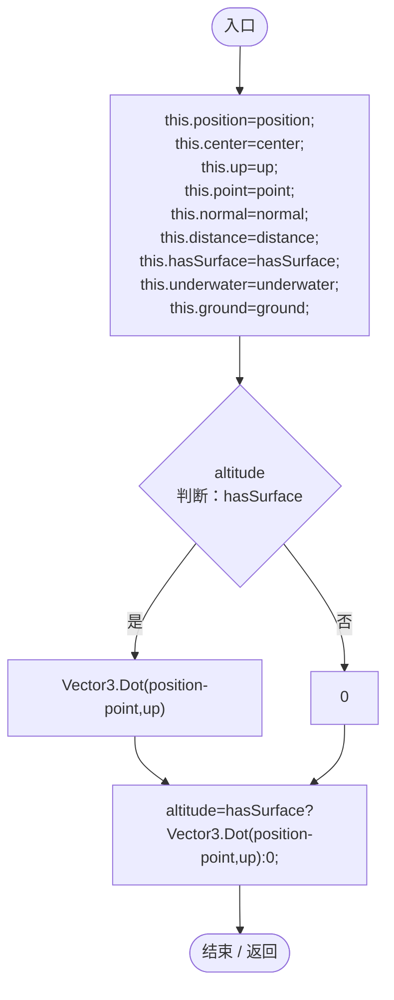
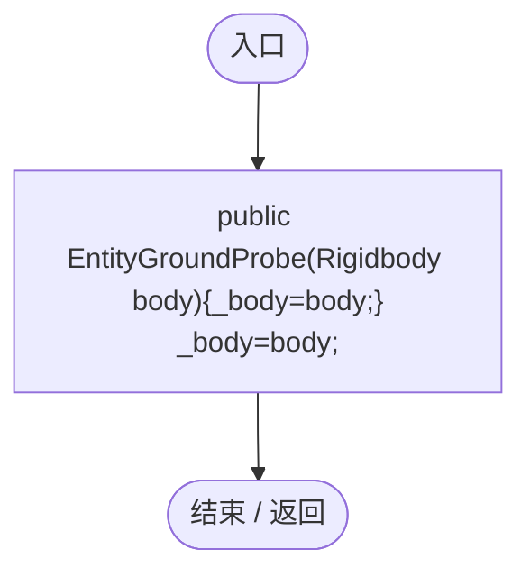
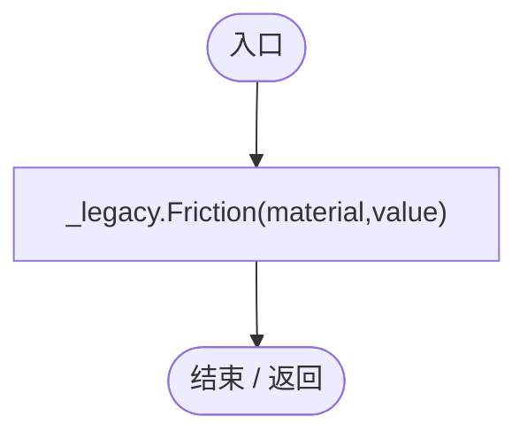
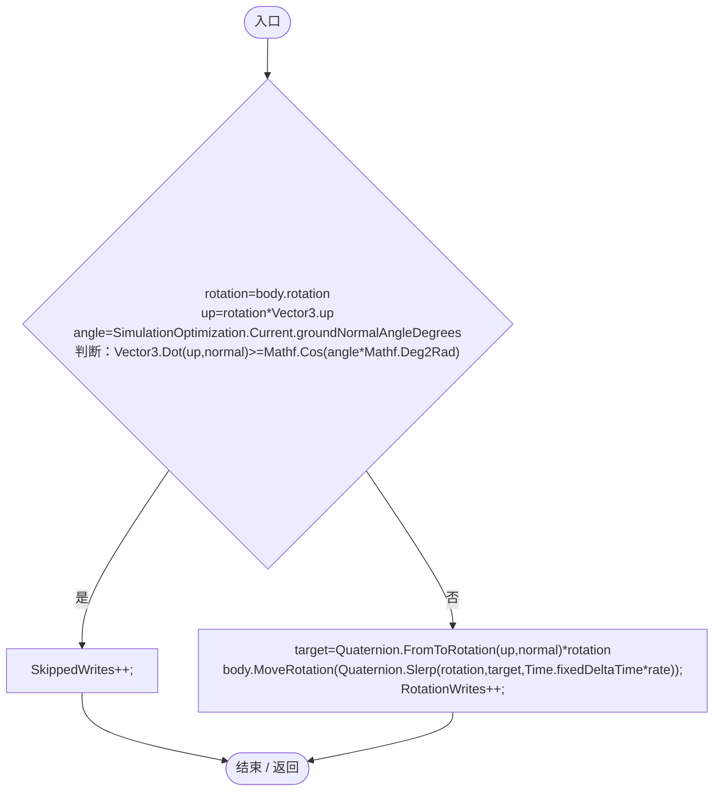

```mermaid
flowchart TD
  b0(["入口"])
  b1{"Steps++;<br/>判断：_planet!=planet"}
  b2{"判断：_builder==null"}
  b3{"判断：_ground==null"}
  b4["_planet=planet;"]
  b5{"_builder<br/>判断：planet!=null"}
  b6["planet.GetComponent&lt;PlanetTerrainMeshBuilder&gt;()"]
  b7["null"]
  b8["_builder=planet!=null?planet.GetComponent&lt;PlanetTerrainMeshBuilder&gt;():null;"]
  b9{"_ground<br/>判断：planet!=null"}
  b10["planet.GetComponent&lt;MeshCollider&gt;()"]
  b11["null"]
  b12["_ground=planet!=null?planet.GetComponent&lt;MeshCollider&gt;():null;"]
  b13["_stamp=float.NaN;"]
  b14{"position=_body.position<br/>判断：planet==null"}
  b15["结果：default"]
  b16["matrix=planet.localToWorldMatrix"]
  b17{"_builder<br/>判断：_builder"}
  b18[".Data"]
  b19["_builder"]
  b20["data=_builder?.Data"]
  b21{"判断：_ground!=null"}
  b22["_ground.sharedMesh"]
  b23["null"]
  b24["mesh=_ground!=null?_ground.sharedMesh:null"]
  b25{"判断：_builder!=null"}
  b26["_builder.radius"]
  b27["0"]
  b28["radius=_builder!=null?_builder.radius:0"]
  b29{"判断：_builder!=null"}
  b30["_builder.heightScale"]
  b31["0"]
  b32["height=_builder!=null?_builder.heightScale:0"]
  b33{"判断：_builder!=null"}
  b34["_builder.WaterRadius"]
  b35["0"]
  b36["water=_builder!=null?_builder.WaterRadius:0"]
  b37{"判断：_ground!=null"}
  b38["_ground.enabled"]
  b39["_ground!=null"]
  b40["enabled=_ground!=null&amp;&amp;_ground.enabled"]
  b41{"direct=SimulationOptimization.Current.directGroundQueries<br/>判断：_stamp==Time.fixedTime"}
  b42{"判断：position==_position"}
  b43{"判断：matrix==_matrix"}
  b44{"判断：ReferenceEquals(data,_data)"}
  b45{"判断：mesh==_mesh"}
  b46{"判断：radius==_radius"}
  b47{"判断：height==_height"}
  b48{"判断：water==_water"}
  b49{"判断：enabled==_enabled"}
  b50{"判断：direct==_direct"}
  b51["ReusedSamples++;<br/>结果：_sample"]
  b52["center=planet.position<br/>offset=position-center<br/>distance=offset.magnitude"]
  b53{"判断：distance&gt;0"}
  b54["offset/distance"]
  b55["Vector3.up"]
  b56["up=distance&gt;0?offset/distance:Vector3.up"]
  b57{"found=false<br/>point=default<br/>normal=up<br/>判断：direct"}
  b58{"判断：RadialTerrainSurface.TrySample(_builder,_ground,position,out var surface)"}
  b59["DirectSamples++;<br/>found=true;<br/>point=surface.point;<br/>normal=surface.normal;"]
  b60{"判断：_ground!=null"}
  b61{"判断：enabled"}
  b62{"Raycasts++;<br/>found=_ground.Raycast(new Ray(center+up*(_ground.bounds.extents.magnitude+distance),-up),out var hit,_ground.bounds.extents.magnitude+distance*2);<br/>判断：found"}
  b63["point=hit.point;<br/>normal=hit.normal;"]
  b64["_position=position;<br/>_matrix=matrix;<br/>_data=data;<br/>_mesh=mesh;<br/>_radius=radius;<br/>_height=height;<br/>_water=water;<br/>_enabled=enabled;<br/>_direct=direct;<br/>_stamp=Time.fixedTime;<br/>结果：_sample=new EntityGroundSample(position,center,up,point,normal,distance…"]
  b65(["结束 / 返回"])
  b0 --> b1
  b1 -->|"否"| b2
  b1 -->|"是"| b4
  b2 -->|"否"| b3
  b2 -->|"是"| b4
  b3 -->|"是"| b4
  b3 -->|"否"| b14
  b4 --> b5
  b5 -->|"是"| b6
  b5 -->|"否"| b7
  b6 --> b8
  b7 --> b8
  b8 --> b9
  b9 -->|"是"| b10
  b9 -->|"否"| b11
  b10 --> b12
  b11 --> b12
  b12 --> b13
  b13 --> b14
  b14 -->|"是"| b15
  b14 -->|"否"| b16
  b15 -->|"返回"| b65
  b16 --> b17
  b17 -->|"否"| b18
  b17 -->|"是"| b19
  b18 --> b20
  b19 --> b20
  b20 --> b21
  b21 -->|"是"| b22
  b21 -->|"否"| b23
  b22 --> b24
  b23 --> b24
  b24 --> b25
  b25 -->|"是"| b26
  b25 -->|"否"| b27
  b26 --> b28
  b27 --> b28
  b28 --> b29
  b29 -->|"是"| b30
  b29 -->|"否"| b31
  b30 --> b32
  b31 --> b32
  b32 --> b33
  b33 -->|"是"| b34
  b33 -->|"否"| b35
  b34 --> b36
  b35 --> b36
  b36 --> b37
  b37 -->|"是"| b38
  b37 -->|"否"| b39
  b38 --> b40
  b39 --> b40
  b40 --> b41
  b41 -->|"是"| b42
  b41 -->|"否"| b52
  b42 -->|"是"| b43
  b42 -->|"否"| b52
  b43 -->|"是"| b44
  b43 -->|"否"| b52
  b44 -->|"是"| b45
  b44 -->|"否"| b52
  b45 -->|"是"| b46
  b45 -->|"否"| b52
  b46 -->|"是"| b47
  b46 -->|"否"| b52
  b47 -->|"是"| b48
  b47 -->|"否"| b52
  b48 -->|"是"| b49
  b48 -->|"否"| b52
  b49 -->|"是"| b50
  b49 -->|"否"| b52
  b50 -->|"是"| b51
  b50 -->|"否"| b52
  b51 -->|"返回"| b65
  b52 --> b53
  b53 -->|"是"| b54
  b53 -->|"否"| b55
  b54 --> b56
  b55 --> b56
  b56 --> b57
  b57 -->|"是"| b58
  b57 -->|"否"| b60
  b58 -->|"是"| b59
  b58 -->|"否"| b60
  b59 --> b64
  b60 -->|"是"| b61
  b60 -->|"否"| b64
  b61 -->|"是"| b62
  b61 -->|"否"| b64
  b62 -->|"是"| b63
  b62 -->|"否"| b64
  b63 --> b64
  b64 -->|"返回"| b65

```

# EntityGroundProbe.cs

[返回总索引](../README.md) · `Runtime` · `Assets/DarwinPark/Entities/EntityGroundProbe.cs`

[源文件](../../../Assets/DarwinPark/Entities/EntityGroundProbe.cs) · 源码校验：`f67bbabd73d7c1b83e8c334f64ecf346253ccaf18dc4ad9369c169f18b7b9e9f`

方法按源文件位置排列。事件/回调引用不表示立即执行；分支与异常说明见总索引。完整源码与可点击关系图请打开离线手册。

## EntityGroundSample.ctor · L9

`public EntityGroundSample(Vector3 position,Vector3 center,Vector3 up,Vector3 point,Vector3 normal,float distance,bool hasSurface,bool underwater,MeshCollider ground)`

### Editor / Player · Roslyn编译器控制流

## EntityGroundProbe.ctor · L17

`public EntityGroundProbe(Rigidbody body)`

### Editor / Player · Roslyn编译器控制流

## Read · L18

`public EntityGroundSample Read(Transform planet)`

### Editor / Player · Roslyn编译器控制流

项目内调用/回调引用：

- [PlanetTerrainMeshBuilder.Data.get · L81](415285cf043354a9.md#m1a65abfe0f34c5d8)（访问器）
- [PlanetTerrainMeshBuilder.WaterRadius.get · L99](415285cf043354a9.md#m76719c213b06ba56)（访问器）
- [SimulationOptimization.Current.get · L25](11c9091e70893352.md#mde7abfdc18429e4a)（访问器）
- [RadialTerrainSurface.TrySample · L12](4eb5c0c8143bed20.md#m994c30d4296dac34)（方法）
- [EntityGroundSample.EntityGroundSample.ctor · L9](6cefee808441951d.md#mb5f376a0611ec93c)（构造函数）

## Friction · L34

`public void Friction(PhysicsMaterial material,float value)`

★ 适配：沿用原摩擦变更缓存，不再由多个组件各写一次相同材质。

### Editor / Player · Roslyn编译器控制流

项目内调用/回调引用：

- [GravityProbeCache.Friction · L25](901cef6b99719cf7.md#me24ce9237e4b975b)（方法）

## Velocity · L35

`public static void Velocity(Rigidbody body,Vector3 value)`

### Editor / Player · Roslyn编译器控制流

项目内调用/回调引用：

- [SimulationOptimization.Current.get · L25](11c9091e70893352.md#mde7abfdc18429e4a)（访问器）

## Align · L37

`public static void Align(Rigidbody body,Vector3 normal,float rate)`

### Editor / Player · Roslyn编译器控制流

项目内调用/回调引用：

- [SimulationOptimization.Current.get · L25](11c9091e70893352.md#mde7abfdc18429e4a)（访问器）

## Reset · L43

`[RuntimeInitializeOnLoadMethod(RuntimeInitializeLoadType.SubsystemRegistration)]private static void Reset()`

### Editor / Player · Roslyn编译器控制流

