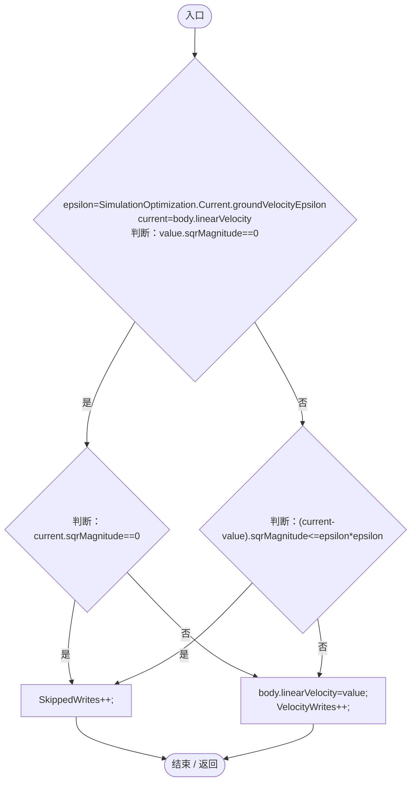
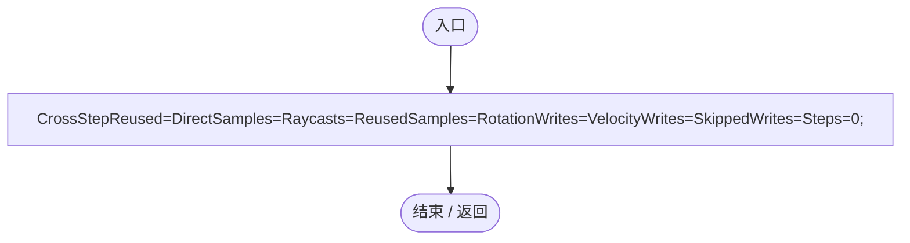

```mermaid
flowchart TD
  b0(["入口"])
  b1["performance=PerformanceTimings.Measure(PerformanceTimings.Area.GroundQuery)"]
  b2{"Steps++;<br/>判断：_planet!=planet"}
  b3{"判断：_builder==null"}
  b4{"判断：_ground==null"}
  b5["_planet=planet;"]
  b6{"_builder<br/>判断：planet!=null"}
  b7["planet.GetComponent&lt;PlanetTerrainMeshBuilder&gt;()"]
  b8["null"]
  b9["_builder=planet!=null?planet.GetComponent&lt;PlanetTerrainMeshBuilder&gt;():null;"]
  b10{"_ground<br/>判断：planet!=null"}
  b11["planet.GetComponent&lt;MeshCollider&gt;()"]
  b12["null"]
  b13["_ground=planet!=null?planet.GetComponent&lt;MeshCollider&gt;():null;"]
  b14["_stamp=float.NaN;"]
  b15{"position=_body.position<br/>判断：planet==null"}
  b16["结果：default"]
  b17["matrix=planet.localToWorldMatrix"]
  b18{"_builder<br/>判断：_builder"}
  b19[".Data"]
  b20["_builder"]
  b21["data=_builder?.Data"]
  b22{"判断：_ground!=null"}
  b23["_ground.sharedMesh"]
  b24["null"]
  b25["mesh=_ground!=null?_ground.sharedMesh:null"]
  b26{"判断：_builder!=null"}
  b27["_builder.radius"]
  b28["0"]
  b29["radius=_builder!=null?_builder.radius:0"]
  b30{"判断：_builder!=null"}
  b31["_builder.heightScale"]
  b32["0"]
  b33["height=_builder!=null?_builder.heightScale:0"]
  b34{"判断：_builder!=null"}
  b35["_builder.WaterRadius"]
  b36["0"]
  b37["water=_builder!=null?_builder.WaterRadius:0"]
  b38{"判断：_ground!=null"}
  b39["_ground.enabled"]
  b40["_ground!=null"]
  b41["enabled=_ground!=null&amp;&amp;_ground.enabled"]
  b42{"direct=SimulationOptimization.Current.directGroundQueries<br/>判断：_stamp==Time.fixedTime"}
  b43{"判断：position==_position"}
  b44{"判断：matrix==_matrix"}
  b45{"判断：ReferenceEquals(data,_data)"}
  b46{"判断：mesh==_mesh"}
  b47{"判断：radius==_radius"}
  b48{"判断：height==_height"}
  b49{"判断：water==_water"}
  b50{"判断：enabled==_enabled"}
  b51{"判断：direct==_direct"}
  b52["ReusedSamples++;<br/>结果：_sample"]
  b53["center=planet.position<br/>offset=position-center<br/>distance=offset.magnitude"]
  b54{"判断：distance&gt;0"}
  b55["offset/distance"]
  b56["Vector3.up"]
  b57["up=distance&gt;0?offset/distance:Vector3.up"]
  b58["found=false<br/>point=default<br/>normal=up<br/>tuning=SimulationOptimization.Current"]
  b59{"判断：matrix==_matrix"}
  b60{"判断：ReferenceEquals(data,_data)"}
  b61{"判断：mesh==_mesh"}
  b62{"判断：radius==_radius"}
  b63{"判断：height==_height"}
  b64{"判断：water==_water"}
  b65{"判断：enabled==_enabled"}
  b66["direct==_direct"]
  b67["matrix==_matrix&amp;&amp;ReferenceEquals(data,_data)&amp;&amp;mesh==_mesh&amp;&amp;radius==_radius&amp;&amp;height==_height&amp;&amp;water==_water&amp;&amp;enabled==_enabled&amp;&amp;direct==_direct"]
  b68["unchanged=matrix==_matrix&amp;&amp;ReferenceEquals(data,_data)&amp;&amp;mesh==_mesh&amp;&amp;radius==_radius&amp;&amp;height==_height&amp;&amp;water==_water&amp;&amp;enabled==_enabled&amp;&amp;direct==_direct"]
  b69{"判断：unchanged"}
  b70{"判断：direct"}
  b71{"判断：_sample.hasSurface"}
  b72{"判断：Time.fixedTime&lt;_next"}
  b73{"判断：(position-_samplePosition).sqrMagnitude&lt;=tuning.groundProbeMoveTolerance*tuning.groundProbeMoveTolerance"}
  b74["Mathf.Abs(Vector3.Dot(_body.linearVelocity,up))&lt;=tuning.groundProbeVerticalSpeed"]
  b75["unchanged&amp;&amp;direct&amp;&amp;_sample.hasSurface&amp;&amp;Time.fixedTime&lt;_next&amp;&amp;(position-_samplePosition).sqrMagnitude&lt;=tuning.groundProbeMoveTolerance*tuning.groundProbeMoveTolerance&amp;&amp;Mathf.Abs(Vector3.Dot(_body.linearVelocity,up))&lt;=tuning.groundProbeVer…"]
  b76["reuse=unchanged&amp;&amp;direct&amp;&amp;_sample.hasSurface&amp;&amp;Time.fixedTime&lt;_next&amp;&amp;(position-_samplePosition).sqrMagnitude&lt;=tuning.groundProbeMoveTolerance*tuning.groundProbeMoveTolerance&amp;&amp;Mathf.Abs(Vector3.Dot(_body.linearVelocity,up))&lt;=tuning.groundPr…"]
  b77{"判断：reuse"}
  b78{"判断：_patch.TryRead(center,up,out point,out normal)"}
  b79["found=true;<br/>ReusedSamples++;<br/>CrossStepReused++;"]
  b80{"判断：direct"}
  b81{"判断：RadialTerrainSurface.TrySample(_builder,_ground,position,out var surface)"}
  b82["DirectSamples++;<br/>found=true;<br/>point=surface.point;<br/>normal=surface.normal;<br/>_patch.Capture(_builder,surface.triangle);<br/>_next=Time.fixedTime+tuning.groundProbeSeconds;<br/>_samplePosition=position;"]
  b83{"判断：_ground!=null"}
  b84{"判断：enabled"}
  b85{"Raycasts++;<br/>found=_ground.Raycast(new Ray(center+up*(_ground.bounds.extents.magnitude+distance),-up),out var hit,_ground.bounds.extents.magnitude+distance*2);<br/>判断：found"}
  b86["point=hit.point;<br/>normal=hit.normal;"]
  b87["_position=position;<br/>_matrix=matrix;<br/>_data=data;<br/>_mesh=mesh;<br/>_radius=radius;<br/>_height=height;<br/>_water=water;<br/>_enabled=enabled;<br/>_direct=direct;<br/>_stamp=Time.fixedTime;"]
  b88{"_sample<br/>position<br/>center<br/>up<br/>point<br/>normal<br/>distance<br/>found<br/>判断：_builder!=null"}
  b89["_builder.IsSubmerged(position)"]
  b90["distance&lt;water"]
  b91["结果：_sample=new EntityGroundSample(position,center,up,point,normal,distance,found,_builder!=null?_builder.IsSubmerged(position):distance&lt;water,_ground)"]
  b92["performance=PerformanceTimings.Measure(PerformanceTimings.Area.GroundQuery)"]
  b93(["结束 / 返回"])
  b0 --> b1
  b1 --> b2
  b2 -->|"否"| b3
  b2 -->|"是"| b5
  b3 -->|"否"| b4
  b3 -->|"是"| b5
  b4 -->|"是"| b5
  b4 -->|"否"| b15
  b5 --> b6
  b6 -->|"是"| b7
  b6 -->|"否"| b8
  b7 --> b9
  b8 --> b9
  b9 --> b10
  b10 -->|"是"| b11
  b10 -->|"否"| b12
  b11 --> b13
  b12 --> b13
  b13 --> b14
  b14 --> b15
  b15 -->|"是"| b16
  b15 -->|"否"| b17
  b16 -->|"返回 · 经过finally 92"| b93
  b17 --> b18
  b18 -->|"否"| b19
  b18 -->|"是"| b20
  b19 --> b21
  b20 --> b21
  b21 --> b22
  b22 -->|"是"| b23
  b22 -->|"否"| b24
  b23 --> b25
  b24 --> b25
  b25 --> b26
  b26 -->|"是"| b27
  b26 -->|"否"| b28
  b27 --> b29
  b28 --> b29
  b29 --> b30
  b30 -->|"是"| b31
  b30 -->|"否"| b32
  b31 --> b33
  b32 --> b33
  b33 --> b34
  b34 -->|"是"| b35
  b34 -->|"否"| b36
  b35 --> b37
  b36 --> b37
  b37 --> b38
  b38 -->|"是"| b39
  b38 -->|"否"| b40
  b39 --> b41
  b40 --> b41
  b41 --> b42
  b42 -->|"是"| b43
  b42 -->|"否"| b53
  b43 -->|"是"| b44
  b43 -->|"否"| b53
  b44 -->|"是"| b45
  b44 -->|"否"| b53
  b45 -->|"是"| b46
  b45 -->|"否"| b53
  b46 -->|"是"| b47
  b46 -->|"否"| b53
  b47 -->|"是"| b48
  b47 -->|"否"| b53
  b48 -->|"是"| b49
  b48 -->|"否"| b53
  b49 -->|"是"| b50
  b49 -->|"否"| b53
  b50 -->|"是"| b51
  b50 -->|"否"| b53
  b51 -->|"是"| b52
  b51 -->|"否"| b53
  b52 -->|"返回 · 经过finally 92"| b93
  b53 --> b54
  b54 -->|"是"| b55
  b54 -->|"否"| b56
  b55 --> b57
  b56 --> b57
  b57 --> b58
  b58 --> b59
  b59 -->|"是"| b60
  b59 -->|"否"| b67
  b60 -->|"是"| b61
  b60 -->|"否"| b67
  b61 -->|"是"| b62
  b61 -->|"否"| b67
  b62 -->|"是"| b63
  b62 -->|"否"| b67
  b63 -->|"是"| b64
  b63 -->|"否"| b67
  b64 -->|"是"| b65
  b64 -->|"否"| b67
  b65 -->|"是"| b66
  b65 -->|"否"| b67
  b66 --> b68
  b67 --> b68
  b68 --> b69
  b69 -->|"是"| b70
  b69 -->|"否"| b75
  b70 -->|"是"| b71
  b70 -->|"否"| b75
  b71 -->|"是"| b72
  b71 -->|"否"| b75
  b72 -->|"是"| b73
  b72 -->|"否"| b75
  b73 -->|"是"| b74
  b73 -->|"否"| b75
  b74 --> b76
  b75 --> b76
  b76 --> b77
  b77 -->|"是"| b78
  b77 -->|"否"| b80
  b78 -->|"是"| b79
  b78 -->|"否"| b80
  b79 --> b87
  b80 -->|"是"| b81
  b80 -->|"否"| b83
  b81 -->|"是"| b82
  b81 -->|"否"| b83
  b82 --> b87
  b83 -->|"是"| b84
  b83 -->|"否"| b87
  b84 -->|"是"| b85
  b84 -->|"否"| b87
  b85 -->|"是"| b86
  b85 -->|"否"| b87
  b86 --> b87
  b87 --> b88
  b88 -->|"是"| b89
  b88 -->|"否"| b90
  b89 --> b91
  b90 --> b91
  b91 -->|"返回 · 经过finally 92"| b93
  b2 -. "退出保护区时 finally（示意）" .-> b92

```

# EntityGroundProbe.cs

[返回总索引](../README.md) · `Runtime` · `Assets/DarwinPark/Entities/EntityGroundProbe.cs`

[源文件](../../../Assets/DarwinPark/Entities/EntityGroundProbe.cs) · 源码校验：`aeba62bb392b448030f7f4a72a767bb569505b9e42fcd1c9aca7407ea92e394b`

方法按源文件位置排列。事件/回调引用不表示立即执行；分支与异常说明见总索引。完整源码与可点击关系图请打开离线手册。

## EntityGroundSample.ctor · L9

`public EntityGroundSample(Vector3 position,Vector3 center,Vector3 up,Vector3 point,Vector3 normal,float distance,bool hasSurface,bool underwater,MeshCollider ground)`

### Editor / Player · Roslyn编译器控制流

## EntityGroundProbe.ctor · L19

`public EntityGroundProbe(Rigidbody body)`

### Editor / Player · Roslyn编译器控制流

## Read · L20

`public EntityGroundSample Read(Transform planet)`

### Editor / Player · Roslyn编译器控制流

项目内调用/回调引用：

- [PerformanceTimings.Measure · L24](a8403a4c7503726d.md#m592e16f2b6513efd)（方法）
- [PlanetTerrainMeshBuilder.Data.get · L81](415285cf043354a9.md#m1a65abfe0f34c5d8)（访问器）
- [PlanetTerrainMeshBuilder.WaterRadius.get · L99](415285cf043354a9.md#m76719c213b06ba56)（访问器）
- [SimulationOptimization.Current.get · L30](11c9091e70893352.md#mcfa8eb2e650e57b1)（访问器）
- [GroundSurfacePatch.TryRead · L28](04c11d343acaab51.md#mddeaf71389fad7b9)（方法）
- [RadialTerrainSurface.TrySample · L12](4eb5c0c8143bed20.md#m994c30d4296dac34)（方法）
- [GroundSurfacePatch.Capture · L12](04c11d343acaab51.md#m300eb73331c1636f)（方法）
- [EntityGroundSample.EntityGroundSample.ctor · L9](6cefee808441951d.md#mb5f376a0611ec93c)（构造函数）
- [PlanetTerrainMeshBuilder.IsSubmerged · L107](415285cf043354a9.md#m77993fefee27a702)（方法）

## Friction · L42

`public void Friction(PhysicsMaterial material,float value)`

★ 适配：沿用原摩擦变更缓存，不再由多个组件各写一次相同材质。

### Editor / Player · Roslyn编译器控制流

项目内调用/回调引用：

- [GravityProbeCache.Friction · L25](901cef6b99719cf7.md#me24ce9237e4b975b)（方法）

## Velocity · L43

`public static void Velocity(Rigidbody body,Vector3 value)`

### Editor / Player · Roslyn编译器控制流

项目内调用/回调引用：

- [SimulationOptimization.Current.get · L30](11c9091e70893352.md#mcfa8eb2e650e57b1)（访问器）

## Align · L45

`public static void Align(Rigidbody body,Vector3 normal,float rate)`

### Editor / Player · Roslyn编译器控制流

项目内调用/回调引用：

- [SimulationOptimization.Current.get · L30](11c9091e70893352.md#mcfa8eb2e650e57b1)（访问器）

## Reset · L51

`[RuntimeInitializeOnLoadMethod(RuntimeInitializeLoadType.SubsystemRegistration)]private static void Reset()`

### Editor / Player · Roslyn编译器控制流

