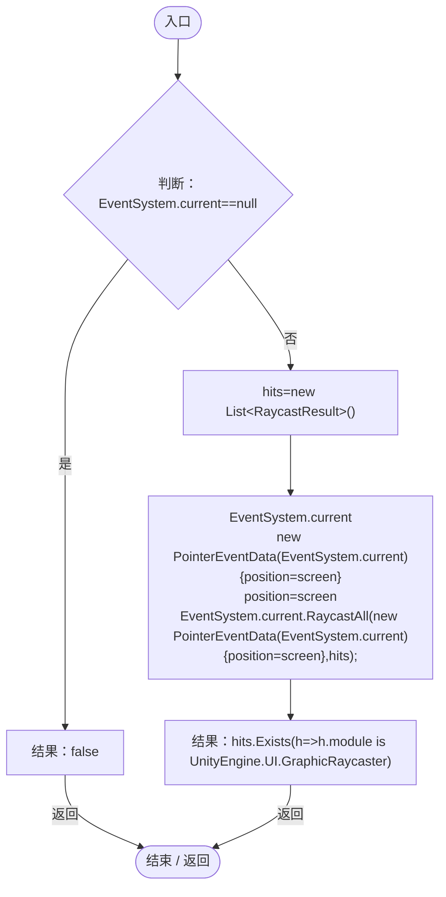
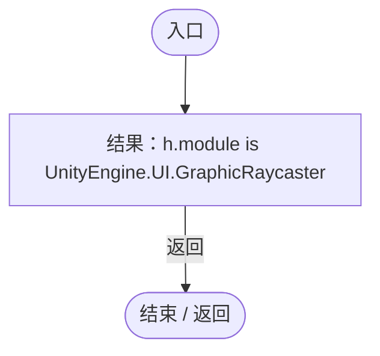
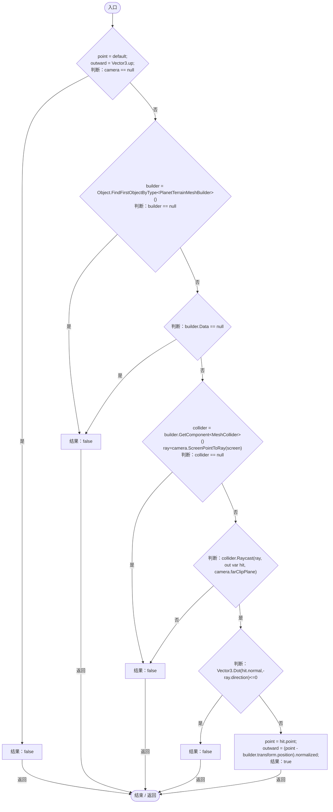
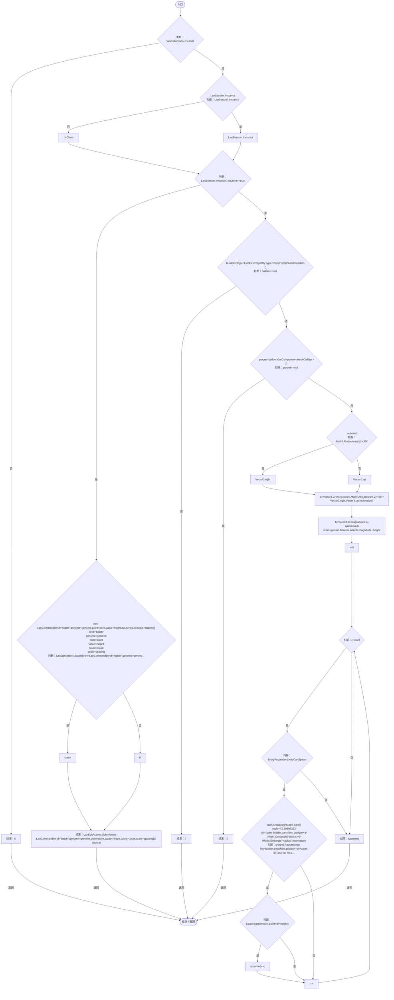
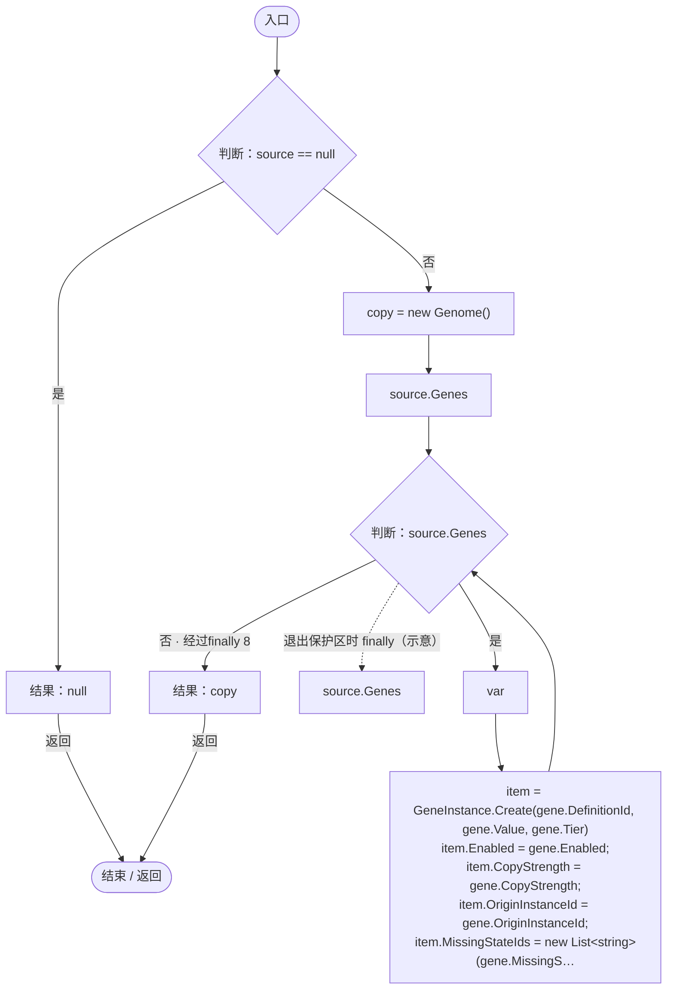
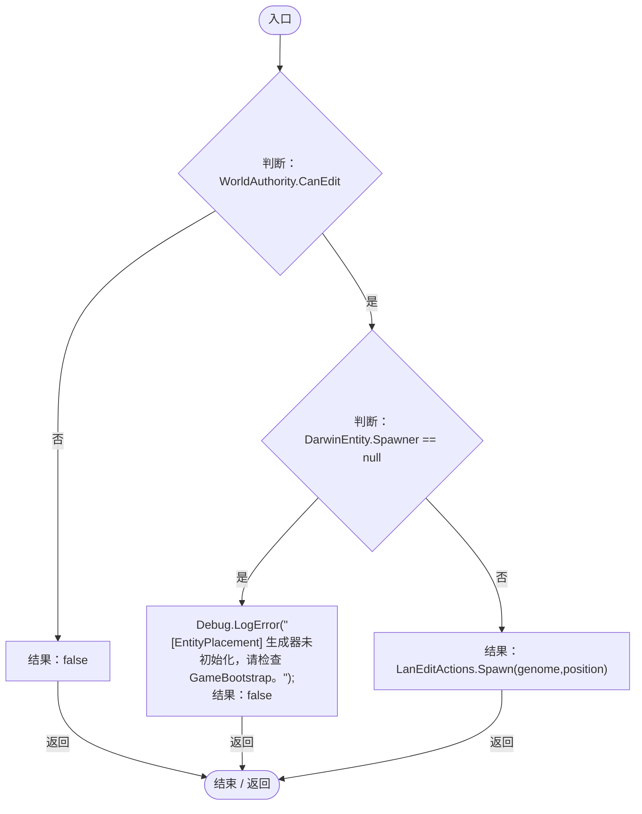
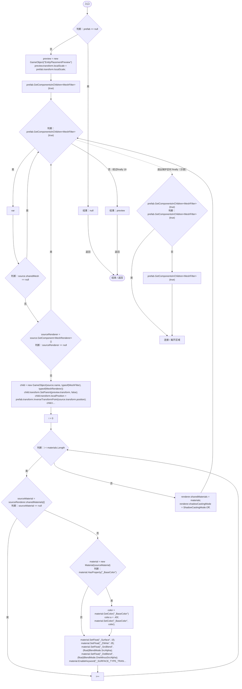
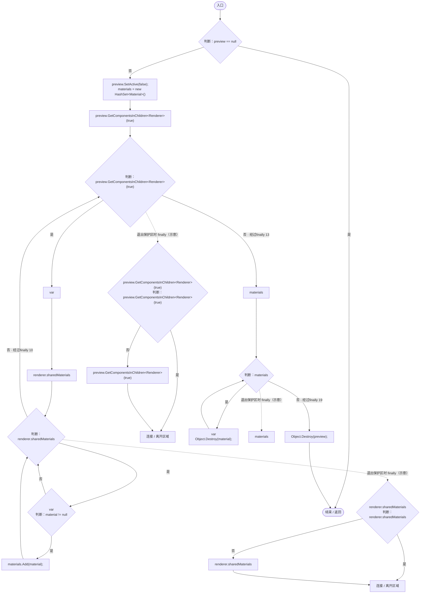

# EntityPlacementUtility.cs

[返回总索引](../README.md) · `Runtime` · `Assets/DarwinPark/UI/EntityPlacementUtility.cs`

[源文件](../../../Assets/DarwinPark/UI/EntityPlacementUtility.cs) · 源码校验：`b461ca91895eb9ce5290f8567e9b0e10b078996b093d18932dee4a586f0af456`

方法按源文件位置排列。事件/回调引用不表示立即执行；分支与异常说明见总索引。完整源码与可点击关系图请打开离线手册。

## IsPointerOverUI · L16

`public static bool IsPointerOverUI(Vector2 screen)`

★ 修复（防Bug回归）：拖拽松手不能读取缓存的 pointerEnter，按释放坐标重做 UI 命中。

### Editor / Player · Roslyn编译器控制流

项目内调用/回调引用：

- [EntityPlacementUtility.回调@21 · L21](6d2c32e632b9c147.md#md54856ccfa46ea9c)（回调/委托）

## 回调@21 · L21

`h … => 回调`

### Editor / Player · Roslyn编译器控制流

## TryGetSurface · L23

`public static bool TryGetSurface(Camera camera, Vector2 screen, out Vector3 point, out Vector3 outward)`

### Editor / Player · Roslyn编译器控制流

项目内调用/回调引用：

- [PlanetTerrainMeshBuilder.Data.get · L78](415285cf043354a9.md#m8382f579717fbc6d)（访问器）

## SpawnBatch · L41

`public static int SpawnBatch(Genome genome,Vector3 point,Vector3 outward,float height,int count,float spacing)`

★ 新增：批量投放按球面邻域散开，每个位置重新查询真实地面，避免重叠或落进山体。

### Editor / Player · Roslyn编译器控制流

项目内调用/回调引用：

- [LanSession.Instance.get · L23](9fb633eebffe669c.md#mbf83306994878383)（访问器）
- [LanEditActions.Submit · L16](2816321496f6360e.md#m5411c4b97ac4c898)（方法）
- [EntityPlacementUtility.Spawn · L77](6d2c32e632b9c147.md#m79ec74c5c23421cd)（方法）

## CopyGenome · L62

`public static Genome CopyGenome(Genome source)`

### Editor / Player · Roslyn编译器控制流

项目内调用/回调引用：

- [GeneInstance.Create · L20](f82e1498d67f5afd.md#m72e94c278de3cf8b)（方法）
- [Genome.Add · L19](a2ef23f865bc7ee8.md#md9cfdc94b8b8d40f)（方法）

## Spawn · L77

`public static bool Spawn(Genome genome, Vector3 position)`

### Editor / Player · Roslyn编译器控制流

项目内调用/回调引用：

- [LanEditActions.Spawn · L21](2816321496f6360e.md#mbc8b29c9f546988e)（方法）

## CreatePreview · L89

`public static GameObject CreatePreview(GameObject prefab)`

### Editor / Player · Roslyn编译器控制流

## DestroyPreview · L134

`public static void DestroyPreview(GameObject preview)`

### Editor / Player · Roslyn编译器控制流

