# WorldGameSettingsPanel.cs

[返回总索引](../README.md) · `Runtime` · `Assets/DarwinPark/UI/WorldGameSettingsPanel.cs`

[源文件](../../../Assets/DarwinPark/UI/WorldGameSettingsPanel.cs) · 源码校验：`20d11046b0d8cc7ded1a5e68a86dd69f45157ec08c47c02dad77f2c92ed0d7e1`

方法按源文件位置排列。事件/回调引用不表示立即执行；分支与异常说明见总索引。完整源码与可点击关系图请打开离线手册。

## Instance.get · L11

`get`

### Editor / Player · 语法控制结构 / 声明（非CFG）

## Instance.set · L11

`private set`

### Editor / Player · 语法控制结构 / 声明（非CFG）

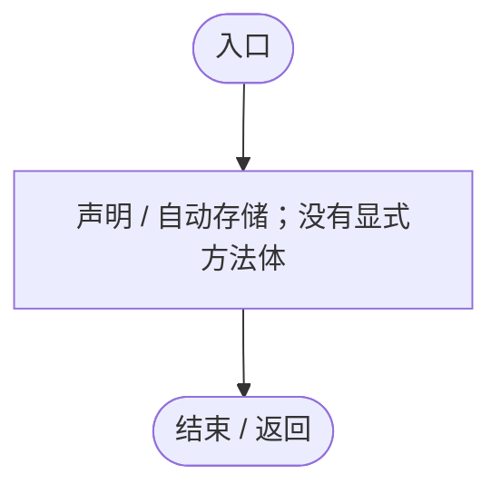

## Awake · L12

`private void Awake()`

### Editor / Player · Roslyn编译器控制流

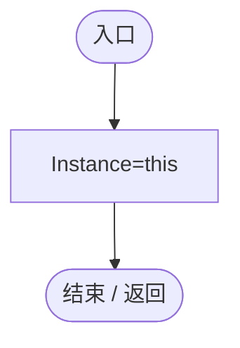

项目内调用/回调引用：

- [WorldGameSettingsPanel.Instance.set · L11](6df051f7f7177d08.md#m29793ff05c0641bf)（访问器）

## OnDestroy · L13

`private void OnDestroy()`

### Editor / Player · Roslyn编译器控制流

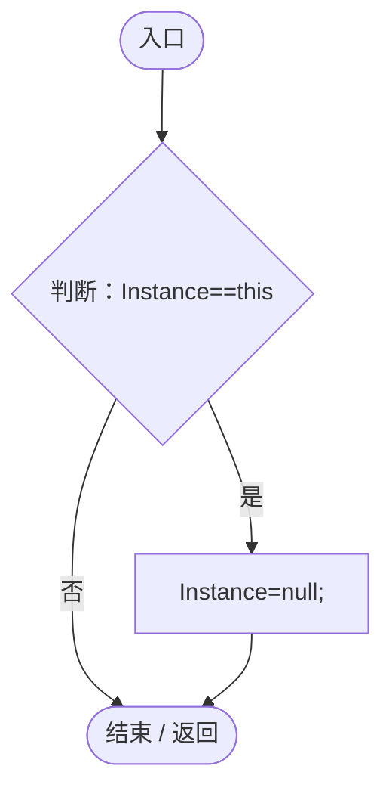

项目内调用/回调引用：

- [WorldGameSettingsPanel.Instance.get · L11](6df051f7f7177d08.md#mcccf01908bb54d27)（访问器）
- [WorldGameSettingsPanel.Instance.set · L11](6df051f7f7177d08.md#m29793ff05c0641bf)（访问器）

## Visible.get · L14

`public bool Visible`

### Editor / Player · 语法控制结构 / 声明（非CFG）

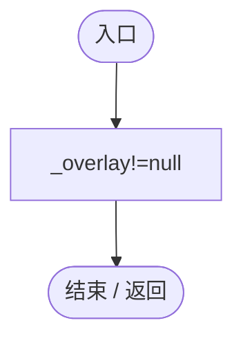

## Ensure · L16

`public static WorldGameSettingsPanel Ensure()`

### Editor / Player · Roslyn编译器控制流

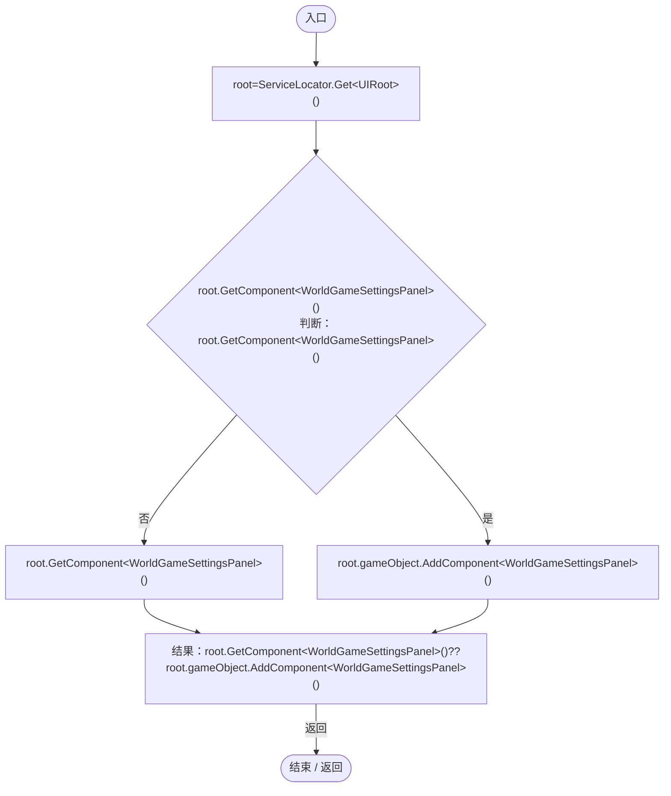

项目内调用/回调引用：

- [ServiceLocator.Get · L33](f2fdbe9f9ccd93cb.md#m2ae625299520c56d)（方法）

## Open · L17

`public void Open()`

### Editor / Player · Roslyn编译器控制流

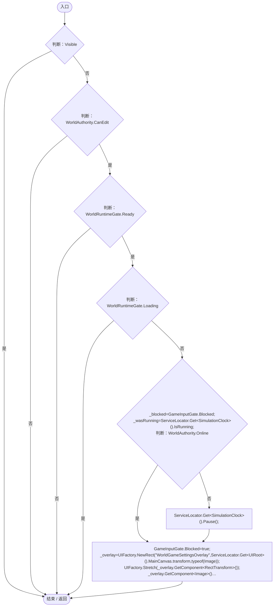

项目内调用/回调引用：

- [GameInputGate.Blocked.get · L8](52955daae7e592ab.md#m765763b665829633)（访问器）
- [SimulationClock.IsRunning.get · L22](a8f444aec9614b0a.md#m10f4fe307faca0f0)（访问器）
- [ServiceLocator.Get · L33](f2fdbe9f9ccd93cb.md#m2ae625299520c56d)（方法）
- [SimulationClock.Pause · L79](a8f444aec9614b0a.md#m30929d45a885d0f1)（方法）
- [GameInputGate.Blocked.set · L8](52955daae7e592ab.md#m578697f6379686f4)（访问器）
- [UIFactory.NewRect · L33](dd1096a6995423db.md#med612116f3152344)（方法）
- [UIRoot.MainCanvas.get · L14](9c1421378791f0e0.md#maa2cc9baf1248477)（访问器）
- [UIFactory.Stretch · L150](dd1096a6995423db.md#m11d8f6c6d00cc047)（方法）
- [UIVisualTheme.Paint · L58](ca525a798a08f966.md#m2d61a6b26ab24980)（方法）
- [WorldGameSettingsPanel.Label · L32](6df051f7f7177d08.md#m6d9164285549ccfe)（方法）
- [WorldGameSettingsPanel.Place · L31](6df051f7f7177d08.md#mc3adf8bfb61bc70c)（方法）
- [UIFactory.NewText · L57](dd1096a6995423db.md#m9dbccb5f0c38189e)（方法）
- [UIFactory.NewButton · L73](dd1096a6995423db.md#m5896f1b097c8bdde)（方法）
- [WorldGameSettingsPanel.Apply · L33](6df051f7f7177d08.md#m806209be7a84338a)（方法）
- [WorldGameSettingsPanel.Close · L39](6df051f7f7177d08.md#m019774ab8575ddd2)（方法）

## Place · L31

`private static void Place(RectTransform rect,Vector2 point,Vector2 size)`

### Editor / Player · Roslyn编译器控制流

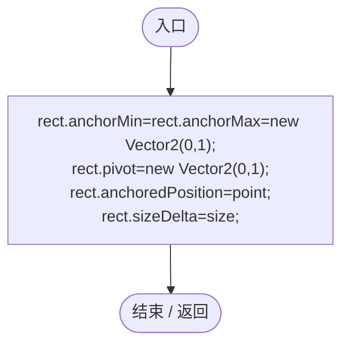

## Label · L32

`private static Text Label(Transform parent,string name,string text,Vector2 point,Vector2 size,int font)`

### Editor / Player · Roslyn编译器控制流

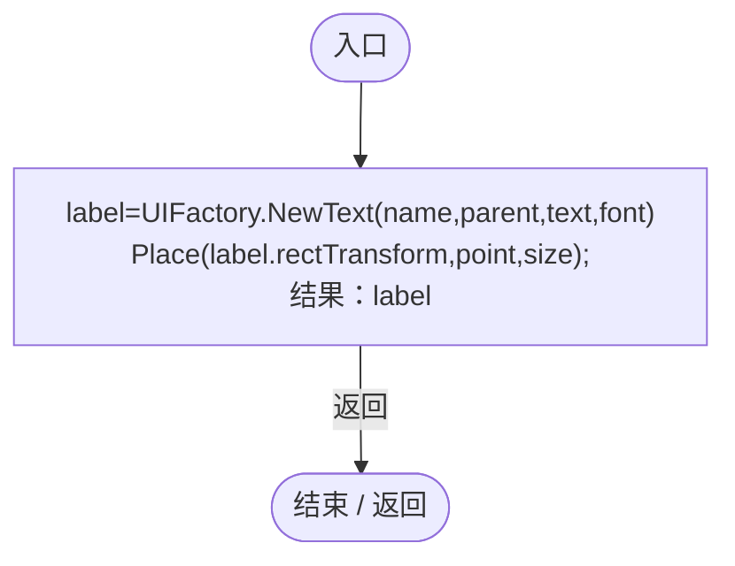

项目内调用/回调引用：

- [UIFactory.NewText · L57](dd1096a6995423db.md#m9dbccb5f0c38189e)（方法）
- [WorldGameSettingsPanel.Place · L31](6df051f7f7177d08.md#mc3adf8bfb61bc70c)（方法）

## Apply · L33

`public void Apply()`

### Editor / Player · Roslyn编译器控制流

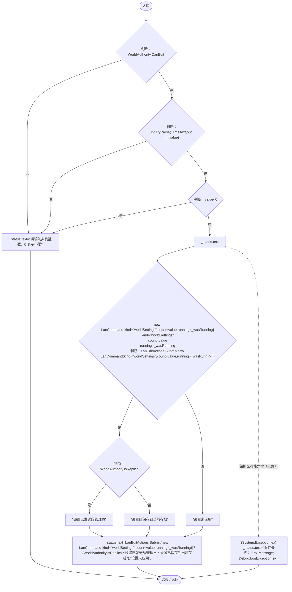

项目内调用/回调引用：

- [LanEditActions.Submit · L16](2816321496f6360e.md#m5411c4b97ac4c898)（方法）

## Update · L38

`private void Update()`

### Editor / Player · Roslyn编译器控制流

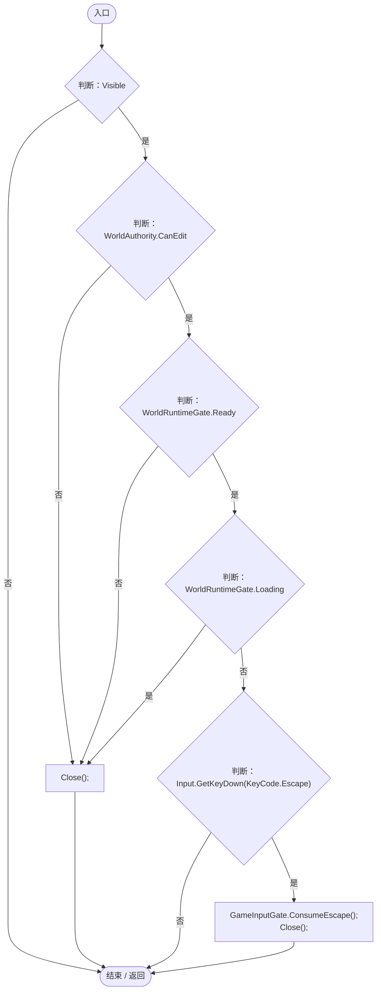

项目内调用/回调引用：

- [WorldGameSettingsPanel.Close · L39](6df051f7f7177d08.md#m019774ab8575ddd2)（方法）
- [GameInputGate.ConsumeEscape · L9](52955daae7e592ab.md#m5b050ac6f014de67)（方法）

## Close · L39

`public void Close()`

### Editor / Player · Roslyn编译器控制流

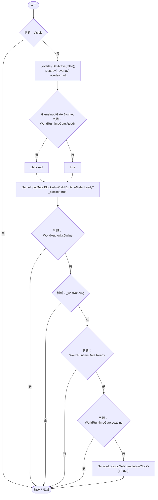

项目内调用/回调引用：

- [GameInputGate.Blocked.set · L8](52955daae7e592ab.md#m578697f6379686f4)（访问器）
- [SimulationClock.Play · L78](a8f444aec9614b0a.md#m7aa9e64b7de60ed0)（方法）
- [ServiceLocator.Get · L33](f2fdbe9f9ccd93cb.md#m2ae625299520c56d)（方法）

## OnDisable · L40

`private void OnDisable()`

### Editor / Player · Roslyn编译器控制流

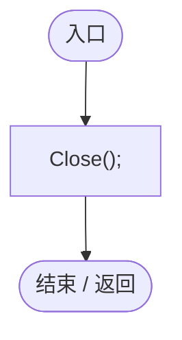

项目内调用/回调引用：

- [WorldGameSettingsPanel.Close · L39](6df051f7f7177d08.md#m019774ab8575ddd2)（方法）
