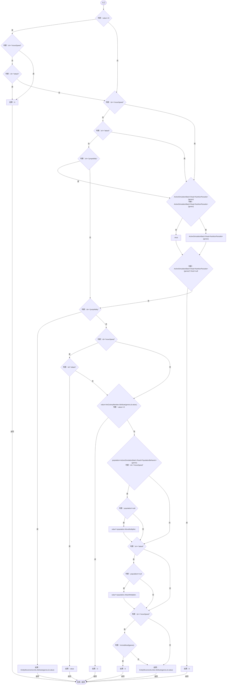
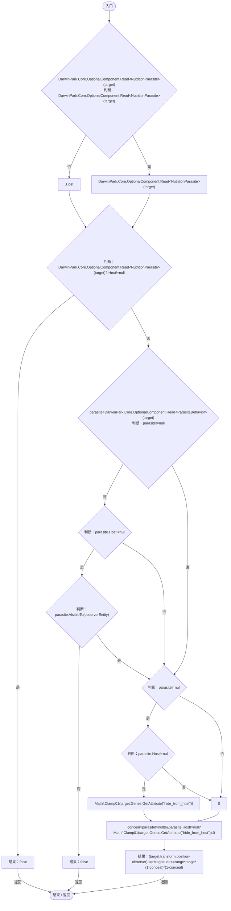

```mermaid
flowchart TD
  b0(["入口"])
  b1{"ActiveSimulationBatch.Read&lt;NutritionParasite&gt;(genes)<br/>判断：ActiveSimulationBatch.Read&lt;NutritionParasite&gt;(genes)"}
  b2[".Host"]
  b3["ActiveSimulationBatch.Read&lt;NutritionParasite&gt;(genes)"]
  b4{"判断：ActiveSimulationBatch.Read&lt;NutritionParasite&gt;(genes)?.Host!=null"}
  b5{"ActiveSimulationBatch.Read&lt;ParasiteBehavior&gt;(genes)<br/>判断：ActiveSimulationBatch.Read&lt;ParasiteBehavior&gt;(genes)"}
  b6[".Active"]
  b7["ActiveSimulationBatch.Read&lt;ParasiteBehavior&gt;(genes)"]
  b8{"判断：ActiveSimulationBatch.Read&lt;ParasiteBehavior&gt;(genes)?.Active==true"}
  b9{"ActiveSimulationBatch.Read&lt;EggIncubation&gt;(genes)<br/>判断：ActiveSimulationBatch.Read&lt;EggIncubation&gt;(genes)"}
  b10[".Incubating"]
  b11["ActiveSimulationBatch.Read&lt;EggIncubation&gt;(genes)"]
  b12{"判断：ActiveSimulationBatch.Read&lt;EggIncubation&gt;(genes)?.Incubating==true"}
  b13["AntColonyWorker.IsCarried(ActiveSimulationBatch.Read&lt;DarwinEntity&gt;(genes))"]
  b14["ActiveSimulationBatch.Read&lt;NutritionParasite&gt;(genes)?.Host!=null&#124;&#124;ActiveSimulationBatch.Read&lt;ParasiteBehavior&gt;(genes)?.Active==true&#124;&#124;ActiveSimulationBatch.Read&lt;EggIncubation&gt;(genes)?.Incubating==true&#124;&#124;AntColonyWorker.IsCarried(ActiveSimu…"]
  b15["结果：ActiveSimulationBatch.Read&lt;NutritionParasite&gt;(genes)?.Host!=null&#124;&#124;ActiveSimulationBatch.Read&lt;ParasiteBehavior&gt;(genes)?.Active==true&#124;&#124;ActiveSimulationBatch.Read&lt;EggIncubation&gt;(genes)?.Incubating==true&#124;&#124;AntColonyWorker.IsCarried(ActiveS…"]
  b16(["结束 / 返回"])
  b0 --> b1
  b1 -->|"否"| b2
  b1 -->|"是"| b3
  b2 --> b4
  b3 --> b4
  b4 -->|"否"| b5
  b4 -->|"是"| b14
  b5 -->|"否"| b6
  b5 -->|"是"| b7
  b6 --> b8
  b7 --> b8
  b8 -->|"否"| b9
  b8 -->|"是"| b14
  b9 -->|"否"| b10
  b9 -->|"是"| b11
  b10 --> b12
  b11 --> b12
  b12 -->|"否"| b13
  b12 -->|"是"| b14
  b13 --> b15
  b14 --> b15
  b15 -->|"返回"| b16

```

```mermaid
flowchart TD
  b0(["入口"])
  b1{"target=null;<br/>point=genes.transform.position;<br/>multiplier=1;<br/>判断：ActiveSimulationBatch.Read&lt;AntColonyMember&gt;(genes) is AntColonyMember supplyMember"}
  b2{"判断：supplyMember.Active"}
  b3{"判断：supplyMember.TrySupplyDestination(out point)"}
  b4["结果：true"]
  b5{"判断：CombatIntent.Destination(genes,out point,out target)"}
  b6["结果：true"]
  b7{"rts=ActiveSimulationBatch.Read&lt;RtsOrderController&gt;(genes)<br/>判断：rts!=null"}
  b8{"判断：rts.Destination(out point,out target)"}
  b9["结果：true"]
  b10{"ant=ActiveSimulationBatch.Read&lt;AntColonyMember&gt;(genes)<br/>判断：ant!=null"}
  b11{"判断：ant.Destination(out point,out target,out multiplier)"}
  b12["结果：true"]
  b13{"energy=ActiveSimulationBatch.Read&lt;EnergyBlockMetabolism&gt;(genes)<br/>判断：energy!=null"}
  b14{"判断：energy.Destination(out point)"}
  b15["结果：true"]
  b16{"ActiveSimulationBatch.Read&lt;NutritionParasite&gt;(genes)<br/>判断：ActiveSimulationBatch.Read&lt;NutritionParasite&gt;(genes)"}
  b17[".Destination(out point)"]
  b18["ActiveSimulationBatch.Read&lt;NutritionParasite&gt;(genes)"]
  b19{"判断：ActiveSimulationBatch.Read&lt;NutritionParasite&gt;(genes)?.Destination(out point)==true"}
  b20["结果：true"]
  b21{"ActiveSimulationBatch.Read&lt;CorpseFeeding&gt;(genes)<br/>判断：ActiveSimulationBatch.Read&lt;CorpseFeeding&gt;(genes)"}
  b22[".Destination(out point)"]
  b23["ActiveSimulationBatch.Read&lt;CorpseFeeding&gt;(genes)"]
  b24{"判断：ActiveSimulationBatch.Read&lt;CorpseFeeding&gt;(genes)?.Destination(out point)==true"}
  b25["结果：true"]
  b26{"territory=ActiveSimulationBatch.Read&lt;TerritoryBehavior&gt;(genes)<br/>判断：territory!=null"}
  b27{"判断：territory.Active"}
  b28{"判断：territory.EvictionRemaining&gt;0"}
  b29["结果：territory.Destination(out point,out multiplier)"]
  b30{"population=ActiveSimulationBatch.Read&lt;PopulationBehavior&gt;(genes)<br/>判断：population!=null"}
  b31{"判断：population.Destination(out point,out target)"}
  b32["结果：true"]
  b33{"判断：territory!=null"}
  b34{"判断：territory.Destination(out point,out multiplier)"}
  b35["结果：true"]
  b36{"判断：PatrolRhythm.Defensive(genes)"}
  b37{"ActiveSimulationBatch.Read&lt;EntityStateController&gt;(genes)<br/>判断：ActiveSimulationBatch.Read&lt;EntityStateController&gt;(genes)"}
  b38[".Current.Behavior"]
  b39["ActiveSimulationBatch.Read&lt;EntityStateController&gt;(genes)"]
  b40{"判断：ActiveSimulationBatch.Read&lt;EntityStateController&gt;(genes)?.Current.Behavior==EntityStateBehavior.TerritoryPatrol"}
  b41["territory.PatrolDestination(out point);"]
  b42["结果：true"]
  b43{"判断：PatrolRhythm.Resting(genes)"}
  b44["point=genes.transform.position;<br/>结果：true"]
  b45["结果：EntityStateMotion.Directive(genes,out point,out target,out multiplier)"]
  b46(["结束 / 返回"])
  b0 --> b1
  b1 -->|"是"| b2
  b1 -->|"否"| b5
  b2 -->|"是"| b3
  b2 -->|"否"| b5
  b3 -->|"是"| b4
  b3 -->|"否"| b5
  b4 -->|"返回"| b46
  b5 -->|"是"| b6
  b5 -->|"否"| b7
  b6 -->|"返回"| b46
  b7 -->|"是"| b8
  b7 -->|"否"| b10
  b8 -->|"是"| b9
  b8 -->|"否"| b10
  b9 -->|"返回"| b46
  b10 -->|"是"| b11
  b10 -->|"否"| b13
  b11 -->|"是"| b12
  b11 -->|"否"| b13
  b12 -->|"返回"| b46
  b13 -->|"是"| b14
  b13 -->|"否"| b16
  b14 -->|"是"| b15
  b14 -->|"否"| b16
  b15 -->|"返回"| b46
  b16 -->|"否"| b17
  b16 -->|"是"| b18
  b17 --> b19
  b18 --> b19
  b19 -->|"是"| b20
  b19 -->|"否"| b21
  b20 -->|"返回"| b46
  b21 -->|"否"| b22
  b21 -->|"是"| b23
  b22 --> b24
  b23 --> b24
  b24 -->|"是"| b25
  b24 -->|"否"| b26
  b25 -->|"返回"| b46
  b26 -->|"是"| b27
  b26 -->|"否"| b30
  b27 -->|"是"| b28
  b27 -->|"否"| b30
  b28 -->|"是"| b29
  b28 -->|"否"| b30
  b29 -->|"返回"| b46
  b30 -->|"是"| b31
  b30 -->|"否"| b33
  b31 -->|"是"| b32
  b31 -->|"否"| b33
  b32 -->|"返回"| b46
  b33 -->|"是"| b34
  b33 -->|"否"| b36
  b34 -->|"是"| b35
  b34 -->|"否"| b36
  b35 -->|"返回"| b46
  b36 -->|"是"| b37
  b36 -->|"否"| b43
  b37 -->|"否"| b38
  b37 -->|"是"| b39
  b38 --> b40
  b39 --> b40
  b40 -->|"是"| b41
  b40 -->|"否"| b42
  b41 --> b42
  b42 -->|"返回"| b46
  b43 -->|"是"| b44
  b43 -->|"否"| b45
  b44 -->|"返回"| b46
  b45 -->|"返回"| b46

```

```mermaid
flowchart TD
  b0(["入口"])
  b1{"判断：PredationSizePolicy.Allows(genes,target)"}
  b2{"判断：AntColonyCombat.CanAttack(ActiveSimulationBatch.Read&lt;DarwinEntity&gt;(genes),target)"}
  b3{"判断：AntColonyWorker.IsCarried(target)"}
  b4["结果：false"]
  b5{"ActiveSimulationBatch.Read&lt;PopulationBehavior&gt;(genes)<br/>判断：ActiveSimulationBatch.Read&lt;PopulationBehavior&gt;(genes)"}
  b6[".SameGroup(target)"]
  b7["ActiveSimulationBatch.Read&lt;PopulationBehavior&gt;(genes)"]
  b8{"判断：ActiveSimulationBatch.Read&lt;PopulationBehavior&gt;(genes)?.SameGroup(target)==true"}
  b9["结果：false"]
  b10{"member=ActiveSimulationBatch.Read&lt;AntColonyMember&gt;(genes)<br/>判断：member!=null"}
  b11{"判断：member.Active"}
  b12["结果：ColonyActivityRange.Contains(member.Population,target.transform.position)"]
  b13["territory=ActiveSimulationBatch.Read&lt;TerritoryBehavior&gt;(genes)"]
  b14{"判断：territory==null"}
  b15["territory.AllowsTarget(target.transform.position)"]
  b16["territory==null"]
  b17["结果：territory==null&#124;&#124;territory.AllowsTarget(target.transform.position)"]
  b18(["结束 / 返回"])
  b0 --> b1
  b1 -->|"是"| b2
  b1 -->|"否"| b4
  b2 -->|"是"| b3
  b2 -->|"否"| b4
  b3 -->|"是"| b4
  b3 -->|"否"| b5
  b4 -->|"返回"| b18
  b5 -->|"否"| b6
  b5 -->|"是"| b7
  b6 --> b8
  b7 --> b8
  b8 -->|"是"| b9
  b8 -->|"否"| b10
  b9 -->|"返回"| b18
  b10 -->|"是"| b11
  b10 -->|"否"| b13
  b11 -->|"是"| b12
  b11 -->|"否"| b13
  b12 -->|"返回"| b18
  b13 --> b14
  b14 -->|"否"| b15
  b14 -->|"是"| b16
  b15 --> b17
  b16 --> b17
  b17 -->|"返回"| b18

```

# EcologyMotion.cs

[返回总索引](../README.md) · `Runtime` · `Assets/DarwinPark/Entities/Ecology/EcologyMotion.cs`

[源文件](../../../Assets/DarwinPark/Entities/Ecology/EcologyMotion.cs) · 源码校验：`8a2899acaee8de53da5dbf10feecf4c633b39830b455237b426bd3b96f0c682d`

方法按源文件位置排列。事件/回调引用不表示立即执行；分支与异常说明见总索引。完整源码与可点击关系图请打开离线手册。

## Immobilized · L11

`public static bool Immobilized(EntityGeneController genes)`

### Editor / Player · Roslyn编译器控制流

项目内调用/回调引用：

- [ActiveSimulationBatch.Read · L57](ac63422a085684a6.md#mc77e063d3598b3fd)（方法）
- [NutritionParasite.Host.get · L22](4a18785b7c1e1484.md#m5812c5feaf5f3103)（访问器）
- [AntColonyWorker.IsCarried · L132](8a0cca2020271b6f.md#m0ec4e12a23e5a9fa)（方法）

## Directive · L12

`public static bool Directive(EntityGeneController genes,out Vector3 point,out DarwinEntity target,out float multiplier)`

### Editor / Player · Roslyn编译器控制流

项目内调用/回调引用：

- [ActiveSimulationBatch.Read · L57](ac63422a085684a6.md#mc77e063d3598b3fd)（方法）
- [AntColonyMember.TrySupplyDestination · L170](baebd85c05598377.md#m1f0cca9de5e7b5ef)（方法）
- [CombatIntent.Destination · L21](34193b994b2c0894.md#m1a83c0f1b775b970)（方法）
- [RtsOrderController.Destination · L45](cac3b6501f41ca35.md#m9b45c4820e66e721)（方法）
- [AntColonyMember.Destination · L150](baebd85c05598377.md#m8add16c6caee911b)（方法）
- [EnergyBlockMetabolism.Destination · L27](123c1bf82bdb8ea2.md#maca6a1912f9ee1b1)（方法）
- [NutritionParasite.Destination · L56](4a18785b7c1e1484.md#m9338b426cf5068f9)（方法）
- [CorpseFeeding.Destination · L26](0494eed2004cafc6.md#m860439c88c988249)（方法）
- [TerritoryBehavior.EvictionRemaining.get · L12](19d504dcdc8bc624.md#m737a47b8e966cdb5)（访问器）
- [TerritoryBehavior.Destination · L51](19d504dcdc8bc624.md#m374e03b42ee0c515)（方法）
- [PopulationBehavior.Destination · L179](21e4f62f75a9a80f.md#mbfd410e08d78bffb)（方法）
- [PatrolRhythm.Defensive · L24](f55940fd5773d413.md#m157d3dba33d51915)（方法）
- [TerritoryBehavior.PatrolDestination · L66](19d504dcdc8bc624.md#m876514deba1e74d9)（方法）
- [PatrolRhythm.Resting · L30](f55940fd5773d413.md#m3ced5d236403db27)（方法）
- [EntityStateMotion.Directive · L10](d5c725c964fe5c61.md#mc1cc9f4ca4cac68b)（方法）

## CanHunt · L42

`public static bool CanHunt(EntityGeneController genes,DarwinEntity target)`

### Editor / Player · Roslyn编译器控制流

项目内调用/回调引用：

- [PredationSizePolicy.Allows · L9](80ea865fb0f12053.md#m70764380d885d2d4)（方法）
- [AntColonyCombat.CanAttack · L9](aa858de55ec8e51a.md#mf20367836d4406a5)（方法）
- [ActiveSimulationBatch.Read · L57](ac63422a085684a6.md#mc77e063d3598b3fd)（方法）
- [AntColonyWorker.IsCarried · L132](8a0cca2020271b6f.md#m0ec4e12a23e5a9fa)（方法）
- [PopulationBehavior.SameGroup · L127](21e4f62f75a9a80f.md#m4af6332162bb0355)（方法）
- [ColonyActivityRange.Contains · L21](e8d854132f563257.md#m535d817473d6a256)（方法）
- [AntColonyMember.Population.get · L37](baebd85c05598377.md#m8a87d3d378490df9)（访问器）
- [TerritoryBehavior.AllowsTarget · L44](19d504dcdc8bc624.md#me15c2336b446d739)（方法）

## ResolveAttribute · L52

`public static float ResolveAttribute(EntityGeneController genes,string id,float value)`

### Editor / Player · Roslyn编译器控制流

项目内调用/回调引用：

- [ActiveSimulationBatch.Read · L57](ac63422a085684a6.md#mc77e063d3598b3fd)（方法）
- [NutritionParasite.Host.get · L22](4a18785b7c1e1484.md#m5812c5feaf5f3103)（访问器）
- [EntityMovementLimits.Attribute · L10](bf2a44fffc5f10d6.md#m5656261bdba0054b)（方法）
- [AntColonyMember.Attribute · L199](baebd85c05598377.md#me665b27e4fe17128)（方法）
- [PopulationBehavior.AttackMultiplier.get · L64](21e4f62f75a9a80f.md#mb4e81f8c8f5bc8cf)（访问器）
- [EcologyMotion.Immobilized · L11](6ed9d0eedb456d32.md#m5ee13c6cd31e5243)（方法）

## Detectable · L69

`public static bool Detectable(DarwinEntity target,Vector3 observer,float range,DarwinEntity observerEntity=null)`

### Editor / Player · Roslyn编译器控制流

项目内调用/回调引用：

- [OptionalComponent.Read · L7](806c46b42ced4d36.md#m69622a4dee165c5a)（方法）
- [NutritionParasite.Host.get · L22](4a18785b7c1e1484.md#m5812c5feaf5f3103)（访问器）
- [ParasiteBehavior.Host.get · L18](ec21ecbd299caaed.md#m26d7e4af4cdffdbb)（访问器）
- [ParasiteBehavior.VisibleTo · L22](ec21ecbd299caaed.md#md0a6c5009a0a1a3e)（方法）
- [EntityGeneController.GetAttribute · L288](7494d53178552f0e.md#m45127bcdd833aaf5)（方法）
- [DarwinEntity.Genes.get · L14](70798dde169f2e8b.md#m622eb1adf401d431)（访问器）
